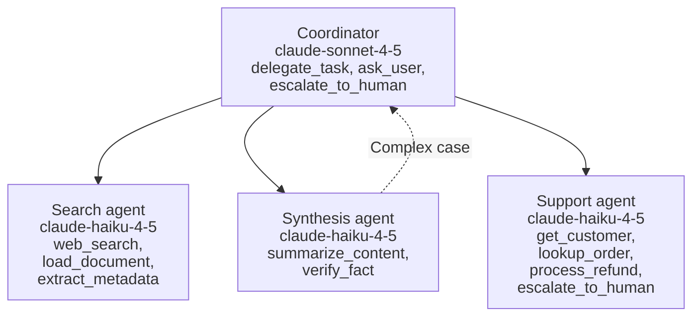

# Task Statement 2.3: Distribute Tools Across Agents and Configure Tool Choice

> Scenario alignment: Scenario 4 (Developer Productivity), also Scenario 3 (research synthesis)

## In One Minute

- **What**: Give each agent only the few tools its role needs, and control **when** it must call a tool with `tool_choice`.
- **Why**: An agent with 18 tools picks worse than one with 4 or 5. Fewer tools also means fewer unsafe calls.
- **How**: Scope tools per role. Replace broad tools (`fetch_url`) with constrained ones (`load_document`). Give a synthesis agent a small scoped tool (`verify_fact`).
- **`tool_choice`**: `auto` (may return text), `any` (must call some tool), forced `{"type": "tool", "name": ...}` (must call that tool).
- **Thinking rule**: With extended thinking, only `auto` or `none` work. `any` or a forced tool is **HTTP 400**.
- **Exam answer in one line**: Scope tools to the role, and use a forced `tool_choice` (no thinking) for a mandatory first step.

---

## 🧒 Explain Like I'm 13

**The picture:** A plumber brings plumbing tools, not all 18 tools in the garage. A smaller toolbox means fewer wrong picks. `tool_choice` is like the teacher's instruction: "use what you like" (`auto`), "you must use *some* tool" (`any`), "you must use the calculator" (forced), "no tools" (`none`).

**In plain steps:**
1. Give each agent role 4 to 5 tools.
2. Prefer a narrow tool (`load_document` by ID) over an open one (`fetch_url`).
3. To make sure one tool runs first, force it on turn 1, then go back to `auto`.
4. Extended thinking cannot be combined with forced or `any` (HTTP 400).

**Tiny example:** "Please call extract_invoice first" with `auto` sometimes gets a text answer instead. Forcing the tool never does.

---

## 📖 Concepts Explained

### 1. Why it matters
- More tools means more choices and more wrong picks. Going from 4–5 tools to 18 hurts accuracy.
- Every tool definition costs input tokens on every turn.
- A broad tool can do harm. An open `fetch_url` can reach any site.

### 2. How it works

**Scope tools per role**

| Role | Tools (4–5 max) |
|---|---|
| Support agent | `get_customer`, `lookup_order`, `process_refund`, `escalate_to_human` |
| Search agent | `web_search`, `load_document`, `extract_metadata` |
| Synthesis agent | `summarize_content`, `verify_fact` |
| Coordinator | `delegate_task`, `ask_user`, `escalate_to_human` |

**Constrain broad tools.** Replace `fetch_url` with `load_document`. It accepts only allowed hosts over https.

**Scoped cross-role tool.** The synthesis agent often needs to check one fact. Sending every check back through the coordinator is slow. Give it `verify_fact`: a narrow, read-only check. Complex cases (deep research, many sources) still go through the coordinator.

**`tool_choice` modes**

| Value | Behavior | Use when |
|---|---|---|
| `{"type": "auto"}` | Claude may call a tool or answer in text | Normal conversation, final answers |
| `{"type": "any"}` | Claude **must call some tool**. It cannot reply with chat text only | A step where text-only is not acceptable |
| `{"type": "tool", "name": "extract_metadata"}` | Claude must call **that** tool | A mandatory first step |
| `{"type": "none"}` | Claude may not call tools | Final text-only answer |

**Forced first step, then free choice.** Turn 1: force `extract_metadata`. Next turns: switch to `auto` so Claude can continue.

---

## 🔑 Key Terms

- **Least privilege**: Each agent gets only the tools its job needs.
- **Tool overload**: Too many tools, causing wrong or slow selection.
- **Constrained tool**: A narrow replacement for a broad one (`load_document` for `fetch_url`).
- **Scoped cross-role tool**: A small tool given to another role for a frequent need (`verify_fact`).
- **Forced tool choice**: `{"type": "tool", "name": ...}`.

---

## 🏗️ Architecture



---

## 🧪 Worked Example (Research Scenario)

**Problem**: A synthesis agent has 18 tools, including `web_search` and `fetch_url`. It keeps picking the wrong one and sometimes browses the open web.

1. **Count the tools.** 18 is far above the 4–5 target.
2. **Cut to role.** Synthesis keeps `summarize_content` and `verify_fact`. Search tools move to the search agent.
3. **Replace `fetch_url`.** The search agent gets `load_document`, which only allows listed hosts.
4. **Add `verify_fact`.** The synthesis agent can check one claim in one call. Hard cases go to the coordinator.
5. **Force the first step.** The search agent must always run `extract_metadata` first. Turn 1 uses `{"type": "tool", "name": "extract_metadata"}`. Later turns use `auto`. This request has **no** `thinking`.

Code: `ROLE_TOOLSETS`, `check_tool_budget()`, `load_document()`, `verify_fact()`, `tool_choice_for_turn()` and `validate_request_params()` in [main.py](main.py).

---

## ⚠️ Exam Traps and Correct Patterns

### Trap 1: Tool overload

**Exam scenario**: One agent has 18 tools and keeps choosing the wrong one. Options: add more prompt guidance, or split.

More tools means a bigger decision space and more near-duplicates. Prompt text does not shrink the choice set. Give each role 4 to 5 tools.

```python
ROLE_TOOLSETS = {
    "search_agent":    ["web_search", "load_document"],
    "analysis_agent":  ["extract_entities", "summarize"],
    "synthesis_agent": ["verify_fact"],      # scoped, cheap check
}
```

If the synthesis agent needs a quick fact check often, give it the scoped `verify_fact` tool directly. Route only the complex cases through the coordinator. Giving it the whole web-search suite breaks role scope and re-creates overload. Batching every check into one blocking pass at the end adds delay and does not remove the round-trips.

### Trap 2: A broad generic tool instead of a constrained one

- Anti-pattern: `fetch_url(url)` plus the prompt "only fetch our docs". The tool can still reach anything, and a prompt injection can make it.
- Pattern: `load_document(doc_id)` that only resolves ids from an allow-list. The constraint is in the tool, not in the model's good behaviour.

### Trap 3: Choosing `tool_choice` by feel

| Value | Meaning | Use when |
|---|---|---|
| `auto` | Model may answer in text or call a tool | Default. Does **not** guarantee a tool call |
| `any` | Must call some tool, model picks which | Several extraction tools, document type unknown |
| `{"type": "tool", "name": "extract_invoice"}` | Must call this tool | A step must run first (for example extract metadata, then enrich) |
| `none` | No tools | Plain text answer |

```text
Anti-pattern: tool_choice auto + prompt "please call extract_invoice first"  -> sometimes answers in text.
Pattern: turn 1 forced tool, then switch back to auto for the following turns.
```

### Trap 4: Forced tools plus extended thinking

With manual extended thinking (Claude 4.5), only `auto` and `none` are accepted. `any` or a forced named tool returns **HTTP 400**. Also forgetting to switch from forced to `auto` after the first turn makes the model call the same tool again and again.

```python
# ANTI-PATTERN: HTTP 400
client.messages.create(thinking={"type": "enabled", "budget_tokens": 2000},
                       tool_choice={"type": "tool", "name": "extract_invoice"}, ...)

# PATTERN: forced tool without thinking, OR thinking with auto
```

---

## 🛠️ Hands-on Workbook Guide

Open [`ts_2_3_tool_distribution_and_choice.ipynb`](ts_2_3_tool_distribution_and_choice.ipynb). It runs offline.
1. **Count** tools in the 18-tool monolith vs scoped roles.
2. **Test** `load_document()` with allowed and blocked URLs.
3. **Build** `tool_choice` values for auto, any, none and forced.
4. **Validate** request params. See the thinking plus forced combination rejected.
5. **Assert** every role stays within 5 tools.

---

## 📝 Exam-Style Practice Questions

**Q1.** A synthesis agent must verify simple facts often. Each check goes through the coordinator and adds latency. A few checks are complex. What is the best design?
- A. Give the synthesis agent the full web search tool suite.
- B. Give it a scoped `verify_fact` tool. Route complex cases through the coordinator.
- C. Batch all verifications into one pass after synthesis finishes.
- D. Merge the synthesis and search agents into one agent with all tools.

**Q2.** A document pipeline must always run `extract_metadata` before anything else. Extended thinking is **off**. Which `tool_choice` on the first request is correct?
- A. `{"type": "auto"}` with a prompt reminder.
- B. `{"type": "any"}`.
- C. `{"type": "tool", "name": "extract_metadata"}`, then `auto` for later turns.
- D. `{"type": "none"}`.

**Q3.** A team enables extended thinking and sets `tool_choice` to `{"type": "any"}` so the model always calls a tool. The request fails. Why, and what is the fix?
- A. With thinking, only `auto` or `none` are allowed. Use `auto` with thinking, or drop thinking for the forced request.
- B. `any` is unsupported on Claude 4.5. Use `temperature: 0`.
- C. `budget_tokens` is too large. Lower it to 100.
- D. Thinking requires `top_k` to be set.

### Answers

**Q1 → B.** A narrow tool handles the common case. The coordinator keeps the complex ones.
- A: A full search suite breaks the role scope and causes tool overload.
- C: A final blocking pass adds delay and does not help the workflow in between.
- D: One agent with all tools is the overload anti-pattern.

**Q2 → C.** Forcing the named tool guarantees it. Then `auto` lets the loop continue.
- A: Prompt reminders are not guaranteed.
- B: `any` lets Claude pick a different tool.
- D: `none` forbids all tool calls.

**Q3 → A.** `any` and forced tools return HTTP 400 with thinking.
- B: `any` is supported. Temperature is the wrong lever and is rejected with thinking.
- C: `budget_tokens` must be at least 1024. 100 would also fail.
- D: `top_k` is unrelated to the failure. Leave it unset.

---

## ✅ Self-Check Checklist

- [ ] I can say why 4–5 tools beats 18.
- [ ] I can explain `load_document` vs `fetch_url`.
- [ ] I can describe the scoped `verify_fact` pattern and when the coordinator is still used.
- [ ] I can state what `auto`, `any` and forced do. `any` guarantees a tool call, not chat text.
- [ ] I know thinking allows only `auto` or `none`.

**Memory hook**: *"Small toolbox per role. `any` means any tool, forced means that tool, thinking means auto."*
