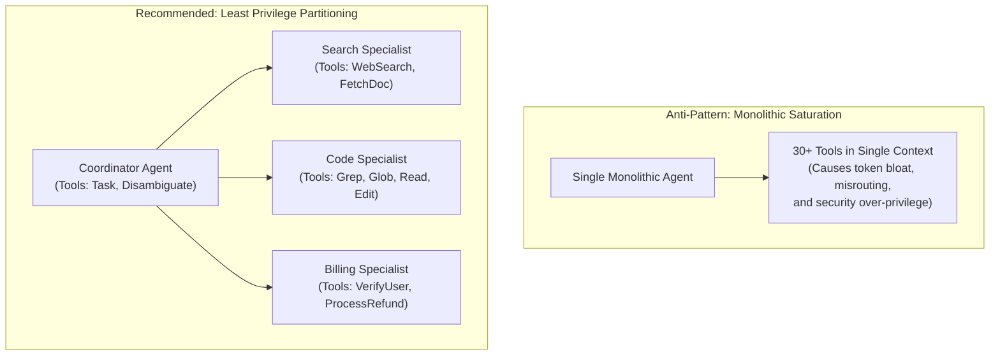

# Task Statement 2.3: Distribute Tools Appropriately and Configure Tool Choice

## 📌 Executive Overview: Goal, Scope & Exam Importance

### Certification Domain & Weight
- **Domain**: Domain 2: Tool Design & MCP Integration
- **Domain Weight**: 20% of total CCAR-F exam score
- **Scenario Alignment**: Scenario 1 (Customer Support) & Scenario 4 (Developer Productivity)

### The Core Goal
To design modular tool distribution architectures adhering to the **Principle of Least Privilege**, eliminate **tool description saturation**, and master the configuration of **`tool_choice`** options (`auto`, `any`, and forced named tool selection).

### Why This Matters in Production
As organizations adopt MCP, dozens of tools become available (Slack, GitHub, JIRA, SQL, Kubernetes, AWS). A naive developer often loads all 40 MCP tools into every agent prompt so that "Claude can do anything".
In production, this **Tool Saturation** pattern causes catastrophic failures:
1. **Severe Token Overhead**: 40 tool schemas consume 5,000–8,000 tokens of input overhead on *every single turn*.
2. **Degraded Decision Accuracy**: With 40 tools in context, Claude suffers from semantic interference and tool misrouting, selecting tangential or dangerous tools.
3. **Security Violations**: A read-only support agent might accidentally invoke a database drop or production deployment tool.
Adhering to the Principle of Least Privilege ensures that agents have only the tools strictly required for their specific scope.

### Exam Importance
Task Statement 2.3 questions frequently present scenarios where an agent has too many tools, is misrouting requests, or needs to guarantee an authentication step on turn 1. You must select partitioned tool suites (3–5 tools per agent) and forced `tool_choice` configurations over monolithic prompt dumping.

---

## 📖 Deep Narrative: Why We Do What We Do

### 1. The Problem: Tool Description Saturation
When an LLM receives tool definitions, the entire JSON schema of every tool is serialized into the system/tool layer of the context window.
- **40 Tools $\times$ 150 Tokens/Schema = 6,000 Tokens**: Even for a simple "hello" message, 6,000 tokens are billed.
- **Attention Interference**: Tools with similar names (e.g., `query_sql`, `run_query`, `fetch_records`) compete for the model's attention. Claude might call `run_query` thinking it's a read-only search, when in reality it mutates data.

### 2. The Architectural Solution: Partitioning & Least Privilege
Production architectures partition tools across specialized agents:
- **Coordinator Agent**: Receives only orchestration tools (`Task`, `AskUserClarification`).
- **Research Specialist**: Receives only read-only search tools (`WebSearch`, `FetchArticle`).
- **Billing Specialist**: Receives only authenticated finance tools (`VerifyUser`, `LookupBalance`, `ProcessRefund`).
- **DevOps Specialist**: Receives only deployment tools (`DeployContainer`, `InspectLogs`).
Each agent operates with a focused suite of **3 to 5 tools**, maximizing attention density and eliminating security spillover.

### 3. Mastering `tool_choice` Modes
The Anthropic API provides three configurations for controlling how Claude selects tools:

1. **`tool_choice: {"type": "auto"}` (Default)**:
   - Claude decides autonomously whether to call zero tools, one tool, or reply with natural language text.
   - *Best Used For*: Standard conversational turns and final synthesis.

2. **`tool_choice: {"type": "any"}`**:
   - Claude is **forced to invoke at least one tool**, but the model chooses *which* tool from its available suite.
   - *Best Used For*: Exploratory worker passes where text-only responses or conversational stalling are prohibited.

3. **`tool_choice: {"type": "tool", "name": "lookup_customer"}`**:
   - Claude is **strictly forced to invoke this specific named tool**.
   - *Best Used For*: Mandatory turn-1 authentication, security gating, and compliance telemetry.

---

## 🔑 Key Technical Terminology Explained

- **Principle of Least Privilege**: A security and architectural standard where an agent is granted only the minimum set of tools and permissions necessary to accomplish its bounded objective.
- **Tool Description Saturation**: Context window bloat and attention degradation caused by presenting too many tool schemas simultaneously to an LLM.
- **`tool_choice: "auto"`**: The default mode permitting the model to decide between tool execution and conversational text.
- **`tool_choice: "any"`**: A forced constraint requiring the model to invoke a tool, while leaving tool selection to the model.
- **Forced Named Tool Choice**: Setting `tool_choice: {"type": "tool", "name": "..."}` to guarantee that a specific tool executes deterministically on that turn.

---

## 🏗️ Architecture: Tool Partitioning vs Monolithic Saturation

---

## ⚠️ Critical Exam Distinctions & Distractor Teardown

| Design Aspect | Recommended Architecture | Exam Trap to Reject | Why the Trap Fails |
|---|---|---|---|
| **Tool Suite Sizing** | Limit each agent to a compact, high-cohesion set (**3 to 6 tools**). | **TRAP**: Ingesting all tools from all available MCP servers into every agent prompt. | Drastically inflates token spend on every turn and causes frequent tool collision and misrouting. |
| **Enforcing Prerequisites** | Configure `tool_choice: {"type": "tool", "name": "auth"}` on turn 1. | **TRAP**: Leaving `tool_choice: "auto"` and asking Claude in the prompt to *"please call auth first"*. | Model adherence is probabilistic; prompts can be bypassed by complex or adversarial user phrasing. |
| **Exploratory Workers** | Use `tool_choice: "any"` for worker subagents whose sole job is data collection. | **TRAP**: Using `tool_choice: "auto"` for data gathering bots that stall by replying *"I will now look for files"*. | Forces the agent to act rather than generating filler conversational promises. |

---

## 💡 Architectural Decision Matrix: Rules of Thumb

| Tool Choice Setting | Model Behavior | When to Select on Exam |
|---|---|---|
| **`"auto"`** | Claude decides whether to call tools or output text | Standard interactive chat; final answers. |
| **`"any"`** | Claude MUST call a tool, but picks which one | Exploration passes where text output is prohibited. |
| **`{"type": "tool", "name": "..."}`** | Claude MUST call this specific named tool | Turn-1 authentication, security gating, telemetry. |

---

## 🧠 Claude 4.5 Extended Thinking & Parameter Standards

- **Tool Choice with Extended Thinking**: When `tool_choice` is set to `"any"` or a specific tool name, Claude uses its extended thinking budget to reason through input argument generation and schema constraints before outputting the forced tool call.
- **Sampling Rules**: Omit `temperature` whenever thinking is active.
- **Thinking Continuity**: When transitioning from forced tool choice on turn 1 to `"auto"` on turn 2, preserve assistant thinking blocks with signatures.

---

## 🛠️ Hands-on Workbook Guide: Following the Code Step-by-Step

When exploring [`ts_2_3_tool_distribution_and_choice.ipynb`](ts_2_3_tool_distribution_and_choice.ipynb):
1. **Step 1: Setup & Tool Suites**: Defines partitioned tool suites for search, billing, and code specialists.
2. **Step 2: Simulating Tool Saturation**: Demonstrates how 30+ tools degrade routing accuracy and waste tokens.
3. **Step 3: Least Privilege Partitioning**: Demonstrates delegating tasks to compact 3-tool specialist agents.
4. **Step 4: Comparing `tool_choice` Modes**: Tests `auto`, `any`, and forced named tool selection in action.
5. **Step 5: Verification Assertions**: Verifies that tool counts remain $\le 5$ per agent and forced choice triggers 100% deterministically.
