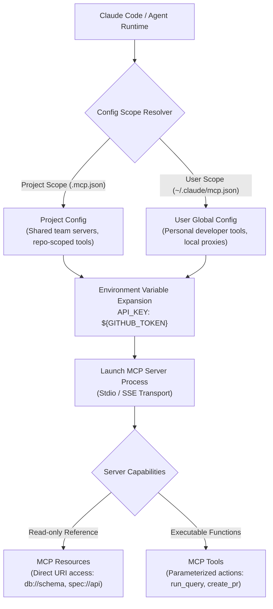

# Task Statement 2.4: Integrate MCP Servers into Claude Code and Agent Workflows

## 📌 Executive Overview: Goal, Scope & Exam Importance

### Certification Domain & Weight
- **Domain**: Domain 2: Tool Design & MCP Integration
- **Domain Weight**: 20% of total CCAR-F exam score
- **Scenario Alignment**: Scenario 4 (Developer Productivity with Claude)

### The Core Goal
To integrate Model Context Protocol (MCP) servers into Claude Code and custom agent runtimes, differentiate between **Project-level (`.mcp.json`)** and **User-level (`~/.claude/mcp.json`)** scopes, manage credentials securely via **`${ENV_VAR}` expansion**, and leverage **MCP Resources** versus **MCP Tools** appropriately.

### Why This Matters in Production
In enterprise development, teams collaborate on shared codebases that rely on specific infrastructure (PostgreSQL databases, internal API gateways, CI/CD runners). 
If an architect puts team server configs in their personal user home directory, other engineers and CI runners cannot access them. Conversely, if developers check plain-text API keys and database credentials into `.mcp.json` in the Git repository, credentials leak immediately. 
Furthermore, wrapping static reference documents (e.g. database schemas, OpenAPI specifications) in active executable tools forces Claude into multi-turn trial-and-error queries, whereas exposing them as **MCP Resources** allows instantaneous zero-overhead context injection.

### Exam Importance
Task Statement 2.4 tests your understanding of MCP configuration boundaries, credential interpolation syntax, and the architectural distinction between static MCP Resources (read-only catalogs) and dynamic MCP Tools (parameterized executable functions).

---

## 📖 Deep Narrative: Why We Do What We Do

### 1. The Problem: Credential Leaks and Configuration Drift
Consider two common production failures:
- **Failure 1 (Security Incident)**: A team creates `.mcp.json` to connect Claude to their staging database. The developer hardcodes `"password": "prod_secret_123"`. The file is committed to GitHub, triggering security revocation.
- **Failure 2 (Latency & Cost Waste)**: An architect wants Claude to understand the 200-table database schema. They create an executable tool: `query_database_schema(table_name)`. Claude must call this tool 25 times across 25 turns to piece together the foreign key relationships, burning latency and context.

### 2. The Architectural Solution: Scopes, Env Interpolation & MCP Resources
Production architectures resolve this cleanly:

1. **Config Scoping**:
   - **Project Scope (`./.mcp.json` or `.claude/mcp.json`)**: Checked into version control. Defines shared team servers (Postgres, GitHub, local dev servers).
   - **User Scope (`~/.claude/mcp.json`)**: Kept local to the developer's laptop. Contains personal utilities, local proxies, and developer-specific overrides.

2. **Environment Variable Expansion (`${VAR_NAME}`)**:
   In `.mcp.json`, credentials are never hardcoded; they interpolate from the host environment:
   ```json
   {
     "mcpServers": {
       "github": {
         "command": "npx",
         "args": ["-y", "@modelcontextprotocol/server-github"],
         "env": {
           "GITHUB_PERSONAL_ACCESS_TOKEN": "${GITHUB_TOKEN}"
         }
       }
     }
   }
   ```

3. **MCP Resources vs MCP Tools**:
   - **MCP Resources (`resource://...`)**: Expose static, read-only content catalogs (database schemas, design tokens, OpenAPI specifications). Claude can read the complete resource directly in 1 hop without parameter guessing.
   - **MCP Tools**: Expose dynamic, parameterized, or state-mutating functions (`run_sql_query`, `create_github_pr`, `deploy_service`).

---

## 🔑 Key Technical Terminology Explained

- **Model Context Protocol (MCP)**: An open standard protocol created by Anthropic that standardizes how LLM applications communicate with external data sources, tools, and prompts.
- **Project Scope Config (`.mcp.json`)**: Configuration file located in the project root directory, shared among team members and automated CI runners via Git.
- **User Scope Config (`~/.claude/mcp.json`)**: Global configuration file located in the developer's user home directory for personal machine-wide tools.
- **Environment Variable Expansion (`${ENV_VAR}`)**: The mechanism that substitutes runtime environment variables into MCP configuration files, keeping secrets out of source control.
- **MCP Resource**: A standardized read-only data entity identified by a URI (e.g. `schema://postgres/users`) that can be read directly into context.
- **MCP Tool**: An executable JSON Schema function with parameters and side effects that Claude calls dynamically.

---

## 🏗️ Architecture: MCP Server Integration Topology



---

## ⚠️ Critical Exam Distinctions & Distractor Teardown

| Configuration Element | Correct MCP Implementation | Exam Trap to Reject | Why the Trap Fails |
|---|---|---|---|
| **Secret Management** | Use `${VAR_NAME}` syntax to interpolate secrets from the host environment. | **TRAP**: Hardcoding plain-text API keys or passwords inside `.mcp.json`. | Committing secrets into Git creates critical security vulnerabilities and credential revocation. |
| **Configuration Scoping** | Use **Project scope** (`.mcp.json`) for team-shared repo tools; use **User scope** for personal workstation utilities. | **TRAP**: Putting repo-critical database MCP servers into `~/.claude/mcp.json`. | Teammates and automated CI pipelines clone the repo and fail because the server config is missing. |
| **Static Reference Catalogs** | Expose static schemas and OpenAPI specs as **MCP Resources**. | **TRAP**: Creating dynamic executable tools for reading static schemas. | Forces Claude to make multiple trial-and-error tool calls when a single resource read would suffice. |

---

## 💡 Architectural Decision Matrix: Rules of Thumb

| Use Case | Capability | Transport / Location |
|---|---|---|
| **Database Schema / API Spec** | MCP Resource (`resource://...`) | Project Scope (`.mcp.json`) |
| **Database Mutation (`INSERT/UPDATE`)** | MCP Tool (`run_sql`) | Project Scope with `${DB_PASSWORD}` |
| **Personal Shell Helper / Linter** | MCP Tool | User Scope (`~/.claude/mcp.json`) |

---

## 🧠 Claude 4.5 Extended Thinking & Parameter Standards

- **Resource Reading**: When reading MCP Resources, Claude incorporates the entire schema into its extended thinking phase, allowing it to plan cross-table joins before calling any SQL execution tools.
- **Sampling Rules**: Omit `temperature` whenever thinking is active.
- **Thinking Continuity**: When transitioning between reading MCP Resources and invoking MCP Tools, preserve assistant thinking blocks.

---

## 🛠️ Hands-on Workbook Guide: Following the Code Step-by-Step

When exploring [`ts_2_4_mcp_server_integration.ipynb`](ts_2_4_mcp_server_integration.ipynb):
1. **Step 1: Setup & Mock MCP Server**: Initializes mock MCP servers supporting both Resources and Tools.
2. **Step 2: Environment Variable Expansion**: Demonstrates how `${API_KEY}` safely interpolates host secrets.
3. **Step 3: Direct Resource Access**: Demonstrates reading database schemas via `read_mcp_resource` in a single hop.
4. **Step 4: Tool Execution**: Demonstrates invoking parameterized tools with validated arguments.
5. **Step 5: Verification Assertions**: Verifies that secrets are never logged in plain text and resources load with 0 tool calls.
