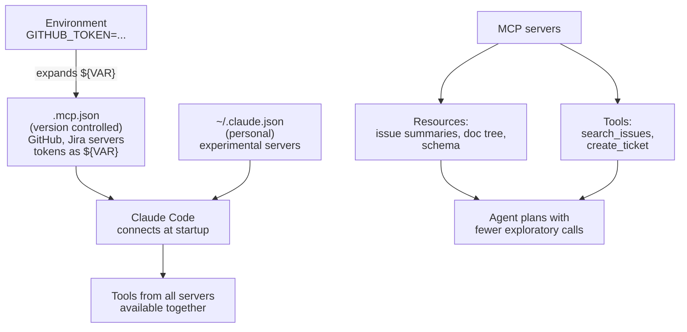

# Task Statement 2.4: Integrate MCP Servers into Claude Code and Agent Workflows

> Scenario alignment: Scenario 3 (Multi-Agent Research) and Scenario 4 (Developer Productivity)

## In One Minute

- **What**: MCP servers add tools and resources to Claude Code. You decide **where** they are configured and **how secrets** are handled.
- **Where**: Project `.mcp.json` is shared and version controlled. User `~/.claude.json` is personal or experimental.
- **Secrets**: Never commit tokens. Write `${GITHUB_TOKEN}` in the file and keep the value in the environment.
- **At connection**: Tools from **all** configured servers are discovered and available **at the same time**.
- **Resources**: Expose content catalogs (issue summaries, doc hierarchies, DB schemas) as MCP resources so the agent makes fewer exploratory calls.
- **Exam answer in one line**: Shared team server goes in `.mcp.json` with `${ENV_VAR}` expansion. Personal setup goes in `~/.claude.json`.

---

## 🧒 Explain Like I'm 13

**The picture:** A shared class wifi setup sheet versus your private notes. `.mcp.json` lives in the repo, so every teammate gets it. `~/.claude.json` is only yours. Passwords never go on the sheet. The sheet says "ask the locker" (`${GITHUB_TOKEN}`) and each person keeps the real key in their own locker (environment variable).

**In plain steps:**
1. Team server: put it in `.mcp.json` and commit.
2. Personal experiment: `~/.claude.json`.
3. Secrets: `${ENV_VAR}`.
4. A big catalog to browse: expose it as a **resource** (a library shelf), not 20 search calls.
5. If Claude prefers `Grep`, improve the MCP tool's description.

**Tiny example:** A token pasted into `.mcp.json` is now in git history forever, even if the repo is private.

---

## 📖 Concepts Explained

### 1. Why it matters
- If team servers sit only in one person's home config, nobody else gets them.
- If a token is written in `.mcp.json` and committed, it leaks.
- If the agent must explore a large catalog with tool calls, it wastes turns.

### 2. How it works

**Scopes**

| Scope | File | Shared? | Use for |
|---|---|---|---|
| Project | `.mcp.json` in the repo | Yes, version controlled | Team tools (GitHub, Jira, project DB) |
| User | `~/.claude.json` | No, personal | Personal or experimental servers |

**Secrets with environment expansion**

```json
{
  "mcpServers": {
    "github": {
      "command": "npx",
      "args": ["-y", "@modelcontextprotocol/server-github"],
      "env": { "GITHUB_PERSONAL_ACCESS_TOKEN": "${GITHUB_TOKEN}" }
    }
  }
}
```
The file holds only the name `${GITHUB_TOKEN}`. Each developer sets the real value in their own environment.

**Discovery.** When Claude Code connects, it discovers tools from **every** configured server. All of them are available at once.

**Resources vs tools**
- **Resource**: read-only content the agent can look at (issue summaries, doc hierarchy, DB schema). Cheap, no side effects.
- **Tool**: an action or a parameterized query. Can have side effects.
A catalog as a resource means the agent sees what exists **before** it starts guessing with tool calls.

**Rich tool descriptions.** If an MCP tool has a thin description, the agent may prefer built-in `Grep`. Describe what the MCP tool returns, its inputs, and when to prefer it.

**Community vs custom.** For standard systems such as Jira, use an existing community MCP server. Build a custom server only for team-specific needs.

---

## 🔑 Key Terms

- **`.mcp.json`**: The repository-scoped configuration file tracked in version control that defines team-wide Model Context Protocol server connections for all developers.
- **`~/.claude.json`**: The user-level configuration file stored in the local home directory for personal tools, experimental servers, or private workflows.
- **`${VAR}` environment expansion**: A secure configuration syntax that resolves dynamic system environment variables at runtime, preventing API keys and secrets from being committed to source control.
- **MCP resource**: Read-only structured data or context artifacts (such as database schemas, documentation indexes, or project boards) that an agent inspects without triggering side effects.
- **MCP tool**: An executable, parameter-driven function exposed by an MCP server that allows an agent to take actions, query remote APIs, or mutate external state.
- **Community MCP server**: A battle-tested, pre-built Model Context Protocol server developed for standard platforms (such as GitHub, Jira, or PostgreSQL) that should be prioritized over building custom servers from scratch.

---

## 🏗️ Architecture



---

## 🧪 Worked Example

### ❌ Invalid Example (Anti-Pattern / What Breaks)
*(Anti-Pattern: Hardcoded Secrets in Git & Multi-Turn Schema Probing)*
```json
// BROKEN 1: Hardcoding plaintext credentials into committed repository file (.mcp.json)
{
  "mcpServers": {
    "github": {
      "command": "npx",
      "args": ["-y", "@modelcontextprotocol/server-github"],
      "env": {
        "GITHUB_PERSONAL_ACCESS_TOKEN": "ghp_live_secret_token_12345"  // LEAKED IN GIT HISTORY!
      }
    }
  }
}

// BROKEN 2: Forcing Claude to discover OpenAPI specs or database schemas via 15 exploratory Bash tool calls
// Result: Consumes 30,000 tokens of command output just to learn what database tables exist!
```

### ✅ Valid Example (Production Pattern)
*(Production Pattern: Environment Expansion & Zero-Turn MCP Resources)*
```json
// CORRECT 1: Project-level .mcp.json using ${ENV_VAR} substitution
{
  "mcpServers": {
    "github": {
      "command": "npx",
      "args": ["-y", "@modelcontextprotocol/server-github"],
      "env": {
        "GITHUB_PERSONAL_ACCESS_TOKEN": "${GITHUB_TOKEN}"  // Reads from developer's secure environment!
      }
    },
    "jira": {
      "command": "npx",
      "args": ["-y", "@modelcontextprotocol/server-jira"],
      "env": {
        "JIRA_API_TOKEN": "${JIRA_API_TOKEN}"
      }
    }
  }
}

// CORRECT 2: Exposing database schema or issue catalog as an MCP Resource (spec:// or db://schema)
// Claude accesses the entire table catalog as an immutable context resource before planning:
// - Zero exploratory bash tool turns.
// - Zero risk of destructive table modification during discovery.
```

**Walkthrough:**
1. Standard community MCP servers are selected for Jira and GitHub.
2. Put both in `.mcp.json` at the repo root so they are version-controlled and shared across the team.
3. Write secrets as `${JIRA_API_TOKEN}` and `${GITHUB_TOKEN}` so nothing sensitive is committed.
4. Put personal or experimental tools in `~/.claude.json` on the individual engineer's workstation.
5. Expose the issue list or OpenAPI catalog as an MCP Resource so the agent reads the summary upfront instead of guessing with tools.
6. Provide rich tool descriptions so Claude knows when to pick MCP tools over built-in Grep.

Code: `load_mcp_config()`, `expand_env()`, `find_hardcoded_secrets()`, `discover_tools()`, and `DeveloperMCPService` in [main.py](main.py).

---

## ⚠️ Exam Traps and Correct Patterns

### Trap 1: Putting a team server in a personal file

| Config | Location | Who gets it |
|---|---|---|
| Project | `.mcp.json` in the repo (committed) | Every teammate and CI after clone |
| User | `~/.claude.json` | Only you |

**Exam scenario**: The whole team needs the GitHub MCP server. Putting it in `~/.claude.json` on each laptop means onboarding steps, drift, and CI that never has it. Use `.mcp.json`.

Reverse trap: committing a personal experiment to `.mcp.json` pushes it onto everyone.

### Trap 2: Secrets inside the config file

```json
// ANTI-PATTERN: token committed to git history
{"mcpServers": {"github": {"command": "npx", "args": ["-y", "@modelcontextprotocol/server-github"],
  "env": {"GITHUB_TOKEN": "ghp_abc123..."}}}}

// PATTERN: expansion from the environment
{"mcpServers": {"github": {"command": "npx", "args": ["-y", "@modelcontextprotocol/server-github"],
  "env": {"GITHUB_TOKEN": "${GITHUB_TOKEN}"}}}}
```

"The repo is private" is not a defence: tokens in history outlive access changes and forks.

### Trap 3: The agent keeps using Grep instead of the MCP tool

**Exam scenario**: A Jira MCP server is connected. Asked "what is PROJ-481 about?", Claude runs `Grep` over the repo.

- Anti-pattern: remove or hide `Grep`. That damages every other task.
- Pattern: the description is the selector. Make the MCP tool say "Searches Jira issues by key (PROJ-123), status, or text. Use this instead of Grep for ticket questions."

All configured servers' tools are discovered at connection time and are available together. Capability is not the issue. Selection is.

### Trap 4: Tool where a resource fits, custom where community exists

- A large read-only catalog (issue summaries, DB schema, doc hierarchy) is best exposed as an MCP **resource** the agent can browse. Wrapping it in a search tool makes the agent guess queries through many exploratory calls.
- For standard integrations (GitHub, Jira, Slack), use a community server first. Build a custom server only for team-specific systems that nothing covers.

---

## 🛠️ Hands-on Workbook Guide

Open [`ts_2_4_mcp_server_integration.ipynb`](ts_2_4_mcp_server_integration.ipynb). It runs offline.
1. **Parse** an example `.mcp.json` and expand `${VAR}` from a fake environment.
2. **Detect** a hardcoded secret with `find_hardcoded_secrets()`.
3. **Merge** tools from two servers with `discover_tools()`.
4. **List and read** resources from `DeveloperMCPService`.
5. **Assert** missing variables raise a clear error.

---

## 📝 Exam-Style Practice Questions

**Q1.** A team wants a shared GitHub MCP server for everyone. It needs a personal access token. What is the best setup?
- A. Put the server in each developer's `~/.claude.json` with their token inline.
- B. Put the server in the project `.mcp.json` with the token as `${GITHUB_TOKEN}`.
- C. Put the server in `.mcp.json` with the token pasted in, and make the repo private.
- D. Run a custom MCP server that hardcodes the token.

**Q2.** An agent must understand a 200-table schema. It makes 25 exploratory tool calls to learn it. What reduces this best?
- A. Add a `get_table` tool with a longer description.
- B. Force `tool_choice` to `any`.
- C. Expose the schema (or a table catalog) as an MCP resource.
- D. Switch the agent to a smaller model.

**Q3.** A Jira MCP server is configured, but the agent keeps using built-in `Grep` to search for tickets in the repo. What is the best fix?
- A. Rewrite the Jira tool description: what it returns, input formats, and when to prefer it over Grep.
- B. Remove the Grep built-in tool.
- C. Move the Jira server to `~/.claude.json`.
- D. Build a custom Jira server.

### Answers

**Q1 → B.** Project scope shares it. `${GITHUB_TOKEN}` keeps the secret out of git.
- A: Not shared and tokens end up inline in each file.
- C: A private repo still leaks the token to anyone with access and to history.
- D: A hardcoded token is the same leak. Community servers exist for standard integrations.

**Q2 → C.** A resource gives the agent the catalog up front.
- A: Another tool still needs many calls.
- B: `any` forces calls, which makes it worse.
- D: Model size does not remove the exploration.

**Q3 → A.** The description decides which tool Claude prefers.
- B: Removing built-ins is the wrong lever and hurts other work.
- C: Scope does not change selection.
- D: A custom server has the same thin-description problem.

---

## ✅ Self-Check Checklist

- [ ] I know `.mcp.json` is project and shared, `~/.claude.json` is user and personal.
- [ ] I can write a `${ENV_VAR}` reference for a token.
- [ ] I know tools from all configured servers are available together.
- [ ] I can say when to use a resource instead of a tool.
- [ ] I know richer MCP descriptions stop the agent preferring Grep, and community servers are first choice for standard services.

**Memory hook**: *"Team in `.mcp.json`, me in `~/.claude.json`, secrets in `${VARS}`, catalogs as resources."*

---

## 🧭 Navigation & Study Links
- ⬅️ **Previous Topic**: [TS 2.3: Tool Distribution & Selection Strategies](../ts_2_3_tool_distribution_and_choice/README.md)
- 📋 **Domain Overview**: [Domain 2: Tool Design & Model Context Protocol (MCP)](../README.md)
- ➡️ **Next Topic**: [TS 2.5: Built-in Tools & Agent Sandbox Optimization](../ts_2_5_builtin_tools_usage/README.md)
- 🎯 **Scenario Practice**: [Master Scenario Practice](../../scenarios/MASTER_SCENARIO_PRACTICE.md)
