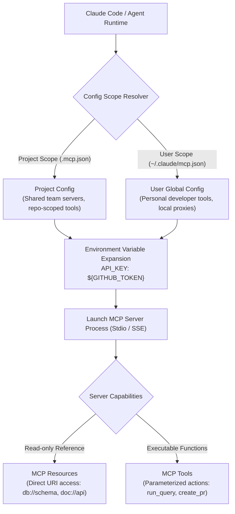

# Task Statement 2.4: Integrate MCP Servers into Claude Code and Agent Workflows

## 🎯 Exam Objective
Understand how to integrate Model Context Protocol (MCP) servers into Claude Code workflows, distinguish project-level versus user-level scopes, configure secure environment variable expansion, and leverage **MCP Resources** versus **MCP Tools**.

---

## 🏗️ Architecture: MCP Server Integration Topology

---

## ⚠️ Critical Exam Distinctions & Anti-Patterns

| Configuration / Feature | Correct MCP Implementation | Exam Trap to Reject |
|---|---|---|
| **Credential Management** | Use `${VAR_NAME}` syntax to interpolate secrets from the host environment. | **TRAP**: Hardcoding plain-text API tokens or database passwords in checked-in configuration files. |
| **Config Scoping** | Use **Project scope** (`.mcp.json`) for team-shared repo tools; use **User scope** for personal workstation utilities. | **TRAP**: Putting team project dependencies in user home directories where teammates cannot access them. |
| **Resources vs Tools** | Expose static schemas and documentation as **MCP Resources** (read directly without tool calls). | **TRAP**: Wrapping static read-only reference data in dynamic executable tools that consume multiple round-trips. |

---

## 💡 Architectural Decision Matrix

| Capability | Primitives | Best Use Case | Performance Benefit |
|---|---|---|---|
| **MCP Resources** | Static URIs (`resource://...`) | Database schemas, design system specs, API docs | Injected directly into context without tool execution latency. |
| **MCP Tools** | JSON Schema functions | Queries with dynamic parameters, write operations | Invoked selectively only when required. |
| **MCP Prompts** | Reusable prompt templates | Standardized bug report triage, PR review checklists | Consistency across developer teams. |

---

## 🛠️ Production Code Reference
- Interactive Workbook: [`ts_2_4_mcp_server_integration.ipynb`](ts_2_4_mcp_server_integration.ipynb)
- Runnable Script: [`main.py`](main.py)
- Offline Verification: Run via `uv run pytest tests/test_domain2_full.py` in WSL.
