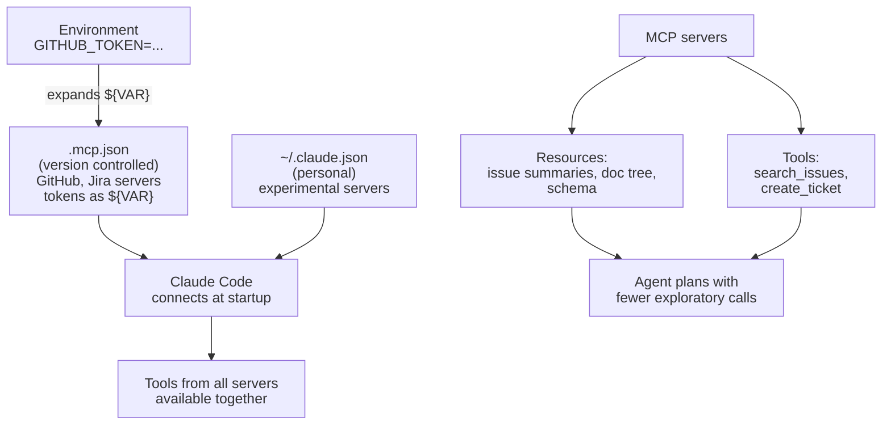

# Task Statement 2.4: Integrate MCP Servers into Claude Code and Agent Workflows

## In One Minute

- **What**: MCP servers add tools and resources to Claude Code. You decide **where** they are configured and **how secrets** are handled.
- **Where**: Project `.mcp.json` is shared and version controlled. User `~/.claude.json` is personal or experimental.
- **Secrets**: Never commit tokens. Write `${GITHUB_TOKEN}` in the file and keep the value in the environment.
- **At connection**: Tools from **all** configured servers are discovered and available **at the same time**.
- **Resources**: Expose content catalogs (issue summaries, doc hierarchies, DB schemas) as MCP resources so the agent makes fewer exploratory calls.
- **Exam answer in one line**: Shared team server goes in `.mcp.json` with `${ENV_VAR}` expansion. Personal setup goes in `~/.claude.json`.

---

## 📌 Overview

- **Domain**: Domain 2: Tool Design & MCP Integration (**18%** of the exam)
- **Scenario alignment**: Scenario 3 (Multi-Agent Research) and Scenario 4 (Developer Productivity)
- **What the exam tests**: Choosing the right config scope, handling credentials safely, using resources, and getting the agent to prefer a capable MCP tool over built-in Grep.
- **Study order**: [2.3](../ts_2_3_tool_distribution_and_choice/README.md) → 2.4 (this file) → [2.5](../ts_2_5_builtin_tools_usage/README.md). Back to the [Domain 2 map](../README.md).

---

## 📖 Concepts Explained

### 1. The simple idea
An MCP server is a plug-in. `.mcp.json` says which plug-ins the **team** uses. `~/.claude.json` holds the ones only **you** use.

### 2. Why it matters
- If team servers sit only in one person's home config, nobody else gets them.
- If a token is written in `.mcp.json` and committed, it leaks.
- If the agent must explore a large catalog with tool calls, it wastes turns.

### 3. How it works

**Scopes**

| Scope | File | Shared? | Use for |
|---|---|---|---|
| Project | `.mcp.json` in the repo | Yes, version controlled | Team tools (GitHub, Jira, project DB) |
| User | `~/.claude.json` | No, personal | Personal or experimental servers |

**Secrets with environment expansion**

```json
{
  "mcpServers": {
    "github": {
      "command": "npx",
      "args": ["-y", "@modelcontextprotocol/server-github"],
      "env": { "GITHUB_PERSONAL_ACCESS_TOKEN": "${GITHUB_TOKEN}" }
    }
  }
}
```
The file holds only the name `${GITHUB_TOKEN}`. Each developer sets the real value in their own environment.

**Discovery.** When Claude Code connects, it discovers tools from **every** configured server. All of them are available at once.

**Resources vs tools**
- **Resource**: read-only content the agent can look at (issue summaries, doc hierarchy, DB schema). Cheap, no side effects.
- **Tool**: an action or a parameterized query. Can have side effects.
A catalog as a resource means the agent sees what exists **before** it starts guessing with tool calls.

**Rich tool descriptions.** If an MCP tool has a thin description, the agent may prefer built-in `Grep`. Describe what the MCP tool returns, its inputs, and when to prefer it.

**Community vs custom.** For standard systems such as Jira, use an existing community MCP server. Build a custom server only for team-specific needs.

---

## 🔑 Key Terms

- **`.mcp.json`**: Project-level MCP config. Shared through version control.
- **`~/.claude.json`**: User-level config. Personal or experimental.
- **`${VAR}` expansion**: A placeholder replaced from the environment, so secrets stay out of git.
- **MCP resource**: Read-only content exposed by a server, such as a schema or a doc tree.
- **MCP tool**: A callable function exposed by a server.
- **Community server**: A ready-made MCP server for a standard service.

---

## 🏗️ Architecture



---

## 🧪 Worked Example (Developer Productivity)

**Goal**: The team wants Jira and GitHub available to everyone. One developer also wants a personal notes server.

1. **Pick community servers** for Jira and GitHub. These are standard integrations.
2. **Put both in `.mcp.json`** at the repo root so they are shared.
3. **Write secrets as `${JIRA_API_TOKEN}` and `${GITHUB_TOKEN}`.** Each developer sets them locally. Nothing sensitive is committed.
4. **Put the notes server in `~/.claude.json`.** It is personal.
5. **Expose the issue list as a resource.** The agent reads a summary first, then calls tools only for the issues it needs.
6. **Improve tool descriptions.** The agent used `Grep` to look for tickets in the repo. A richer Jira tool description says "searches Jira issues by key, status or text. Use this instead of Grep for ticket questions."

Code: `load_mcp_config()`, `expand_env()`, `find_hardcoded_secrets()`, `discover_tools()` and `DeveloperMCPService` in [main.py](main.py).

---

## ⚠️ Exam Traps and Correct Patterns

| Situation | Correct pattern | Trap | Why the trap fails |
|---|---|---|---|
| Whole team needs a server | Project `.mcp.json` | `~/.claude.json` on each laptop | Not shared, drifts between people |
| Server needs a token | `${GITHUB_TOKEN}` expansion | Paste the token in the file | Leaks into version control |
| Personal experiment | `~/.claude.json` | Commit it to `.mcp.json` | Pushes experiments on the team |
| Agent keeps using Grep instead of the MCP tool | Richer MCP tool description | Remove or hide Grep | Wrong lever. The description is the selector |
| Standard Jira integration | Community MCP server | Build a custom one | Needless work and upkeep |
| Large catalog to browse | MCP resource | Many exploratory tool calls | Slow and costly |

---

## ❌ Common Mistakes

- Thinking secrets in `.mcp.json` are fine for private repos.
- Believing only one server's tools are visible at a time. All are discovered at connection.
- Wrapping a read-only catalog in a tool when a resource fits.
- Leaving MCP tool descriptions short, so built-in Grep wins.
- Writing a custom MCP server for something a community server already does.

---

## 💡 Quick Decision Rules

| If you see... | Do this |
|---|---|
| Shared, team-wide server | `.mcp.json` |
| Personal or experimental | `~/.claude.json` |
| Credential in config | `${ENV_VAR}` |
| Agent explores a catalog blindly | Expose it as a resource |
| Agent prefers Grep over MCP tool | Expand the MCP tool description |
| Standard SaaS integration | Community server first |

---

## 🧠 Claude 4.5 Notes

- `claude-sonnet-4-5` for the coordinator, `claude-haiku-4-5` for workers.
- With extended thinking: `budget_tokens` ≥ 1024 and below `max_tokens`. **Omit `temperature`**. Leave `top_k` and `top_p` unset. `tool_choice` only `auto` or `none`.
- Return thinking blocks with signatures unchanged in tool loops.

---

## 🛠️ Hands-on Workbook Guide

Open [`ts_2_4_mcp_server_integration.ipynb`](ts_2_4_mcp_server_integration.ipynb). It runs offline.
1. **Parse** an example `.mcp.json` and expand `${VAR}` from a fake environment.
2. **Detect** a hardcoded secret with `find_hardcoded_secrets()`.
3. **Merge** tools from two servers with `discover_tools()`.
4. **List and read** resources from `DeveloperMCPService`.
5. **Assert** missing variables raise a clear error.

---

## 📝 Exam-Style Practice Questions

**Q1.** A team wants a shared GitHub MCP server for everyone. It needs a personal access token. What is the best setup?
- A. Put the server in each developer's `~/.claude.json` with their token inline.
- B. Put the server in the project `.mcp.json` with the token as `${GITHUB_TOKEN}`.
- C. Put the server in `.mcp.json` with the token pasted in, and make the repo private.
- D. Run a custom MCP server that hardcodes the token.

**Q2.** An agent must understand a 200-table schema. It makes 25 exploratory tool calls to learn it. What reduces this best?
- A. Add a `get_table` tool with a longer description.
- B. Force `tool_choice` to `any`.
- C. Expose the schema (or a table catalog) as an MCP resource.
- D. Switch the agent to a smaller model.

**Q3.** A Jira MCP server is configured, but the agent keeps using built-in `Grep` to search for tickets in the repo. What is the best fix?
- A. Rewrite the Jira tool description: what it returns, input formats, and when to prefer it over Grep.
- B. Remove the Grep built-in tool.
- C. Move the Jira server to `~/.claude.json`.
- D. Build a custom Jira server.

### Answers

**Q1 → B.** Project scope shares it. `${GITHUB_TOKEN}` keeps the secret out of git.
- A: Not shared and tokens end up inline in each file.
- C: A private repo still leaks the token to anyone with access and to history.
- D: A hardcoded token is the same leak. Community servers exist for standard integrations.

**Q2 → C.** A resource gives the agent the catalog up front.
- A: Another tool still needs many calls.
- B: `any` forces calls, which makes it worse.
- D: Model size does not remove the exploration.

**Q3 → A.** The description decides which tool Claude prefers.
- B: Removing built-ins is the wrong lever and hurts other work.
- C: Scope does not change selection.
- D: A custom server has the same thin-description problem.

---

## ✅ Self-Check Checklist

- [ ] I know `.mcp.json` is project and shared, `~/.claude.json` is user and personal.
- [ ] I can write a `${ENV_VAR}` reference for a token.
- [ ] I know tools from all configured servers are available together.
- [ ] I can say when to use a resource instead of a tool.
- [ ] I know richer MCP descriptions stop the agent preferring Grep, and community servers are first choice for standard services.

**Memory hook**: *"Team in `.mcp.json`, me in `~/.claude.json`, secrets in `${VARS}`, catalogs as resources."*
