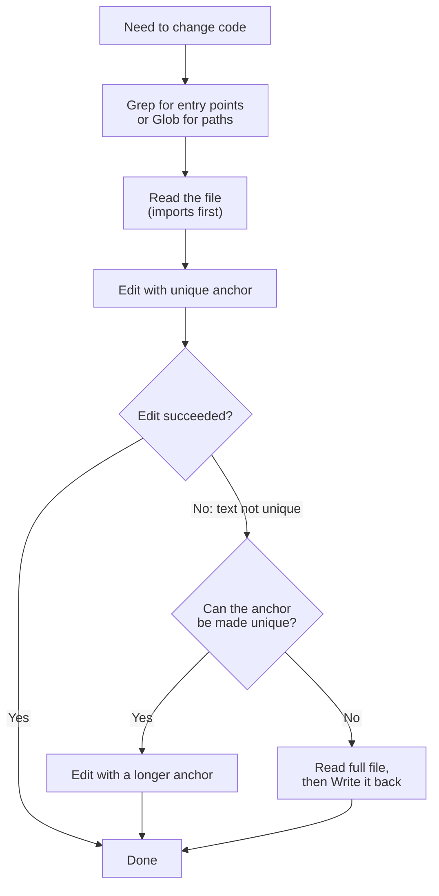

# Task Statement 2.5: Select and Apply Built-in Tools Effectively

> Scenario alignment: Scenario 4 (Developer Productivity)

## In One Minute

- **What**: Claude Code ships built-in tools. Pick the right one for each job.
- **Pick**: `Grep` searches file **content**. `Glob` matches file **paths**. `Read` and `Write` handle **whole files**. `Edit` makes a **targeted replacement** of unique text.
- **When Edit fails** because the text is not unique: use `Read` + `Write` (or expand the anchor so it is unique).
- **Explore step by step**: `Grep` for entry points, `Read` the imports, then follow the code. Do not read everything up front.
- **Trace through wrappers**: list the wrapper's exported names, then `Grep` each name.
- **Exam answer in one line**: Grep for content, Glob for paths, Edit for unique text, and fall back to Read + Write when Edit cannot find a unique match.

---

## 🧒 Explain Like I'm 13

**The picture:** Library tools. `Grep` is Ctrl+F **inside** books (content). `Glob` is looking at the **spines** on the shelf (file names). `Edit` is correction fluid on one sentence. `Write` is rewriting the whole page.

**In plain steps:**
1. Looking for text? `Grep`. Looking for files by name? `Glob`.
2. Small change? `Edit` with a unique anchor. If the text is not unique, make the anchor longer, or `Read` and `Write`.
3. New to a codebase? Follow footprints: `Grep` the entry point, `Read` it, `Grep` what it imports.

**Tiny example:** Finding every caller of `charge_card` when a wrapper re-exports it as `pay`: list the wrapper's exported names, then `Grep` each one.

---

## 📖 Concepts Explained

### 1. Why it matters
- Reading a whole repo to find one function floods the context with irrelevant text.
- Rewriting a 600-line file to change one line risks accidental damage.
- Repeating a failed `Edit` unchanged will fail again.

### 2. How it works

| You want to... | Use | Why |
|---|---|---|
| Find where `class UserAuth` is defined | `Grep` | Searches **content** across files |
| Find all `test_*.py` files | `Glob` | Matches **paths** by pattern |
| Look at a file or a section | `Read` | Whole file or a range |
| Create a file or replace it completely | `Write` | Writes the **whole file** |
| Change one unique snippet | `Edit` | **Targeted** replacement of unique text |

**`Edit` needs unique text.** If the text you want to replace appears 0 or 2+ times, `Edit` fails.

**Recovery when `Edit` fails on non-unique text**
1. `Read` the file to see the context around each match.
2. Option A: try `Edit` again with a longer, unique anchor (include nearby lines).
3. Option B: **`Read` + `Write`**: read the full content, change the right occurrence, write the file back.

**Build understanding step by step**
1. `Grep` for entry points (a function name, a route, an error message).
2. `Read` those files, starting with the imports.
3. Follow what the imports point to. Repeat.

**Trace usage across wrapper modules.** A wrapper module re-exports other code, so names change on the way. List the names the wrapper exports. Then `Grep` each name across the repo to see who really uses it.

---

## 🔑 Key Terms

- **Grep**: Content search with a pattern.
- **Glob**: Path pattern matching, such as `**/*.ts`.
- **Read / Write**: View a whole file / write a whole file.
- **Edit**: Replace unique text with new text in an existing file.
- **Anchor**: The text you ask `Edit` to match. It must be unique.
- **Wrapper module**: A module that re-exports names from elsewhere.

---

## 🏗️ Architecture



---

## 🧪 Worked Example (Developer Productivity)

**Goal**: Change the retry count in a `refund` module. The text `retries = 3` appears twice.

1. **Find it.** `Grep` for `retries = 3`. Two matches in `refund.py`.
2. **Try `Edit`.** It fails. The text is not unique.
3. **Read the file.** One match is in `issue_refund`, the other in `issue_credit`.
4. **Expand the anchor.** Use `def issue_refund():\n    retries = 3`. This is unique.
5. **Retry `Edit`.** It works.
6. **If it still fails**, `Read` the whole file and `Write` it back with the right occurrence changed.

**Tracing a wrapper.** `tools/__init__.py` exports `get_order` and `get_customer`. List those two names, then `Grep` each. You see which modules really call them.

Code: `BuiltinToolbox` in [main.py](main.py): `edit_file()`, `execute_edit_with_fallback()`, `list_exported_names()` and `trace_usage()`.

---

## ⚠️ Exam Traps and Correct Patterns

### Trap 1: Grep and Glob swapped

| Question | Tool | Example |
|---|---|---|
| Where is `process_refund` defined or called? (search **content**) | `Grep` | `Grep "def process_refund"` |
| Which files are tests? (search **path/name**) | `Glob` | `Glob "**/*.test.tsx"` |

Anti-patterns: `Grep` for "*.test.tsx" (it searches inside files, returns nothing useful), or `Glob` to find a string inside files (it only matches paths).

### Trap 2: `Write` for a one-line change, and repeating a failed `Edit`

```text
ANTI-PATTERN: Write the full 900-line file to change one constant.
  Risk: the rewrite silently drops or alters unrelated lines.

PATTERN: Edit with a unique anchor.
  old: 'TIMEOUT_SECONDS = 30'    new: 'TIMEOUT_SECONDS = 60'
```

If `Edit` fails because the text is not unique (appears 4 times), repeating the same call fails the same way. Either include more surrounding lines to make the anchor unique, or `Read` the file and `Write` the new content.

### Trap 3: Reading everything to learn a codebase

```text
ANTI-PATTERN: Read all 300 files first. Context is full before any work starts.

PATTERN (incremental):
  1. Grep entry points (main, route registrations)
  2. Read the one file that matches, note its imports
  3. Grep each imported name to find callers and definitions
  4. Read only what the question needs
```

### Trap 4: Tracing usage through wrapper modules

**Exam scenario**: Find every caller of `charge_card`, but `payments/__init__.py` re-exports it as `pay`.

```text
ANTI-PATTERN: Grep "charge_card" -> finds only the definition and the wrapper. Callers use `pay(...)`.
PATTERN: Read the wrapper, list its exported names (charge_card, pay), then Grep each name.
```

---

## 🛠️ Hands-on Workbook Guide

Open [`ts_2_5_builtin_tools_usage.ipynb`](ts_2_5_builtin_tools_usage.ipynb). It runs offline in a temporary folder.
1. **Create** a small project with `Write`.
2. **Search** with `Grep` and `Glob`.
3. **Trigger** an ambiguous `Edit` and read the error.
4. **Recover** with an expanded anchor, then with `Read` + `Write`.
5. **Trace** usage through a wrapper module with `trace_usage()`.

---

## 📝 Exam-Style Practice Questions

**Q1.** You need to find every file that calls `process_refund` in a large repo. Which tool should you use first?
- A. `Read` each file in the repo.
- B. `Glob` with the pattern `process_refund`.
- C. `Grep` for `process_refund`.
- D. `Write` a script that lists files.

**Q2.** `Edit` fails because `timeout = 30` appears in four places and you want to change only one. What is the best next step?
- A. Call the same `Edit` again.
- B. `Read` the file, then retry `Edit` with a longer unique anchor, or use `Read` + `Write`.
- C. `Write` an empty file and start over.
- D. Give up and report the task as impossible.

**Q3.** `utils/__init__.py` re-exports `load_cfg` and `save_cfg` from other modules. You must find who uses them. What is the best approach?
- A. `Grep` for `utils` only.
- B. `Glob` for `**/*cfg*`.
- C. `Read` every file in the repo.
- D. List the names exported by the wrapper, then `Grep` each name across the repo.

### Answers

**Q1 → C.** `Grep` searches content and returns file and line.
- A: Reading every file wastes context.
- B: `Glob` matches paths, not content.
- D: Writing a script is unneeded work and not a built-in search.

**Q2 → B.** Read for context, then use a unique anchor or the Read + Write fallback.
- A: The same call fails the same way.
- C: Overwriting with an empty file destroys content.
- D: There is a documented recovery path.

**Q3 → D.** Re-exported names are what callers import, so grep each one.
- A: Callers may import the names, not the wrapper path.
- B: `Glob` matches filenames, which may not include the names.
- C: Reading everything wastes context.

---

## ✅ Self-Check Checklist

- [ ] I can say which tool searches content and which matches paths.
- [ ] I know `Edit` needs unique text.
- [ ] I can describe the two recoveries: longer anchor, or `Read` + `Write`.
- [ ] I can explore a codebase step by step: Grep entry points, then Read imports.
- [ ] I can trace wrapper usage: list exported names, then Grep each.

**Memory hook**: *"Grep = what's inside, Glob = what's named, Edit = unique only, otherwise Read then Write."*
