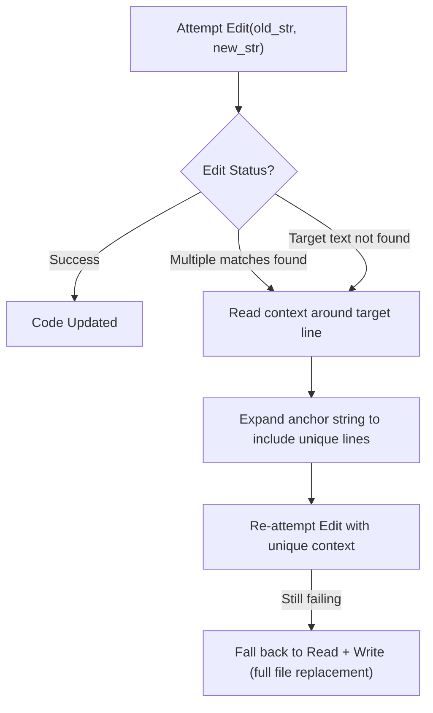

# Task Statement 2.5: Select and Apply Built-in Tools Effectively

## 🎯 Exam Objective
Understand when and how Claude Code selects and applies built-in developer tools (`Read`, `Write`, `Edit`, `Bash`, `Grep`, `Glob`) and how to handle tool failure recovery.

---

## 🏗️ Built-in Tools Decision Matrix

| Tool | Primary Purpose | When to Choose | When to Avoid |
|---|---|---|---|
| **`Grep`** | Content pattern search | Finding function definitions, symbol usages, or error strings across files | Searching for file names or directory structures |
| **`Glob`** | File path matching | Locating files by filename pattern (e.g. `**/*.py`, `tests/test_*.py`) | Searching within file contents |
| **`Read`** | Full or chunked file inspection | Reading context around a known line range or inspecting complete files | Checking if a keyword exists across 50 files (use `Grep` first) |
| **`Edit`** | Targeted surgical replacement | Modifying specific functions or lines while preserving existing formatting | Creating brand new files; replacing entire multi-hundred line files |
| **`Write`** | Full file creation or overwrite | Creating new files from scratch, or complete rewrites when `Edit` fails | Small targeted bug fixes in existing large files |
| **`Bash`** | Shell execution | Running linters, test suites, git commands, and build tools | Simple file operations that built-in tools handle safer |

---

## ⚡ The `Edit` Fallback Protocol

On the exam, scenarios often ask what happens when `Edit` fails:

### Key Gotcha
- If `old_str` matches 2+ locations in the target file, `Edit` **fails** to prevent unintended replacements.
- **Resolution**: Expand the anchor lines above/below to ensure uniqueness, or fallback to `Read` followed by clean `Write`.
