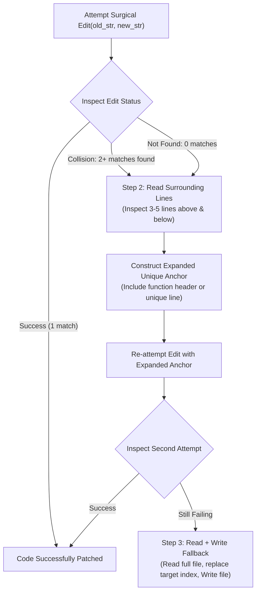

# Task Statement 2.5: Select and Apply Built-in Tools Effectively

## 📌 Executive Overview: Goal, Scope & Exam Importance

### Certification Domain & Weight
- **Domain**: Domain 2: Tool Design & MCP Integration
- **Domain Weight**: 20% of total CCAR-F exam score
- **Scenario Alignment**: Scenario 4 (Developer Productivity with Claude)

### The Core Goal
To master the selection criteria and execution protocols for Claude Code's built-in developer tool suite (**`Read`**, **`Write`**, **`Edit`**, **`Bash`**, **`Grep`**, **`Glob`**), and implement the deterministic **`Edit` Fallback Recovery Protocol** when surgical string replacements encounter non-unique match collisions.

### Why This Matters in Production
In real-world software engineering, tools carry stark trade-offs in token cost, latency, and safety:
- Using `Read` to search for a function name across a 50-file repository floods the context window with 40,000 irrelevant tokens, whereas **`Grep`** returns the exact file and line number in 200 tokens.
- Using `Write` to overwrite a 600-line file to change 1 line risks accidental deletions and formatting regressions, whereas **`Edit`** performs surgical, diff-safe replacements.
- If `Edit` fails because the target string appears in multiple locations, naively repeating the same edit causes an infinite loop. Understanding the exact recovery path (expanding surrounding anchor lines, or falling back to `Read` followed by `Write`) is critical to autonomous reliability.

### Exam Importance
Task Statement 2.5 questions test tool selection instincts (e.g. choosing between Grep and Glob) and failure recovery behavior. The exam frequently asks what an agent must do when an `Edit` call fails with an "ambiguous match" or "multiple matches found" status.

---

## 📖 Deep Narrative: Why We Do What We Do

### 1. The Built-in Tool Ecosystem Explained
Claude Code provides six native primitives:
1. **`Grep` (Content Search)**: Searches inside file contents using regex. Used to find function definitions, imported symbols, variable references, or error strings across the repository.
2. **`Glob` (Path Search)**: Matches file paths by pattern (e.g. `tests/**/*.py`, `src/**/*.tsx`). Does *not* inspect file contents.
3. **`Read` (File Inspection)**: Reads full files or specific line ranges (using `offset` and `limit`). Used *after* `Grep` or `Glob` to inspect surrounding context.
4. **`Edit` (Surgical Replacement)**: Replaces an exact string (`old_str`) with a replacement string (`new_str`) inside an existing file, preserving the rest of the file untouched.
5. **`Write` (File Creation & Overwrite)**: Writes complete file contents to disk. Used for creating brand new files or complete rewrites when surgical editing is impossible.
6. **`Bash` (Shell Execution)**: Runs compilers, test suites (`pytest`), linters (`black`, `flake8`), and git commands.

### 2. The `Edit` Collision & Fallback Recovery Protocol
To protect codebases against unintended widespread mutations, the `Edit` tool enforces a strict safety contract:
- If `old_str` matches **exactly 1 location** in the target file $\rightarrow$ **Success** (applied cleanly).
- If `old_str` matches **0 locations** $\rightarrow$ **Fails** (`NOT_FOUND`).
- If `old_str` matches **2 or more locations** $\rightarrow$ **Fails** (`AMBIGUOUS_COLLISION`).

#### The 3-Step Recovery Hierarchy:
1. **Initial Attempt**: Attempt surgical `Edit(path, old_str, new_str)`.
2. **Step 2 (Anchor Expansion)**: If `AMBIGUOUS_COLLISION` occurs, call `Read` to inspect 3–5 lines of code above and below the target. Re-attempt `Edit` using the **expanded unique anchor string** (including surrounding context lines).
3. **Step 3 (Read + Write Fallback)**: If anchor expansion still fails (e.g. deeply duplicated repetitive code), read the full file into memory, perform in-memory string manipulation for the specific occurrence index, and write the complete file using `Write`.

---

## 🔑 Key Technical Terminology Explained

- **`Grep` vs `Glob`**: `Grep` inspects the text *inside* files; `Glob` inspects file and directory *names* on disk.
- **Surgical `Edit`**: A tool operation that modifies only a small contiguous block of text inside a file while leaving all other lines byte-for-byte identical.
- **Anchor String**: Surrounding lines of code included in `old_str` to make the target text globally unique within the file.
- **Ambiguous Collision (`AMBIGUOUS_COLLISION`)**: An error returned by `Edit` when the target string matches multiple locations in the file, preventing ambiguous replacements.
- **Read + Write Fallback**: The secondary recovery protocol where the agent reads the complete file into memory and uses `Write` to perform a full file replacement when surgical anchors cannot be disambiguated.

---

## 🏗️ Architecture: The `Edit` Fallback Protocol

---

## ⚠️ Critical Exam Distinctions & Distractor Teardown

| Scenario / Dilemma | Correct Implementation | Exam Trap to Reject | Why the Trap Fails |
|---|---|---|---|
| **Searching for a Symbol** | Use **`Grep`** with symbol regex to find file and line numbers. | **TRAP**: Calling `Read` across every file in the directory tree. | Exhausts context window tokens and introduces massive unnecessary latency. |
| **Locating Test Files** | Use **`Glob`** with `tests/**/test_*.py`. | **TRAP**: Using `Grep` to search for filenames inside files. | `Grep` searches content, not directory paths; misses files without specific text strings. |
| **Fixing 1 Line in Large File** | Use surgical **`Edit`** with unique anchors. | **TRAP**: Using **`Write`** to rewrite the entire 1,000-line file. | High risk of hallucinating dropped functions, syntax regressions, and losing file permissions. |
| **Handling Edit Collision** | **Expand context anchor lines** above/below to ensure uniqueness, or fallback to `Read + Write`. | **TRAP**: Blindly re-executing the identical `Edit` call with no changes. | Fails identically on every retry until iteration limits abort the session. |

---

## 💡 Architectural Decision Matrix: Built-in Tools

| Developer Intent | Optimal Tool | Reason |
|---|---|---|
| Find which file defines `class UserAuth` | `Grep` | Content search across all files in 1 turn. |
| Find all `.json` files in `config/` | `Glob` | File path pattern matching. |
| Inspect lines 40–80 of `server.py` | `Read(offset=40, limit=40)` | Targeted window without reading full 2,000-line file. |
| Update variable name in 1 function | `Edit` | Surgical, diff-safe modification. |
| Create new test file `test_auth.py` | `Write` | New file creation from scratch. |
| Run test suite and check exit code | `Bash` | Executes `pytest` in native runtime environment. |

---

## 🧠 Claude 4.5 Extended Thinking & Parameter Standards

- **Anchor Planning**: Extended Thinking allows Claude to analyze the target file contents during its reasoning phase and construct a unique multi-line anchor string *before* calling `Edit`, avoiding collisions on the first turn.
- **Sampling Rules**: Omit `temperature` whenever thinking is enabled.
- **Thinking Continuity**: When handling collision retries, assistant thinking blocks describing the failed attempt must be preserved with their cryptographic signatures.

---

## 🛠️ Hands-on Workbook Guide: Following the Code Step-by-Step

When exploring [`ts_2_5_builtin_tools_usage.ipynb`](ts_2_5_builtin_tools_usage.ipynb):
1. **Step 1: Setup & Developer Toolbox**: Initializes the simulated file system with Grep, Glob, Read, Write, and Edit tools.
2. **Step 2: Grep & Glob Discovery**: Demonstrates finding symbols in contents via `grep_symbols` and files via `glob_paths`.
3. **Step 3: Triggering Edit Collision**: Intentionally attempts to replace a duplicated string, triggering `AMBIGUOUS_COLLISION`.
4. **Step 4: Anchor Expansion & Fallback**: Demonstrates successful recovery using expanded multi-line context anchors.
5. **Step 5: Verification Assertions**: Verifies that 100% of duplicate collisions recover safely without corrupting unrelated code.
