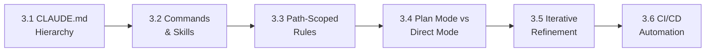
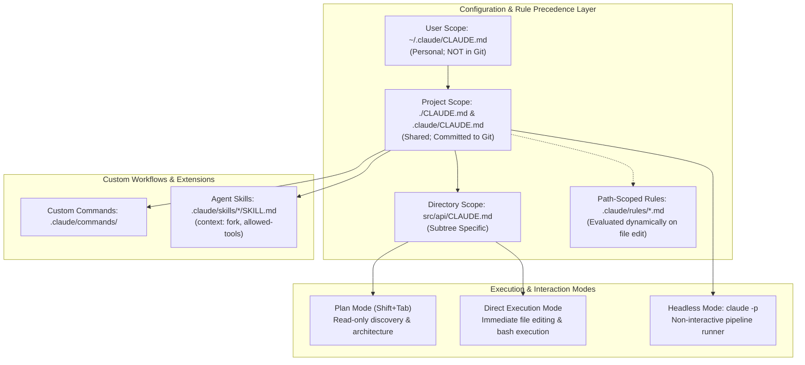
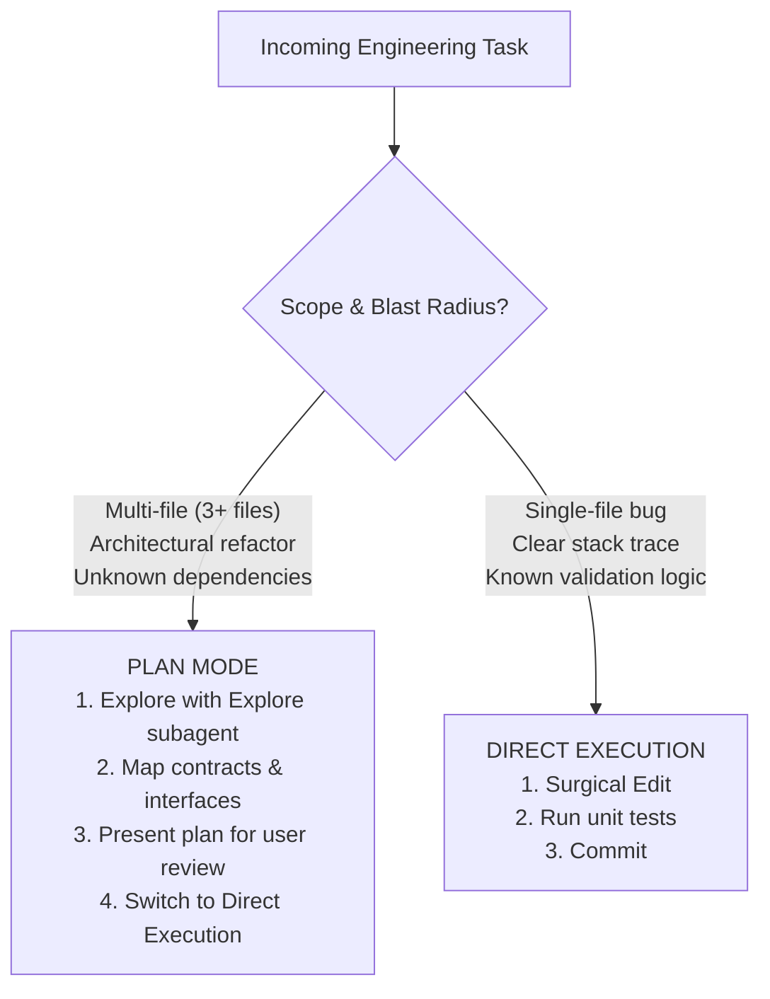
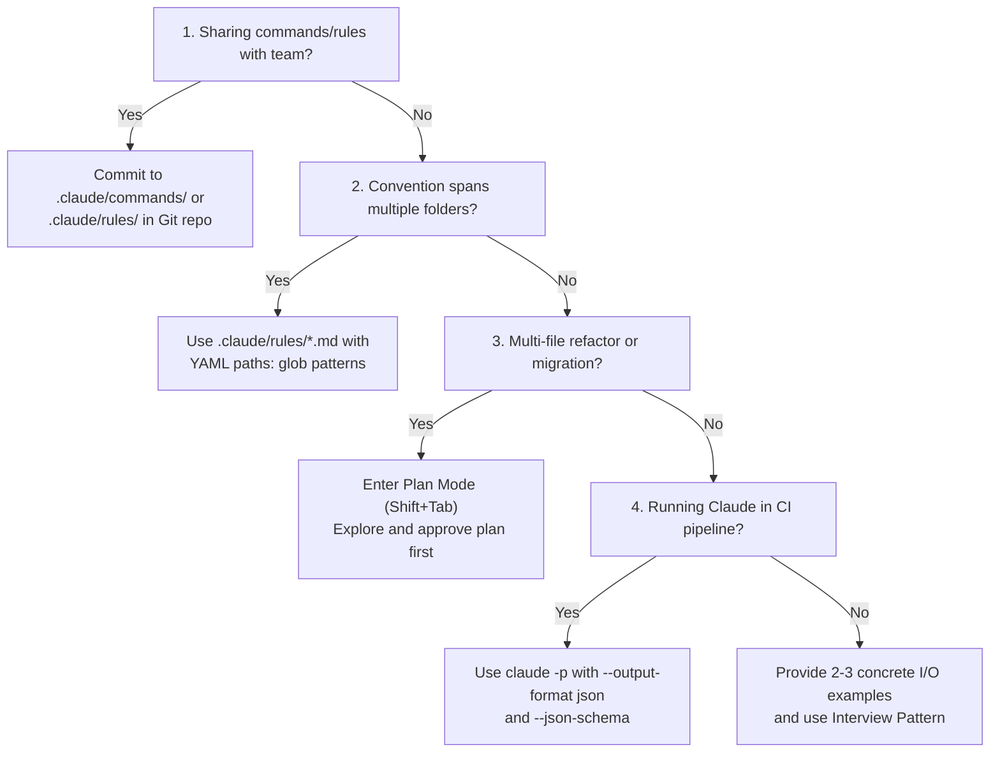

# Domain 3: Claude Code Configuration & Workflows (20% of Exam)
**Master Blueprint & Deep Architectural Guide** | **Certification Weight**: 20% (Second Highest Weighting on Exam)

---

## 🧭 Study Order, Weights, and One-Line Summaries

**Exam weights**: D1 27% · D2 18% · D3 20% · D4 20% · D5 15%. Domain 3 tests team collaboration, repository scoping, workflow orchestration, and CI/CD automation with Claude Code. Start with the short guides in [README.md](README.md), then use this file for architectural depth.

**Study order**: 3.1 CLAUDE.md hierarchy & scoping → 3.2 slash commands & skills → 3.3 path-specific rules → 3.4 plan mode vs direct execution → 3.5 iterative refinement & interview pattern → 3.6 CI/CD automation.

| TS | Study Guide | What It Tests | Key Architectural Trap |
|---|---|---|---|
| 3.1 | [Guide](ts_3_1_claude_code_workflows/README.md) | Hierarchy (User vs Project vs Directory), `@import` modularity, `/memory` inspection | Leaving team conventions in user `~/.claude/CLAUDE.md` (isolated from teammates) |
| 3.2 | [Guide](ts_3_2_slash_commands_and_skills/README.md) | `.claude/commands/`, skills with `context: fork`, `allowed-tools`, `argument-hint` | Running noisy exploration skills inline; editing team skills instead of personal variants |
| 3.3 | [Guide](ts_3_3_path_specific_rules/README.md) | `.claude/rules/*.md` with YAML `paths:` globs (`**/*.test.tsx`) for conditional loading | Creating directory-level CLAUDE.md files for conventions that span multiple directories |
| 3.4 | [Guide](ts_3_4_plan_mode_and_refinement/README.md) | Plan mode for architectural/multi-file refactors; Direct execution for single-file fixes | Starting with direct execution on a 45-file microservice migration |
| 3.5 | [Guide](ts_3_5_iterative_refinement_interview/README.md) | 2–3 I/O examples, test-driven iteration, Interview Pattern, batching interacting bugs | Providing vague prose feedback ("be more precise") instead of concrete input/output |
| 3.6 | [Guide](ts_3_6_cicd_pipeline_automation/README.md) | Non-interactive `-p`, `--output-format json`, `--json-schema`, independent review session | Inventing imaginary flags like `CLAUDE_HEADLESS` or `--batch`, or using author instance |



---

## 📌 Executive Architecture & Task Statement Mapping

Claude Code operates within a layered context hierarchy. Unlike standard conversational chat, Claude Code automatically ingests repository memory, dynamically evaluates path-scoping rules, and executes developer skills. Understanding where configuration lives determines whether instructions apply to a single developer, the entire engineering organization, or specific source files.



| Task Statement | Focus Area | Deterministic Contract | Primary Architectural Artifact |
|---|---|---|---|
| **TS 3.1** | Configuration Hierarchy | Precedence order & team visibility | `CLAUDE.md` modular structure with `@import` & `/memory` |
| **TS 3.2** | Commands & Custom Skills | Context isolation for auxiliary tasks | `.claude/skills/*/SKILL.md` with `context: fork` |
| **TS 3.3** | Path-Specific Rules | Just-in-time token economics | `.claude/rules/*.md` YAML frontmatter with `paths:` glob |
| **TS 3.4** | Plan Mode vs Direct Execution | Architectural risk assessment | Plan mode exploration with Explore subagent isolation |
| **TS 3.5** | Iterative Refinement | Ambiguity elimination | 2–3 I/O pairs, TDD loop, and the Interview Pattern |
| **TS 3.6** | CI/CD Pipeline Integration | Machine-parseable non-interactive execution | `claude -p` + `--output-format json` + `--json-schema` |

---

## 🏗️ Detailed Topic & Subtopic Explanations

### TS 3.1: Configure CLAUDE.md Files with Appropriate Hierarchy, Scoping, and Modular Organization

#### 1. The Configuration Hierarchy and Precedence Order
Claude Code resolves instructions through a strict three-tier inheritance model:
1. **User Scope (`~/.claude/CLAUDE.md`)**:  
   Loaded first. Contains personal developer preferences (e.g. keybindings, preferred editor, personal aliases).  
   *Critical Exam Invariant*: Instructions in `~/.claude/CLAUDE.md` are **never committed to version control**. They are completely invisible to teammates and CI/CD runners.
2. **Project Scope (`./CLAUDE.md` or `.claude/CLAUDE.md`)**:  
   Loaded second, overriding conflicting user settings. Contains universal repository standards: build commands, linting rules, architectural style guides, and test runner configurations. Committed to git.
3. **Directory Scope (`<subdirectory>/CLAUDE.md`)**:  
   Loaded when Claude operates within that specific subtree, overriding project-level defaults for local conventions (e.g. `frontend/CLAUDE.md` specifying React/Tailwind rules, `backend/CLAUDE.md` specifying FastAPI/SQLAlchemy rules).

#### 2. The Monolithic CLAUDE.md Trap & Modular `@import` Syntax
As projects mature, teams frequently dump 800+ lines of documentation into a single root `CLAUDE.md`.
- **The Failure Mode**: Floods every session with 10k+ context tokens on turn 1, slowing down simple inquiries and causing attention dilution over critical rules.
- **The Architectural Solution**: Keep root `CLAUDE.md` under 200 lines by declaring core invariants and importing specialized standards using the `@import` syntax:

```markdown
# Repository Architecture Guidelines

Universal Standards:
- Python 3.12+ managed via uv
- Run tests via `uv run pytest tests/`
- Strict typing with mypy required

@import .claude/rules/testing_standards.md
@import .claude/rules/api_conventions.md
@import .claude/rules/deployment_policy.md
```

#### 3. Organizing Topic-Specific Rules in `.claude/rules/`
Instead of maintaining a monolithic file, create dedicated, single-responsibility markdown files inside the `.claude/rules/` directory:
- `.claude/rules/testing.md`: Fixtures, mocking standards, coverage thresholds.
- `.claude/rules/api.md`: HTTP status codes, error payload schemas, JWT validation.
- `.claude/rules/git.md`: Branch naming conventions, conventional commits format.

#### 4. The `/memory` Diagnostic Command
When Claude exhibits inconsistent behavior or ignores a newly configured convention:
- Run the `/memory` slash command in Claude Code.
- `/memory` outputs the **authoritative list and load order of all active memory files** currently injected into the session context.
- **Diagnosis Pattern**: If a newly joined engineer's Claude instance fails to apply team linting rules, running `/memory` immediately reveals whether the rule file is being shadowed by a local directory file or whether the developer mistakenly placed the rule in their personal user directory.

---

### TS 3.2: Create and Configure Custom Slash Commands and Skills

#### 1. Project-Scoped vs User-Scoped Commands
Custom slash commands allow engineers to encapsulate multi-step developer workflows into repeatable commands (e.g. `/review`, `/benchmark`, `/audit`).

| Command Type | File Location | Scope & Visibility |
|---|---|---|
| **Project-Scoped** | `.claude/commands/<name>.md` | Committed to git. Available to all developers on `git pull`. |
| **User-Scoped** | `~/.claude/commands/<name>.md` | Local home directory only. Personal to that developer. |

- **Exam Scenario Question**: Your engineering manager wants a standardized `/security-review` command available across the entire team.  
  *Answer*: Create `.claude/commands/security-review.md` in the project repository.

#### 2. Agent Skills Architecture (`.claude/skills/`)
Skills are specialized, on-demand capabilities defined in `.claude/skills/<skill-name>/SKILL.md`. Unlike `CLAUDE.md` (which is loaded permanently into context on every turn), Skills are **loaded dynamically only when invoked**.

#### 3. The `context: fork` Isolation Mechanism
When a skill performs deep codebase exploration, brainstorming, or log analysis, it can generate tens of thousands of tokens of intermediate noise:
- If executed in the main session, it consumes the developer's context window, degrading subsequent reasoning.
- Setting `context: fork` in the skill's YAML frontmatter spawns an **isolated sub-agent session**:
  - The sub-agent executes all exploratory tool calls in its own private context.
  - Upon completion, it returns **only the final summary or artifact** back to the main conversation.
  - The main session context remains lean and uncontaminated.

```markdown
---
name: codebase-architectural-audit
description: Scans dependency graphs and module coupling across the monorepo.
context: fork
allowed-tools:
  - Glob
  - Grep
  - Read
argument-hint: [module_name]
---

Analyze the architectural boundaries and import dependencies of module: $ARGUMENTS.
Identify circular dependencies, layer violations, and unused exports.
Return an executive summary with a Markdown table of identified coupling risks.
```

#### 4. Safety Scoping: `allowed-tools` and `argument-hint`
- **`allowed-tools`**: Restricts tool execution during skill execution to prevent destructive accidents (e.g. restricting an audit skill to `Glob`, `Grep`, `Read` so it cannot execute `Write` or `Bash`).
- **`argument-hint`**: Provides UI tab-completion prompts when developers type `/skill-name` without parameters.
- **Personal Customization**: To customize a shared team skill without affecting teammates, copy it to `~/.claude/skills/<different-name>/SKILL.md`. Never edit the team copy in `.claude/skills/` for personal tweaks.

---

### TS 3.3: Apply Path-Specific Rules for Conditional Convention Loading

#### 1. Why Path-Specific Rules Are Required
Monolithic instructions suffer from two opposing failure modes:
1. Omitting specialized conventions causes Claude to use generic patterns (e.g. writing class-based components when the team requires functional React hooks).
2. Including all conventions for every framework (React, Terraform, Go, Python, SQL) in root `CLAUDE.md` wastes thousands of tokens per turn and causes rule confusion.

#### 2. YAML Frontmatter Path Scoping (`paths:`)
Path-specific rules in `.claude/rules/*.md` solve this by activating **only when Claude reads or modifies files matching specified glob patterns**:

```markdown
---
paths:
  - "**/*.test.tsx"
  - "**/*.test.ts"
  - "tests/frontend/**"
---

# Frontend Testing Standards

- Use Vitest and React Testing Library exclusively (no Jest).
- Always use `screen.getByRole` over container queries.
- Mock all network requests using MSW (Mock Service Worker).
- Assert user-visible behavior; never inspect internal component state.
```

#### 3. Glob Patterns vs Directory-Level CLAUDE.md
A crucial distinction tested on the exam:
- **Directory-Level `CLAUDE.md`**: Applies only to files physically residing inside that specific folder subtree.
- **Path-Scoped Rules (`paths: ["**/*.test.*"]`)**: Apply to files by **naming pattern across the entire repository**, regardless of directory depth.
- In modern microservices or React codebases, test files are co-located next to implementation files (e.g. `Button.test.tsx` beside `Button.tsx`). A directory-level `CLAUDE.md` cannot distinguish between testing files and implementation files in the same folder. **Path-scoped rules with glob patterns are the only maintainable solution**.

---

### TS 3.4: Determine When to Use Plan Mode vs Direct Execution

#### 1. The Decision Matrix: Complexity and Blast Radius
Claude Code supports two fundamental operational modalities:
- **Plan Mode (`Shift+Tab` / `/plan`)**: A read-only exploration and architecture design phase where Claude explores the codebase, maps dependencies, and formulates an implementation plan before writing any code.
- **Direct Execution Mode**: Immediate, iterative file modification and tool execution.



#### 2. Production Scenarios Requiring Plan Mode
- **Restructuring Monolith to Microservices (Scenario 2 Exam Question)**: Decisions about service boundaries, database transactions, and network interfaces affect dozens of files. Direct execution risks massive rework when circular dependencies are discovered in file 25.
- **Major Dependency Upgrades**: Upgrading SQLAlchemy 1.4 to 2.0 Async across 50 models.
- **New Feature with Multiple Valid Architectural Approaches**: Choosing between Event-Driven Pub/Sub vs Polling requires human design review before authoring boilerplate.

#### 3. The Explore Subagent in Plan Mode
During Plan Mode exploration, Claude Code delegates codebase reconnaissance to the specialized **Explore subagent**:
- The Explore subagent performs broad `Grep` and `Glob` searches across the repository in an isolated session.
- It returns a concise structural summary to the Plan Mode interface, preventing exploration token bloat from consuming the primary conversation budget.

---

### TS 3.5: Apply Iterative Refinement Techniques for Progressive Improvement

#### 1. Concrete Input/Output Examples Over Vague Prose
When Claude produces code or transformations that don't match team expectations, human engineers often respond with vague adjectives:
> *"Be more precise." / "Handle edge cases better." / "Write cleaner code."*

These directives fail because they provide zero constraint signals to the language model.
- **The Architectural Standard**: Provide **2–3 concrete Input/Output examples** illustrating the exact data transformation, expected null handling, and error response shapes. Concrete examples eliminate semantic ambiguity immediately.

#### 2. Test-Driven Iteration (TDD Loop)
For intricate logic (e.g. complex regex parsing, state machines, financial interest calculations):
1. Author comprehensive unit test suites covering edge cases and performance boundaries **before** prompting Claude for the implementation.
2. Prompt Claude with the test suite and contract requirements.
3. Iterate by sharing raw test failure outputs directly from `pytest` or `vitest`. Claude analyzes stack traces and assertion diffs to correct logic systematically.

#### 3. The Interview Pattern
When tasked with implementing complex features in unfamiliar domains (e.g. distributed caching, OAuth flow):
- Prompt Claude to invoke the **Interview Pattern**:
> *"Before writing code, ask me 3–5 clarifying questions regarding concurrency, cache invalidation, failure modes, and security requirements to resolve any ambiguous architecture assumptions."*
- This surfaces unstated operational assumptions upfront, preventing costly rewrites.

#### 4. Batching Interacting Issues vs Sequential Independent Issues
- **Interacting Problems**: If bugs share state, database tables, or network contracts, present **all issues in a single structured message**. Splitting interacting bugs sequentially causes Claude to oscillate, fixing Bug A while breaking Bug B.
- **Independent Problems**: If bugs reside in separate modules (e.g. a CSS alignment bug in the navbar and a SQL index bug in billing), address them in **sequential, isolated turns** to preserve context focus.

---

### TS 3.6: Integrate Claude Code into CI/CD Pipelines

#### 1. Headless Execution with the `-p` (`--print`) Flag
Running Claude Code inside automated CI/CD runners (GitHub Actions, GitLab CI, Jenkins) requires non-interactive execution:
- Invoking `claude "Analyze pull request"` in a pipeline causes the job to **hang indefinitely** because Claude Code initializes an interactive terminal waiting for user keystrokes.
- **The Flag**: You must pass the `-p` (or `--print`) flag:
  ```bash
  claude -p "Analyze pull request for security vulnerabilities"
  ```
- *Exam Trap Alert*: Flags like `CLAUDE_HEADLESS=true` or `--batch` do not exist. Always reject options suggesting non-existent environment variables or Unix stdin redirection workarounds (`< /dev/null`).

#### 2. Machine-Parseable Output: `--output-format json` and `--json-schema`
To automatically post review findings as inline pull request comments or evaluate PR merge gates in CI:
- Claude Code must output deterministic structured JSON adhering to a verified schema:
  ```bash
  claude -p "Review this PR" \
    --output-format json \
    --json-schema "$(cat .claude/ci-review-schema.json)" \
    > findings.json
  ```

#### 3. Complete Production GitHub Actions CI Workflow
```yaml
name: Claude Automated Code Review

on:
  pull_request:
    types: [opened, synchronize]

jobs:
  review:
    runs-on: ubuntu-latest
    steps:
      - name: Checkout Repository
        uses: actions/checkout@v4
        with:
          fetch-depth: 0

      - name: Install Claude Code
        run: npm install -g @anthropic-ai/claude-code

      - name: Run Headless Review
        env:
          ANTHROPIC_API_KEY: ${{ secrets.ANTHROPIC_API_KEY }}
        run: |
          claude -p "Review git diff origin/${{ github.base_ref }}...HEAD for high-severity security vulnerabilities and contract violations. Adhere strictly to .claude/CLAUDE.md standards." \
            --output-format json \
            --json-schema '{
              "type": "object",
              "properties": {
                "critical_defects": {"type": "integer"},
                "findings": {
                  "type": "array",
                  "items": {
                    "type": "object",
                    "properties": {
                      "file": {"type": "string"},
                      "line": {"type": "integer"},
                      "severity": {"type": "string", "enum": ["CRITICAL", "HIGH", "MEDIUM", "LOW"]},
                      "comment": {"type": "string"}
                    },
                    "required": ["file", "line", "severity", "comment"]
                  }
                }
              },
              "required": ["critical_defects", "findings"]
            }' > review_findings.json

      - name: Evaluate Merge Gate
        run: |
          CRITICAL=$(jq '.critical_defects' review_findings.json)
          if [ "$CRITICAL" -gt 0 ]; then
            echo "::error::Blocked: Found $CRITICAL critical security defects."
            exit 1
          fi
          echo "PR approved by automated Claude review gate."
```

#### 4. Session Context Isolation in Code Review
A fundamental principle of automated code verification:
- **The Self-Review Bias Trap**: Asking the same Claude session that generated a pull request to review its own code produces shallow, biased feedback. The model retains its generation rationales in its KV-cache, making it blind to subtle bugs.
- **The Architectural Standard**: Always invoke an **independent Claude instance** in CI without prior conversation history. An independent instance evaluates the raw git diff objectively against repository standards.
- **Rerun Deduplication**: When developers push new commits to an open PR, feed prior review findings into the rerun prompt with the instruction: *"Report only newly introduced or still-unaddressed issues. Do not repeat previously resolved findings."*

---

## ⚡ Exam Rules, Golden Architectural Rules & Anti-Patterns Reference

### 📋 CCAR-F Exam Rules & Scope Boundaries for Domain 3

| Aspect | In-Scope Exam Focus | Out-of-Scope Distractor (Do Not Choose) |
|---|---|---|
| **Configuration Scoping** | Project `.claude/CLAUDE.md` in git for teams; `~/.claude/` for personal settings. | Storing team standards in user home directories; hardcoding configs in JSON arrays. |
| **Command Scoping** | `.claude/commands/` for version-controlled team commands; `~/.claude/commands/` for personal. | Suggesting custom commands can only be created via global API keys. |
| **Skill Execution** | `context: fork` in `SKILL.md` frontmatter for isolated sub-agent execution. | Running exploratory skills inline in the main session context. |
| **Conditional Loading** | `.claude/rules/*.md` with `paths:` glob arrays (`**/*.test.tsx`). | Creating a `CLAUDE.md` in every directory for files that span multiple folders. |
| **Operational Modes** | Plan Mode for complex/architectural multi-file tasks; Direct Execution for small fixes. | Using Direct Execution for monolith refactors or Plan Mode for 1-line syntax fixes. |
| **Refinement** | 2–3 concrete I/O examples; Test-Driven Iteration; Interview Pattern for assumptions. | Responding with subjective adjectives ("make it better", "be thorough"). |
| **CI Automation** | `claude -p` (or `--print`) with `--output-format json` and `--json-schema`. | Suggesting `CLAUDE_HEADLESS=true`, `--batch` flag, or piping `< /dev/null`. |
| **Review Integrity** | Independent review instance in CI to prevent self-review confirmation bias. | Having the generating Claude session review its own pull request. |

---

### 🏆 The 8 Golden Architectural Rules of Domain 3

1. **Version Control Governs Team Scope (`TS 3.1`)**:  
   All team conventions, build scripts, and coding standards must live in project-level configuration files (`./CLAUDE.md`, `.claude/rules/`) committed to version control. Settings in `~/.claude/` are strictly personal and invisible to teammates and CI runners.
2. **Lean Monolithic Prevention via `@import` (`TS 3.1`)**:  
   Keep root `CLAUDE.md` under 200 lines. Split specialized guidelines into `.claude/rules/` and reference them using `@import` syntax to prevent token exhaustion and attention degradation.
3. **Verify Configuration State with `/memory` (`TS 3.1`)**:  
   Use the `/memory` command to inspect active memory files, verify load precedence, and diagnose why specific rules are not applying.
4. **Isolate Verbose Work with `context: fork` (`TS 3.2`)**:  
   Any custom skill that conducts exploratory analysis or generates verbose intermediate output must declare `context: fork` in its frontmatter. Return only executive summaries to the main conversation.
5. **Path-Scoped Rules for Distributed Patterns (`TS 3.3`)**:  
   When conventions apply to files scattered across directories (e.g. test files, Terraform configs, database models), use `.claude/rules/*.md` with YAML `paths:` glob patterns. Never place individual `CLAUDE.md` files in dozens of subdirectories.
6. **Plan First When Blast Radius Is Broad (`TS 3.4`)**:  
   Always enter Plan Mode (`Shift+Tab`) for tasks involving multi-file modifications, architectural trade-offs, or library migrations. Use the Explore subagent for reconnaissance before authoring code.
7. **Show, Do Not Tell, During Iteration (`TS 3.5`)**:  
   Provide 2–3 concrete input/output examples when prose instructions produce inconsistent results. Leverage test-driven iteration and the Interview Pattern before writing implementation code.
8. **Automated CI Requires `-p` and Strict Schemas (`TS 3.6`)**:  
   Always run Claude Code in CI using `claude -p` to prevent hanging. Combine `--output-format json` with `--json-schema` to produce machine-parseable findings for automated PR commenting and gate enforcement.

---

### 🚫 Architectural Anti-Patterns to Reject in Domain 3 (Exam Distractor Teardown)

| Anti-Pattern | The Exam Distractor Trap (Why Candidates Pick It) | Fatal Production Consequence | Correct Architectural Solution |
|---|---|---|---|
| **User Scope for Team Standards** | Put instructions in `~/.claude/CLAUDE.md` so it works on the developer's laptop. | Teammates who pull the repo and CI runners do not receive the instructions, leading to inconsistent PRs. | Commit instructions to `.claude/CLAUDE.md` or `.claude/rules/` at the repository root. |
| **Inline Exploration Skill Execution** | Omit `context: fork` from skill frontmatter because it seems simpler. | Thousands of tokens of raw exploration code flood the main session context, causing attention dilution. | Add `context: fork` in `SKILL.md` frontmatter to isolate execution in a sub-agent. |
| **Subdirectory CLAUDE.md for Tests** | Place a `CLAUDE.md` in every subdirectory where test files exist. | Impossible to maintain across 50 folders; fails when test files are co-located next to implementation files. | Use a single rule in `.claude/rules/testing.md` with `paths: ["**/*.test.*"]`. |
| **Direct Execution on Monolith Split** | Start hacking immediately on a monolith-to-microservices restructuring. | Causes catastrophic rework when circular dependencies and schema mismatches are discovered late. | Enter Plan Mode (`Shift+Tab`) to explore dependencies, design architecture, and approve plan first. |
| **Adjective-Based Prompt Iteration** | Tell Claude: "Be more conservative and pay closer attention to edge cases." | Adjectives provide zero constraint boundaries. Output remains inconsistent and errors repeat. | Provide 2–3 concrete Input/Output examples showing exact edge case transformations. |
| **Imaginary CI Flags (`CLAUDE_HEADLESS`)** | Set `CLAUDE_HEADLESS=true` or use `--batch` flag in automated GitHub Actions script. | Script fails or hangs indefinitely because these flags do not exist in Claude Code CLI. | Use the documented non-interactive flag: `claude -p "prompt"`. |
| **Author Self-Review in CI** | Pass the conversation session that wrote the feature into the review step. | KV-cache anchoring and self-review confirmation bias prevent Claude from catching subtle regressions. | Run an independent Claude review instance evaluating only the raw git diff against repository rules. |

---

### 🧠 Domain 3 Rapid Decision Matrix for Scenario Questions



| Question Trigger / Condition | Decision Branch | Architectural Action & Distractor Rule |
| :--- | :---: | :--- |
| **Sharing custom slash commands across team members?** | **YES** | Create command in `.claude/commands/` within repo *(NEVER in developer's `~/.claude/commands/`)*. |
| **Conventions apply to files scattered across project (e.g. `**/*.test.tsx`)?** | **YES** | Create `.claude/rules/` file with YAML `paths:` glob scoping *(NEVER directory-level `CLAUDE.md`)*. |
| **Restructuring monolithic application into microservices?** | **YES** | Enter **Plan Mode** to explore and design approach before changes *(NEVER Direct Execution)*. |
| **Single-file bug fix with clear stack trace?** | **YES** | Use **Direct Execution** *(Plan Mode adds unnecessary overhead for simple fixes)*. |
| **Claude Code hangs indefinitely in GitHub Actions CI?** | **YES** | Add `-p` (or `--print`) flag for non-interactive execution *(NEVER `CLAUDE_HEADLESS` or `--batch`)*. |
| **Automated PR review posting inline comments?** | **YES** | Use `--output-format json` with `--json-schema` *(NEVER regex parsing of freeform text)*. |
| **Code transformation produces inconsistent results?** | **YES** | Provide **2–3 concrete Input/Output examples** *(NEVER vague directives like "be more precise")*. |
| **Skill generates verbose intermediate exploration logs?** | **YES** | Add `context: fork` to skill frontmatter *(NEVER run inline in primary session)*. |
