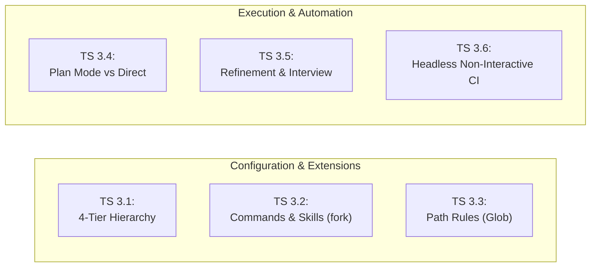
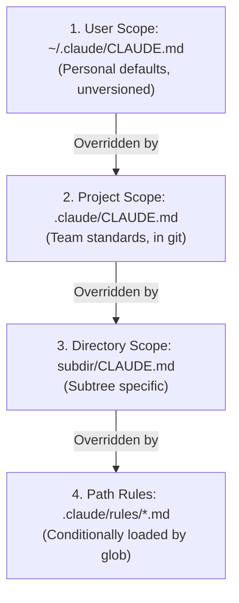
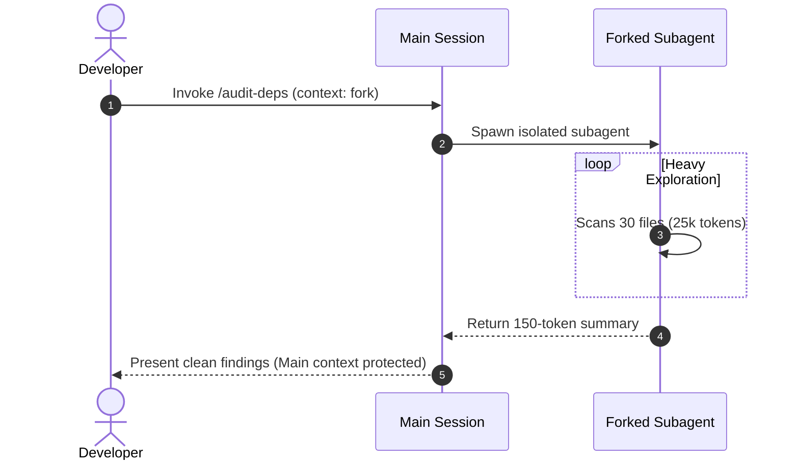
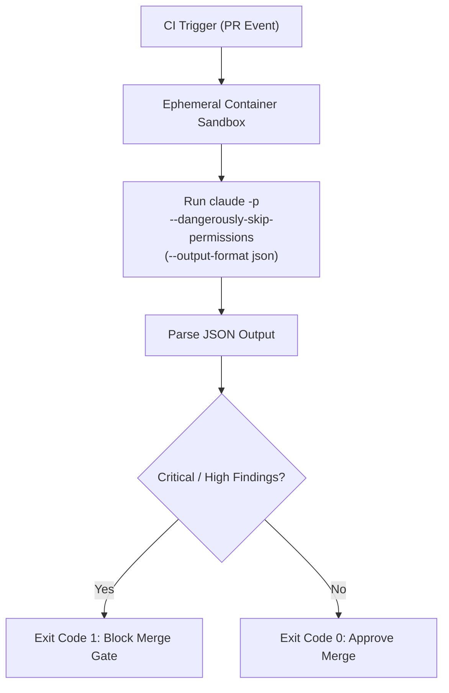
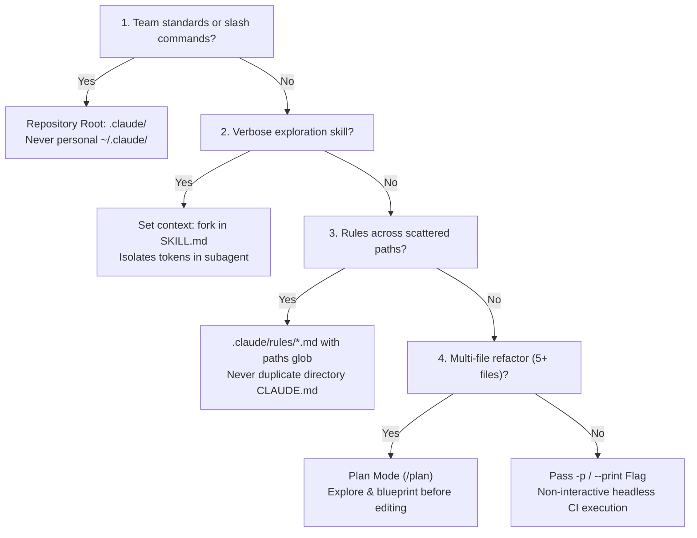

# Domain 3: Claude Code Configuration & Workflows (20% of Exam)
**Master Blueprint & Deep Architectural Guide** | **Certification Weight**: 20%

---

## 📌 Executive Architecture & Task Statement Mapping



| Task Statement | Focus Area | Deterministic Guarantee | Primary Architectural Artifact |
|---|---|---|---|
| **TS 3.1** | CLAUDE.md Hierarchy | Precedence resolution order | 4-tier configuration: User -> Project -> Subdir -> Path rules |
| **TS 3.2** | Slash Commands & Skills | Context window protection | `.claude/commands/` & `.claude/skills/` with `context: fork` |
| **TS 3.3** | Path-Specific Rules | Zero token pollution on unneeded rules | `.claude/rules/*.md` with YAML glob `paths: ["**/*.test.*"]` |
| **TS 3.4** | Plan Mode vs Direct Execution | Architectural safety & consensus | Plan mode (`/plan`, Explore subagent) vs Direct Execution |
| **TS 3.5** | Iterative Refinement | Ambiguity elimination | 2–3 I/O pairs, Interview Pattern, coupled vs isolated fixes |
| **TS 3.6** | CI/CD Pipeline Automation | Zero hanging runners & parseable PRs | `-p` / `--print` flag, `--output-format json`, `--json-schema` |

---

## 🏗️ Detailed Topic & Subtopic Explanations

### TS 3.1: Configure CLAUDE.md Files with Appropriate Hierarchy, Scoping, and Modular Organization

#### 1. The 4-Tier Configuration Resolution Hierarchy
Claude Code enforces a strict, hierarchical inheritance model when loading configuration instructions:



#### 2. Precedence and Merging Rules
Claude Code evaluates configurations using a strict precedence resolution chain:
1. **Rule of Specificity**: Deeper, more specific configurations **override** higher-level general configurations when conflicts occur.
   - User-level (`~/.claude/CLAUDE.md`) defines individual baseline preferences (editor, default aliases), but is overridden by project-level rules.
   - Project-level (`.claude/CLAUDE.md` or `./CLAUDE.md`) defines universal repository standards, committed to version control.
   - Directory-level (`<subdir>/CLAUDE.md`) governs specific subtrees (e.g., `services/billing/CLAUDE.md` specifies decimal precision rules).
   - Path-scoped rules (`.claude/rules/*.md`) apply conditionally based on glob matching and take ultimate precedence for files matching those glob patterns.
2. **Merging Behavior**: Non-conflicting guidelines across layers are concatenated and preserved in memory. Conflicting directives are resolved in favor of the most specific scope (Path > Subdirectory > Project > User).

#### 3. Modular Organization via `@import` Directives
Monolithic 2,000-line `CLAUDE.md` files waste tokens and degrade model attention on irrelevant instructions.
- Use the `@import` directive to split guidelines into modular, purpose-built files:
  ```markdown
  # Project Standards
  @import ./standards/testing.md
  @import ./standards/git-workflow.md
  @import ./standards/security.md
  ```
- **Syntax and Path Resolution**:
  - `@import <relative-path>` resolves relative to the directory of the file containing the import.
  - Claude Code detects and prevents circular imports automatically.

#### 4. Memory Diagnostics via the `/memory` Command
To verify that configurations and path-scoped rules are loading properly:
- Run `/memory` in the Claude Code interactive session.
- Displays:
  - Active loaded files (User, Project, Directory, Path rules).
  - Total token consumption of loaded rules in context.
  - Diagnostics explaining whether a specific rule was loaded or skipped based on current working directory and accessed files.

---

### TS 3.2: Create and Configure Custom Slash Commands and Skills

#### 1. Custom Slash Commands
Custom slash commands provide shortcuts for repetitive developer prompts.
- **Project Commands**: Stored in `.claude/commands/<command_name>.md`. Committed to git and available to the whole team.
- **User Commands**: Stored in `~/.claude/commands/<command_name>.md`. Personal shortcuts across repositories.
- **Parameter Substitution**:
  - `$1`, `$2`: Positional arguments passed after the command.
  - `$@`: All arguments concatenated.
  - Example (`.claude/commands/review-pr.md`):
    ```markdown
    Review pull request #$1. Run git diff against main and check for SQL injection vulnerabilities.
    ```

#### 2. Agent Skills and Frontmatter Directives
Agent skills provide packaged, multi-step autonomous capabilities located in `.claude/skills/<skill-name>/SKILL.md`.
Skills support advanced YAML frontmatter directives that control execution:
```markdown
---
name: optimize-database-queries
description: Profiles slow PostgreSQL queries and recommends indexing strategies.
context: fork
allowed-tools: ["Grep", "Glob", "Read", "execute_sql_explain"]
argument-hint: [query-log-path]
---

Analyze the slow query log provided in $1...
```

#### 3. The `context: fork` Isolation Pattern
One of the most critical architectural patterns on the certification exam:
- **The Problem**: When a skill performs extensive codebase scanning (e.g., reading 40 files, grepping 50 imports, profiling queries), it generates **20,000+ tokens of verbose tool outputs**. If run in the main conversation thread, it pollutes the context window, triggers premature context compaction, and causes attention degradation for the rest of the developer's session.
- **The Solution**: Setting `context: fork` executes the skill inside an **isolated subagent session**.
  - The subagent performs all verbose file operations in its own ephemeral buffer.
  - Upon completion, the subagent returns a concise, 200-token executive summary back to the main session.
  - The main session context remains completely clean and unpolluted.



---

### TS 3.3: Apply Path-Specific Rules for Conditional Convention Loading

#### 1. Why Path-Specific Rules Outperform Directory-Level CLAUDE.md
Directory-level `CLAUDE.md` files only apply to files contained physically within their subfolder.
In modern architectures, conventions cut across arbitrary directories:
- Unit tests are co-located alongside source code (`src/auth/auth.test.ts`, `src/billing/billing.test.ts`).
- Database migrations span multiple services.
- GraphQL schemas are distributed.

Placing a `CLAUDE.md` in every folder causes massive file duplication.

#### 2. Configuring `.claude/rules/*.md` with YAML Glob Patterns
Path-specific rules reside in `.claude/rules/` and use YAML frontmatter with `paths:` glob arrays:
```markdown
---
paths:
  - "**/*.test.ts"
  - "**/*.spec.ts"
  - "**/tests/**"
---

# Testing Standards
- All tests must use Vitest and react-testing-library.
- Never use enzyme or jest mocking utilities.
- Mock network calls exclusively using MSW (Mock Service Worker).
```

#### 3. Dynamic Context Loading
Claude Code monitors active file operations (`Read`, `Edit`, `Write`).
- When a developer asks Claude to edit `src/auth/auth.ts`, the testing rule is **not loaded**, saving valuable context tokens.
- As soon as Claude accesses `src/auth/auth.test.ts`, the rule is dynamically injected into context.

---

### TS 3.4: Determine When to Use Plan Mode vs Direct Execution

#### 1. Decision Matrix: Plan Mode vs Direct Execution

| Architectural Attribute | Plan Mode (`Shift+Tab` / `/plan`) | Direct Execution |
|---|---|---|
| **Scope of Impact** | Multi-file (5+ files), cross-service | Single-file, localized module |
| **Complexity Tier** | Architectural refactoring, schema migrations | Well-understood bug fix, syntax update |
| **Irreversibility** | High (deleting endpoints, breaking API changes) | Low (reversible localized edit) |
| **Ambiguity** | Multiple valid implementation designs | Known stack trace, straightforward solution |
| **Discovery Mechanism** | Uses **Explore subagent** for read-only mapping | Immediate file `Read` and `Edit` |
| **Execution Flow** | Formulate plan -> User Review -> Approval Gate -> Execute | Immediate execution loop |

#### 2. The Explore Subagent in Plan Mode
In Plan Mode, Claude Code leverages a dedicated **Explore subagent**:
- Traverses directory trees, checks dependency graphs, and reads interfaces.
- Operates in read-only mode (destructive write tools are locked).
- Generates a structured implementation roadmap with verified file paths and dependency order before any code is modified.

---

### TS 3.5: Apply Iterative Refinement Techniques for Progressive Improvement

#### 1. Concrete Input/Output Examples
When natural language prompt directives result in fluctuating, inconsistent outputs:
- Do not add more adjectives (*"be extremely precise, make sure it is accurate"*).
- Provide **2–3 concrete Input/Output pairs** directly demonstrating expected edge-case handling, null treatment, and transformation rules.
```markdown
<example>
Input:  {"date": "2026/10/05", "currency": "EUR", "amount": "1.250,50"}
Output: {"iso_date": "2026-10-05", "currency": "EUR", "normalized_amount": 1250.50}
</example>
```

#### 2. The Interview Pattern
When embarking on tasks in complex, ambiguous, or poorly documented codebases:
- Instruct Claude:
  ```markdown
  Before writing or modifying any code, conduct an architectural interview by asking me 3 to 5 targeted questions regarding operational constraints, backward compatibility requirements, and error recovery expectations. Await my answers before proceeding.
  ```
- Resolves latent assumptions before irreversible code modifications occur.
- Prevents rework and aligns implementation details with unspoken domain constraints.

#### 3. Interacting vs. Independent Issues
- **Interacting Issues** (e.g. changing an auth token payload while updating the router middleware and database session):
  - Must be communicated together in a **single comprehensive prompt**.
  - Allows Claude's cross-attention to resolve all shared invariants and state transitions atomically.
- **Independent Issues** (e.g. fixing a CSS padding bug on the dashboard and updating a payment retry timeout):
  - Must be addressed in **separate, sequential conversation turns**.
  - Bundling independent issues causes attention fragmentation and sloppy commits.

---

### TS 3.6: Integrate Claude Code into CI/CD Pipelines

#### 1. Headless Execution: The `-p` / `--print` Flag
In automated CI/CD runners (GitHub Actions, GitLab CI, Jenkins):
- Interactive prompts (asking the user for confirmation or input) cause the runner to **hang indefinitely on `stdin`** until the runner job times out (e.g. after 60 minutes).
- **Mandatory CI Flags**:
  ```bash
  claude -p "Review the changes in PR #$PR_ID for security vulnerabilities" \
    --dangerously-skip-permissions \
    --output-format json \
    --json-schema ./schemas/ci-review-schema.json > review_results.json
  ```
- The `-p` (or `--print`) flag runs Claude Code in headless non-interactive batch mode, executing all read-only steps and outputting results directly to `stdout`.

#### 2. Tool Permission Confirmation Bypass: `--dangerously-skip-permissions`
In interactive developer sessions, Claude Code prompts the user with terminal confirmation modals before running tools (e.g. `Read`, `Grep`, or running unit tests).
- In a headless CI runner with no attached TTY, **tool confirmation prompts cause the runner to freeze on stdin**.
- Passing `--dangerously-skip-permissions` bypasses interactive confirmation prompts, enabling fully automated tool execution.
- **Sandboxing Requirement**: Because permissions are skipped, CI jobs running Claude Code MUST execute in **ephemeral, isolated container sandboxes** (Docker/Kubernetes runners) with restricted read-only repository tokens and zero access to production databases.

#### 3. Machine-Readable Structured Output
Using `--output-format json` with `--json-schema` guarantees that Claude's review findings adhere strictly to a predefined JSON schema:
```json
{
  "summary": "Found 1 high severity vulnerability.",
  "findings": [
    {
      "severity": "HIGH",
      "file": "src/api/auth.py",
      "line": 42,
      "rule_id": "SEC-004",
      "message": "Unvalidated redirect using user-supplied URL parameter."
    }
  ]
}
```
Downstream CI steps can parse this JSON with `jq` to post automated PR comments or block merging if `findings` contains `HIGH` or `CRITICAL` severity issues.



| CI Flag / Setting | Operational Purpose in CI Runners | Failure Consequence if Omitted | Security & Sandboxing Requirement |
| :--- | :--- | :--- | :--- |
| **`-p` / `--print`** | Headless non-interactive batch mode | Runner hangs indefinitely on stdin awaiting user keystroke | Mandatory in all automated CI runner scripts |
| **`--dangerously-skip-permissions`** | Bypasses interactive terminal tool confirmation prompts | Runner freezes on stdin awaiting human approval | Mandatory ephemeral container sandbox; zero write access |
| **`--output-format json`** | Enforces machine-readable JSON on stdout | Conversational prose output breaks downstream CI parsers | Pair with `--json-schema` for deterministic schema enforcement |
| **`--json-schema <path>`** | Constrains output grammar to strict JSON schema | Output drifts into unstructured text or missing fields | Commit validation schema into repository under version control |


#### 4. Self-Review Bias Mitigation
An engineer must never instruct the same Claude session that authored a pull request to review that pull request.
- **Self-Review Bias**: The author session retains its generative context and rationalizations, making it blind to its own subtle assumptions and boundary errors.
- **Production Standard**: CI review pipelines must spawn a **completely clean, independent Claude instance** possessing zero prior conversation history from the development session.

---

## ⚡ What to Remember (Key Exam Day Rules of Thumb)

1. **Hierarchy Order**: User (`~/.claude/CLAUDE.md`) -> Project (`.claude/CLAUDE.md`) -> Directory -> Path-scoped rules.
2. **Path-Scoped Rules Use Glob Paths**: `.claude/rules/*.md` with YAML `paths: [...]` applies conditionally across multiple folders without file duplication.
3. **`context: fork` for Heavy Skills**: Always use `context: fork` in skill frontmatter when a task generates verbose discovery outputs to protect main conversation context.
4. **Plan Mode for Multi-File Refactoring**: Use Plan Mode for architectural changes and migrations touching 5+ files; use Direct Execution for isolated single-file fixes.
5. **Headless CI Requires `-p`**: Never run `claude "prompt"` in CI without `-p` (or `--print`); it will hang on terminal interactive input.
6. **Machine-Readable CI Output**: Combine `--output-format json` with `--json-schema` for deterministic CI automation.
7. **Mitigate Self-Review Bias**: Always run CI reviews in an independent Claude instance with a clean context window.
8. **`/memory` is the Inspection Command**: Use `/memory` in Claude Code to inspect loaded configurations and active context files.

---

## ⚠️ Anti-Patterns & Exam Traps

| Anti-Pattern | Exam Scenario Formulation | Real Failure Mode | Architectural Remedy |
|---|---|---|---|
| **Interactive CI Hang** | `claude "Run security review on PR #12"` in GitHub Actions. | Process hangs waiting for interactive confirmation; runner times out after 60 min. | Add `-p` (or `--print`) flag for non-interactive headless mode. |
| **Unforked Verbose Skills** | Skill reads 50 files directly in main session. | Context explodes by 30,000 tokens, triggering premature compaction and memory loss. | Add `context: fork` to skill YAML frontmatter. |
| **Subdirectory CLAUDE.md Duplication** | Creating identical `CLAUDE.md` in 15 test subdirectories. | Maintenance nightmare; rules fall out of sync across microservices. | Use single path-scoped rule in `.claude/rules/testing.md` with glob `paths: ["**/*.test.*"]`. |
| **Direct Execution for Service Decomposition** | Asking Claude in direct mode to split a monolith into 4 microservices. | Makes premature irreversible edits across 25 files; breaks build without a rollback plan. | Use Plan Mode (`/plan`) with Explore subagent review first. |
| **Self-Review PR Audit** | Resuming the developer's 40-turn authoring session to review its own code. | Self-review bias causes model to overlook its own logic errors. | Spawn independent review instance with clean context. |
| **Vague Refinement Directives** | Reprompting with "Please try harder and be more accurate." | Output changes arbitrarily without fixing the root misunderstanding. | Provide 2–3 concrete Input/Output examples or use Interview Pattern. |

---

## 🎯 Practical Scenario Questions & Answers

### Question 1: Non-Interactive CI/CD Automation
**Scenario**: A Platform Engineering team is integrating Claude Code into a GitHub Actions workflow to automatically review pull requests for hardcoded AWS credentials and SQL injection vulnerabilities. The workflow step executes:
```bash
- name: Run Claude Code Security Review
  run: |
    claude "Review all modified files in this PR for credentials and SQL injection"
```
When a pull request is submitted, the GitHub Actions job starts but stays in the "Running" state for 60 minutes until it is terminated by GitHub's timeout limit. No error message is logged.

What is the root cause and the required architectural change?

- **A)** GitHub Actions runner lacks network access to Anthropic API; configure a NAT gateway.
- **B)** Claude Code is running in interactive mode and hanging while waiting for `stdin` input; pass the `-p` (or `--print`) flag to enforce headless execution.
- **C)** The pull request contains binary files that crashed the LLM tokenizer; add `--exclude-binaries`.
- **D)** The GitHub Actions runner ran out of memory; upgrade runner to `ubuntu-latest-16-core`.

**Correct Answer**: **B**  
**Architectural Rationale**:  
Option B is correct. By default, Claude Code runs as an interactive terminal CLI that expects a human user to provide interactive confirmations and inputs via standard input (`stdin`). When executed in a headless CI/CD environment without a TTY, the process halts indefinitely waiting for terminal input, causing the CI runner to hang until reaching the job timeout. Passing the `-p` (or `--print`) flag instructs Claude Code to run non-interactively in headless mode and print results directly to `stdout`.  
- *Distractor Analysis*:  
  - Option A is incorrect because network issues produce an immediate connection timeout or socket error within seconds, not a silent 60-minute hang.  
  - Option C is incorrect because Claude Code handles file types gracefully and skips binaries automatically.  
  - Option D is incorrect because CLI processes waiting on stdin consume negligible CPU and memory.

---

### Question 2: Context Window Protection via Forked Skills
**Scenario**: An engineering organization creates a custom agent skill `/license-audit` to inspect all open-source dependencies, scan lockfiles, check AST imports, and flag GPL license violations. When developers run `/license-audit` during an active coding session, Claude scans 45 files and generates 35,000 tokens of file reading trails. Afterwards, developers notice that Claude begins forgetting recent instructions from earlier in their chat and asks repetitive questions.

How should the skill definition in `.claude/skills/license-audit/SKILL.md` be modified to prevent this context window pollution?

- **A)** Add `model: claude-3-5-haiku` to the frontmatter so the skill runs cheaper.
- **B)** Add `context: fork` to the YAML frontmatter so the skill executes in an isolated subagent conversation and returns only a concise summary to the main session.
- **C)** Delete the skill and instruct developers to run `npm audit` directly in bash.
- **D)** Increase the project `CLAUDE.md` token limit configuration to 500,000 tokens.

**Correct Answer**: **B**  
**Architectural Rationale**:  
Option B is correct. In Claude Code, the `context: fork` frontmatter directive runs the skill within a completely isolated, ephemeral subagent session. All 35,000 tokens of verbose tool execution, lockfile dumps, and dependency graphs remain confined to the subagent's temporary context. Once finished, only the concise synthesized findings (e.g. a 200-token summary table of flagged licenses) are returned to the developer's main conversation session, leaving the primary context window clean and unpolluted.  
- *Distractor Analysis*:  
  - Option A is incorrect because changing the model does not change where the tool outputs are appended; the 35,000 tokens would still flood the main context window.  
  - Option C is incorrect because `npm audit` only checks known security vulnerabilities, not license compliance across deep AST dependencies, and circumvents Claude's automated remediation.  
  - Option D is incorrect because context windows have fixed hardware/API limits and cannot be arbitrarily expanded via `CLAUDE.md`.

---

### Question 3: Path-Specific Rules for Co-Located Tests
**Scenario**: A full-stack TypeScript repository follows a co-located architecture where test files (`*.test.ts`) live in the exact same directories as production source files across 80 different feature folders. The team has strict testing rules:
1. Tests must strictly use `vi.mock` instead of `jest.mock`.
2. Every test suite must contain an accessibility test with `axe-core`.

A junior engineer proposes creating a directory-level `CLAUDE.md` in each of the 80 feature folders containing these testing rules.

What is the architecturally superior solution supported natively by Claude Code?

- **A)** Concatenate the testing rules into the root `CLAUDE.md` so they are always in context for all files.
- **B)** Create a single path-scoped rule in `.claude/rules/testing.md` with YAML frontmatter `paths: ["**/*.test.ts", "**/*.spec.ts"]`.
- **C)** Write a bash script that copies `CLAUDE.md` into all 80 directories before running Claude Code.
- **D)** Instruct developers to manually type the testing rules into their prompt whenever they write tests.

**Correct Answer**: **B**  
**Architectural Rationale**:  
Option B is correct. Claude Code provides **path-specific rules** in `.claude/rules/*.md` specifically to handle cross-cutting conventions across distributed directory structures. By using YAML glob matching (`paths: ["**/*.test.ts"]`), the rules are maintained in a single centralized file and are **dynamically loaded only when a test file is accessed**. This eliminates duplicating 80 files and prevents wasting context tokens when working on non-test source files.  
- *Distractor Analysis*:  
  - Option A is incorrect because putting testing rules into root `CLAUDE.md` permanently consumes context window tokens even when developers are doing backend SQL work or UI styling where test rules are irrelevant.  
  - Option C is incorrect because creating and maintaining 80 duplicated files is a notorious anti-pattern that leads to drift and sync failures.  
  - Option D is incorrect because relying on human manual typing is error-prone, non-deterministic, and defeats automated engineering standards.

---

### Question 4: Plan Mode vs Direct Execution Selection
**Scenario**: A legacy monolithic billing repository needs to extract its payment processing logic into an independent microservice. This refactoring requires creating 8 new files, modifying 14 existing files, altering database transaction boundaries, and updating 3 RPC client interfaces.

Which workflow pattern should the lead architect mandate for this task?

- **A)** Direct Execution: Prompt Claude to start modifying files immediately to maximize delivery velocity.
- **B)** Plan Mode: Invoke Plan Mode (`/plan`), allowing the Explore subagent to map dependencies in read-only mode and construct a comprehensive architectural roadmap for user review before making code edits.
- **C)** Automated CI Pipeline: Commit an empty branch and let a GitHub Actions bot execute the refactor headless.
- **D)** Few-shot Prompting: Provide 10 examples of microservices in the system prompt.

**Correct Answer**: **B**  
**Architectural Rationale**:  
Option B is correct. In Claude Code, **Plan Mode** is specifically architected for complex, multi-file architectural changes, microservice extractions, and high-impact refactorings. Plan Mode locks destructive write operations, utilizes an **Explore subagent** to inspect directory structures and dependency contracts safely, and produces a structured multi-step execution plan for human architectural review before any code is modified.  
- *Distractor Analysis*:  
  - Option A is incorrect because Direct Execution on a 22-file architectural migration will make premature, fragmented edits, break build states, and risk irreversible file corruption without an overarching strategy.  
  - Option C is incorrect because CI bots cannot make high-level architectural decomposition decisions without interactive human guidance.  
  - Option D is incorrect because few-shot examples do not provide the repository-specific dependency analysis necessary to decouple the monolithic service.

---

### Question 5: Eliminating Self-Review Bias in Automated Auditing
**Scenario**: A company uses Claude Code to accelerate feature development. After an engineer finishes an extensive 30-turn interactive session that implements a new OAuth2 authentication flow, the manager wants Claude to conduct a rigorous security review of the code before opening a PR. The engineer prompts Claude in the same session: *"Now review the code you just wrote and list all security vulnerabilities."* Claude replies: *"I have reviewed the implementation; all OAuth2 flows are completely secure and adhere to RFC 6749."*

Later, a human security audit discovers a critical state-parameter CSRF vulnerability in the implementation.

What architectural flaw explains why Claude missed this vulnerability, and how should it be corrected?

- **A)** Claude 3.7 Sonnet lacks training data on RFC 6749; upgrade to Claude 4.
- **B)** Self-Review Bias: The session context contains all of Claude's prior generation reasoning and design justifications, blinding it to its own assumptions. Remedy: Conduct security reviews in a separate, independent Claude session with a clean context window.
- **C)** The temperature was set to 0.7; it should be set to 1.0 for creative vulnerability discovery.
- **D)** Claude Code does not support security auditing; security checks must only be performed by static analysis tools.

**Correct Answer**: **B**  
**Architectural Rationale**:  
Option B is correct. **Self-Review Bias** is a documented failure mode in LLM agent workflows. When the same conversation session that generated code is asked to review it, the model's attention is biased by its own prior justifications, rationale, and internal consistency checks stored in the conversation history. To conduct an objective, high-precision review, the organization must spawn an **independent Claude instance with a clean context window** containing only the code diff and explicit review criteria.  
- *Distractor Analysis*:  
  - Option A is incorrect because Claude models have extensive, deep knowledge of OAuth2 and RFC 6749.  
  - Option C is incorrect because increasing temperature increases output randomness and hallucination, which is detrimental to security auditing.  
  - Option D is incorrect because Claude excels at semantic security auditing when evaluated in an independent session with explicit vulnerability rubrics.

---

### Question 6: Configuration Hierarchy Precedence & Memory Diagnostics
**Scenario**: An enterprise monorepo contains the following configuration layers:
1. Developer's personal `~/.claude/CLAUDE.md`: *"Always format Python code with 2-space indentation."*
2. Monorepo root `.claude/CLAUDE.md`: *"Universal standard: All Python files must use 4-space indentation. All tests must use pytest."*
3. `services/billing/CLAUDE.md`: *"In the billing service, all financial calculations must use Python decimal.Decimal, never float."*
4. `.claude/rules/testing.md` with frontmatter `paths: ["services/billing/tests/**"]`: *"Mock external bank APIs exclusively with responses library."*

A developer opens Claude Code in `services/billing/tests/test_invoicing.py`. Claude formats the file using 4-space indentation, applies `decimal.Decimal`, and uses the `responses` library. The developer wants to verify which configuration files were loaded and inspect their token impact on context.

Which command inspects this configuration trail, and which precedence rule explains the indentation resolution?

- **A)** Command: `/config list`. Indentation is 4 spaces because user-level settings always override project settings.
- **B)** Command: `/memory`. Indentation is 4 spaces because project-level `.claude/CLAUDE.md` overrides user-level `~/.claude/CLAUDE.md`, and path-scoped rules take highest precedence for matching test files.
- **C)** Command: `/debug context`. Indentation is 4 spaces because Claude randomly selects between user and project rules.
- **D)** Command: `cat .claude.json`. Indentation is 4 spaces because JSON files are loaded last.

**Correct Answer**: **B**  
**Architectural Rationale**:  
Option B is correct. In Claude Code (TS 3.1):  
1. The **`/memory`** command is the official diagnostic tool used to inspect loaded `CLAUDE.md` files, modular `@import` chains, path-scoped rules, and active token consumption.  
2. Under the 4-tier hierarchy precedence rules, project-level configurations (`.claude/CLAUDE.md`) strictly **override** user-level defaults (`~/.claude/CLAUDE.md`), preventing individual developer machine preferences from violating committed team repository standards. Furthermore, path-scoped rules (`.claude/rules/*.md`) apply specific localized overrides on matching file patterns (`services/billing/tests/**`).  
- *Distractor Analysis*:  
  - Option A is incorrect because `/config list` does not show loaded contextual memory files, and user settings do not override project repository standards.  
  - Option C is incorrect because rule resolution is fully deterministic based on specificity, not random.  
  - Option D is incorrect because `.claude.json` is an MCP server configuration file, not the instruction memory file.

---

### Question 7: Iterative Refinement & Interacting Issue Decomposition
**Scenario**: You are modernizing a legacy subscription billing engine. You must implement a feature where customers can change their subscription renewal billing currency. This requires three coordinated updates:
1. Database Schema: Add `billing_currency` (ISO-4217) and `fx_rate_locked` columns to the `subscriptions` table.
2. Payment Gateway Interface: Update `charge_customer` to pass the newly added currency code and conversion rate.
3. Invoicing Service: Update invoice generation logic to render monetary symbols and tax amounts in the selected currency.

An engineer attempts to delegate these tasks to Claude Code by issuing three independent, isolated prompts across consecutive turns without providing context on the other services. On turn 2, Claude generates a patch for the payment gateway that assumes `fx_rate` is a float, while the database migration authored in turn 1 created `fx_rate_locked` as a string, causing a fatal type mismatch and broken build.

What iterative refinement technique resolves this architectural breakdown?

- **A)** Run the three prompts simultaneously across 3 separate terminal tabs.
- **B)** Apply the principle of **Interacting Issues**: Coupled changes that share state transitions, database columns, and API contracts must be specified together in a single comprehensive prompt, optionally using the **Interview Pattern** first to clarify contract types and migration sequencing before code edits occur.
- **C)** Increase temperature to 1.0 to encourage Claude to guess the database types correctly.
- **D)** Use Message Batches API to execute all three tasks overnight.

**Correct Answer**: **B**  
**Architectural Rationale**:  
Option B is correct. In TS 3.5 (Iterative Refinement), a core architectural rule governs problem decomposition:  
- **Independent issues** (e.g., updating a button color and fixing an unrelated backend timeout) should be handled in separate turns to avoid attention fragmentation.  
- **Interacting / coupled issues** (e.g., database schema changes that directly feed API client calls and invoicing services) **must be specified together in a single prompt**. Splitting coupled changes across turns forces Claude to make blind, ungrounded assumptions in turn 2 about what was decided in turn 1, leading to interface mismatches. Preceding the work with the **Interview Pattern** allows Claude to proactively clarify type definitions (`decimal` vs `float` vs `string`) before generating code.  
- *Distractor Analysis*:  
  - Option A is incorrect because running 3 uncoordinated terminal sessions guarantees race conditions and git merge conflicts.  
  - Option C is incorrect because increasing temperature increases randomness, worsening type errors.  
  - Option D is incorrect because Message Batches API runs offline without interactivity and does not coordinate interdependent code modifications.

---

## ⚡ Exam Rules, Golden Architectural Rules & Anti-Patterns Reference

### 📋 CCAR-F Exam Rules & Scope Boundaries for Domain 3

| Aspect | In-Scope Exam Focus | Out-of-Scope Distractor (Do Not Choose) |
|---|---|---|
| **CLAUDE.md Hierarchy** | Enterprise > User (`~/.claude/CLAUDE.md`) > Project (`.claude/CLAUDE.md`) > Directory > Path rules. | Storing team repo standards in user home directories; using unversioned files for CI. |
| **Modular Rules** | `@import ./path/to/rule.md` syntax for modular organization; `.claude/rules/` directory. | Creating single monolithic 2,000-line CLAUDE.md files that load unconditionally. |
| **Configuration Inspection** | The `/memory` slash command to inspect loaded memory, active rules, and token usage. | Running non-existent commands like `/config list` or inspect raw binary caches. |
| **Custom Slash Commands** | Project-scoped in `.claude/commands/*.md` (git-shared); user-scoped in `~/.claude/commands/`. | Hardcoding commands in CLAUDE.md text or relying on manual prompt copy-pasting. |
| **Agent Skills Frontmatter** | YAML frontmatter: `context: fork`, `allowed-tools`, and `argument-hint`. | Running verbose exploration skills in main session without `context: fork`. |
| **Path-Scoped Rules** | `.claude/rules/*.md` with YAML `paths: ["**/*.test.ts"]` for multi-directory glob matches. | Duplicating identical CLAUDE.md files in 50 separate unit test subdirectories. |
| **Execution Mode Selection** | Plan Mode (`/plan`) for multi-file migrations (5+ files), microservices; Direct for single-file fixes. | Direct execution on multi-service architecture changes without explore/plan phase. |
| **Iterative Refinement** | 2–3 concrete I/O examples; Test-Driven Iteration; The Interview Pattern (clarifying questions). | Vague abstract adjectives ("make it clean"); guessing requirements blindly. |
| **Coupled Changes** | Interacting issues provided in a single prompt; independent issues addressed sequentially. | Splitting coupled DB schema + API client changes across separate ungrounded turns. |
| **CI/CD Execution** | Mandatory `-p` (or `--print`) flag for non-interactive execution; `--output-format json` + `--json-schema`. | Relying on stdin redirection (`< /dev/null`) or non-existent flags (`CLAUDE_HEADLESS`). |
| **Self-Review Mitigation** | Spawning a second independent Claude instance with clean context to review generated code. | Having the generating Claude session review its own pull request code. |

---

### 🏆 The 8 Golden Architectural Rules of Domain 3

1. **Project-Scoped Hierarchy Governs Team Consistency (`TS 3.1`)**:  
   Instructions in project-level `.claude/CLAUDE.md` and `.claude/rules/` override user-level `~/.claude/CLAUDE.md`. Universal team standards, build scripts, and linting rules must be version-controlled in the repository so all developers and CI pipelines share identical standards.
2. **The `/memory` Command is the Official Audit Standard (`TS 3.1`)**:  
   Use `/memory` as the authoritative command to inspect active memory files, verify `@import` hierarchy resolution, and diagnose instruction conflicts across sessions.
3. **Isolate Verbose Skills with `context: fork` (`TS 3.2`)**:  
   Skills that generate verbose exploratory logs (code audits, test runs, AST parsing) **must declare `context: fork`** in their YAML frontmatter. This executes the skill inside an ephemeral subagent, returning only a compact summary to the main conversation window.
4. **Path-Scoped Rules Eliminate Token Bloat (`TS 3.3`)**:  
   Use `.claude/rules/*.md` with `paths: ["pattern"]` for conventions that apply across distributed folders (e.g. `**/*.test.tsx`). Path-scoped rules load conditionally only when matching files are edited, preserving 30,000+ tokens compared to monolithic configurations.
5. **Blast-Radius Mode Gating: Plan Mode vs Direct Execution (`TS 3.4`)**:  
   Enter **Plan Mode** (`Shift+Tab`, `/plan`) for tasks with high blast radius: microservice extractions, multi-file refactors (5+ files), and irreversible schema shifts. Reserve **Direct Execution** strictly for localized, well-scoped single-file changes with clear stack traces.
6. **The Interview Pattern for Ambiguity Resolution (`TS 3.5`)**:  
   When a task has multiple valid architectural paths or underspecified requirements, instruct Claude to ask 3–5 clarifying questions with concrete options *before* writing code. Never allow the agent to guess architectural choices.
7. **Atomic Specification for Interacting Issues (`TS 3.5`)**:  
   Interacting code modifications sharing state, schema columns, or API contracts **must be specified together in a single prompt turn**. Splitting coupled changes across turns forces downstream turns to make blind assumptions, leading to broken contracts.
8. **Headless CI Automation & Clean Review Instances (`TS 3.6`)**:  
   In CI/CD pipelines, **always pass the `-p` (or `--print`) flag** to prevent runner hangs on interactive stdin, and pair with `--output-format json` and `--json-schema`. To prevent **self-review bias**, always spawn a fresh, independent Claude review instance rather than asking the generating session to audit its own code.

---

### 🚫 Architectural Anti-Patterns to Reject in Domain 3 (Exam Distractor Teardown)

| Anti-Pattern | The Exam Distractor Trap (Why Candidates Pick It) | Fatal Production Consequence | Correct Architectural Solution |
|---|---|---|---|
| **Personal Config for Team Standards** | Placing company coding standards in `~/.claude/CLAUDE.md` because it's already set up. | New hires and CI runners don't have the user's home directory config, causing severe build inconsistencies. | Commit project standards to `.claude/CLAUDE.md` or root `CLAUDE.md` in git repository. |
| **Monolithic 2,000-Line CLAUDE.md** | Putting all backend, frontend, database, and devops rules into a single root file. | Floods context on every single query, wasting tokens, raising costs, and diluting model attention. | Split into modular files using `@import` and path-scoped rules in `.claude/rules/*.md`. |
| **Executing Verbose Skills in Main Context** | Running codebase-wide grep/find skills directly without subagent isolation. | Ingests 20,000+ tokens of raw file paths and noise into the main conversation, exhausting token limits. | Configure `context: fork` in `SKILL.md` frontmatter to run skill in an isolated subagent. |
| **Directory Rule Duplication** | Creating identical `CLAUDE.md` files in 40 separate test directories across the repo. | Impossible to maintain; updating a testing standard requires editing 40 separate files. | Create a single `.claude/rules/testing.md` with frontmatter `paths: ["**/*.test.*"]`. |
| **Direct Execution on Monolith Restructuring** | Jumping straight into coding a microservice split without preliminary exploration. | Claude makes irreversible edits across dozens of files, resulting in syntax breakage, circular dependencies, and costly rework. | Enter Plan Mode (`/plan`), explore dependencies safely, generate a blueprint, and obtain approval before editing. |
| **Guessing Technology Choices on Ambiguity** | When a user says "Add caching", Claude immediately generates a Redis client. | Project may use Memcached, DynamoDB DAX, or in-memory LRU; incorrect guess requires full rewrite. | Trigger the Interview Pattern: ask 3–5 clarifying questions with concrete technology options. |
| **Splitting Coupled Changes Across Turns** | Prompting Turn 1: "Add column to DB", Turn 2: "Update API handler", Turn 3: "Update UI". | Turn 2 does not know the exact column type chosen in Turn 1, producing type errors and broken builds. | Group interacting issues into a single prompt turn with concrete input/output contracts. |
| **Running Claude in CI Without `-p`** | Running `claude "audit PR"` in a GitHub Action or GitLab CI pipeline script. | Claude launches interactive terminal UI waiting for user keystrokes; CI runner hangs until timeout (6 hours). | Pass `-p` (or `--print`) flag: `claude -p "audit PR" --output-format json`. |
| **Author Self-Review Bias** | Asking the same Claude session that wrote a pull request to review the pull request. | The session retains its generative reasoning context and rationalizes its own bugs and hallucinations. | Spawn a separate, independent Claude instance with a clean context to perform an objective review. |

---

### 🧠 Domain 3 Rapid Decision Matrix for Scenario Questions



| Question Trigger / Condition | Decision Branch | Architectural Action & Distractor Rule |
| :--- | :---: | :--- |
| **Team-wide slash commands or build standards location?** | **YES** | Store in repository: `.claude/commands/` and `.claude/CLAUDE.md` *(NEVER user home `~/.claude/`)*. |
| **Prevent verbose exploration skill from polluting session?** | **YES** | Configure `context: fork` in `SKILL.md` frontmatter *(NEVER run directly in main session)*. |
| **Apply conventions to test files across 50+ packages?** | **YES** | Create `.claude/rules/testing.md` with `paths: ["**/*.test.*"]` *(NEVER duplicate `CLAUDE.md`)*. |
| **Restructuring monolith across 40+ files?** | **YES** | Enter **Plan Mode** (`/plan`) to explore and blueprint before editing *(NEVER Direct Execution)*. |
| **CI runner hangs indefinitely on Claude invocation?** | **YES** | Pass `-p` (or `--print`) non-interactive flag with `--output-format json`. |


