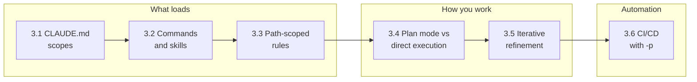
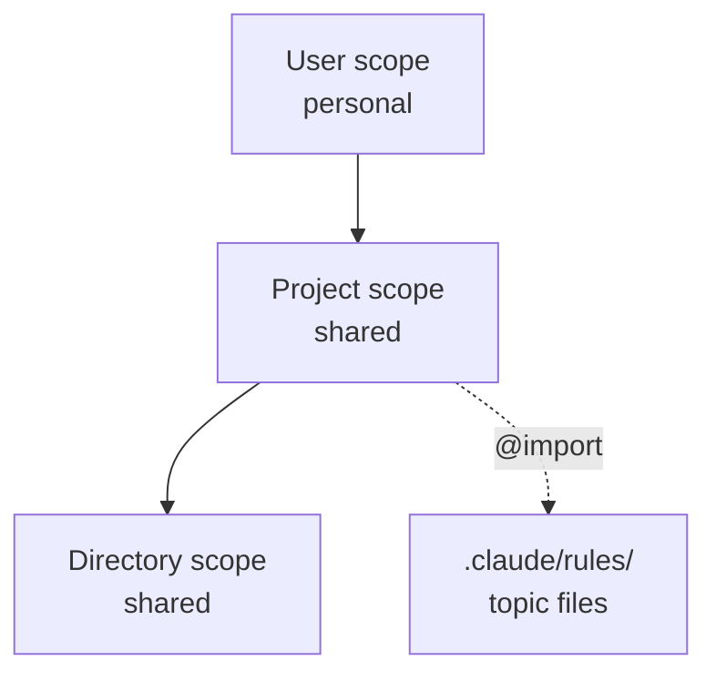
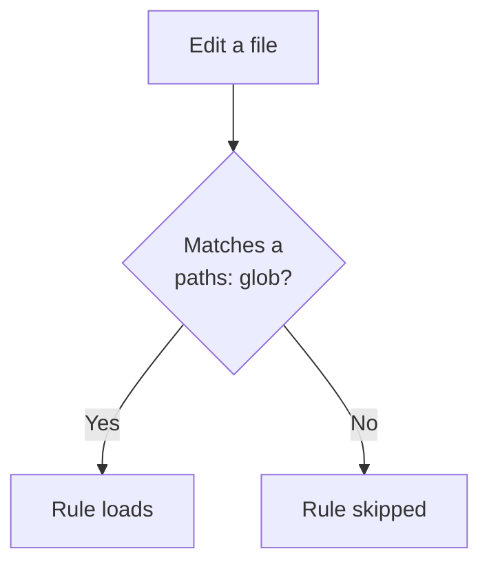
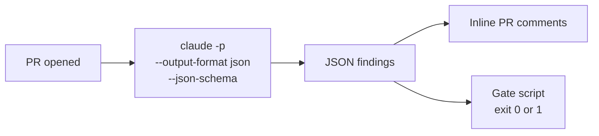

# Domain 3 Key Concepts: Claude Code Configuration & Workflows

**Weight**: 20% of the exam (D1 27%, D2 18%, D3 20%, D4 20%, D5 15%). Start with the [Domain 3 README](README.md) for the study order, then use this page as a one-page reference.

## Map

| TS | One-line summary | Key trap | Guide |
|---|---|---|---|
| 3.1 | User file is personal; project and directory files are shared | Team rules in `~/.claude/CLAUDE.md` | [3.1](ts_3_1_claude_code_workflows/README.md) |
| 3.2 | Commands in `.claude/commands/` are shared; skills use `context: fork` | Team command in `~/.claude/commands/` | [3.2](ts_3_2_slash_commands_and_skills/README.md) |
| 3.3 | `paths:` globs load a rule only for matching files | `CLAUDE.md` in every directory | [3.3](ts_3_3_path_specific_rules/README.md) |
| 3.4 | Plan mode for big, direct execution for small | Direct execution for a monolith split | [3.4](ts_3_4_plan_mode_and_refinement/README.md) |
| 3.5 | Examples, tests first, interview, batch interacting issues | Adjectives instead of examples | [3.5](ts_3_5_iterative_refinement_interview/README.md) |
| 3.6 | `-p`, JSON output with schema, independent review | `CLAUDE_HEADLESS`, `--batch` | [3.6](ts_3_6_cicd_pipeline_automation/README.md) |

## TS 3.1: CLAUDE.md Hierarchy

- **User** `~/.claude/CLAUDE.md`: personal, **not** shared via version control.
- **Project** `./CLAUDE.md` or `.claude/CLAUDE.md`: shared. **Directory** `<subdir>/CLAUDE.md`: shared, for that subtree.
- **Modularity**: `@import`, and topic files in `.claude/rules/` (`testing.md`, `api-conventions.md`, `deployment.md`).
- **Diagnosis**: a new teammate misses instructions means they sit in user-level config. `/memory` shows loaded memory files.

## TS 3.2: Commands and Skills

- Project-scoped command: `.claude/commands/`. User-scoped command: `~/.claude/commands/`.
- Skill: `.claude/skills/<name>/SKILL.md` with `context: fork`, `allowed-tools`, `argument-hint`.
- `context: fork` keeps verbose output out of the main conversation; only a summary returns.
- Personal skill variants: `~/.claude/skills/` with a different name.
- Skills are on-demand workflows; CLAUDE.md is always-loaded universal standards.

## TS 3.3: Path-Scoped Rules

- `.claude/rules/*.md` with `paths:` globs, for example `["terraform/**/*"]` or `"**/*.test.tsx"`.
- Loads only when editing matching files, which saves tokens.
- Best for conventions spread across directories (tests beside code). A rule without `paths:` always loads.

## TS 3.4: Plan Mode vs Direct Execution

- Plan mode: large, multi-file, architectural, or several valid approaches (monolith to microservices).
- Direct execution: small and well-scoped (single-file fix with stack trace, one validation).
- Explore subagent isolates verbose discovery and returns a summary.
- Hybrid: plan mode to investigate, direct execution to implement.

## TS 3.5: Iterative Refinement

- 2-3 concrete input/output examples when prose is read inconsistently.
- Tests first, then share failures.
- Interview pattern: Claude asks first (for example about cache invalidation).
- One message for interacting problems; sequential messages for independent ones.

## TS 3.6: CI/CD

- `-p` / `--print` for non-interactive runs. A hanging job needs `-p`. `CLAUDE_HEADLESS` and `--batch` do not exist.
- `--output-format json` with `--json-schema` gives findings a script can post as inline PR comments.
- `CLAUDE.md` supplies testing standards, fixtures and review criteria to CI.
- Independent review instance; on re-runs include prior findings and ask for only new or unaddressed issues; give existing tests when generating tests.
- Message Batches API fits overnight jobs, not blocking pre-merge checks (see Domain 4, TS 4.5, in the [Domain 4 README](../domain4/README.md)).

## Anti-Patterns

| Anti-pattern | Fix |
|---|---|
| Team rules in `~/.claude/CLAUDE.md` | Move to project level |
| Giant root `CLAUDE.md` | Split into `.claude/rules/` topic files and `@import` |
| Noisy skill run inline | `context: fork` |
| Duplicate `CLAUDE.md` per folder | One path-scoped rule |
| Plan mode for a typo, direct execution for a re-architecture | Match mode to scope |
| Vague "try harder" feedback | Examples, tests, interview |
| `claude "..."` in CI | Add `-p` |
| Self-review in the authoring session | Independent instance |

## Study Practice

Each task statement README has 3 scenario questions with per-option explanations, a 5-item self-check and a memory hook. Memory hooks:

1. Home folder is private; the repo is shared.
2. Team shortcut in the repo, personal shortcut at home, noisy work in a fork.
3. Same pattern in many places means a glob rule.
4. Big or unclear: plan first. Small and clear: just do it.
5. Show examples, share failing tests, ask before building.
6. -p to run it, JSON to read it, a fresh reviewer to trust it.
