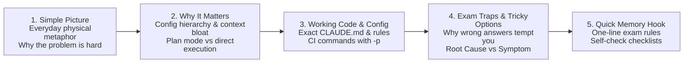
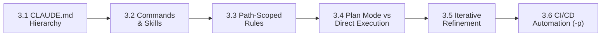

# Domain 3: Claude Code Configuration & Workflows (20% of the Exam)

Domain 3 represents **20%** of the **Claude Certified Architect – Foundations (CCAR-F)** exam (~12 of 60 questions). It is heavily tested in Scenario 2 (Code Generation) and Scenario 5 (Continuous Integration). Exam weights: D1 27%, D2 18%, **D3 20%**, D4 20%, D5 15%.

> 📖 Master Deep Dive: [KEY_CONCEPTS.md](KEY_CONCEPTS.md) contains full architectural notes, configuration files, and CI pipeline scripts.
> 
> ⚡ Quick Cram: [CHEATSHEET.md](CHEATSHEET.md) (question stems to answers, look-alike pairs, exact values, elimination filters).

---

## 🧠 How to Master Domain 3 (5 Clear Steps)

$$\text{1. Simple Picture} \longrightarrow \text{2. Why It Matters (The Architecture)} \longrightarrow \text{3. Working Code / Schema} \longrightarrow \text{4. Exam Traps \& Wrong Answers} \longrightarrow \text{5. Memory Hook}$$



---

## 🏛️ Everyday Metaphors: Foundational Mental Models

| Task Statement | Topic | Everyday Physical Metaphor | Why Naive Approaches Fail | Correct Architectural Pattern |
| :--- | :--- | :--- | :--- | :--- |
| **TS 3.1** | **CLAUDE.md Hierarchy** | **Company Handbook vs Team Board** | Putting team coding rules on your personal laptop handbook means no teammate or CI runner sees them. | **Project-Level Scoping**: Commit `.claude/CLAUDE.md` to git; keep it < 200 lines and use `@import` ([TS 3.1](ts_3_1_claude_code_workflows/main.py)). |
| **TS 3.2** | **Commands & Skills** | **Specialist Subcontractor** | Having a subcontractor make a mess in the living room ruins the house; working in a sandbox keeps it clean. | **Skills with `context: fork`**: Execute noisy discovery in an isolated subagent sandbox ([TS 3.2](ts_3_2_slash_commands_and_skills/main.py)). |
| **TS 3.3** | **Path-Specific Rules** | **PPE in Cleanrooms vs Construction** | Wearing a sterile gown on a construction site is silly; hard hat rules shouldn't apply in the office. | **Path-Scoped Rules**: `.claude/rules/*.md` with YAML `paths:` globs load only when editing matching files ([TS 3.3](ts_3_3_path_specific_rules/main.py)). |
| **TS 3.4** | **Plan Mode vs Direct** | **Architectural Blueprint vs Spackling** | Knocking down walls without blueprints causes structural collapse; drafting blueprints to spackle one nail hole is slow. | **Plan Mode for 10+ Files**: Explore dependencies before editing; Direct Execution for small bug fixes ([TS 3.4](ts_3_4_plan_mode_and_refinement/main.py)). |
| **TS 3.5** | **Iterative Refinement** | **Tailor Fitting a Suit** | Telling the tailor "make it look nice" produces a baggy suit; giving 2–3 precise measurements fits perfectly. | **2–3 Concrete Examples & Interview**: Provide I/O pairs; let Claude interview you to uncover hidden requirements ([TS 3.5](ts_3_5_iterative_refinement_interview/main.py)). |
| **TS 3.6** | **CI/CD Automation** | **Automated Factory Robot** | A robot on an automated line that freezes waiting for a human keyboard halts the whole factory. | **Non-Interactive `-p` Flag**: Run `claude -p "..." --output-format json` to eliminate stdin hangs ([TS 3.6](ts_3_6_cicd_pipeline_automation/main.py)). |

---

## 🗺️ Study-Order Map

Learn what configuration loads first (3.1 to 3.3), then how you interact (3.4, 3.5), then how you automate in CI/CD (3.6):



---

## 📋 Task Statements at a Glance

| TS | Study Guide | Core Architectural Focus | Key Exam Trap to Avoid |
|---|---|---|---|
| **3.1** | [README](ts_3_1_claude_code_workflows/README.md) | `CLAUDE.md` hierarchy (User `~/.claude/` vs Project `.claude/`), `@import` modularity, `/memory`. | Storing shared team conventions in personal `~/.claude/CLAUDE.md` (not in Git). |
| **3.2** | [README](ts_3_2_slash_commands_and_skills/README.md) | Project `.claude/commands/`, `SKILL.md` frontmatter (`context: fork`, `allowed-tools`, `argument-hint`). | Running noisy discovery skills in the primary session context without `context: fork`. |
| **3.3** | [README](ts_3_3_path_specific_rules/README.md) | YAML frontmatter `paths: [...]` glob patterns; conditional loading on file match to save context. | Creating a `CLAUDE.md` in every directory for files scattered across folders (e.g. `**/*.test.tsx`). |
| **3.4** | [README](ts_3_4_plan_mode_and_refinement/README.md) | Plan mode for architectural/multi-file refactors (10+ files); Direct execution for single-file fixes. | Entering Plan Mode for trivial single-file bug fixes with known stack traces. |
| **3.5** | [README](ts_3_5_iterative_refinement_interview/README.md) | 2–3 concrete I/O examples; test-driven iteration; Interview Pattern for surfacing hidden requirements. | Giving vague prose instructions ("make it faster") instead of concrete input/output examples. |
| **3.6** | [README](ts_3_6_cicd_pipeline_automation/README.md) | Non-interactive `-p` / `--print` flag; `--output-format json`; `--json-schema`; independent review instance. | Running `claude` in automated CI scripts without `-p` (hangs runner waiting for stdin). |

---

## ⚡ Domain 3 Golden Rules

1. **Scope Decides Who Gets the Configuration (3.1)**:  
   Team standards go in project-level files under version control (`./CLAUDE.md`, `.claude/`). Personal preferences go in `~/.claude/`. A rule left in a user-level file never reaches teammates or CI. Keep `CLAUDE.md` < 200 lines; use `@import` to modularize, and verify with `/memory`.
2. **Always-On vs On-Demand (3.1, 3.2)**:  
   `CLAUDE.md` holds short standards needed in every turn. Procedures used occasionally belong in a skill (`SKILL.md`), so they consume zero context until invoked.
3. **Shared Commands Live in the Project (3.2)**:  
   `.claude/commands/` is committed to the repository. `~/.claude/commands/` is personal. To customize a team skill, create a personal variant under `~/.claude/skills/` with a different name instead of editing the team copy.
4. **Isolate Noisy Work with `context: fork` (3.2)**:  
   A skill configured with `context: fork` runs in its own isolated subagent context and returns only the final summary, preventing token bloat in the main session. Restrict write tools with `allowed-tools`.
5. **Use Path-Scoped Rules for Cross-Folder Patterns (3.3)**:  
   A `.claude/rules/*.md` file with `paths:` globs (e.g. `**/*.test.tsx`) loads only when matching files are edited. This cleanly manages conventions for files scattered across 30 directories without bloating non-test files.
6. **Plan First When Scope Is Large (3.4)**:  
   Plan Mode fits multi-file, architectural, or ambiguous changes (a monolith split, a database migration). Direct Execution fits small, well-understood fixes like a bug with a known stack trace.
7. **Show, Do Not Tell, When Refining (3.5)**:  
   Two or three concrete input/output examples beat vague directives like "be more precise". Write unit tests first and iterate on failures. Let Claude interview you with multiple-choice options to clarify unstated requirements.
8. **CI Needs Non-Interactive, Structured, Independent Runs (3.6)**:  
   Pass `-p` (`--print`) so the CI job never freezes waiting for stdin. Pass `--output-format json` with `--json-schema` for machine-parseable findings. Review PRs using an independent Claude instance, never the authoring session. Note: `CLAUDE_HEADLESS` and `--batch` do not exist.

---

## 🛠️ Offline Verification & Test Commands

All Domain 3 exercises and simulations execute 100% offline:

```bash
# Run all Domain 3 offline tests:
uv run pytest tests/test_new_task_statements.py -k "ts32 or ts33 or ts35 or ts36" -q
```

---

## 🧭 Navigation & Study Links
- ⬅️ **Previous Domain**: [Domain 2: Tool Design & Model Context Protocol (MCP)](../domain2/README.md)
- 📋 **Exam Blueprint**: [5-Domain Blueprint Matrix](../EXAM_BLUEPRINT.md)
- ⚡ **Exam Refresher**: [Core Architectural Rules & Cheatsheet](../EXAM_REFRESHER.md)
- ➡️ **Next Domain**: [Domain 4: Prompt Engineering & Model Guidance](../domain4/README.md)
- 🎯 **Scenario Practice**: [Master Scenario Practice](../scenarios/MASTER_SCENARIO_PRACTICE.md)
