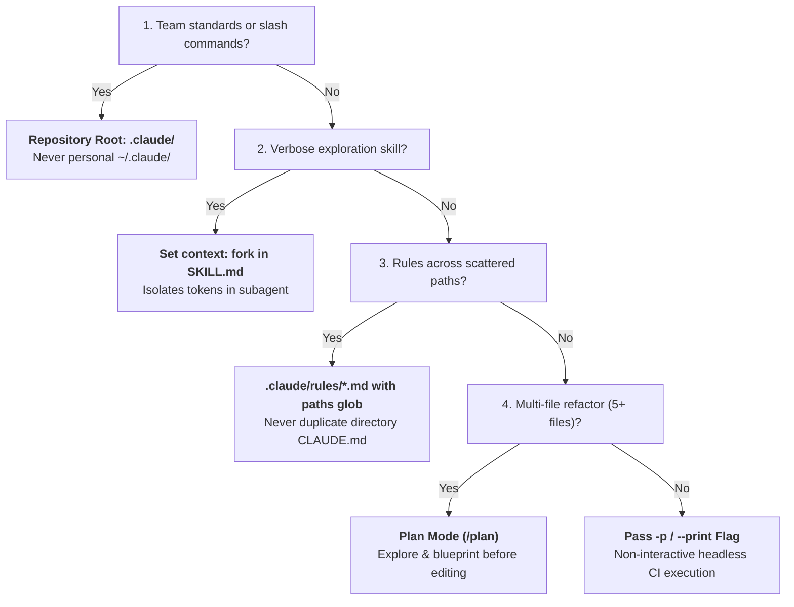

# Domain 3: Claude Code Configuration & Workflows (20% of Exam)

Domain 3 represents 20% of the **Claude Certified Architect – Foundations (CCAR-F)** exam. It tests configuring Claude Code for engineering teams, mastering the CLAUDE.md hierarchy, custom slash commands, agent skills with `context: fork`, path-specific rules, Plan Mode vs Direct Execution, and headless CI/CD pipeline automation.

> 📖 **Deep Dive Master Guide**: For exhaustive technical explanations, architecture diagrams, sequence flows, gotchas, to-remember points, and practical scenario questions & answers, see [KEY_CONCEPTS.md](KEY_CONCEPTS.md).

---

## 📋 Task Statements & Core Architectural Principles

### [TS 3.1: Configure CLAUDE.md Files with Appropriate Hierarchy, Scoping, and Modular Organization](ts_3_1_claude_code_workflows/main.py)
- **4-Tier Hierarchy Order**: User-level (`~/.claude/CLAUDE.md`) -> Project-level (root `CLAUDE.md` or `.claude/CLAUDE.md`) -> Directory-level (`<subdir>/CLAUDE.md`) -> Path-scoped rules (`.claude/rules/*.md`).
- **Scoping Principle**: User-level is personal and uncommitted; project-level is team-shared via git.
- **Modular Rules**: Use `@import ./path/to/rules.md` to avoid monolithic files.
- **Diagnostics**: Run `/memory` in Claude Code to inspect currently loaded configurations and active instructions.
- **Reference Exercise**: [ts_3_1_claude_code_workflows/](ts_3_1_claude_code_workflows/)

### [TS 3.2: Create and Configure Custom Slash Commands and Skills](ts_3_2_slash_commands_and_skills/main.py)
- **Custom Slash Commands**: `.claude/commands/*.md` with parameter substitution (`$1`, `$2`, `$@`).
- **Agent Skills**: `.claude/skills/<name>/SKILL.md` with YAML frontmatter.
- **The `context: fork` Directives**: Executes the skill inside an isolated subagent conversation, preventing verbose exploratory tool trails (20,000+ tokens) from polluting the main session context.
- **Additional Directives**: `allowed-tools` (least privilege whitelist) and `argument-hint`.
- **Reference Exercise**: [ts_3_2_slash_commands_and_skills/](ts_3_2_slash_commands_and_skills/)

### [TS 3.3: Apply Path-Specific Rules for Conditional Convention Loading](ts_3_3_path_specific_rules/main.py)
- **Glob Scoping**: YAML frontmatter `paths: ["**/*.test.ts"]` or `paths: ["src/api/**/*.py"]` in `.claude/rules/*.md`.
- **Advantage Over Directory CLAUDE.md**: Applies conventions across distributed files in arbitrary folders (co-located tests, migrations) without duplicating configuration files.
- **Dynamic Context Loading**: Rules load into context only when matching files are accessed.
- **Reference Exercise**: [ts_3_3_path_specific_rules/](ts_3_3_path_specific_rules/)

### [TS 3.4: Determine When to Use Plan Mode vs Direct Execution](ts_3_4_plan_mode_and_refinement/main.py)
- **Plan Mode (`Shift+Tab` / `/plan`)**: Architectural changes, service decomposition, multi-file refactoring (5+ files), and irreversible schema shifts. Uses read-only **Explore subagent** and human approval gates.
- **Direct Execution**: Localized, well-understood single-file fixes with known stack traces.
- **Reference Exercise**: [ts_3_4_plan_mode_and_refinement/](ts_3_4_plan_mode_and_refinement/)

### [TS 3.5: Apply Iterative Refinement Techniques for Progressive Improvement](ts_3_5_iterative_refinement_interview/main.py)
- **Concrete I/O Examples**: 2–3 concrete input/output pairs resolve ambiguity far better than abstract adjectives.
- **Interview Pattern**: Instruct Claude to ask 3–5 clarifying questions before writing code in complex or ambiguous domains.
- **Coupled vs Decoupled Issues**: Address interacting issues together in a single prompt; address independent issues sequentially.
- **Reference Exercise**: [ts_3_5_iterative_refinement_interview/](ts_3_5_iterative_refinement_interview/)

### [TS 3.6: Integrate Claude Code into CI/CD Pipelines](ts_3_6_cicd_pipeline_automation/main.py)
- **Headless Non-Interactive Mode**: Passing `-p` (or `--print`) is mandatory in CI/CD to prevent runners from hanging indefinitely on `stdin`.
- **Machine-Readable Output**: Combine `--output-format json` with `--json-schema` for deterministic PR gating and automated comments.
- **Mitigating Self-Review Bias**: Never use the generating session to review its own PR; spawn an independent Claude instance with a clean context.
- **Reference Exercise**: [ts_3_6_cicd_pipeline_automation/](ts_3_6_cicd_pipeline_automation/)

---

## 🛠️ Hands-on Exercises in this Domain
- `ts_3_1_claude_code_workflows/`: CLAUDE.md hierarchy resolution, precedence merging, and `@import`.
- `ts_3_2_slash_commands_and_skills/`: Custom slash commands and `context: fork` subagent skills.
- `ts_3_3_path_specific_rules/`: Path-scoped rules with glob matching in `.claude/rules/`.
- `ts_3_4_plan_mode_and_refinement/`: Plan Mode exploration, dependency analysis, and execution gates.
- `ts_3_5_iterative_refinement_interview/`: The Interview Pattern and concrete I/O refinement pairs.
- `ts_3_6_cicd_pipeline_automation/`: Headless CI execution, JSON schema validation, and self-review mitigation.

---

## ⚡ Domain 3 Exam Rules, Golden Architectural Rules & Anti-Patterns Reference

### 📋 CCAR-F Exam Rules & Scope Boundaries for Domain 3

| Aspect | In-Scope Exam Focus (Official Syllabus) | Out-of-Scope Distractor (Do Not Choose on Exam) |
|---|---|---|
| **Configuration Hierarchy** | User-level (`~/.claude/CLAUDE.md`) $\rightarrow$ Project-level (root or `.claude/CLAUDE.md`) $\rightarrow$ Subdirectory `CLAUDE.md` $\rightarrow$ Path-scoped rules (`.claude/rules/*.md`). | Placing team standards in user home directories; believing project rules don't override user rules. |
| **CLAUDE.md vs Skills** | Universal standards in `CLAUDE.md` (always-loaded); task-specific workflows in `.claude/skills/` (on-demand invocation). | Stashing 500 lines of rare build/release instructions into root `CLAUDE.md` to pollute every turn. |
| **Personal Skill Customization** | Creating personal variants in `~/.claude/skills/` with distinct names to avoid affecting teammates. | Overwriting shared team skills in `.claude/skills/` with personal machine-specific hacks. |
| **Skill Configuration** | `context: fork` to isolate verbose exploratory outputs; `allowed-tools` to restrict write/bash tools; `argument-hint` to prompt for parameters. | Running verbose discovery skills directly in main session context without isolation. |
| **Path-Specific Rules** | `.claude/rules/*.md` with YAML `paths: ["..."]` for conditional rule activation across directories. | Duplicating identical `CLAUDE.md` files in 40 separate test subdirectories across a monorepo. |
| **Mode Gating** | **Plan Mode** (`/plan`) for multi-file refactors (5+ files), schema shifts, and microservice restructuring; **Direct Execution** for localized single-file fixes. | Using Direct Execution for monolith restructuring; using Plan Mode for single-line typos. |
| **Iterative Refinement** | Providing 2–3 concrete I/O examples; test-driven iteration (sharing test failures to guide fixes); the Interview Pattern for ambiguity. | Adding vague prompt directives ("make it work better"); guessing architecture choices without asking. |
| **Interacting vs Independent Issues**| Grouping interacting problems in a single prompt turn; fixing independent problems sequentially across turns. | Splitting coupled database schema and API handler changes across separate, blind turns. |
| **CI/CD Execution** | Passing `-p` (or `--print`) flag for non-interactive execution; pairing with `--output-format json` and `--json-schema`. | Omitting `-p` (causes runner to hang waiting for stdin); attempting stdin redirects (`< /dev/null`). |
| **CI Review Deduplication** | Including prior review findings in context on follow-up commits, instructing Claude to report only new or unaddressed issues. | Deleting all prior PR comments or running reviews only once on the first commit. |
| **CI Test Generation Context** | Providing existing test files in context and documenting testing standards/fixtures in `CLAUDE.md` to avoid duplicate test output. | Generating tests blindly without providing existing test suites, producing redundant coverage. |
| **Review Instance Isolation** | Spawning an independent, fresh Claude review instance with clean context to eliminate author self-review bias. | Having the generating Claude session review its own code changes. |

---

### 🏆 The 8 Golden Architectural Rules of Domain 3

1. **Repository Versioning of Team Standards (`TS 3.1 & 3.2`)**:  
   All team coding standards, slash commands, and project skills must reside in the repository (`.claude/CLAUDE.md`, `.claude/commands/`, `.claude/skills/`). User-level settings (`~/.claude/`) apply only to that specific developer and are never shared via version control.
2. **Path-Scoped Monorepo Scoping (`TS 3.3`)**:  
   In multi-tier or monorepo environments, use `.claude/rules/*.md` with YAML `paths: ["..."]` frontmatter (e.g. `paths: ["**/*.test.*"]`). Rules load dynamically only when touching matching files, eliminating context bloat and avoiding configuration duplication across directories.
3. **Skill Context Isolation via `context: fork` (`TS 3.2`)**:  
   Skills that perform verbose repository discovery, dependency analysis, or extensive log scanning **must declare `context: fork`** in `SKILL.md` frontmatter. This executes the skill inside an isolated ephemeral subagent, returning only a synthesized summary to the main conversation.
4. **Skills (On-Demand) vs CLAUDE.md (Always-Loaded) (`TS 3.2`)**:  
   Keep `CLAUDE.md` lean with universal standards needed on every turn. Move task-specific, procedural workflows (e.g. database migration generation, release tagging) into on-demand skills in `.claude/skills/`.
5. **Blast-Radius Mode Gating: Plan Mode vs Direct Execution (`TS 3.4`)**:  
   Enter **Plan Mode** (`Shift+Tab`, `/plan`) for tasks with high blast radius: microservice extractions, multi-file refactors (5+ files), and schema shifts. Reserve **Direct Execution** strictly for localized, well-scoped single-file changes with clear stack traces.
6. **The Interview Pattern for Ambiguity Resolution (`TS 3.5`)**:  
   When a task has multiple valid architectural paths or underspecified requirements, instruct Claude to ask 3–5 clarifying questions with concrete options *before* writing code. Never allow the agent to guess architectural choices.
7. **Atomic Specification for Interacting Issues (`TS 3.5`)**:  
   Interacting code modifications sharing state, schema columns, or API contracts **must be specified together in a single prompt turn**. Splitting coupled changes across turns forces downstream turns to make blind assumptions, leading to broken contracts.
8. **Headless CI Automation & Clean Review Instances (`TS 3.6`)**:  
   In CI/CD pipelines, **always pass the `-p` (or `--print`) flag** to prevent runner hangs on interactive stdin, paired with `--output-format json` and `--json-schema`. To prevent **self-review bias**, always spawn a fresh, independent Claude review instance rather than asking the generating session to audit its own code.

---

### 🚫 Architectural Anti-Patterns to Reject in Domain 3 (Exam Distractor Teardown)

| Anti-Pattern | The Exam Distractor Trap (Why Candidates Pick It) | Fatal Production Consequence | Correct Architectural Solution |
|---|---|---|---|
| **Personal Config for Team Standards** | Placing company coding standards in `~/.claude/CLAUDE.md` because it's already set up. | New hires and CI runners don't have the user's home directory config, causing severe build inconsistencies. | Commit project standards to `.claude/CLAUDE.md` or root `CLAUDE.md` in git repository. |
| **Monolithic 2,000-Line CLAUDE.md** | Putting all backend, frontend, database, and devops rules into a single root file. | Floods context on every single query, wasting tokens, raising costs, and diluting model attention. | Split into modular files using `@import` and path-scoped rules in `.claude/rules/*.md`. |
| **Executing Verbose Skills in Main Context** | Running codebase-wide grep/find skills directly without subagent isolation. | Ingests 20,000+ tokens of raw file paths and noise into the main conversation, exhausting token limits. | Configure `context: fork` in `SKILL.md` frontmatter to run skill in an isolated subagent. |
| **Directory Rule Duplication** | Creating identical `CLAUDE.md` files in 40 separate test directories across the repo. | Impossible to maintain; updating a testing standard requires editing 40 separate files. | Create a single `.claude/rules/testing.md` with frontmatter `paths: ["**/*.test.*"]`. |
| **Direct Execution on Monolith Restructuring** | Jumping straight into coding a microservice split without preliminary exploration. | Claude makes irreversible edits across dozens of files, resulting in syntax breakage, circular dependencies, and costly rework. | Enter Plan Mode (`/plan`), explore dependencies safely, generate a blueprint, and obtain approval before editing. |
| **Guessing Technology Choices on Ambiguity** | When a user says "Add caching", Claude immediately generates a Redis client. | Project may use Memcached, DynamoDB DAX, or in-memory LRU; incorrect guess requires full rewrite. | Trigger the Interview Pattern: ask 3–5 clarifying questions with concrete technology options. |
| **Splitting Coupled Changes Across Turns** | Prompting Turn 1: "Add column to DB", Turn 2: "Update API handler", Turn 3: "Update UI". | Turn 2 does not know the exact column type chosen in Turn 1, producing type errors and broken builds. | Group interacting issues into a single prompt turn with concrete input/output contracts. |
| **Running Claude in CI Without `-p`** | Running `claude "audit PR"` in a GitHub Action or GitLab CI pipeline script. | Claude launches interactive terminal UI waiting for user keystrokes; CI runner hangs until timeout (6 hours). | Pass `-p` (or `--print`) flag: `claude -p "audit PR" --output-format json`. |
| **Author Self-Review Bias** | Asking the same Claude session that wrote a pull request to review the pull request. | The session retains its generative reasoning context and rationalizes its own bugs and hallucinations. | Spawn a separate, independent Claude instance with a clean context to perform an objective review. |

---

### 🧠 Domain 3 Rapid Decision Matrix for Scenario Questions

| Question Trigger / Condition | Decision Branch | Architectural Action & Distractor Rule |
| :--- | :---: | :--- |
| **Team-wide slash commands or build standards location?** | **YES** | Store in repository: `.claude/commands/` and `.claude/CLAUDE.md` *(NEVER user home `~/.claude/`)*. |
| **Prevent verbose exploration skill from polluting session?** | **YES** | Configure `context: fork` in `SKILL.md` frontmatter *(NEVER run directly in main session)*. |
| **Apply conventions to test files across 50+ packages?** | **YES** | Create `.claude/rules/testing.md` with `paths: ["**/*.test.*"]` *(NEVER duplicate `CLAUDE.md`)*. |
| **Restructuring monolith across 40+ files?** | **YES** | Enter **Plan Mode** (`/plan`) to explore and blueprint before editing *(NEVER Direct Execution)*. |
| **CI runner hangs indefinitely on Claude invocation?** | **YES** | Pass `-p` (or `--print`) non-interactive flag with `--output-format json`. |

