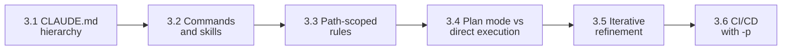

# Domain 3: Claude Code Configuration & Workflows (20% of the Exam)

Domain 3 is **20%** of the **Claude Certified Architect - Foundations (CCAR-F)** exam. Scenarios 2 (Code Generation) and 5 (CI) lean on it heavily. Weights: D1 27%, D2 18%, **D3 20%**, D4 20%, D5 15%.

Deeper reference: [KEY_CONCEPTS.md](KEY_CONCEPTS.md). Quick revision: [CHEATSHEET.md](CHEATSHEET.md). Other domains: [Domain 1](../domain1/README.md) | [Domain 2](../domain2/README.md) | [Domain 4](../domain4/README.md) | [Domain 5](../domain5/README.md).

## Study-Order Map

Learn what loads (3.1 to 3.3), then how you work (3.4, 3.5), then automate (3.6).



## Task Statements at a Glance

Each guide has: In One Minute, Explain Like I'm 13, Worked Example, Exam Traps with examples, 3 practice questions with answers, a self-check, and an offline workbook.

| TS | What it tests | Key trap | Guide |
|---|---|---|---|
| 3.1 | Where CLAUDE.md files live and who gets them; `@import`; `.claude/rules/`; `/memory` | Team rules left in user-level `~/.claude/CLAUDE.md` | [README](ts_3_1_claude_code_workflows/README.md) |
| 3.2 | Project-scoped vs user-scoped commands; skills with `context: fork`, `allowed-tools`, `argument-hint` | Shared `/review` placed in `~/.claude/commands/` | [README](ts_3_2_slash_commands_and_skills/README.md) |
| 3.3 | `paths:` globs in `.claude/rules/*.md`; loads only for matching files | A `CLAUDE.md` per directory, or a skill, for co-located tests | [README](ts_3_3_path_specific_rules/README.md) |
| 3.4 | Plan mode for big or architectural work; direct execution for small; Explore subagent | Direct execution for a monolith split | [README](ts_3_4_plan_mode_and_refinement/README.md) |
| 3.5 | 2-3 examples; tests first; interview pattern; batch interacting problems | "Be more precise" instead of examples | [README](ts_3_5_iterative_refinement_interview/README.md) |
| 3.6 | `-p`; `--output-format json` with `--json-schema`; independent review; no duplicate comments | `CLAUDE_HEADLESS` or `--batch` (they do not exist) | [README](ts_3_6_cicd_pipeline_automation/README.md) |

Each folder also has `main.py` (offline) and a `.ipynb` workbook. Offline tests: [tests/test_domain3_enhancements.py](../tests/test_domain3_enhancements.py).

## Terms Used Consistently

- **Path-scoped rule**: `.claude/rules/*.md` with a `paths:` glob list.
- **Project-scoped command**: `.claude/commands/` (shared). **User-scoped command**: `~/.claude/commands/` (personal).
- **Skill**: `.claude/skills/<name>/SKILL.md`, loaded on demand.
- **Plan mode** and **direct execution**: investigate-then-propose vs make the change now.

## Rules of Thumb

| Aspect | Exam answer | Distractor |
|---|---|---|
| Sharing config | Project level (in version control) | User-level `~/.claude/CLAUDE.md` |
| CLAUDE.md vs skills | CLAUDE.md = always-loaded standards; skill = on-demand workflow | Rare procedures in CLAUDE.md |
| Personal skill variant | `~/.claude/skills/` with a different name | Edit the shared skill |
| Noisy workflow | `context: fork` | Run inline |
| Cross-folder file pattern | Path-scoped rule with globs | A `CLAUDE.md` in every directory |
| Big refactor | Plan mode | Direct execution |
| Small fix with stack trace | Direct execution | Plan mode |
| Hanging CI job | `-p` / `--print` | `CLAUDE_HEADLESS`, `--batch` |
| CI findings | `--output-format json` + `--json-schema` | Regex on prose |
| Reviewer | Independent instance | The authoring session |
| Overnight bulk work | Message Batches API (Domain 4, TS 4.5: [Domain 4 README](../domain4/README.md)) | Using it for blocking pre-merge checks |

## Domain 3 Golden Rules

1. **Scope decides who gets the config (3.1)**:  
   Team standards go in project-level files under version control (`./CLAUDE.md`, `.claude/`). Personal preferences go in `~/.claude/`. A rule left in the user-level file never reaches teammates or CI. Use `@import` and `.claude/rules/` to split a large `CLAUDE.md`, and `/memory` to check what is actually loaded.
2. **Always-on vs on-demand (3.1, 3.2)**:  
   `CLAUDE.md` holds short standards needed in every session. Procedures used occasionally belong in a skill, so they cost no context until invoked. Keep `CLAUDE.md` small.
3. **Shared commands live in the project (3.2)**:  
   `.claude/commands/` is shared through the repo. `~/.claude/commands/` is personal. To customise a shared skill, create a personal variant under `~/.claude/skills/` with a different name instead of editing the team copy.
4. **Isolate noisy work with `context: fork` (3.2)**:  
   A skill with `context: fork` runs in its own context and returns only a result, so verbose exploration does not pollute the main session. Restrict it with `allowed-tools` and prompt for input with `argument-hint`.
5. **Use path-scoped rules for cross-folder patterns (3.3)**:  
   A `.claude/rules/*.md` file with `paths:` globs (for example `**/*.test.tsx`) loads only when matching files are edited. This covers conventions for files scattered across directories, which a per-directory `CLAUDE.md` or a skill cannot do reliably.
6. **Plan first when scope is large (3.4)**:  
   Plan mode fits multi-file, architectural or ambiguous changes (a monolith split, a library migration). Direct execution fits a well-understood small fix such as a bug with a stack trace. Use the Explore subagent to keep discovery output out of the main context.
7. **Show, do not tell, when refining (3.5)**:  
   Two or three concrete input/output examples beat "be more precise". Write tests first and iterate on failures. Let Claude interview you to surface unstated requirements. Put interacting problems in one message and independent ones in separate messages.
8. **CI needs non-interactive, structured, independent runs (3.6)**:  
   Use `-p` (`--print`) so the job does not hang. Use `--output-format json` with `--json-schema` for machine-parseable findings, not regex on prose. Review with an independent instance, not the authoring session. Include prior findings so reruns do not post duplicate comments. `CLAUDE_HEADLESS` and `--batch` do not exist.

## Hands-on Exercises

Run the offline workbooks, or the tests, with:

```bash
wsl -d Ubuntu-26.04 bash -c "cd /mnt/c/Repos/Claude_cert && ~/.local/bin/uv run pytest tests -q"
```

These Domain 3 scripts make no Claude API calls (they are simulations), but follow the repo [execution policy](../EXECUTION_POLICY.md) and run them manually.
