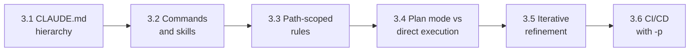

# Domain 3: Claude Code Configuration & Workflows (20% of the Exam)

Domain 3 is **20%** of the **Claude Certified Architect - Foundations (CCAR-F)** exam. Scenarios 2 (Code Generation) and 5 (CI) lean on it heavily. Weights: D1 27%, D2 18%, **D3 20%**, D4 20%, D5 15%.

Deeper reference: [KEY_CONCEPTS.md](KEY_CONCEPTS.md). Other domains: [Domain 1](../domain1/README.md) | [Domain 2](../domain2/README.md) | [Domain 4](../domain4/README.md) | [Domain 5](../domain5/README.md).

## Study-Order Map

Learn what loads (3.1 to 3.3), then how you work (3.4, 3.5), then automate (3.6).



## Task Statements at a Glance

Each guide has: In One Minute, Worked Example, Common Mistakes, 3 practice questions with answers, a self-check, and an offline workbook.

| TS | What it tests | Key trap | Guide |
|---|---|---|---|
| 3.1 | Where CLAUDE.md files live and who gets them; `@import`; `.claude/rules/`; `/memory` | Team rules left in user-level `~/.claude/CLAUDE.md` | [README](ts_3_1_claude_code_workflows/README.md) |
| 3.2 | Project-scoped vs user-scoped commands; skills with `context: fork`, `allowed-tools`, `argument-hint` | Shared `/review` placed in `~/.claude/commands/` | [README](ts_3_2_slash_commands_and_skills/README.md) |
| 3.3 | `paths:` globs in `.claude/rules/*.md`; loads only for matching files | A `CLAUDE.md` per directory, or a skill, for co-located tests | [README](ts_3_3_path_specific_rules/README.md) |
| 3.4 | Plan mode for big or architectural work; direct execution for small; Explore subagent | Direct execution for a monolith split | [README](ts_3_4_plan_mode_and_refinement/README.md) |
| 3.5 | 2-3 examples; tests first; interview pattern; batch interacting problems | "Be more precise" instead of examples | [README](ts_3_5_iterative_refinement_interview/README.md) |
| 3.6 | `-p`; `--output-format json` with `--json-schema`; independent review; no duplicate comments | `CLAUDE_HEADLESS` or `--batch` (they do not exist) | [README](ts_3_6_cicd_pipeline_automation/README.md) |

Each folder also has `main.py` (offline) and a `.ipynb` workbook. Offline tests: [tests/test_domain3_enhancements.py](../tests/test_domain3_enhancements.py).

## Terms Used Consistently

- **Path-scoped rule**: `.claude/rules/*.md` with a `paths:` glob list.
- **Project-scoped command**: `.claude/commands/` (shared). **User-scoped command**: `~/.claude/commands/` (personal).
- **Skill**: `.claude/skills/<name>/SKILL.md`, loaded on demand.
- **Plan mode** and **direct execution**: investigate-then-propose vs make the change now.

## Rules of Thumb

| Aspect | Exam answer | Distractor |
|---|---|---|
| Sharing config | Project level (in version control) | User-level `~/.claude/CLAUDE.md` |
| CLAUDE.md vs skills | CLAUDE.md = always-loaded standards; skill = on-demand workflow | Rare procedures in CLAUDE.md |
| Personal skill variant | `~/.claude/skills/` with a different name | Edit the shared skill |
| Noisy workflow | `context: fork` | Run inline |
| Cross-folder file pattern | Path-scoped rule with globs | A `CLAUDE.md` in every directory |
| Big refactor | Plan mode | Direct execution |
| Small fix with stack trace | Direct execution | Plan mode |
| Hanging CI job | `-p` / `--print` | `CLAUDE_HEADLESS`, `--batch` |
| CI findings | `--output-format json` + `--json-schema` | Regex on prose |
| Reviewer | Independent instance | The authoring session |
| Overnight bulk work | Message Batches API (Domain 4, TS 4.5: [Domain 4 README](../domain4/README.md)) | Using it for blocking pre-merge checks |

## Hands-on Exercises

Run the offline workbooks, or the tests, with:

```bash
wsl -d Ubuntu-26.04 bash -c "cd /mnt/c/Repos/Claude_cert && ~/.local/bin/uv run pytest tests -q"
```

These Domain 3 scripts make no Claude API calls (they are simulations), but follow the repo [execution policy](../EXECUTION_POLICY.md) and run them manually.
