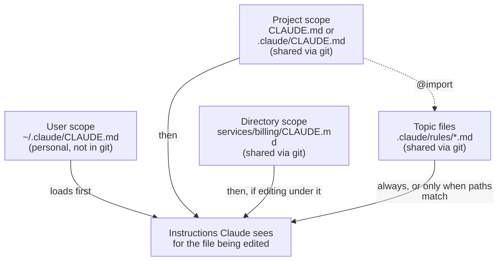

# Task Statement 3.1: Configure CLAUDE.md Files with Appropriate Hierarchy and Scoping

> Scenarios: Scenario 2 (Code Generation) and Scenario 5 (CI).

## In One Minute

- **What**: `CLAUDE.md` files give Claude Code standing instructions. *Where a file lives decides who gets it.*
- **Three scopes**: user (`~/.claude/CLAUDE.md`, personal, **not** in version control), project (`CLAUDE.md` or `.claude/CLAUDE.md`, shared), and directory (`<subdir>/CLAUDE.md`, shared).
- **Stay modular**: use `@import` and topic files in `.claude/rules/` (`testing.md`, `api-conventions.md`, `deployment.md`). Run `/memory` to see which memory files are loaded.
- **Exam answer in one line**: a new teammate is not getting the instructions because they sit in *user-level* config. Move them to project level.

---

## Explain Like I'm 13

**The picture:** Posters on walls. The poster in the school hallway (project `CLAUDE.md`) is seen by everyone. The sticky note in your own diary (`~/.claude/CLAUDE.md`) is only seen by you. A poster on one classroom door (directory `CLAUDE.md`) applies in that room only.

**In plain steps:**
1. Team rules go in the project `CLAUDE.md` and are committed.
2. Too long? Keep the main file short and `@import` topic files from `.claude/rules/`.
3. Claude ignoring a rule? Run `/memory` to see which posters are actually up.

**Tiny example:** "It works on my laptop but not on Priya's" means the rule was in your diary, not on the hallway wall.

---

## Concepts Explained

### Why it matters
If your standards live only in your home folder, your teammates and the CI job never see them. Claude then behaves differently for each person.

### How it works

| Scope | Location | Shared via version control? | Typical content |
|---|---|---|---|
| **User** | `~/.claude/CLAUDE.md` | No, personal | Your editor habits, shell aliases |
| **Project** | `./CLAUDE.md` or `.claude/CLAUDE.md` | Yes | Build and test commands, team standards |
| **Directory** | `services/billing/CLAUDE.md` | Yes | Rules for one subtree |

- **Load order** (Claude Code memory docs): files are **concatenated, not overridden**. Broadest first: managed policy (organisation), user, then project files from the repo root down to your working directory; `CLAUDE.local.md` is read last at each level. Subdirectory files load on demand when Claude works there. If two files contradict, Claude may follow either, so keep them consistent.
- **Context, not enforcement**: `CLAUDE.md` guides Claude but cannot force it. To block an action whatever Claude decides, use a `PreToolUse` hook (TS 1.5).
- **Topic files**: put focused guidance in `.claude/rules/*.md` (for example `testing.md`, `api-conventions.md`, `deployment.md`). Add `paths:` to make one conditional (see TS 3.3).
- **`@import` syntax**: write `@path/to/file` in a `CLAUDE.md` to pull that file in. Relative paths resolve from the importing file, and imports can nest up to four hops. Imported files still load into context, so imports organise a file but do not shrink it:
  ```markdown
  # Project Standards
  See @.claude/rules/testing.md for test conventions.
  ```
- **`/memory`**: shows which memory files Claude Code has loaded. Use it first when an instruction seems ignored.
- **Keep it short**: this repo keeps the root `CLAUDE.md` under 200 lines as a house rule. Move rare, task-specific procedures into skills (TS 3.2).

---

## Key Terms

- **User-level config**: `~/.claude/CLAUDE.md`. Personal. Never reaches teammates or CI.
- **Project-level config**: root `CLAUDE.md` or `.claude/CLAUDE.md`. Committed and shared.
- **Directory-level config**: a `CLAUDE.md` inside a subfolder. Committed and shared.
- **`@import`**: the `@path/to/file` syntax that includes another file so a `CLAUDE.md` stays modular.
- **`/memory`**: command that shows the loaded memory files.

---

## Architecture



---

## Worked Example

A repo and two developers:

```text
~/.claude/CLAUDE.md                 <- user scope (Ana's laptop only)
my-repo/
  CLAUDE.md                         <- project scope
  .claude/rules/
    testing.md                      <- topic file
    api-conventions.md
    deployment.md
  services/billing/CLAUDE.md        <- directory scope
  services/billing/api.py
```

Ana edits `services/billing/api.py`. Claude sees: her user file, the project `CLAUDE.md`, and `services/billing/CLAUDE.md`.

Ben clones the repo and edits the same file. Claude sees: the project `CLAUDE.md` and `services/billing/CLAUDE.md`. **Ben never gets Ana's user file.** If the commit-message rules were only in Ana's user file, Ben's Claude ignores them.

Fix: move those rules to the project `CLAUDE.md` (or a topic file) and commit.

The `main.py` in this folder does this on the real files of this repo (`resolve_claude_md_chain`, `teammate_visible`).

---

## Exam Traps and Correct Patterns

### Trap 1: Team standards saved at user level

**Exam scenario**: A new teammate's Claude Code ignores the team's testing conventions. The rules work on the original author's machine.

| File | Scope | Shared through git? |
|---|---|---|
| `~/.claude/CLAUDE.md` | You, every project | No |
| `./CLAUDE.md` or `./.claude/CLAUDE.md` | Whole project | Yes |
| `services/billing/CLAUDE.md` | That subtree | Yes |

```text
Symptom: "works for me, not for Priya"  -> rules are in ~/.claude/CLAUDE.md
Fix:     move them to the project CLAUDE.md (or .claude/rules/), commit, push.
```

Files are loaded and combined (user, project, directory), not overridden. That is why a personal file never reaches teammates or CI.

### Trap 2: One giant `CLAUDE.md`

A 600-line file loads every session. Important rules are buried, and every task pays for rules it never uses.

```markdown
# CLAUDE.md (short: universal facts only)
- Python 3.10+, uv, pytest.
- Testing rules: @.claude/rules/testing.md
- API rules: @.claude/rules/api.md
```

Use `@path` imports and `.claude/rules/` topic files. Rare procedures go to skills (TS 3.2).

### Trap 3: Debugging by retyping the rule

When Claude "ignores" an instruction, the cause is usually that the file was never loaded. Run `/memory` to see exactly which files are loaded in this session. Retyping the rule in each prompt fixes one conversation and leaves the root cause for everyone else.

### Trap 4: Secrets in instructions

`CLAUDE.md` is committed text. Passwords or tokens in it end up in git history. Reference environment variables (`$DB_URL`) instead and keep the secret in the environment or a secret manager.

---

## Exam-Style Practice Questions

**Q1 (Scenario 2: Code Generation).** A new developer clones the repo. Their Claude Code ignores the team's commit-message and test conventions. A senior developer's Claude Code follows them. What is the most likely cause?

- A) The conventions are in the senior developer's `~/.claude/CLAUDE.md`.
- B) The new developer must switch to `claude-sonnet-4-5`.
- C) Conventions only load for developers who have commit rights.
- D) The repo's `.claude/` folder is read only by CI.

**Q2 (Scenario 2).** The root `CLAUDE.md` has grown to 900 lines covering testing, API design and deployment. What is the best fix?

- A) Move it all to `~/.claude/CLAUDE.md`.
- B) Keep the root file short and split topics into `.claude/rules/testing.md`, `api-conventions.md` and `deployment.md` (use `@import` where needed).
- C) Delete it and paste the rules into each prompt.
- D) Copy the whole file into every subdirectory.

**Q3 (Scenario 5: CI).** A review job in CI seems to ignore a team rule. You reproduce locally in an interactive session. What do you check first?

- A) Ask Claude to recite its instructions and trust the answer.
- B) Run `/memory` to see which memory files were loaded and from which scope.
- C) Read the git history of `CLAUDE.md`.
- D) Restart the CI runner.

### Answers

**Q1: A.**
- B fails: the model choice does not decide whether `CLAUDE.md` files load.
- C fails: loading does not depend on commit rights.
- D fails: `.claude/` project files are read by developers' sessions too, not only CI.

**Q2: B.**
- A fails: user-level files are personal, so the team loses them.
- C fails: manual prompting is inconsistent and per person.
- D fails: copies drift apart and still load context that is not needed.

**Q3: B.**
- A fails: the model's recitation is not a reliable record of what was loaded.
- C fails: history shows edits, not what the session loaded.
- D fails: restarting changes nothing about which files exist at which scope.

---

## Self-Check Checklist

- [ ] I can name the three scopes and their file locations.
- [ ] I know the user-level file is not shared via version control.
- [ ] I can explain `@import` and `.claude/rules/` topic files.
- [ ] I know `/memory` shows loaded memory files.
- [ ] I can diagnose "teammate does not get the instructions".

**Memory hook**: *Home folder is private; the repo is shared.*

---

## Hands-on Workbook Guide

Open [`ts_3_1_claude_code_workflows.ipynb`](ts_3_1_claude_code_workflows.ipynb) (offline, no API calls). It runs the code in [main.py](main.py):

1. Setup and imports.
2. Resolve the real CLAUDE.md chain for a file and check which entries a teammate receives.
3. Load the real `.claude/rules/` files and see which match a file.
4. Assertions that confirm the order and the teammate view.

Next: [TS 3.2 Slash Commands and Skills](../ts_3_2_slash_commands_and_skills/README.md). Overview: [Domain 3 README](../README.md).
