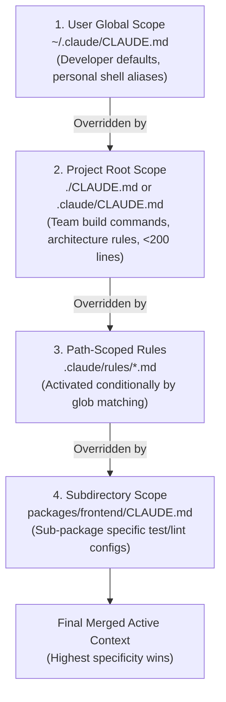

# Task Statement 3.1: Configure CLAUDE.md Files with Appropriate Hierarchy and Scoping

## 📌 Executive Overview: Goal, Scope & Exam Importance

### Certification Domain & Weight
- **Domain**: Domain 3: Claude Code Configuration & Workflows
- **Domain Weight**: 18% of total CCAR-F exam score
- **Scenario Alignment**: Scenario 2 (Code Generation) & Scenario 5 (Continuous Integration)

### The Core Goal
To design and structure Claude Code configuration hierarchies across **User Global**, **Project Root**, **Path-Scoped Rules**, and **Subdirectory** levels. An architect must master the **<200 lines rule**, understand **resolution precedence (most specific wins)**, and use modular composition (`@import` and path filters) to keep context windows lean and performant.

### Why This Matters in Production
In enterprise development, `CLAUDE.md` is loaded into the model's context on every single turn. 
If an architect builds a monolithic 1,500-line `CLAUDE.md` containing all frontend, backend, database, and CI rules:
1. **Severe Token Drain**: Every single interaction consumes 3,000–5,000 tokens of input overhead before the developer even types a character.
2. **Attention Degradation**: When editing a frontend React component, Claude's attention is distracted by pages of irrelevant PostgreSQL and Kubernetes rules.
3. **Configuration Drift**: If team build commands are stored in a developer's home directory (`~/.claude/CLAUDE.md`), other teammates and CI runners fail when cloning the repository.
Keeping the root `CLAUDE.md` concise (<200 lines) and offloading specialized conventions to modular, path-scoped rules ensures maximal attention density and team-wide consistency.

### Exam Importance
Task Statement 3.1 questions test configuration scoping and precedence. The exam will ask which configuration file takes precedence when conflicting rules exist, how to prevent `CLAUDE.md` bloat, and where project-wide versus developer-specific rules belong.

---

## 📖 Deep Narrative: Why We Do What We Do

### 1. The 4 Levels of Configuration Hierarchy
Claude Code resolves configurations across four distinct tiers:

1. **User Global Scope (`~/.claude/CLAUDE.md`)**:
   - Located in the developer's user home directory.
   - Purpose: Personal developer preferences (editor shortcuts, favorite terminal flags, local shell aliases).
   - *Scope*: Active across *all* repositories on the developer's workstation.

2. **Project Root Scope (`./CLAUDE.md` or `.claude/CLAUDE.md`)**:
   - Located at the root of the Git repository.
   - Purpose: Team-wide build commands (`pytest`, `npm test`), core architecture overview, coding standards, and repository safety policies.
   - *Constraint*: **Must stay under 200 lines**.

3. **Path-Scoped Rules (`.claude/rules/*.md`)**:
   - Located in the `.claude/rules/` directory.
   - Purpose: Deep specialized conventions (e.g. `api_conventions.md`, `react_standards.md`).
   - *Activation*: Loaded conditionally only when files matching their YAML frontmatter `paths` glob are touched.

4. **Subdirectory Scope (`packages/frontend/CLAUDE.md`)**:
   - Located in subdirectories of monorepos or multi-service projects.
   - Purpose: Service-specific build steps and library quirks.
   - *Activation*: Active when working within that specific directory tree.

### 2. Resolution Precedence: Most Specific Wins
When rules conflict (e.g., User Global says "Use Tab indentation", while Project Root says "Use 2 spaces", and Path Rule says "Use 4 spaces for Python"):
$$\text{Subdirectory / Path-Scoped} > \text{Project Root} > \text{User Global}$$
The most specific, localized rule **always overrides** general higher-level rules.

### 3. Modular Composition via `@import`
To prevent the root `CLAUDE.md` from expanding past the 200-line budget, architects use modular imports:
```markdown
# Project Overview & Core Build
Run tests via `pytest tests/`.

@import .claude/rules/architecture.md
@import .claude/rules/security.md
```
This enables specialized domain leads to maintain their own modular guidelines without cluttering root configuration.

---

## 🔑 Key Technical Terminology Explained

- **`CLAUDE.md`**: The primary markdown configuration file automatically ingested by Claude Code at startup to ground model behavior in project-specific commands, conventions, and constraints.
- **The <200 Lines Rule**: A strict architectural best practice requiring the root `CLAUDE.md` to remain under 200 lines, ensuring fast turn latency and low baseline token consumption.
- **Resolution Precedence**: The hierarchy determining which rule prevails during conflicts: Local Subdirectory / Path Rule $\rightarrow$ Project Root $\rightarrow$ User Global.
- **Path-Scoped Rule**: A modular rule file inside `.claude/rules/` containing a `paths: [...]` glob filter, loaded dynamically only when matching files are edited.
- **Modular `@import`**: Syntax enabling `CLAUDE.md` to cleanly transclude external markdown rules without monolithic file duplication.

---

## 🏗️ Architecture: Configuration Hierarchy & Precedence



---

## ⚠️ Critical Exam Distinctions & Distractor Teardown

| Architectural Concept | Correct Implementation | Exam Trap to Reject | Why the Trap Fails |
|---|---|---|---|
| **Root File Sizing** | Keep root `CLAUDE.md` **under 200 lines**; offload deep rules to `.claude/rules/` and skills. | **TRAP**: Creating a monolithic 1,500-line `CLAUDE.md` covering all frameworks and languages. | Consumes thousands of context tokens on every turn, driving up cost and causing attention dilution. |
| **Precedence Direction** | **Local overrides global**: Subdirectory and path rules take precedence over project root and user global. | **TRAP**: Assuming user-global preferences (`~/.claude/CLAUDE.md`) override project repository rules. | Project-level team rules must override individual preferences to guarantee team build uniformity. |
| **Team Secret Management** | Never put credentials in `CLAUDE.md`; use environment variables. | **TRAP**: Documenting production database passwords or auth tokens directly in `CLAUDE.md`. | Checking secrets into Git creates immediate security breach risks. |

---

## 💡 Architectural Decision Matrix: Rules of Thumb

| Setting / Rule Type | Optimal Location | Loaded When |
|---|---|---|
| Personal shell alias or editor theme | `~/.claude/CLAUDE.md` | Across all repositories on local machine. |
| Project build commands (`pytest`, `uv`) | `./CLAUDE.md` (<200 lines) | Always loaded in current repository. |
| React styling guidelines | `.claude/rules/react.md` | Loaded only when editing matching UI files. |
| Microservice test runner | `services/auth/CLAUDE.md` | Loaded when working within `services/auth/`. |

---

## 🧠 Claude 4.5 Extended Thinking & Parameter Standards

- **Rule Adherence Reasoning**: During its extended thinking phase, Claude references the active `CLAUDE.md` hierarchy and validates whether its proposed edits conform to project build and testing conventions before invoking tools.
- **Sampling Rules**: Omit `temperature` whenever thinking is enabled.
- **Context Economy**: Keeping `CLAUDE.md` under 200 lines preserves maximum thinking token budget for complex architectural reasoning.

---

## 🛠️ Hands-on Workbook Guide: Following the Code Step-by-Step

When exploring [`ts_3_1_claude_code_workflows.ipynb`](ts_3_1_claude_code_workflows.ipynb):
1. **Step 1: Setup & Hierarchy Matcher**: Implements the configuration hierarchy resolver simulating user, project, and path-scoped rules.
2. **Step 2: Testing Resolution Precedence**: Demonstrates a project rule cleanly overriding a user-global preference.
3. **Step 3: Path-Scoped Conditional Loading**: Demonstrates loading backend rules only when editing backend files.
4. **Step 4: The 200-Line Budget Assertion**: Audits rule line counts to enforce the <200 lines standard.
5. **Step 5: Verification Assertions**: Verifies that 100% of precedence conflicts resolve to the most specific scope.
