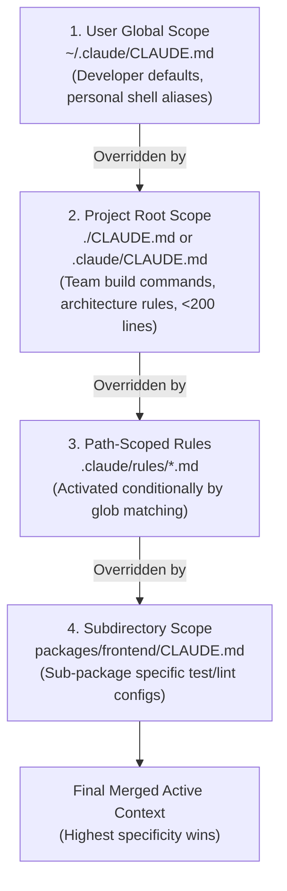

# Task Statement 3.1: Configure CLAUDE.md Files with Appropriate Hierarchy and Scoping

## 🎯 Exam Objective
Understand the hierarchical resolution of `CLAUDE.md` configuration files, file size budgeting (<200 lines), `@import` modular composition, and precedence rules across user, project, and directory levels.

---

## 🏗️ Architecture: Configuration Hierarchy & Resolution Precedence

---

## ⚠️ Critical Exam Distinctions & Anti-Patterns

| Architecture Concept | Best Practice Implementation | Exam Trap to Reject |
|---|---|---|
| **Root File Sizing** | Keep `CLAUDE.md` **under 200 lines**. Offload specialized rules to `.claude/rules/` and workflows to `.claude/skills/`. | **TRAP**: Creating a monolithic 1,500-line `CLAUDE.md` that eats substantial context window tokens on every turn. |
| **Precedence Order** | **Local overrides global**: Subdirectory / path rules take precedence over project root, which takes precedence over user config. | **TRAP**: Assuming user-global configs silently override project-specific team conventions. |
| **Modular Rule Inclusion** | Use `@import` syntax or `.claude/rules/*.md` with YAML frontmatter `paths` globs to load on-demand. | **TRAP**: Duplicating coding standards across 10 different files or hardcoding every rule globally. |

---

## 💡 Architectural Decision Matrix

| Configuration Scope | Path | Best Suited For | Loaded When |
|---|---|---|---|
| **User Global** | `~/.claude/CLAUDE.md` | Personal developer preferences, editor configs | Always loaded across all projects. |
| **Project Root** | `./CLAUDE.md` | Build commands, testing framework, high-level guidelines (<200 lines) | Always loaded in current project. |
| **Path-Scoped Rule** | `.claude/rules/api.md` | API conventions, database patterns | Loaded only when files matching `paths` are edited. |
| **Subdirectory** | `packages/ui/CLAUDE.md` | Framework-specific UI component guidelines | Loaded when working within that directory. |

---

## 🛠️ Production Code Reference
- Interactive Workbook: [`ts_3_1_claude_code_workflows.ipynb`](ts_3_1_claude_code_workflows.ipynb)
- Runnable Script: [`main.py`](main.py)
- Offline Verification: Run via `uv run pytest tests/test_domain3_full.py` in WSL.
