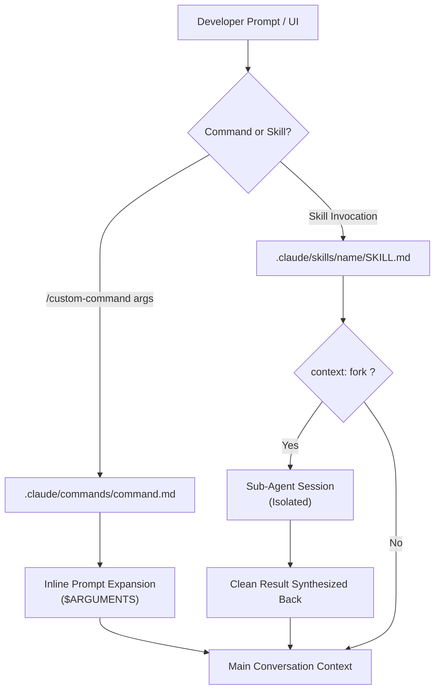

# Task Statement 3.2: Custom Slash Commands & Skills

## 🎯 Exam Objective
Understand how to define, configure, and isolate custom slash commands and skills within Claude Code.

---

## 🏗️ Architecture: Commands vs Skills



---

## 📋 Frontmatter Reference for `SKILL.md`

```markdown
---
name: security-audit
description: Scans code for hardcoded secrets, SQL injection, and insecure endpoints.
context: fork
allowed-tools:
  - Read
  - Grep
  - Glob
argument-hint: [optional target directory]
---

You are a security auditor sub-agent.
...
```

### Critical Exam Rules:
1. **`context: fork`**:
   - Runs the skill in an **isolated subagent context**.
   - Intermediate grep outputs, file scans, and reasoning stay inside the fork.
   - Prevents **context window exhaustion** in the main developer conversation.
2. **`allowed-tools`**:
   - Principle of least privilege: Prevents the skill from invoking destructive tools (e.g. `Bash` or `Write` during a read-only audit).
3. **Slash Commands (`.claude/commands/`)**:
   - Plain markdown files.
   - Substitute `$ARGUMENTS` or `$1`, `$2` directly into the prompt text.
