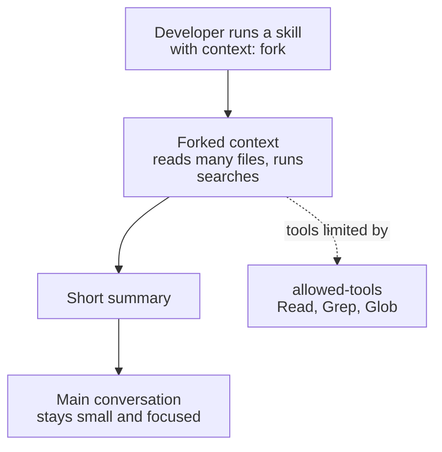

# Task Statement 3.2: Configure Custom Slash Commands and Skills

> Scenarios: Scenario 2 (Code Generation), also useful in Scenario 5.

## In One Minute

- **Slash command** = a saved prompt. A **project-scoped command** lives in `.claude/commands/` and is shared through version control. A **user-scoped command** lives in `~/.claude/commands/` and is personal.
- **Skill** = an on-demand task workflow in `.claude/skills/<name>/SKILL.md`. Frontmatter keys: `context: fork`, `allowed-tools`, `argument-hint`.
- **`context: fork`** runs the skill in an isolated context, so noisy exploration does not fill your main conversation. Only the result comes back.
- **Skills vs CLAUDE.md**: skills load on demand for a task; `CLAUDE.md` is always loaded for universal standards. Personal skill variants go in `~/.claude/skills/` with a *different name*.
- **Exam answer in one line**: a team `/review` command goes in `.claude/commands/` in the repo.

---

## Explain Like I'm 13

**The picture:** A slash command is a **shortcut button** on the shared remote. A skill is a **recipe card** that can be cooked in a separate kitchen (`context: fork`) so the mess stays out of your main kitchen. Buttons and cards in the repo are shared. Ones in your home folder are yours.

**In plain steps:**
1. Team shortcut: `.claude/commands/`.
2. Multi-step workflow: a skill in `.claude/skills/`.
3. Messy output? Add `context: fork`; only a short summary comes back.
4. Want your own variant? Copy it to `~/.claude/skills/` with a different name.
5. Rule that must always apply? That is `CLAUDE.md`, not a skill.

**Tiny example:** An audit skill that only reads files should be limited to `Read`, `Grep`, `Glob`.

---

## Concepts Explained

### Why it matters
If a shared `/review` command sits in your home folder, teammates cannot use it. If a noisy audit runs in the main conversation, it floods the context and crowds out your real work.

### How it works

**Where things live**

| Item | Location | Shared? |
|---|---|---|
| Project-scoped command | `.claude/commands/<name>.md` | Yes, via version control |
| User-scoped command | `~/.claude/commands/<name>.md` | No, personal |
| Project skill | `.claude/skills/<name>/SKILL.md` | Yes |
| Personal skill | `~/.claude/skills/<name>/SKILL.md` | No |

**Skill frontmatter keys** (the ones this task statement covers)

| Key | Meaning |
|---|---|
| `context: fork` | Run in an isolated context; return only a summary |
| `allowed-tools` | Tools the skill may use **without a permission prompt** (exam wording: restricts tool access). Other tools stay under normal permissions; `disallowed-tools` removes tools |
| `argument-hint` | Hint shown to the user about the expected argument |

- **Fork**: verbose or exploratory work (reading many files, long searches) stays in the fork. The main conversation gets the summary.
- **Personal variants**: copy a team skill to `~/.claude/skills/` and give it a **different name**, so you do not change the shared one.
- **Skill or CLAUDE.md?** Universal standards that always apply go in `CLAUDE.md`. Task workflows that apply sometimes go in a skill.

---

## Key Terms

- **Project-scoped command**: a `.claude/commands/` file in the repo, shared with the team.
- **User-scoped command**: a `~/.claude/commands/` file, personal.
- **Skill**: a `SKILL.md` workflow loaded on demand.
- **`context: fork`**: isolates a skill's context from the main conversation.
- **`allowed-tools`**: the tools a skill pre-approves (a permission allow-list for the skill's turn).
- **`argument-hint`**: guidance about what argument the skill expects.

---

## Architecture



---

## Worked Example

```text
my-repo/
  .claude/
    commands/review.md              <- project-scoped: everyone gets /review
    skills/architect-eval/SKILL.md  <- project skill
~/.claude/
  commands/my-notes.md              <- user-scoped: only you
  skills/architect-eval-mine/SKILL.md   <- personal variant, different name
```

A real skill from this repo (`.claude/skills/architect-eval/SKILL.md`), frontmatter only:

```yaml
---
name: architect-eval
description: Evaluates an agent or tool implementation against the exam criteria
context: fork
allowed-tools:
  - Read
  - Grep
  - Glob
argument-hint: "<domain_or_filepath>"
---
```

When you run it: Claude forks a context, uses only `Read`, `Grep` and `Glob`, and returns a short evaluation. The main chat does not receive every file read.

The `main.py` here parses these real files (`load_skills_from_dir`) and classifies commands as project-scoped or user-scoped (`classify_command_path`). The fork itself is **simulated**.

---

## Exam Traps and Correct Patterns

### Trap 1: Team command in the home folder

| Location | Scope |
|---|---|
| `.claude/commands/review.md` (in repo) | Everyone who clones the repo |
| `~/.claude/commands/review.md` | Only you |

**Exam scenario**: "Create a `/review` command available to every developer when they clone or pull." The answer is the project directory. A home-folder command works for you and silently does not exist for others.

### Trap 2: Noisy exploration run inline

```text
ANTI-PATTERN: /analyze-codebase runs in the main chat. 80 file reads fill the context.
PATTERN: a skill with `context: fork` runs in an isolated context and returns a short summary.
```

```markdown
---
name: architect-eval
description: Evaluates an agent implementation against the exam criteria
context: fork
allowed-tools: Read, Grep, Glob
---
```

`allowed-tools` keeps a read-only audit skill to read tools so it cannot edit files.

### Trap 3: Editing a shared skill for a personal tweak

Editing `.claude/skills/review/SKILL.md` changes it for the whole team on the next pull. For a personal variant, create `~/.claude/skills/my-review/` with a **different name**.

### Trap 4: Skill vs CLAUDE.md

| Content | Where | Why |
|---|---|---|
| "Always use type hints", "tests live in `tests/`" | `CLAUDE.md` | Must apply to every task, loaded always |
| 12-step release procedure used monthly | Skill | Loaded only when invoked. Does not cost context every session |

An "always" rule in a skill is a trap: the skill might never be invoked. A rare procedure in `CLAUDE.md` is a trap too: it wastes context every session.

---

## Exam-Style Practice Questions

**Q1 (Scenario 2: Code Generation).** Your team wants every developer to have the same `/review` command. Where should it be created?

- A) `~/.claude/commands/review.md` on each developer's machine.
- B) `.claude/commands/review.md` in the repository.
- C) A paragraph inside `~/.claude/CLAUDE.md`.
- D) `.claude/skills/review/` with `context: fork` removed.

**Q2 (Scenario 2).** A codebase-analysis skill reads dozens of files. After running it, the main conversation is full of file contents and Claude loses earlier instructions. What is the best change?

- A) Add `argument-hint` to the frontmatter.
- B) Move the skill steps into the root `CLAUDE.md`.
- C) Raise the response length in the prompt.
- D) Add `context: fork` to the skill frontmatter.

**Q3 (Scenario 5: CI flavour).** A developer wants a stricter personal version of the team's `deploy-check` skill without affecting teammates. What should they do?

- A) Edit `.claude/skills/deploy-check/SKILL.md` and avoid committing it.
- B) Copy it to `~/.claude/skills/` under a different name.
- C) Create `~/.claude/skills/deploy-check/` with the same name and hope it wins.
- D) Put the stricter steps in the project `CLAUDE.md`.

### Answers

**Q1: B.**
- A fails: each machine would need its own copy; nothing is shared.
- C fails: a user-level `CLAUDE.md` is personal, and a paragraph is not a command.
- D fails: that is a skill, not a project-scoped command, and the fork setting is irrelevant to sharing.

**Q2: D.**
- A fails: `argument-hint` only describes the argument.
- B fails: `CLAUDE.md` loads every session and would make context worse.
- C fails: response length does not stop tool output filling the chat.

**Q3: B.**
- A fails: it edits the shared file and risks an accidental commit.
- C fails: reusing the name is ambiguous and not the recommended pattern; use a different name.
- D fails: that changes the rules for the whole team.

---

## Self-Check Checklist

- [ ] I can say where project-scoped and user-scoped commands live.
- [ ] I can write a `SKILL.md` frontmatter with `context`, `allowed-tools`, `argument-hint`.
- [ ] I can explain what `context: fork` protects.
- [ ] I know personal skill variants need a different name.
- [ ] I can say when to use a skill and when to use `CLAUDE.md`.

**Memory hook**: *Team shortcut in the repo, personal shortcut at home, noisy work in a fork.*

---

## Hands-on Workbook Guide

Open [`ts_3_2_slash_commands_and_skills.ipynb`](ts_3_2_slash_commands_and_skills.ipynb) (offline). It uses [main.py](main.py):

1. Setup and imports.
2. Classify this repo's commands and parse its real `SKILL.md` frontmatter.
3. Expand a command template and simulate fork vs inline.
4. Assertions on parsed `context`, `allowed-tools`, `argument-hint`.

Previous: [TS 3.1](../ts_3_1_claude_code_workflows/README.md). Next: [TS 3.3](../ts_3_3_path_specific_rules/README.md).
