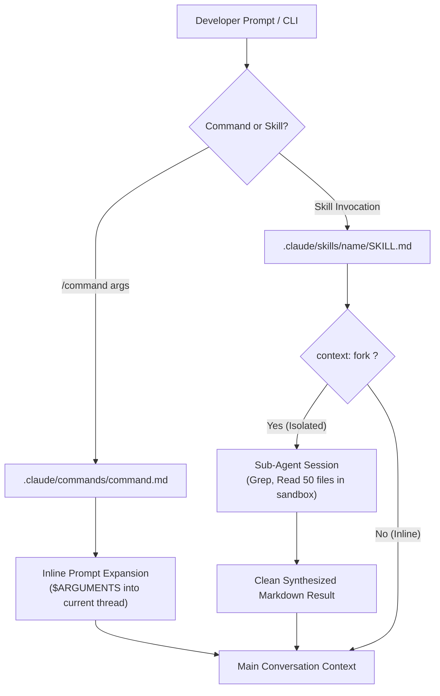

# Task Statement 3.2: Configure Custom Slash Commands and Forked Skills

## 📌 Executive Overview: Goal, Scope & Exam Importance

### Certification Domain & Weight
- **Domain**: Domain 3: Claude Code Configuration & Workflows
- **Domain Weight**: 18% of total CCAR-F exam score
- **Scenario Alignment**: Scenario 2 (Code Generation) & Scenario 4 (Developer Productivity)

### The Core Goal
To design and configure custom Claude Code extensions using **Slash Commands (`.claude/commands/`)** and **Skills (`.claude/skills/`)**, master the **`context: fork`** isolation primitive to shield main conversational context from intermediate tool bloat, and enforce least-privilege tool scoping via `allowed-tools`.

### Why This Matters in Production
Developers frequently run repetitive, high-cognitive-load workflows: security audits, performance profiling, database migrations, and PR reviews. 
If a developer runs a security audit that scans 40 files directly in their main conversation thread:
1. **Context Pollution**: Thousands of lines of raw grep outputs, syntax trees, and intermediate file contents fill the main conversation context.
2. **Context Window Exhaustion**: The developer quickly hits token limits and experiences attention degradation on their primary coding task.
By configuring custom skills with **`context: fork`**, the skill executes inside a sandboxed **subagent session**. The subagent performs all 40 file scans in isolation and returns only a concise, high-value synthesis back to the main chat, keeping the developer's primary context pristine.

### Exam Importance
Task Statement 3.2 questions test whether candidates can differentiate between lightweight inline slash commands and isolated skills, know how to configure YAML frontmatter (`context: fork`, `allowed-tools`), and understand how subagent execution preserves main context health.

---

## 📖 Deep Narrative: Why We Do What We Do

### 1. Slash Commands vs. Skills: The Architectural Choice

Claude Code provides two extension mechanisms:

#### A. Custom Slash Commands (`.claude/commands/<command>.md`)
- **Execution Mode**: **Inline Expansion**.
- **How It Works**: When the developer types `/review-pr 104`, Claude Code expands `$ARGUMENTS` directly into the current conversation thread as a user turn.
- **Best Suited For**: Quick prompt shortcuts, formatting snippets, or single-step questions that belong in the main conversation history.

#### B. Custom Skills (`.claude/skills/<name>/SKILL.md`)
- **Execution Mode**: **Subagent Isolation (`context: fork`)** or Inline.
- **How It Works**: A complete capability package defined by YAML frontmatter and specialized instructions:
  ```markdown
  ---
  name: security-audit
  description: Scans repository for hardcoded secrets, SQL injection, and vulnerable endpoints.
  context: fork
  allowed-tools:
    - Read
    - Grep
    - Glob
  argument-hint: [optional target directory]
  ---

  You are a specialized security auditing subagent.
  Scan the target directory for vulnerability patterns.
  Return only a prioritized markdown table of verified vulnerabilities.
  ```

### 2. The Power of `context: fork`
When `context: fork` is declared:
1. Claude Code spawns an ephemeral, sandboxed child session.
2. The child session receives the prompt, the skill instructions, and only the tools listed in `allowed-tools` (e.g. read-only tools, blocking `Write` or `Edit`).
3. The child agent runs 20 intermediate Grep and Read operations.
4. When finished, only the **final markdown table** is transmitted back to the parent session.
5. All intermediate tool logs and tokens are cleanly discarded, keeping parent context consumption near zero.

---

## 🔑 Key Technical Terminology Explained

- **Custom Slash Command**: A lightweight markdown prompt template inside `.claude/commands/` that expands arguments directly into the active conversation thread.
- **Custom Skill**: A self-contained capability package inside `.claude/skills/<name>/SKILL.md` containing frontmatter metadata, scoped tools, and specialized instructions.
- **`context: fork`**: A YAML frontmatter setting that forces the skill to execute in an isolated subagent session, preventing intermediate tool outputs from polluting parent context.
- **`allowed-tools`**: An array restricting which specific tools the skill subagent is permitted to call (enforcing the Principle of Least Privilege).
- **`argument-hint`**: User-facing UI hint displayed in Claude Code when the developer autocompletes the command (e.g. `[branch-name]`).

---

## 🏗️ Architecture: Commands vs Forked Skills



---

## ⚠️ Critical Exam Distinctions & Distractor Teardown

| Extension Element | Correct Implementation | Exam Trap to Reject | Why the Trap Fails |
|---|---|---|---|
| **Heavy Repository Scans** | Configure a **Skill with `context: fork`** to sandbox intermediate grep and read calls. | **TRAP**: Running repository-wide audits as an inline slash command in the main chat. | Floods main context with thousands of lines of search output, causing immediate context degradation. |
| **Tool Restrictions on Audit** | Restrict `allowed-tools` to read-only tools (`Read`, `Grep`, `Glob`). | **TRAP**: Granting auditing skills full access to `Write`, `Edit`, and `Bash`. | A security audit subagent should never mutate source files or execute arbitrary shell commands. |
| **Simple Prompt Shortcuts** | Use `.claude/commands/<name>.md` with `$ARGUMENTS`. | **TRAP**: Creating heavy multi-file forked skills for simple 1-line prompt aliases. | Adds unnecessary subagent invocation latency to trivial conversational shortcuts. |

---

## 💡 Architectural Decision Matrix: Commands vs Skills

| Requirement | Recommended Extension | Frontmatter Settings |
|---|---|---|
| **Quick 1-turn prompt alias** | Custom Slash Command | None (plain markdown in `.claude/commands/`) |
| **Multi-file security/AST scan** | Custom Skill | `context: fork`, `allowed-tools: [Read, Grep, Glob]` |
| **Targeted refactoring workflow** | Custom Skill | `context: fork`, `allowed-tools: [Read, Edit, Bash]` |
| **Inline code explanation** | Custom Slash Command | `.claude/commands/explain.md` |

---

## 🧠 Claude 4.5 Extended Thinking & Parameter Standards

- **Subagent Thinking**: A forked skill inherits its own independent thinking token budget (`budget_tokens`), allowing deep multi-file reasoning within the subagent without consuming parent context tokens.
- **Sampling Rules**: Omit `temperature` across both parent session and forked skill subagents.
- **Thinking Continuity**: The final synthesized text returned by the forked subagent is appended cleanly to the parent session as a tool result.

---

## 🛠️ Hands-on Workbook Guide: Following the Code Step-by-Step

When exploring [`ts_3_2_slash_commands_and_skills.ipynb`](ts_3_2_slash_commands_and_skills.ipynb):
1. **Step 1: Setup & Frontmatter Parser**: Parses YAML frontmatter for commands and skills.
2. **Step 2: Inline Command Expansion**: Demonstrates `$ARGUMENTS` substitution in the main context.
3. **Step 3: Forked Skill Subagent Execution**: Demonstrates spawning an isolated subagent with `context: fork`.
4. **Step 4: Context Health Comparison**: Demonstrates that forked execution shielded the parent context from 40 intermediate tool calls.
5. **Step 5: Verification Assertions**: Verifies tool scoping and context isolation compliance.
