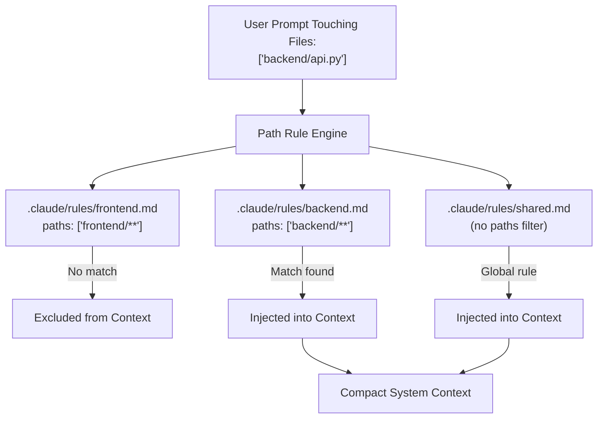

# Task Statement 3.3: Path-Specific Rules & Scoping

## 🎯 Exam Objective
Understand how path-scoped rules in `.claude/rules/` are selectively loaded based on touched files to prevent prompt bloat and instruction interference.

---

## 🏗️ Architecture: Rule Precedence & Conditional Injection



---

## 📋 Rule File Structure (`.claude/rules/<name>.md`)

```markdown
---
paths:
  - "backend/**/*.py"
  - "services/**"
---

# Backend Rules
1. All database queries must use parameterized SQLAlchemy sessions.
2. Return pydantic schemas, never raw ORM models.
3. Catch specific exceptions, never bare `except:`.
```

### Critical Exam Rules:
1. **Context Economy**: If you have 200 rules across frontend, backend, terraform, and ML, loading all 200 consumes thousands of tokens and causes model instruction drift.
2. **Selective Activation**: Rules are only activated when a path being inspected, edited, or passed matches the `paths` globs.
3. **Precedence Hierarchy**:
   1. Enterprise/Managed policy
   2. User global (`~/.claude/CLAUDE.md`)
   3. Project root (`CLAUDE.md` or `.claude/CLAUDE.md`)
   4. Directory-level (`services/payment/CLAUDE.md`)
   5. Conditional path rules (`.claude/rules/*.md`)
