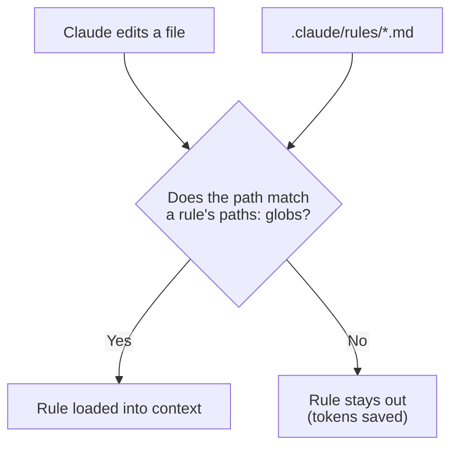

# Task Statement 3.3: Apply Path-Specific Rules for Conditional Convention Loading

## In One Minute

- **What**: a path-scoped rule is a file in `.claude/rules/` with a `paths:` list of globs in its frontmatter.
- **Why**: it loads only when Claude edits a matching file, so it saves tokens.
- **Best for**: conventions spread across many folders, such as tests that sit next to the code.
- **Exam answer in one line**: tests co-located across the repo means glob-pattern path-scoped rules. Not root `CLAUDE.md` inference, not a skill, not a `CLAUDE.md` in every directory.

## Overview

- **Domain**: Domain 3, Claude Code Configuration & Workflows (**20%** of the exam).
- **Scenarios**: Scenario 2 (Code Generation).
- **Goal**: load the right conventions at the right time.
- **Exam focus**: the `paths:` frontmatter, and why it beats directory-level `CLAUDE.md` for scattered files.

## Concepts Explained

### Simple idea
A rule says "when you touch files that look like this, follow these conventions."

### Why it matters
A directory-level `CLAUDE.md` only covers its own folder. A test convention for `**/*.test.tsx` applies in dozens of folders. One glob rule covers all of them with one file.

### How it works

```markdown
---
paths:
  - "**/*.test.tsx"
---

# Testing conventions
- Use Vitest.
```

- The file is in `.claude/rules/` (for example `testing.md`), shared via version control.
- `paths:` is a list of globs (a single string also works, for example `"**/*.test.tsx"`).
- Claude loads the rule when it works on a file that matches.
- A rule **without** `paths:` is universal and loads always.

**Glob cheat sheet** (as implemented in `main.py`)

| Glob | Matches | Does not match |
|---|---|---|
| `**/*.test.tsx` | `src/a/b.test.tsx`, `b.test.tsx` | `src/a/b.tsx` |
| `terraform/**/*` | `terraform/main.tf`, `terraform/modules/vpc/main.tf` | `infra/terraform/main.tf` |
| `*.md` | `README.md` | `docs/README.md` |

`*` stays inside one folder; `**` crosses folders.

## Key Terms

- **Path-scoped rule**: a `.claude/rules/*.md` file with a `paths:` frontmatter list.
- **Glob**: a pattern like `**/*.test.tsx`.
- **Conditional loading**: loading a rule only when a matching file is being worked on.
- **Universal rule**: a rule with no `paths:`.

## Architecture



## Worked Example

```text
my-repo/
  .claude/rules/
    testing.md          paths: ["**/*.test.tsx"]
    terraform.md        paths: ["terraform/**/*"]
    style.md            (no paths: loads always)
  src/auth/auth.tsx
  src/auth/auth.test.tsx
  src/billing/billing.test.tsx
  terraform/main.tf
```

| File being edited | Rules loaded |
|---|---|
| `src/auth/auth.tsx` | `style` |
| `src/auth/auth.test.tsx` | `style`, `testing` |
| `src/billing/billing.test.tsx` | `style`, `testing` |
| `terraform/main.tf` | `style`, `terraform` |

This repo uses the same mechanism: `.claude/rules/python_quality.md` has `paths: ["**/*.py"]` and `.claude/rules/mermaid_standards.md` has `paths: ["**/*.md", "**/*.ipynb"]`. The `main.py` here reads those real files with `RuleEngine.register_rules_from_dir`.

## Exam Traps and Correct Patterns

| Concept | Correct | Trap | Why the trap fails |
|---|---|---|---|
| Tests next to code | One path-scoped rule with a glob | `CLAUDE.md` in each directory | Duplicated files drift apart and cannot match by file type |
| Conditional conventions | `.claude/rules/` with `paths:` | Root `CLAUDE.md` and hoping Claude infers when to apply | Loads always; inference is unreliable |
| Rare workflow vs file-type convention | Path-scoped rule for file patterns | A skill | Skills are invoked on demand; they do not load by file path |
| Token cost | Conditional rules | Everything in root `CLAUDE.md` | Pays for every rule in every session |

## Common Mistakes

- Creating a `CLAUDE.md` in every folder for one cross-cutting convention.
- Writing `paths` as a bare folder name instead of a glob (`terraform` instead of `terraform/**/*`).
- Forgetting that `*.md` matches only the repo root, while `**/*.md` matches everywhere.
- Using a skill when the real trigger is "which file am I editing."
- Leaving `paths:` off a rule that should be conditional (it will load always).

## Quick Decision Rules

| Situation | Choice |
|---|---|
| Convention tied to a file pattern across many folders | Path-scoped rule |
| Convention for one subtree only | Directory-level `CLAUDE.md` |
| Standard for every task | Project `CLAUDE.md` |
| Workflow you invoke by name | Skill |

## Claude 4.5 Notes

- Models in this repo: `claude-sonnet-4-5`, `claude-haiku-4-5`.
- With extended thinking in API code: leave `temperature` and `top_k`/`top_p` unset; only `tool_choice` `auto` or `none`; keep thinking blocks and signatures unchanged.

## Exam-Style Practice Questions

**Q1 (Scenario 2: Code Generation).** Test files sit next to source files across the whole repo (`*.test.tsx`). You want test conventions applied when editing tests, and not otherwise. What is the best approach?

- A) Put the conventions in the root `CLAUDE.md` and let Claude infer when they apply.
- B) Create a skill and invoke it before each test edit.
- C) Create a `.claude/rules/testing.md` rule with `paths: ["**/*.test.tsx"]`.
- D) Add a `CLAUDE.md` to every directory that contains tests.

**Q2 (Scenario 2).** Which frontmatter loads a Terraform rule only for Terraform files?

- A) `paths: ["terraform/**/*"]`
- B) `paths: terraform`
- C) `applyTo: terraform`
- D) No frontmatter; name the file `terraform.md`

**Q3 (Scenario 5: CI flavour).** The root `CLAUDE.md` contains 300 lines of API conventions. Most CI review runs touch only the frontend, yet they still pay for those tokens. What should you do?

- A) Shorten the API conventions to one line.
- B) Move them to a rule with `paths: ["src/api/**/*"]`.
- C) Move them to `~/.claude/CLAUDE.md`.
- D) Move them to a skill and run it on every PR.

### Answers

**Q1: C.**
- A fails: the file always loads and relies on inference.
- B fails: skills are invoked, not loaded by file pattern.
- D fails: many duplicated files, and a directory file cannot match by file type across folders.

**Q2: A.**
- B fails: `paths` needs a glob list; a bare name is not a pattern that matches files inside.
- C fails: `applyTo` is not the key for Claude Code rules.
- D fails: without `paths:` the rule is universal and always loads.

**Q3: B.**
- A fails: it throws away guidance instead of loading it conditionally.
- C fails: user-level files do not reach CI or teammates.
- D fails: running a skill on every PR adds work and still does not load by path.

## Self-Check Checklist

- [ ] I know rules live in `.claude/rules/` and use `paths:` globs.
- [ ] I can write a glob for co-located tests.
- [ ] I know a rule without `paths:` always loads.
- [ ] I can explain why this beats a `CLAUDE.md` in every directory.
- [ ] I can tell a path-scoped rule from a skill.

**Memory hook**: *Same pattern in many places means a glob rule.*

## Hands-on Workbook Guide

Open [`ts_3_3_path_specific_rules.ipynb`](ts_3_3_path_specific_rules.ipynb) (offline). It uses [main.py](main.py):

1. Setup and imports.
2. Parse real frontmatter and test `glob_match`.
3. Load this repo's `.claude/rules/` and see which rules match which files.
4. Assertions on matching and on universal rules.

Previous: [TS 3.2](../ts_3_2_slash_commands_and_skills/README.md). Next: [TS 3.4](../ts_3_4_plan_mode_and_refinement/README.md).
