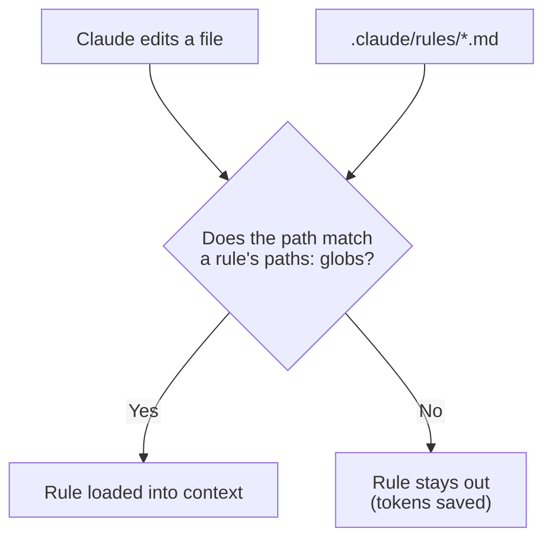

# Task Statement 3.3: Apply Path-Specific Rules for Conditional Convention Loading

> Scenarios: Scenario 2 (Code Generation).

## In One Minute

- **What**: a path-scoped rule is a file in `.claude/rules/` with a `paths:` list of globs in its frontmatter.
- **Why**: it loads only when Claude edits a matching file, so it saves tokens.
- **Best for**: conventions spread across many folders, such as tests that sit next to the code.
- **Exam answer in one line**: tests co-located across the repo means glob-pattern path-scoped rules. Not root `CLAUDE.md` inference, not a skill, not a `CLAUDE.md` in every directory.

---

## Explain Like I'm 13

**The picture:** "Whenever you wear a lab coat, also wear goggles." The rule follows the **clothing** (the file pattern), not the **room** (the folder). Test files live in many folders, but one rule can follow them all.

**In plain steps:**
1. Create `.claude/rules/testing.md` with `paths: ["**/*.test.tsx"]`.
2. Claude loads the rule only when working on a matching file.
3. Check the glob: `**/*.md` matches everywhere, `*.md` only the root.

**Tiny example:** Copying a `CLAUDE.md` into 20 folders means 20 copies to keep in sync, and the next new folder forgets it. One path rule covers all of them.

---

## Concepts Explained

### Why it matters
A directory-level `CLAUDE.md` only covers its own folder. A test convention for `**/*.test.tsx` applies in dozens of folders. One glob rule covers all of them with one file.

### How it works

```markdown
---
paths:
  - "**/*.test.tsx"
---

# Testing conventions
- Use Vitest.
```

- The file is in `.claude/rules/` (for example `testing.md`), shared via version control.
- `paths:` is a list of globs (a single string also works, for example `"**/*.test.tsx"`).
- Claude loads the rule when it works on a file that matches.
- A rule **without** `paths:` is universal and loads always.

**Glob cheat sheet** (as implemented in `main.py`)

| Glob | Matches | Does not match |
|---|---|---|
| `**/*.test.tsx` | `src/a/b.test.tsx`, `b.test.tsx` | `src/a/b.tsx` |
| `terraform/**/*` | `terraform/main.tf`, `terraform/modules/vpc/main.tf` | `infra/terraform/main.tf` |
| `*.md` | `README.md` | `docs/README.md` |

`*` stays inside one folder; `**` crosses folders.

---

## Key Terms

- **Path-scoped rule**: a `.claude/rules/*.md` file with a `paths:` frontmatter list.
- **Glob**: a pattern like `**/*.test.tsx`.
- **Conditional loading**: loading a rule only when a matching file is being worked on.
- **Universal rule**: a rule with no `paths:`.

---

## Architecture



---

## Worked Example

```text
my-repo/
  .claude/rules/
    testing.md          paths: ["**/*.test.tsx"]
    terraform.md        paths: ["terraform/**/*"]
    style.md            (no paths: loads always)
  src/auth/auth.tsx
  src/auth/auth.test.tsx
  src/billing/billing.test.tsx
  terraform/main.tf
```

| File being edited | Rules loaded |
|---|---|
| `src/auth/auth.tsx` | `style` |
| `src/auth/auth.test.tsx` | `style`, `testing` |
| `src/billing/billing.test.tsx` | `style`, `testing` |
| `terraform/main.tf` | `style`, `terraform` |

This repo uses the same mechanism: `.claude/rules/python_quality.md` has `paths: ["**/*.py"]` and `.claude/rules/mermaid_standards.md` has `paths: ["**/*.md", "**/*.ipynb"]`. The `main.py` here reads those real files with `RuleEngine.register_rules_from_dir`.

---

## Exam Traps and Correct Patterns

### Trap 1: A `CLAUDE.md` in every folder for a cross-cutting convention

**Exam scenario**: Test files sit next to code across `src/billing/`, `src/auth/`, `src/reports/` (`*.test.tsx`). All need the same testing conventions.

```text
ANTI-PATTERN: copy a CLAUDE.md into each directory.
  Problems: 3+ copies drift apart. New folders miss it. A directory file applies to every file
  in that folder, not only the tests.

PATTERN: one path-scoped rule.
```

```markdown
---
paths:
  - "**/*.test.tsx"
---
# Testing conventions
- Use React Testing Library, not enzyme.
```

The rule loads only when Claude is working with files matching the glob, wherever they are.

### Trap 2: Hoping Claude infers when to apply a rule

A root `CLAUDE.md` line like "for Terraform files, use these tags" is loaded every session and relies on inference. A rule with `paths: ["terraform/**/*"]` is loaded because of the file match, and costs nothing in other sessions.

### Trap 3: Using a skill for a file-type convention

Skills are invoked on demand. They do not load because you opened a `.tf` file. Use a skill for "run this workflow", a path rule for "when editing these files, follow these conventions".

### Trap 4: Glob mistakes

| Written | Matches | Problem |
|---|---|---|
| `terraform` | Nothing useful (bare name) | Not a glob |
| `terraform/**/*` | Everything under `terraform/` | Correct |
| `*.md` | Root-level markdown only | Misses `docs/guide.md` |
| `**/*.md` | Markdown anywhere | Correct |

A rule with no `paths:` loads always, so it is not conditional at all.

---

## Exam-Style Practice Questions

**Q1 (Scenario 2: Code Generation).** Test files sit next to source files across the whole repo (`*.test.tsx`). You want test conventions applied when editing tests, and not otherwise. What is the best approach?

- A) Put the conventions in the root `CLAUDE.md` and let Claude infer when they apply.
- B) Create a skill and invoke it before each test edit.
- C) Create a `.claude/rules/testing.md` rule with `paths: ["**/*.test.tsx"]`.
- D) Add a `CLAUDE.md` to every directory that contains tests.

**Q2 (Scenario 2).** Which frontmatter loads a Terraform rule only for Terraform files?

- A) `paths: ["terraform/**/*"]`
- B) `paths: terraform`
- C) `applyTo: terraform`
- D) No frontmatter; name the file `terraform.md`

**Q3 (Scenario 5: CI flavour).** The root `CLAUDE.md` contains 300 lines of API conventions. Most CI review runs touch only the frontend, yet they still pay for those tokens. What should you do?

- A) Shorten the API conventions to one line.
- B) Move them to a rule with `paths: ["src/api/**/*"]`.
- C) Move them to `~/.claude/CLAUDE.md`.
- D) Move them to a skill and run it on every PR.

### Answers

**Q1: C.**
- A fails: the file always loads and relies on inference.
- B fails: skills are invoked, not loaded by file pattern.
- D fails: many duplicated files, and a directory file cannot match by file type across folders.

**Q2: A.**
- B fails: `paths` needs a glob list; a bare name is not a pattern that matches files inside.
- C fails: `applyTo` is not the key for Claude Code rules.
- D fails: without `paths:` the rule is universal and always loads.

**Q3: B.**
- A fails: it throws away guidance instead of loading it conditionally.
- C fails: user-level files do not reach CI or teammates.
- D fails: running a skill on every PR adds work and still does not load by path.

---

## Self-Check Checklist

- [ ] I know rules live in `.claude/rules/` and use `paths:` globs.
- [ ] I can write a glob for co-located tests.
- [ ] I know a rule without `paths:` always loads.
- [ ] I can explain why this beats a `CLAUDE.md` in every directory.
- [ ] I can tell a path-scoped rule from a skill.

**Memory hook**: *Same pattern in many places means a glob rule.*

---

## Hands-on Workbook Guide

Open [`ts_3_3_path_specific_rules.ipynb`](ts_3_3_path_specific_rules.ipynb) (offline). It uses [main.py](main.py):

1. Setup and imports.
2. Parse real frontmatter and test `glob_match`.
3. Load this repo's `.claude/rules/` and see which rules match which files.
4. Assertions on matching and on universal rules.

Previous: [TS 3.2](../ts_3_2_slash_commands_and_skills/README.md). Next: [TS 3.4](../ts_3_4_plan_mode_and_refinement/README.md).
