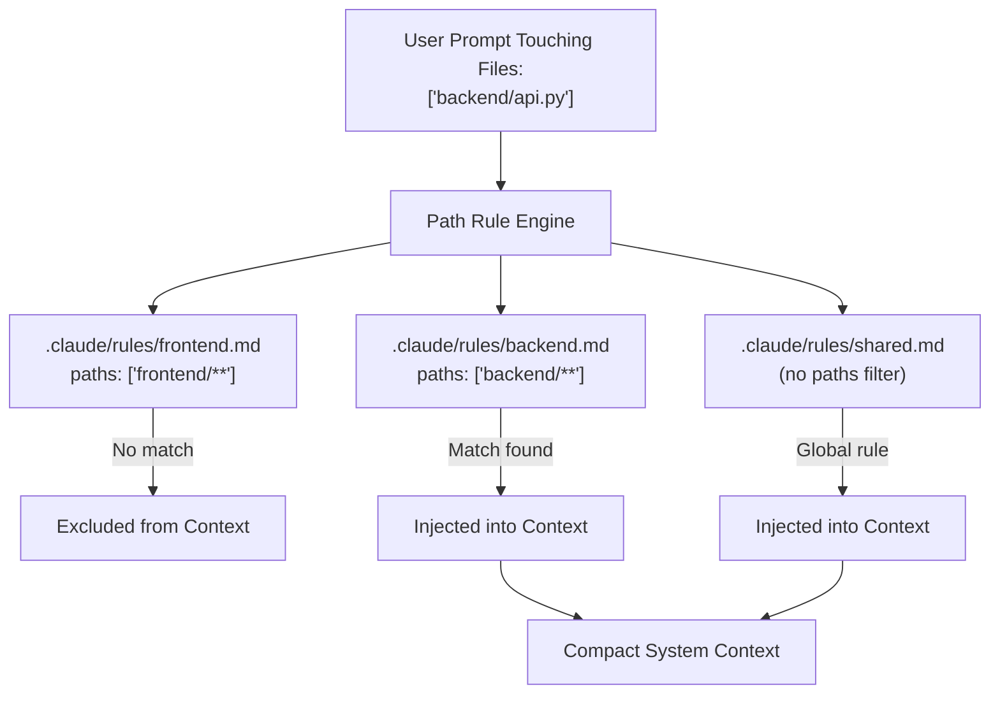

# Task Statement 3.3: Apply Path-Specific Rules for Conditional Convention Loading

## 📌 Executive Overview: Goal, Scope & Exam Importance

### Certification Domain & Weight
- **Domain**: Domain 3: Claude Code Configuration & Workflows
- **Domain Weight**: 18% of total CCAR-F exam score
- **Scenario Alignment**: Scenario 2 (Code Generation) & Scenario 5 (Continuous Integration)

### The Core Goal
To design and deploy **path-specific rules** in `.claude/rules/<name>.md` using YAML frontmatter `paths: [...]` glob patterns. An architect must understand how to dynamically load coding conventions, testing patterns, and architectural constraints **only when matching files are edited**, eliminating context bloat and contradictory instructions across monorepos and multi-stack applications.

### Why This Matters in Production
Modern production repositories rarely contain just one language or framework. A typical repository contains:
- React / TypeScript in `frontend/` (CamelCase, functional components, JSX conventions).
- Python / FastAPI in `backend/` (snake_case, Pydantic schemas, async endpoints).
- Terraform in `infra/` (HCL syntax, resource naming conventions).
If an architect places all these conventions into a single global configuration, two severe problems arise:
1. **Contradictory Instructions**: Claude sees rules saying *"Use CamelCase for variables"* and *"Use snake_case for variables"*, leading to erratic, blended code generation.
2. **Context Window Inflation**: Developers editing CSS files are burdened with 2,000 tokens of backend database migration guidelines.
Path-specific rules solve this by ensuring conventions are injected **only when the developer is actively touching matching files**.

### Exam Importance
Task Statement 3.3 is tested through multi-framework repository scenarios. Questions test whether you know where to place rule files (`.claude/rules/`), how to write YAML frontmatter `paths` glob filters, and how the rule engine resolves which files are active during a turn.

---

## 📖 Deep Narrative: Why We Do What We Do

### 1. The Anatomy of a Path-Specific Rule
A path-specific rule is a standalone markdown file placed inside `.claude/rules/`:
```markdown
---
description: Coding standards and testing patterns for Python backend services.
paths:
  - "backend/**/*.py"
  - "services/**/*.py"
---

# Python Backend Guidelines
- Always use type annotations on all function signatures.
- Use Pydantic v2 schemas for all request/response models.
- All database operations must be wrapped in async context managers.
- Tests must use `pytest-asyncio` fixtures.
```

### 2. The Dynamic Rule Injection Lifecycle
1. **Turn Start**: The developer sends a prompt: *"Refactor `backend/api/auth.py` to support JWT rotation."*
2. **Path Evaluation**: The Claude Code rule engine inspects the file paths touched or mentioned in the prompt (`backend/api/auth.py`).
3. **Glob Matching**:
   - `.claude/rules/frontend.md` (`paths: ["frontend/**"]`) $\rightarrow$ **No Match** (Excluded).
   - `.claude/rules/infra.md` (`paths: ["infra/**"]`) $\rightarrow$ **No Match** (Excluded).
   - `.claude/rules/backend.md` (`paths: ["backend/**/*.py"]`) $\rightarrow$ **Match Found!** (Injected into active prompt).
   - `.claude/rules/security.md` (No `paths` filter) $\rightarrow$ **Global Rule** (Always Injected).
4. **Execution**: Claude receives a focused context containing only general security rules and specific Python backend standards. React and Terraform rules are completely absent.

---

## 🔑 Key Technical Terminology Explained

- **Path-Specific Rule**: A modular rule file located in `.claude/rules/<name>.md` configured to activate conditionally based on file path glob patterns.
- **`paths` Glob Pattern**: A YAML frontmatter array of glob expressions (e.g. `["src/**/*.tsx", "tests/**/*.test.ts"]`) evaluated against files affected in the current interaction.
- **Conditional Rule Injection**: The process of assembling the model's active system prompt by dynamically appending only the rules whose glob patterns match the files under modification.
- **Monorepo Context Isolation**: Preventing conventions from one sub-project (e.g. mobile app) from leaking into and contaminating another sub-project (e.g. backend microservice).
- **Global Rule (Unfiltered)**: A rule file in `.claude/rules/` that omits the `paths` frontmatter block, causing it to load unconditionally across all turns.

---

## 🏗️ Architecture: Rule Precedence & Conditional Injection



---

## ⚠️ Critical Exam Distinctions & Distractor Teardown

| Rule Scoping Strategy | Correct Implementation | Exam Trap to Reject | Why the Trap Fails |
|---|---|---|---|
| **Multi-Stack Repositories** | Define path-scoped rules in `.claude/rules/*.md` with `paths: [...]` globs. | **TRAP**: Putting all stack rules together in root `CLAUDE.md`. | Blends conflicting conventions (e.g. naming conventions, styling) and bloats baseline token cost. |
| **Rule Placement** | Save rules in `.claude/rules/<name>.md` with YAML frontmatter. | **TRAP**: Creating arbitrary custom folders like `my_rules/` without configuring Claude Code. | Claude Code automatically scans only `.claude/rules/` and `CLAUDE.md` by default. |
| **Global Baseline Rules** | Omit the `paths` frontmatter key for universal rules (e.g. git commit style, security rules). | **TRAP**: Hardcoding `paths: ["**/*"]` across 20 different rule files. | Ingests all 20 rule files simultaneously on every turn, completely defeating the purpose of modular rules. |

---

## 💡 Architectural Decision Matrix: Rules of Thumb

| Rule Scope | Location | Frontmatter Filter |
|---|---|---|
| Universal repo policy (e.g. no secrets committed) | `.claude/rules/security.md` | Omit `paths` (loads globally). |
| TypeScript / UI guidelines | `.claude/rules/frontend.md` | `paths: ["frontend/**", "**/*.tsx"]` |
| Python backend guidelines | `.claude/rules/backend.md` | `paths: ["backend/**", "**/*.py"]` |
| Monorepo package quirks | `packages/service-a/CLAUDE.md` | Scoped to directory tree. |

---

## 🧠 Claude 4.5 Extended Thinking & Parameter Standards

- **Context Focus**: With path-specific rules keeping context lean, Claude 4.5's Extended Thinking budget is focused entirely on the relevant language idioms and testing frameworks.
- **Sampling Rules**: Omit `temperature` whenever thinking is enabled.
- **Dynamic Context Switching**: When a conversation shifts from editing Python to editing TypeScript, previous thinking blocks are preserved, while the rule injector dynamically rotates the active rule payload.

---

## 🛠️ Hands-on Workbook Guide: Following the Code Step-by-Step

When exploring [`ts_3_3_path_specific_rules.ipynb`](ts_3_3_path_specific_rules.ipynb):
1. **Step 1: Setup & Glob Matcher**: Initializes the path matching engine with fnmatch glob evaluation.
2. **Step 2: Defining Multi-Stack Rules**: Creates modular rules for frontend, backend, and security.
3. **Step 3: Simulating File Touch Events**: Tests touching `backend/api.py` and verifies frontend rules are excluded.
4. **Step 4: Cross-Stack Interaction**: Demonstrates that touching both frontend and backend files injects both rule sets cleanly.
5. **Step 5: Verification Assertions**: Verifies that 100% of non-matching rules are excluded from the active context.
