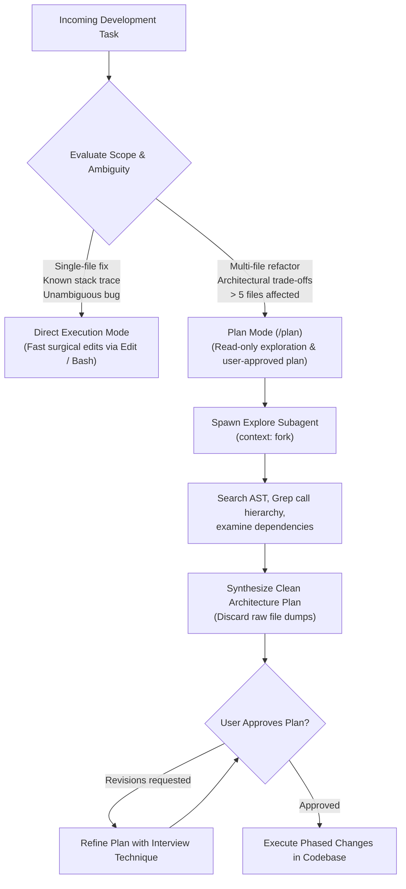

# Task Statement 3.4: Determine When to Use Plan Mode vs Direct Execution

## 📌 Executive Overview: Goal, Scope & Exam Importance

### Certification Domain & Weight
- **Domain**: Domain 3: Claude Code Configuration & Workflows
- **Domain Weight**: 18% of total CCAR-F exam score
- **Scenario Alignment**: Scenario 2 (Code Generation with Claude Code)

### The Core Goal
To master the decision boundaries between **Plan Mode (`/plan`)** and **Direct Execution Mode**, leverage the **Explore Subagent** to isolate codebase reconnaissance, enforce read-only exploration gates before destructive code edits, and manage user approval milestones.

### Why This Matters in Production
In real-world software engineering, premature code editing on complex tasks is the single leading cause of agent failures:
- If an agent jumps straight into writing code on a 25-file database migration, it modifies 4 files, encounters an unexpected cyclic dependency on file 5, gets trapped in compilation errors, and leaves the repository in a partially migrated, un-buildable state.
- Conversely, forcing an agent into a multi-step planning interview for a 1-line typo fix in a known function introduces unnecessary developer friction, latency, and token waste.
Architects must know exactly where the threshold lies: **Direct Execution** for bounded, well-isolated single-file fixes; **Plan Mode** for multi-file refactoring, architectural trade-offs, and ambiguous dependency trees.

### Exam Importance
Task Statement 3.4 questions test whether candidates can evaluate task complexity and select the proper workflow mode. You must recognize that tasks touching multiple files (>5 files) or involving architectural design choices require **Plan Mode** with an **Explore Subagent**, and that no mutating edits are permitted until the user explicitly approves the plan.

---

## 📖 Deep Narrative: Why We Do What We Do

### 1. The Premature Execution Anti-Pattern
Consider a developer instructing Claude: *"Extract the authentication logic from our monolith into a separate microservice package."*
- **The Naive Direct Execution Path**:
  Claude immediately calls `Write("services/auth/main.py")`, then calls `Edit("server.py")` to delete imports. As it edits, it realizes `server.py` relies on shared session cookies that don't exist in the new package. The tests fail. Claude tries to undo its edits, gets lost, and creates duplicate broken files.
- **Root Cause**: The agent modified the codebase before mapping dependencies, understanding call hierarchies, and evaluating trade-offs.

### 2. The Architectural Solution: Plan Mode & The Explore Subagent
Production workflows use **Plan Mode (`/plan`)**:

1. **Read-Only Exploration Gate**:
   - While in Plan Mode, mutating tools (`Write`, `Edit`, `Bash` with side-effects) are **strictly disabled**.
   - Claude is restricted to read-only exploration (`Read`, `Grep`, `Glob`).

2. **The Explore Subagent (`context: fork`)**:
   - Claude Code spawns an Explore Subagent to analyze the call graph, check import paths, and profile database schemas.
   - The subagent runs 30 search queries in a sandboxed session.
   - It distills its findings into an **Architectural Blueprint Plan**, discarding raw file search dumps.

3. **The User Approval Milestone**:
   - Claude presents the structured plan to the developer:
     ```markdown
     ### Architectural Migration Plan:
     1. Phase 1: Create shared auth interface in `interfaces/auth.py`.
     2. Phase 2: Implement JWT session token service in `services/auth/`.
     3. Phase 3: Update `server.py` callers to inject auth client.
     4. Phase 4: Run unit tests and regression suite.
     [Approve Plan / Request Revisions]
     ```
   - Only **after the developer approves the plan** does Claude switch to execution mode and apply code edits sequentially.

---

## 🔑 Key Technical Terminology Explained

- **Plan Mode (`/plan`)**: A specialized Claude Code workflow mode where code mutations are blocked while the agent investigates dependencies, evaluates architectural trade-offs, and formulates a structured implementation plan.
- **Direct Execution Mode**: The standard interactive mode where Claude immediately uses `Read`, `Edit`, and `Write` to implement changes without a formal planning phase.
- **Explore Subagent**: A lightweight subagent spawned with `context: fork` to traverse codebases and summarize dependencies without filling the main conversation with raw search output.
- **Read-Only Exploration Gate**: An architectural constraint in Plan Mode that blocks all file-writing tools until plan approval.
- **User Approval Milestone**: The explicit checkpoint where the human engineer validates the proposed technical approach before code modifications begin.

---

## 🏗️ Architecture: Plan Mode vs Direct Execution Decision Tree



---

## ⚠️ Critical Exam Distinctions & Distractor Teardown

| Workflow Dimension | Correct Implementation | Exam Trap to Reject | Why the Trap Fails |
|---|---|---|---|
| **Broad Multi-File Tasks** | **Plan Mode (`/plan`)**: Map dependencies, formulate plan, obtain user approval before writing code. | **TRAP**: Immediately editing files in a 30-file refactoring task to "demonstrate fast progress". | High probability of hitting unexpected dependencies midway, leaving the codebase in a broken state. |
| **Simple Isolated Fixes** | **Direct Execution**: Perform surgical `Edit` and run tests immediately. | **TRAP**: Entering Plan Mode for 1-line typo fixes or trivial formatting bugs. | Creates unnecessary user friction and wastes latency and tokens on a task with zero ambiguity. |
| **Exploration Output Handling** | Use the **Explore Subagent (`context: fork`)** to keep the main context clean. | **TRAP**: Dumping 40 full file contents directly into the main conversation history. | Fills the context window with raw code, causing attention decay on the actual implementation task. |

---

## 💡 Architectural Decision Matrix: Mode Selection

| Project Indicator | Recommended Mode | Rationale |
|---|---|---|
| **1–2 files affected, known error line** | Direct Execution | Zero ambiguity; fastest time-to-resolution. |
| **5+ files affected, schema changes** | Plan Mode (`/plan`) | High risk of broken interface contracts across modules. |
| **Architectural choices exist (REST vs gRPC)** | Plan Mode (`/plan`) | Human architect must align on design before code is written. |
| **CI pipeline failure with stack trace** | Direct Execution | Stack trace pinpoints exact file and line number. |

---

## 🧠 Claude 4.5 Extended Thinking & Parameter Standards

- **Plan Mode Reasoning**: Extended Thinking (`budget_tokens: 4096`) is critical in Plan Mode to reason through dependency graphs, potential race conditions, and migration rollback steps.
- **Sampling Rules**: Omit `temperature` whenever thinking is enabled.
- **Thinking Continuity**: When transitioning from plan approval to execution, preserve the assistant's thinking blocks so the model maintains reasoning momentum during implementation.

---

## 🛠️ Hands-on Workbook Guide: Following the Code Step-by-Step

When exploring [`ts_3_4_plan_mode_and_refinement.ipynb`](ts_3_4_plan_mode_and_refinement.ipynb):
1. **Step 1: Setup & Task Classifier**: Evaluates task descriptions and file counts to determine execution mode.
2. **Step 2: Direct Execution for Local Fixes**: Demonstrates fast surgical fixes for 1-file bugs.
3. **Step 3: Plan Mode for Multi-File Refactor**: Demonstrates blocking edits, launching Explore subagents, and generating blueprints.
4. **Step 4: User Approval Gate**: Simulates requiring user sign-off before code modifications begin.
5. **Step 5: Verification Assertions**: Verifies that 0 destructive edits occur prior to explicit plan approval.
