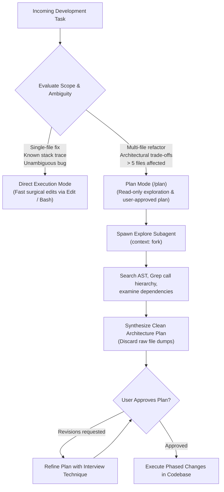

# Task Statement 3.4: Determine When to Use Plan Mode vs Direct Execution

## 🎯 Exam Objective
Understand when to invoke **Plan Mode** versus **Direct Execution**, how to leverage the **Explore Subagent** to isolate verbose codebase investigations, and apply iterative prompt refinement patterns.

---

## 🏗️ Architecture: Plan Mode vs Direct Execution Decision Tree

---

## ⚠️ Critical Exam Distinctions & Anti-Patterns

| Strategy | When to Select on the Exam | Exam Trap to Reject |
|---|---|---|
| **Plan Mode (`/plan`)** | Large refactoring, cross-cutting architectural changes, or when multiple valid implementations exist. | **TRAP**: Diving straight into writing code on a 40-file refactor without creating an architectural plan first. |
| **Direct Execution** | Local bug fixes, well-isolated single-function modifications with deterministic test cases. | **TRAP**: Entering Plan Mode for trivial syntax fixes or 1-line typo corrections (needless friction and delay). |
| **Explore Subagent** | Large codebase discovery and dependency mapping. Runs with `context: fork` to protect main context. | **TRAP**: Dumping thousands of lines of raw grep output directly into the main conversation history. |
| **Iterative Refinement** | Pair ambiguous requirements with **2–3 concrete Input/Output examples** and the **Interview Pattern**. | **TRAP**: Typing repetitive generic follow-ups ("try again", "make it better") without providing test cases or constraints. |

---

## 💡 Architectural Decision Matrix

| Dimension | Direct Execution | Plan Mode (`/plan`) |
|---|---|---|
| **Typical File Scope** | 1–2 files | 3+ files or unknown dependency tree |
| **Tool Restrictions** | All allowed tools active | Read-only exploration until plan approval |
| **Context Strategy** | Inline modifications | Explore subagent with `context: fork` |
| **Reversibility** | High (isolated edit) | Low (broad structural changes) |

---

## 🛠️ Production Code Reference
- Interactive Workbook: [`ts_3_4_plan_mode_and_refinement.ipynb`](ts_3_4_plan_mode_and_refinement.ipynb)
- Runnable Script: [`main.py`](main.py)
- Offline Verification: Run via `uv run pytest tests/test_domain3_full.py` in WSL.
