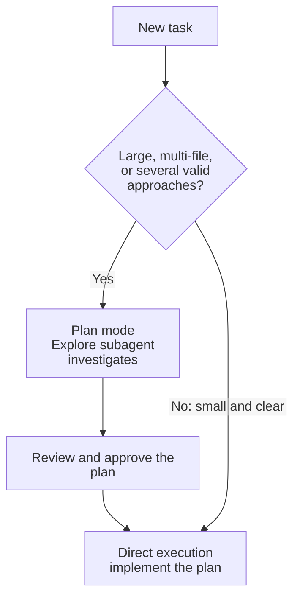

# Task Statement 3.4: Determine When to Use Plan Mode vs Direct Execution

> Scenarios: Scenario 2 (Code Generation).

## In One Minute

- **Plan mode**: for large, multi-file, architectural changes, or when several approaches are valid. Claude investigates and proposes a plan before editing.
- **Direct execution**: for small, well-scoped changes, such as a single-file bug fix with a stack trace or adding one validation.
- **Explore subagent**: runs verbose discovery in its own context and returns a summary, so the main conversation stays clean.
- **Combine them**: plan mode to investigate, direct execution to implement the approved plan.
- **Exam answer in one line**: monolith to microservices means plan mode; a single-file fix with a stack trace means direct execution.

---

## Explain Like I'm 13

**The picture:** Renovating a house needs a blueprint first. Changing a light bulb does not. **Plan mode** is the blueprint step. **Direct execution** is just doing it. An **Explore subagent** is a scout who walks the neighbourhood and brings back a short report instead of you carrying every brick home.

**In plain steps:**
1. Big, many files, several valid designs: plan mode.
2. Small and clear (stack trace points at one line): direct execution.
3. Lots of reading needed: send an Explore subagent.
4. Large and unclear: plan first, then switch to direct to build.

**Tiny example:** "Split the monolith into microservices" without a plan means moving 40 files and then disagreeing about the boundaries.

---

## Concepts Explained

### Why it matters
Starting big changes without a plan causes rework: edits land in the wrong places or follow the wrong design. Planning a one-line fix wastes time.

### How it works

| Signal | Points to |
|---|---|
| Touches many files or services | Plan mode |
| Architectural decision, several valid approaches | Plan mode |
| Unfamiliar codebase, unclear scope | Plan mode |
| Single file, clear cause, stack trace available | Direct execution |
| One small addition (for example one validation) | Direct execution |

- **Explore subagent**: reads and searches in isolation, then returns a summary. This keeps verbose discovery out of the main conversation.
- **Hybrid**: investigate in plan mode, then switch to direct execution to implement what you approved.
- The file-count threshold in `main.py` (`MULTI_FILE_THRESHOLD = 3`) is a **teaching heuristic**, not an official limit.

---

## Key Terms

- **Plan mode**: investigate and propose before editing.
- **Direct execution**: make the change immediately.
- **Explore subagent**: isolates discovery output and returns a summary.
- **Well-scoped change**: small, with a clear cause and clear location.

---

## Architecture



---

## Worked Example

Task A: "Split our billing monolith into three microservices. About 45 files are involved."

- Several valid designs, many files, hard to undo. **Plan mode.**
- Explore subagent maps dependencies and returns a summary. You approve a plan. Then **direct execution** carries it out in steps.

Task B: "`NullPointerException` at `invoice.py:88`, stack trace attached."

- One file, known cause. **Direct execution.** Fix it, run the tests.

`main.py` encodes this: `evaluate_execution_mode(45, True, False, False)` returns plan mode with phases `plan mode: investigate and propose` then `direct execution: apply the plan`. `evaluate_execution_mode(1, False, True, True)` returns direct execution.

---

## Exam Traps and Correct Patterns

### Trap 1: Direct execution for an architectural change

**Exam scenario**: "Restructure the monolith into microservices." Direct execution starts editing at once.

```text
Anti-pattern trace: Claude picks service boundaries by guess, moves 40 files, then you disagree
  with the boundary. Now you undo 40 file moves.
Pattern: plan mode. Claude reads, proposes boundaries, lists affected files and risks. You agree.
  Then switch to direct execution for the approved plan.
```

Signals for plan mode: many files, multiple valid approaches, architectural decision, unfamiliar code. File count is one signal, not a rule.

### Trap 2: Plan mode "to be safe" on a one-line fix

**Exam scenario**: A stack trace points at a null check in `user_service.py` line 88.

Plan mode here adds a proposal step, an approval step, and no benefit, since the cause and fix are clear. Use direct execution: fix, run the tests.

### Trap 3: Verbose discovery in the main chat

Reading 60 files to answer "where is auth handled?" leaves the main context full of file contents. Delegate to an **Explore** subagent. It reads in its own context and returns a summary, so the main conversation keeps room for the real work.

### Trap 4: One mode for the whole job

| Job | Right mix |
|---|---|
| Large task with an unclear start | Plan mode to investigate and propose, then direct execution to implement |
| Typo, rename in one file | Direct only |

Using plan for everything wastes time. Using direct for everything risks expensive rework on large changes.

---

## Exam-Style Practice Questions

**Q1 (Scenario 2: Code Generation).** You must restructure a monolith into microservices. The change spans many files and has several valid designs. Which workflow fits?

- A) Direct execution, starting with the first service.
- B) Plan mode to explore and propose before editing.
- C) Run it once in CI with `-p`.
- D) Add 10 example microservices to `CLAUDE.md`.

**Q2 (Scenario 2).** A production error shows a clear stack trace pointing at one function in one file. What is the best approach?

- A) Plan mode with an Explore subagent across the whole repo.
- B) Plan mode, then ask for three alternative designs.
- C) Direct execution: fix the function and run the tests.
- D) Open a design review before touching any file.

**Q3 (Scenario 5: CI flavour).** You must replace a logging library used at unknown places across the codebase. The call sites are not mapped yet. What is the best workflow?

- A) Direct execution from the start, fixing call sites as you find them.
- B) Plan mode for everything, including the final edits.
- C) Plan mode to investigate (Explore subagent returns a summary), then direct execution of the approved plan.
- D) Skip investigation and let CI find the call sites.

### Answers

**Q1: B.**
- A fails: large, multi-design work needs agreement before edits.
- C fails: `-p` is for non-interactive runs; it does not choose a design.
- D fails: `CLAUDE.md` examples do not replace investigating this codebase.

**Q2: C.**
- A fails: exploring the whole repo is overkill for a known location.
- B fails: there is one obvious fix; alternatives add no value.
- D fails: process overhead for a small, well-scoped change.

**Q3: C.**
- A fails: unknown scope makes edits-as-you-go risky and incomplete.
- B fails: after the plan is approved, direct execution is the efficient way to implement.
- D fails: CI is a late check, not a discovery tool.

---

## Self-Check Checklist

- [ ] I can list signals for plan mode and for direct execution.
- [ ] I know the monolith to microservices example is plan mode.
- [ ] I know a single-file fix with a stack trace is direct execution.
- [ ] I can explain what the Explore subagent isolates.
- [ ] I can describe the hybrid: plan to investigate, direct to implement.

**Memory hook**: *Big or unclear: plan first. Small and clear: just do it.*

---

## Hands-on Workbook Guide

Open [`ts_3_4_plan_mode_and_refinement.ipynb`](ts_3_4_plan_mode_and_refinement.ipynb) (offline). It uses [main.py](main.py):

1. Setup and imports.
2. Run `evaluate_execution_mode` on the two example tasks.
3. Inspect the decision phases and the Explore subagent flag.
4. Assertions on both decisions.

Previous: [TS 3.3](../ts_3_3_path_specific_rules/README.md). Next: [TS 3.5](../ts_3_5_iterative_refinement_interview/README.md).
