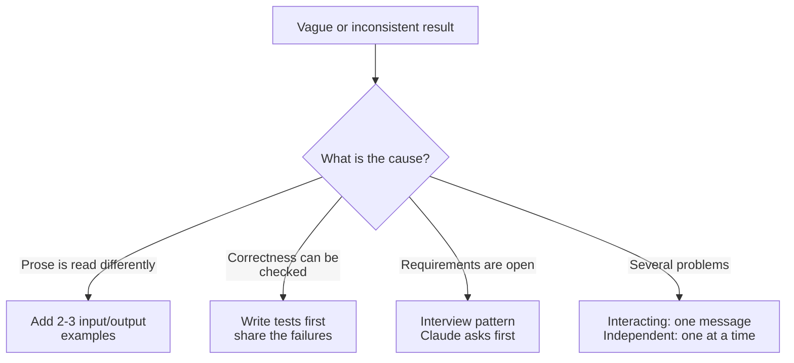

# Task Statement 3.5: Apply Iterative Refinement Techniques for Progressive Improvement

> Scenarios: Scenario 2 (Code Generation).

## In One Minute

- **Concrete examples**: when prose instructions get interpreted inconsistently, give 2-3 input/output examples.
- **Test-driven iteration**: write tests first, run them, and share the failures with Claude.
- **Interview pattern**: have Claude ask questions first, to surface considerations you did not mention (for example cache invalidation).
- **Feedback batching**: put *interacting* problems in one message; fix *independent* problems one after another.
- **Exam answer in one line**: inconsistent results from a prose spec means add concrete input/output examples.

---

## 🧒 Explain Like I'm 13

**The picture:** Teaching a friend a card game. "Play carefully" does not help. Showing two example rounds does. Handing them the answer key (tests) lets them check themselves. And before cooking a birthday dinner you ask what they like (the interview) instead of guessing.

**In plain steps:**
1. Output keeps coming out different? Give 2 to 3 input/output examples.
2. Want it correct? Write the test first, share the failure.
3. Requirements unclear? Ask Claude to interview you first.
4. Problems tangled together? One message. Unrelated problems? One at a time.

**Tiny example:** "Format dates carefully" does nothing. `"3rd March 26" -> 2026-03-03` does.

---

## 📖 Concepts Explained

### Why it matters
Saying "be more precise" changes nothing. Claude needs a concrete target to hit.

### How it works

| Symptom | Technique |
|---|---|
| Output format or edge cases are interpreted differently each run | 2-3 concrete input/output examples |
| You can define "correct" as checks | Write tests first, run, share failures |
| Domain is unfamiliar or requirements are open | Interview pattern: Claude asks questions first |
| Several problems at once | Group those that interact; sequence those that do not |

- **Examples**: show the input, the expected output, and one edge case (for example a missing value).
- **Tests first**: tests define done. After a run, paste the failing output and ask Claude to fix the code, not the tests.
- **Interview**: ask Claude to question you before it designs. It may raise issues like cache invalidation, failure handling, or backward compatibility.
- **Batching**: two issues interact if fixing one changes the other (they touch the same component). Send them together so Claude can solve them jointly.

---

## 🔑 Key Terms

- **Concrete input/output demonstrations**: Representative pairs of input and output data that provide unambiguous ground truth for formatting, schema shapes, and boundary conditions.
- **Test-driven iterative feedback**: The engineering practice of establishing automated unit test assertions and passing raw failure outputs to Claude to guide targeted code fixes.
- **The interview pattern**: A proactive prompting technique where Claude interrogates the developer with 2 to 3 architectural options and trade-offs before generating any implementation code.
- **Interacting feedback issues**: Multiple bugs or design tasks that share shared dependencies or state (such as auth token shapes and auth middleware), requiring bundled resolution in a single turn.
- **Orthogonal independent issues**: Disjoint bugs or improvements (such as a backend route logic bug and a CSS styling fix) that should be decomposed into separate, sequential prompts.

---

## 🏗️ Architecture



---

## 🧪 Worked Example

### ❌ Invalid Example (Anti-Pattern / What Breaks)
*(Anti-Pattern: Guessing Vague Requirements & Prose Adjectives)*
```text
# BROKEN 1: Prompt engineering with vague adjectives
User: "The date parsing is buggy. Please be more careful and precise this time!"
# Result: The model repeats the exact same bug because "be careful" contains zero technical specifications!

# BROKEN 2: Automatically implementing ambiguous requirements without asking
User: "Add rate limiting to our API."
Claude: Automatically writes a Redis token-bucket implementation.
Developer: "We don't use Redis! We use AWS DynamoDB with in-memory caching!"
# Result: Wasted engineering time and 500 lines of throwaway code.
```

### ✅ Valid Example (Production Pattern)
*(Production Pattern: The Interview Pattern & Test-Driven Feedback)*
```text
# CORRECT 1: The Interview Pattern (Present 2-3 options with trade-offs on ambiguous specs)
User: "Add rate limiting to our API."
Claude:
"Before implementing rate limiting, there are 2 architectural approaches depending on your infrastructure:
 Option A: Redis Token Bucket (Best for multi-instance distributed APIs, requires Redis cluster)
 Option B: In-Memory Token Bucket via Guava/LRU (Zero external dependencies, local per-instance limits)
 Option C: API Gateway rate limiting (Offloads traffic before reaching container)
Which backing store fits your deployment?"

# CORRECT 2: Concrete Input/Output Pairs & Test Assertion Feedback
User:
"Here are the exact expected conversions:
- Input: '2026/10/05'  -> Output: '2026-10-05'
- Input: '5 Oct 2026'  -> Output: '2026-10-05'
- Input: ''            -> Output: null

And test failure output:
FAILED tests/test_dates.py::test_empty - AssertionError: expected None, got ''
Fix the code in services/dates.py so this assertion passes without modifying test assertions."
```

Feedback batching with `group_feedback` in `main.py`:

| Issue | Touches | Action |
|---|---|---|
| token payload is wrong | auth, router | Batch together (shares `router`) |
| router order is wrong | router | Batch together (shares `router`) |
| CSS padding is off | dashboard | Send separately (independent subsystem) |

---

## ⚠️ Exam Traps and Correct Patterns

### Trap 1: Adjectives instead of examples

**Exam scenario**: Claude formats dates inconsistently. The prompt says "Be more careful and precise."

That sentence adds no information. Concrete input/output pairs do.

```text
ANTI-PATTERN: "Format dates carefully and consistently."

PATTERN:
  Input: "3rd of March 26"      -> Output: 2026-03-03
  Input: "10/06/2026 (US)"     -> Output: 2026-10-06
  Input: "yesterday"           -> Output: NEEDS_DATE   (do not guess)
```

Use 2 to 3 examples that cover the boundary, not one easy case.

### Trap 2: Describing a failure vaguely instead of using tests

"The export seems wrong sometimes" is not repeatable. Write the failing test first, then ask Claude to make it pass:

```text
FAILED tests/test_export.py::test_empty_cart - expected [] got None
```

Caveat: ask Claude to fix the **code**, not to "fix the tests" until they pass.

### Trap 3: Guessing on open requirements

**Exam scenario**: "Add caching to the API." Claude builds an in-memory cache. You wanted Redis with a 5-minute TTL and invalidation on update.

Use the **interview pattern**: ask Claude to question you first (which data, how stale is acceptable, shared across instances?), then implement. Hidden concerns surface before code, not after a rewrite.

### Trap 4: Batching or splitting issues the wrong way

| Issues | Right | Wrong |
|---|---|---|
| "Token payload is wrong" and "router order is wrong" (both touch `router`) | One message | Two messages: fix 1 can undo fix 2 |
| "CSS padding" and "router order" | Separate sequential messages | One huge message: harder to review and verify |

Rule: interacting problems go together, independent problems go one at a time.

---

## 📝 Exam-Style Practice Questions

**Q1 (Scenario 2: Code Generation).** You describe a log-formatting transformation in prose. Claude interprets it differently on each run, especially for missing values. What is the best next step?

- A) Rewrite the prompt with stronger words such as "exactly" and "always".
- B) Provide 2-3 concrete input/output examples, including a missing-value case.
- C) Ask Claude to try harder.
- D) Move the instructions to `~/.claude/CLAUDE.md`.

**Q2 (Scenario 2).** You are asking for a new caching layer in a system you barely know. You worry you are missing considerations. What technique helps most?

- A) Ask for the full implementation and review it after.
- B) Provide a one-line spec and set a low token limit.
- C) Create a path-scoped rule for cache files.
- D) Use the interview pattern: Claude asks questions first, such as about cache invalidation.

**Q3 (Scenario 5: CI flavour).** A PR review shows three problems: the auth token payload and the router middleware are both wrong (they depend on each other), and a CSS padding bug is unrelated. How should you give feedback?

- A) One message for all three.
- B) Three separate messages in any order.
- C) One message for the payload and middleware, a separate message for the CSS bug.
- D) Ignore the CSS bug.

### Answers

**Q1: B.**
- A fails: stronger words give no new information.
- C fails: this is not an actionable instruction.
- D fails: personal config does not remove the ambiguity.

**Q2: D.**
- A fails: costly rework if hidden constraints appear late.
- B fails: a thin spec makes the gaps worse.
- C fails: rules load conventions by file path; they do not discover missing requirements.

**Q3: C.**
- A fails: bundling an unrelated issue makes review harder.
- B fails: separating interacting issues risks conflicting fixes.
- D fails: unrelated issues still need fixing, just separately.

---

## ✅ Self-Check Checklist

- [ ] I know to use 2-3 concrete input/output examples when prose is inconsistent.
- [ ] I can run a test-first loop and share failures.
- [ ] I can state what the interview pattern is for.
- [ ] I can tell interacting from independent problems.
- [ ] I know that adjectives and "try harder" do not help.

**Memory hook**: *Show examples, share failing tests, ask before building.*

---

## 🛠️ Hands-on Workbook Guide

Open [`ts_3_5_iterative_refinement_interview.ipynb`](ts_3_5_iterative_refinement_interview.ipynb) (offline). It uses [main.py](main.py):

1. Setup and imports.
2. Run the clarity check and build a grounded spec with examples.
3. Group issues with `group_feedback` and format test failures.
4. Assertions on questions, examples and grouping.

---

## 🧭 Navigation & Study Links
- ⬅️ **Previous Topic**: [TS 3.4: Plan Mode, Task Execution & Human Verification](../ts_3_4_plan_mode_and_refinement/README.md)
- 📋 **Domain Overview**: [Domain 3: Claude Code & Developer Workflows](../README.md)
- ➡️ **Next Topic**: [TS 3.6: CI/CD Pipeline Automation & Headless Execution](../ts_3_6_cicd_pipeline_automation/README.md)
- 🎯 **Scenario Practice**: [Master Scenario Practice](../../scenarios/MASTER_SCENARIO_PRACTICE.md)
