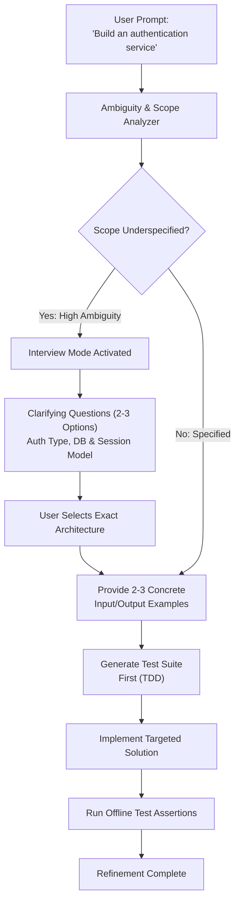

# Task Statement 3.5: Apply Iterative Refinement and the Interview Pattern

## 📌 Executive Overview: Goal, Scope & Exam Importance

### Certification Domain & Weight
- **Domain**: Domain 3: Claude Code Configuration & Workflows
- **Domain Weight**: 18% of total CCAR-F exam score
- **Scenario Alignment**: Scenario 2 (Code Generation) & Scenario 4 (Developer Productivity)

### The Core Goal
To master **iterative prompt refinement techniques**, deploy the **Interview Pattern** to clarify ambiguous requirements before writing code, leverage **concrete Input/Output examples** to eliminate edge-case misunderstandings, and structure feedback appropriately for **interacting versus independent issues**.

### Why This Matters in Production
In real-world software engineering, human requirements are inherently ambiguous: *"Build an authentication service"*, *"Improve query performance"*, or *"Add rate limiting"*. 
If an agent acts on ambiguous prompts by making silent architectural assumptions:
- It might choose JWT tokens when the organization requires server-side Redis sessions.
- It might use SQLite when the production infrastructure runs on PostgreSQL.
- The developer is forced to discard the entire generated codebase and start over.
By applying the **Interview Pattern**, the agent acts as an architectural partner—surfacing 2–3 concrete implementation alternatives with clear trade-offs *before* committing code to disk.

### Exam Importance
Task Statement 3.5 tests your understanding of human-agent collaboration. The exam will ask how Claude should respond to underspecified technical prompts, how to communicate bug reports to Claude, and why providing 2–3 input/output examples is superior to repetitive generic re-prompts.

---

## 📖 Deep Narrative: Why We Do What We Do

### 1. The Interview Pattern: Proactive Clarification
When presented with an underspecified request:
- **Anti-Pattern (Silent Guessing)**: Claude guesses an architecture, writes 400 lines of code, and forces the user to review code built on the wrong stack.
- **Production Standard (The Interview Pattern)**: Claude detects the ambiguity and prompts the user:
  ```markdown
  Before implementing the authentication service, I noticed 3 key architectural decisions:
  1. **Token Strategy**: Stateless JWT vs Server-side Redis session cookies?
  2. **User Storage**: Add to existing PostgreSQL `users` table or create an independent auth schema?
  3. **Password Hashing**: Argon2id (recommended) or bcrypt?
  Please select your preferred configuration, or I can proceed with the recommended defaults.
  ```
- **Result**: The developer aligns the design in 10 seconds, and the generated code is 100% production-ready on the first pass.

### 2. Concrete Input/Output Examples (TDD Grounding)
Natural language descriptions of business logic are notorious for hiding edge cases (e.g., *"Calculate tiered volume discounts"*).
- Vague: *"Make sure discounts apply properly to large enterprise orders."*
- Concrete (The Golden Standard):
  ```markdown
  Please implement `calculate_discount(units: int, price: float) -> float` matching these exact cases:
  - Input: 5 units @ $10.00 -> Output: $50.00 (0% discount for < 10 units)
  - Input: 15 units @ $10.00 -> Output: $135.00 (10% discount for 10-49 units)
  - Input: 100 units @ $10.00 -> Output: $750.00 (25% discount for 50+ units)
  ```
  Concrete examples anchor Claude's reasoning mathematically and allow test generation *before* implementation.

### 3. Interacting vs. Independent Issues Strategy
When reporting issues back to Claude during refinement:
- **Interacting Issues**: When two bugs are causally linked (e.g., a database connection leak causes an API timeout), **report them together in a single prompt** so Claude understands the causal relationship.
- **Independent Issues**: When two bugs are completely unrelated (e.g., a CSS button alignment issue and an SQL query syntax error), **report them in separate, sequential turns** to avoid attention dilution.

---

## 🔑 Key Technical Terminology Explained

- **The Interview Pattern**: Prompting Claude to surface architectural trade-offs, options, and missing specifications before writing code.
- **Ambiguity Gatekeeper**: An internal evaluation step where the agent assesses whether a prompt has sufficient technical specificity to implement reliably.
- **Concrete Input/Output Examples**: Pairing prose requirements with 2–3 explicit numerical or string test cases to anchor model comprehension.
- **Interacting Issues**: Bugs or requirements that share shared state, dependencies, or causal links; must be communicated together.
- **Independent Issues**: Orthogonal bugs with zero shared state; should be resolved in sequential, isolated turns.

---

## 🏗️ Architecture: The Interview Gatekeeper Pattern



---

## ⚠️ Critical Exam Distinctions & Distractor Teardown

| Refinement Scenario | Correct Architectural Implementation | Exam Trap to Reject | Why the Trap Fails |
|---|---|---|---|
| **Underspecified Technical Request** | **The Interview Pattern**: Proactively ask 2–3 targeted questions with options and trade-offs. | **TRAP**: Silently picking the most common framework and immediately generating code. | High probability of choosing the wrong architecture, wasting developer time and requiring full rewrites. |
| **Clarifying Edge Cases** | Provide **2 to 3 concrete Input/Output examples** showing boundary values. | **TRAP**: Repeating the same vague natural language instructions with more aggressive adjectives (*"Be very careful!"*). | Adjectives do not resolve algorithmic ambiguity; concrete data pairs eliminate guesswork. |
| **Reporting Multiple Bugs** | Group **interacting issues** together in 1 prompt; report **independent issues** sequentially. | **TRAP**: Reporting 5 unrelated bugs in a single giant prompt, or splitting causally linked bugs across separate chats. | Conflating unrelated bugs causes attention dilution; splitting causally linked bugs prevents root-cause diagnosis. |

---

## 💡 Architectural Decision Matrix: Refinement Tactics

| Situation | Action to Take | Format |
|---|---|---|
| Prompt mentions "Add database support" | Activate Interview Pattern | Surface 2–3 DB options (Postgres, Redis, SQLite). |
| Edge case in calculation algorithm | Provide Concrete I/O Pairs | Table of Inputs $\rightarrow$ Expected Outputs. |
| Bug A causes Bug B | Report Together | Single prompt explaining the causal link. |
| Bug A in CSS, Bug B in SQL | Report Sequentially | Fix CSS in Turn 1; fix SQL in Turn 2. |

---

## 🧠 Claude 4.5 Extended Thinking & Parameter Standards

- **Interview Generation**: Extended Thinking allows Claude to analyze the user's project structure and formulate high-value architectural questions tailored to the existing stack.
- **Sampling Rules**: Omit `temperature` whenever thinking is enabled.
- **Thinking Continuity**: When the user answers the clarifying questions, preserve previous thinking turns so Claude retains context on the rejected alternatives.

---

## 🛠️ Hands-on Workbook Guide: Following the Code Step-by-Step

When exploring [`ts_3_5_iterative_refinement_interview.ipynb`](ts_3_5_iterative_refinement_interview.ipynb):
1. **Step 1: Setup & Ambiguity Scorer**: Analyzes incoming prompts to calculate an ambiguity score.
2. **Step 2: Activating the Interview Pattern**: Simulates generating structured options for an ambiguous auth task.
3. **Step 3: Concrete I/O Test Generation**: Demonstrates converting I/O examples into automated test assertions.
4. **Step 4: Interacting vs Independent Issue Routing**: Demonstrates grouping causally linked issues.
5. **Step 5: Verification Assertions**: Verifies that ambiguous prompts trigger interviews and concrete examples guarantee test pass rates.
