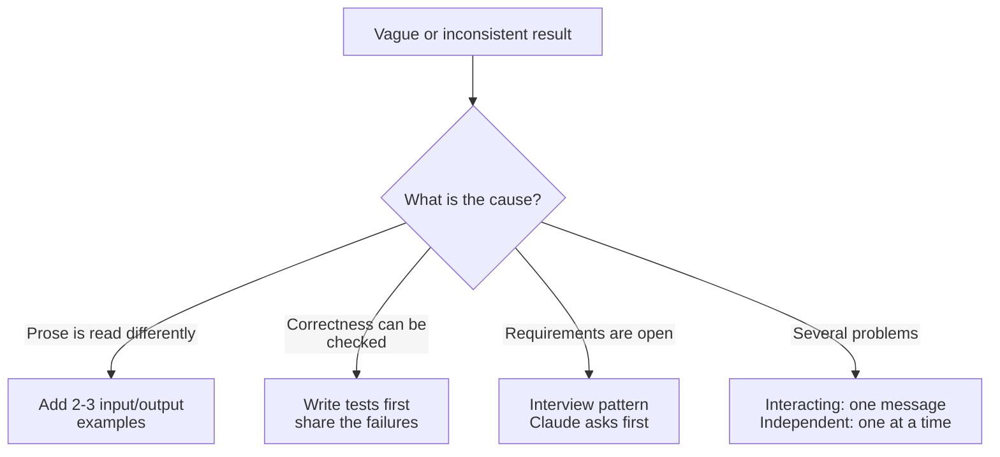

# Task Statement 3.5: Apply Iterative Refinement Techniques for Progressive Improvement

## In One Minute

- **Concrete examples**: when prose instructions get interpreted inconsistently, give 2-3 input/output examples.
- **Test-driven iteration**: write tests first, run them, and share the failures with Claude.
- **Interview pattern**: have Claude ask questions first, to surface considerations you did not mention (for example cache invalidation).
- **Feedback batching**: put *interacting* problems in one message; fix *independent* problems one after another.
- **Exam answer in one line**: inconsistent results from a prose spec means add concrete input/output examples.

## Overview

- **Domain**: Domain 3, Claude Code Configuration & Workflows (**20%** of the exam).
- **Scenarios**: Scenario 2 (Code Generation).
- **Goal**: improve results step by step with precise, checkable feedback.
- **Exam focus**: which refinement technique fits which symptom.

## Concepts Explained

### Simple idea
Show, do not just tell. An example or a failing test is clearer than another adjective.

### Why it matters
Saying "be more precise" changes nothing. Claude needs a concrete target to hit.

### How it works

| Symptom | Technique |
|---|---|
| Output format or edge cases are interpreted differently each run | 2-3 concrete input/output examples |
| You can define "correct" as checks | Write tests first, run, share failures |
| Domain is unfamiliar or requirements are open | Interview pattern: Claude asks questions first |
| Several problems at once | Group those that interact; sequence those that do not |

- **Examples**: show the input, the expected output, and one edge case (for example a missing value).
- **Tests first**: tests define done. After a run, paste the failing output and ask Claude to fix the code, not the tests.
- **Interview**: ask Claude to question you before it designs. It may raise issues like cache invalidation, failure handling, or backward compatibility.
- **Batching**: two issues interact if fixing one changes the other (they touch the same component). Send them together so Claude can solve them jointly.

## Key Terms

- **Concrete input/output example**: a real input paired with its exact expected output.
- **Test-driven iteration**: tests written first, failures shared to guide fixes.
- **Interview pattern**: Claude asks clarifying questions before implementing.
- **Interacting problems**: problems whose fixes affect each other.
- **Independent problems**: problems that can be fixed separately.

## Architecture



## Worked Example

Spec in prose: "Normalize dates." Results vary. Add examples:

```text
Input:  "2026/10/05"      Output: "2026-10-05"
Input:  "5 Oct 2026"      Output: "2026-10-05"
Input:  ""                Output: null
```

Test-driven loop: write `test_normalize_dates`, run it, then send:

```text
These tests fail. Fix the code so they pass without editing the tests:
- test_empty_string: expected None got ""
```

Feedback batching with `group_feedback` in `main.py`:

| Issue | Touches |
|---|---|
| token payload is wrong | auth, router |
| router order is wrong | router |
| CSS padding is off | dashboard |

Result: send *token payload* and *router order* together (they share `router`); send *CSS padding* separately.

## Exam Traps and Correct Patterns

| Concept | Correct | Trap | Why the trap fails |
|---|---|---|---|
| Inconsistent interpretation | 2-3 concrete examples | "Be more careful and precise" | No new information for Claude |
| Verifying correctness | Tests first, share failures | Describe the failure in vague words | Not precise or repeatable |
| Open requirements | Interview first | Guess and rewrite later | Hidden concerns surface late and cost rework |
| Interacting issues | One message | Separate messages | Fixes may conflict |
| Independent issues | Sequential | One huge message | Harder to review and verify |

## Common Mistakes

- Adding adjectives instead of examples.
- Giving one example only, so edge cases stay unclear.
- Asking Claude to "fix the tests" instead of the code.
- Splitting issues that touch the same component across messages.
- Starting a complex feature without asking Claude to interview you.

## Quick Decision Rules

| Situation | Do this |
|---|---|
| Inconsistent output format | Add 2-3 input/output examples |
| Behavior can be checked | Write tests first |
| Open design space | Interview pattern |
| Linked problems | One message |
| Unrelated problems | Separate sequential messages |

## Claude 4.5 Notes

- Models in this repo: `claude-sonnet-4-5`, `claude-haiku-4-5`.
- With extended thinking in API code: leave `temperature` and `top_k`/`top_p` unset; only `tool_choice` `auto` or `none`; echo thinking blocks with signatures unchanged.

## Exam-Style Practice Questions

**Q1 (Scenario 2: Code Generation).** You describe a log-formatting transformation in prose. Claude interprets it differently on each run, especially for missing values. What is the best next step?

- A) Rewrite the prompt with stronger words such as "exactly" and "always".
- B) Provide 2-3 concrete input/output examples, including a missing-value case.
- C) Ask Claude to try harder.
- D) Move the instructions to `~/.claude/CLAUDE.md`.

**Q2 (Scenario 2).** You are asking for a new caching layer in a system you barely know. You worry you are missing considerations. What technique helps most?

- A) Ask for the full implementation and review it after.
- B) Provide a one-line spec and set a low token limit.
- C) Create a path-scoped rule for cache files.
- D) Use the interview pattern: Claude asks questions first, such as about cache invalidation.

**Q3 (Scenario 5: CI flavour).** A PR review shows three problems: the auth token payload and the router middleware are both wrong (they depend on each other), and a CSS padding bug is unrelated. How should you give feedback?

- A) One message for all three.
- B) Three separate messages in any order.
- C) One message for the payload and middleware, a separate message for the CSS bug.
- D) Ignore the CSS bug.

### Answers

**Q1: B.**
- A fails: stronger words give no new information.
- C fails: this is not an actionable instruction.
- D fails: personal config does not remove the ambiguity.

**Q2: D.**
- A fails: costly rework if hidden constraints appear late.
- B fails: a thin spec makes the gaps worse.
- C fails: rules load conventions by file path; they do not discover missing requirements.

**Q3: C.**
- A fails: bundling an unrelated issue makes review harder.
- B fails: separating interacting issues risks conflicting fixes.
- D fails: unrelated issues still need fixing, just separately.

## Self-Check Checklist

- [ ] I know to use 2-3 concrete input/output examples when prose is inconsistent.
- [ ] I can run a test-first loop and share failures.
- [ ] I can state what the interview pattern is for.
- [ ] I can tell interacting from independent problems.
- [ ] I know that adjectives and "try harder" do not help.

**Memory hook**: *Show examples, share failing tests, ask before building.*

## Hands-on Workbook Guide

Open [`ts_3_5_iterative_refinement_interview.ipynb`](ts_3_5_iterative_refinement_interview.ipynb) (offline). It uses [main.py](main.py):

1. Setup and imports.
2. Run the clarity check and build a grounded spec with examples.
3. Group issues with `group_feedback` and format test failures.
4. Assertions on questions, examples and grouping.

Previous: [TS 3.4](../ts_3_4_plan_mode_and_refinement/README.md). Next: [TS 3.6](../ts_3_6_cicd_pipeline_automation/README.md).
