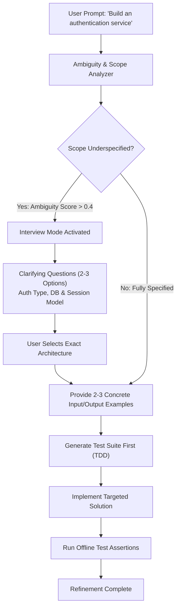

# Task Statement 3.5: Iterative Refinement & The Interview Pattern

## 🎯 Exam Objective
Understand how to apply the Interview Pattern to resolve underspecified requirements before code generation, use concrete I/O examples, and perform test-driven iterative refinement.

---

## 🏗️ Architecture: The Interview Gatekeeper Pattern

---

## ⚠️ Anti-Patterns vs Best Practices

| Anti-Pattern (Fails on Exam) | Recommended Architectural Practice |
|---|---|
| **Silent Guesswork**: Claude assumes JWT + MongoDB without asking and implements 500 lines of throwaway code. | **The Interview Pattern**: Halt execution, outline 2-3 explicit options, and request user confirmation before writing code. |
| **Fragmented Hotfixes**: Fixing one bug at a time across 5 turns, introducing regression cycles. | **Interacting Issue Analysis**: Identify coupling across modules and resolve interacting defects in a unified plan. |
| **Abstract Specifications**: Describing output format purely in prose without examples. | **Concrete Examples**: Provide 2-3 exact Input/Output pairs with boundary conditions. |
