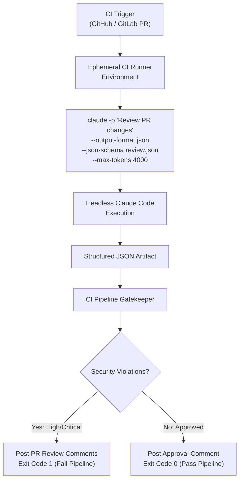

# Task Statement 3.6: CI/CD Pipeline Automation & Headless Execution

## 🎯 Exam Objective
Understand how to integrate Claude Code into automated CI/CD pipelines using non-interactive flags, structured JSON output formats, schema enforcement, and ephemeral sessions.

---

## 🏗️ Architecture: Non-Interactive CI Runner

---

## 📋 Essential CLI Flags for CI/CD

| Flag | Exam Significance |
|---|---|
| `-p` / `--print` | **Mandatory** for CI. Runs non-interactively without prompting for TTY input; prints final output and exits. |
| `--output-format json` | Formats output as machine-readable JSON rather than terminal markdown or ANSI escape sequences. |
| `--json-schema <path>` | Enforces an explicit JSON schema on the response so automated CI scripts can reliably parse fields. |
| `--max-tokens <int>` | Caps total token generation to prevent runaway cloud runner costs on long diffs. |

### Critical Exam Rules:
1. **Never use interactive mode in CI**: Without `-p` or `--print`, the CI runner will hang indefinitely waiting for interactive stdin.
2. **Stateless Ephemeral Sessions**: CI jobs should start fresh and avoid sharing state across builds.
3. **Deterministic Exit Codes**: CI scripts evaluate exit status (0 = success, 1 = failure) to block or approve merge requests.
