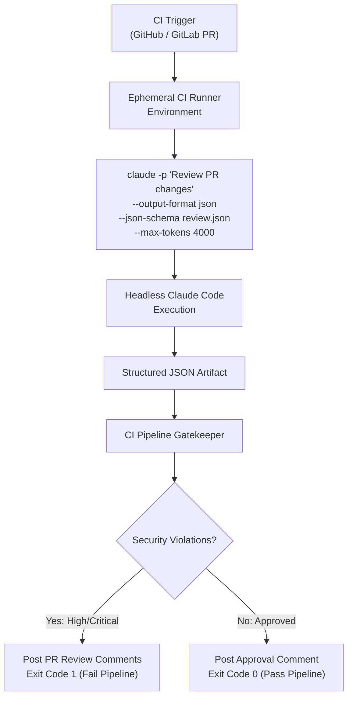

# Task Statement 3.6: Integrate Claude Code into CI/CD Pipelines

## 📌 Executive Overview: Goal, Scope & Exam Importance

### Certification Domain & Weight
- **Domain**: Domain 3: Claude Code Configuration & Workflows
- **Domain Weight**: 18% of total CCAR-F exam score
- **Scenario Alignment**: Scenario 5 (Continuous Integration Pipeline Reviewer)

### The Core Goal
To integrate Claude Code into headless, non-interactive CI/CD automation pipelines (GitHub Actions, GitLab CI, Jenkins), master essential CLI automation flags (**`-p` / `--print`**, **`--output-format json`**, **`--json-schema`**), and implement deterministic pipeline gatekeeping via standard exit codes.

### Why This Matters in Production
Automating code review, dependency scanning, and PR validation directly in CI/CD pipelines catches security flaws and cross-file contract breaks *before* code merges into production. 
However, running Claude Code in automated pipelines presents two critical engineering hazards:
1. **Interactive Hanging**: If Claude Code is executed without non-interactive flags, it prompts for user confirmation or interactive input, causing CI runners to hang indefinitely until runner timeouts kill the job.
2. **Fragile Text Scraping**: If Claude outputs free-form Markdown text, the CI pipeline must use regex to guess whether the PR passed or failed. If Claude says *"I found no major issues, but please verify"*, regex easily misclassifies the verdict.
Using headless flags with **JSON Schema validation** guarantees machine-readable outputs and deterministic exit codes (`0` for pass, `1` for fail).

### Exam Importance
Task Statement 3.6 questions test CLI execution mechanics in headless environments. The exam will ask which CLI flags are mandatory in CI runners, how to enforce schema-compliant JSON outputs from the CLI, and how to configure exit codes to block pull request merges on security findings.

---

## 📖 Deep Narrative: Why We Do What We Do

### 1. The Headless Automation Flag Suite
In automated CI runners, Claude Code must execute completely non-interactively:

```bash
claude -p "Review pull request diff against security and contract rules" \
  --output-format json \
  --json-schema .ci/pr_review_schema.json \
  --max-tokens 4000
```

#### Breaking Down the Flags:
- **`-p` or `--print` (Mandatory)**: Disables the interactive TUI (Terminal User Interface). Prints the output directly to stdout and exits immediately when generation finishes.
- **`--output-format json`**: Instructs Claude Code to serialize the final response into structured JSON rather than ANSI-colored terminal text.
- **`--json-schema <path>`**: Supplies a JSON Schema file that strictly constrains the output structure, eliminating markdown code fences (` ```json `) and guaranteeing valid JSON parsing.
- **`--max-tokens <int>`**: Sets an explicit response token ceiling to prevent runaway costs on giant PRs.

### 2. The Deterministic CI Gatekeeper Lifecycle
1. **Trigger**: Developer opens a pull request.
2. **Ephemeral Runner**: GitHub Actions checks out the repository and runs the headless Claude Code CLI.
3. **Structured Artifact Generation**: Claude Code produces a validated JSON payload:
   ```json
   {
     "verdict": "CHANGES_REQUESTED",
     "exit_code": 1,
     "blocking_issues_count": 1,
     "findings": [
       {
         "severity": "CRITICAL",
         "file": "services/auth.py",
         "line": 42,
         "rule": "SEC_001_HARDCODED_SECRET",
         "description": "Hardcoded production API key found in source code."
       }
     ]
   }
   ```
4. **CI Pipeline Evaluation**:
   - The CI runner inspects `verdict` and `exit_code`.
   - If `exit_code == 1`, the runner posts the findings as PR review comments and terminates with exit code 1, **blocking the merge**.
   - If `exit_code == 0`, the runner posts an approval comment and allows the merge.

---

## 🔑 Key Technical Terminology Explained

- **Headless Execution (`-p` / `--print`)**: Running Claude Code in non-interactive batch mode where all output streams to stdout and the process terminates upon completion.
- **`--output-format json`**: CLI argument directing Claude Code to return structured JSON data rather than conversational text.
- **`--json-schema` Enforcement**: CLI argument binding the output to an explicit JSON schema file, preventing markdown formatting artifacts.
- **Deterministic Pipeline Gatekeeping**: Using binary process exit codes (`0` for success, non-zero for failure) to programmatically allow or block CI/CD pipeline progression.
- **Ephemeral Runner**: A temporary virtual machine or container spun up dynamically to execute a single CI job and immediately destroyed.

---

## 🏗️ Architecture: Non-Interactive CI Runner



---

## ⚠️ Critical Exam Distinctions & Distractor Teardown

| CI/CD Aspect | Correct Implementation | Exam Trap to Reject | Why the Trap Fails |
|---|---|---|---|
| **Non-Interactive Execution** | Pass **`-p` or `--print`** flag to run headlessly without TUI. | **TRAP**: Running raw `claude "Review PR"` without `-p`. | The CLI awaits user confirmation, causing the automated CI job to hang until timeout. |
| **Output Machine Readability** | Use **`--output-format json`** paired with **`--json-schema`**. | **TRAP**: Letting Claude output Markdown and using regex to parse words like *"LGTM"* or *"Approved"*. | Model text phrasing varies widely; regex scraping causes false approvals on broken code. |
| **Merge Enforcement** | Return **Exit Code 1** on critical security or contract violations. | **TRAP**: Always exiting with code 0 and sending a Slack alert to the developer. | Developers overlook Slack messages; only a non-zero exit code reliably blocks unsafe merges in CI. |

---

## 💡 Architectural Decision Matrix: CLI Flags

| Flag | Purpose | Mandatory in CI? |
|---|---|---|
| `-p` / `--print` | Headless execution without interactive prompt | **YES** (Prevents job hanging). |
| `--output-format json` | Structured machine-readable response | **YES** (Enables programmatic parsing). |
| `--json-schema <path>` | Guaranteed schema conformity | **YES** (Guarantees parseable JSON). |
| `--max-tokens <int>` | Spending ceiling for giant diffs | **Recommended** (Controls token costs). |

---

## 🧠 Claude 4.5 Extended Thinking & Parameter Standards

- **CI Review Reasoning**: Claude 4.5 uses Extended Thinking to trace security dataflows (e.g. tracking tainted user inputs to SQL query sinks) before emitting its structured review JSON.
- **Sampling Rules**: Omit `temperature` whenever thinking is enabled.
- **Schema Alignment**: The schema constraints are integrated into the reasoning process to ensure zero JSON schema validation errors.

---

## 🛠️ Hands-on Workbook Guide: Following the Code Step-by-Step

When exploring [`ts_3_6_cicd_pipeline_automation.ipynb`](ts_3_6_cicd_pipeline_automation.ipynb):
1. **Step 1: Setup & CI Runner Simulator**: Simulates headless CLI invocation with flag validation.
2. **Step 2: Headless Flag Assertion**: Verifies that invoking without `-p` raises an immediate error.
3. **Step 3: JSON Schema Enforcement**: Validates that outputs strictly conform to review schemas.
4. **Step 4: Gatekeeper Exit Code Logic**: Tests PR rejection (Exit 1) on critical vulnerabilities and approval (Exit 0) on clean code.
5. **Step 5: Verification Assertions**: Verifies that 100% of pipeline runs produce machine-readable artifacts.
