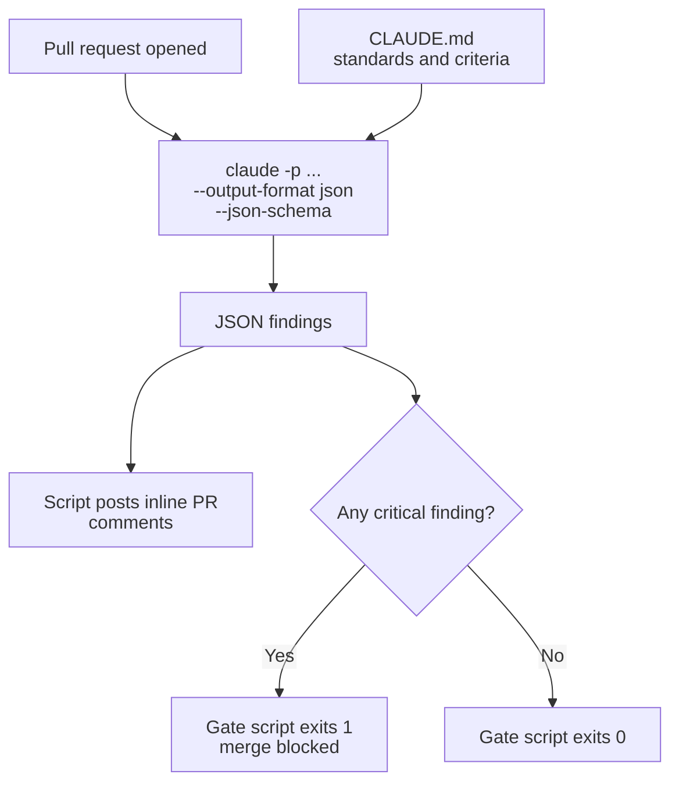

# Task Statement 3.6: Integrate Claude Code into CI/CD Pipelines

> Scenario: Scenario 5 (Claude Code for Continuous Integration).

## In One Minute

- **`-p` / `--print`** runs Claude Code non-interactively. Without it, a CI job hangs waiting for input. (`CLAUDE_HEADLESS` and `--batch` do not exist.)
- **`--output-format json` with `--json-schema`** gives machine-parseable findings that a script can post as inline PR comments.
- **`CLAUDE.md`** gives the CI instance your testing standards, fixtures and review criteria.
- **Use an independent review instance.** The session that wrote the code is worse at reviewing it. On re-runs, include prior findings and ask only for new or unaddressed issues. For test generation, include the existing test files.
- **Exam answer in one line**: a CI job that hangs needs `-p`.

---

## Explain Like I'm 13

**The picture:** A robot with nobody at the keyboard. Without `-p`, Claude waits for someone to press Enter forever. `-p` means "answer once and leave". Findings should come as a **form** (JSON) the robot can read, not a **letter** it must guess at. And the one who wrote the code should not grade it.

**In plain steps:**
1. Run `claude -p "Review this PR" --output-format json --json-schema '{...}'`.
2. Post each finding as an inline PR comment.
3. Use a fresh instance for review, not the author session.
4. On a re-run, include old findings and ask for only new ones.
5. Waiting for the result? Use a normal call. Overnight? Use Batches.

**Tiny example:** A pre-merge check on the 24-hour batch lane means developers wait a day to merge.

---

## Concepts Explained

### Why it matters
A job that waits for input never ends. Free-text output forces fragile text scraping. Both break pipelines.

### How it works

```bash
claude -p "Review this PR diff against our CLAUDE.md criteria" \
  --output-format json \
  --json-schema '{"type":"object","properties":{"findings":{"type":"array"}}}'
```

| Piece | Purpose |
|---|---|
| `-p` / `--print` | Non-interactive run; prints the result and exits |
| `--output-format json` | Machine-parseable output |
| `--json-schema` | Fixes the shape of the findings (file, line, severity, ...) |

- `--json-schema` takes the schema as an **inline JSON string** (print mode only). To keep it in a file, read it in your script: `--json-schema "$(cat .ci/review.schema.json)"`. `--output-format` accepts `text`, `json` or `stream-json`.
- **Findings to comments**: a script reads each finding's `file` and `line` and posts an inline PR comment.
- **Exit code**: the *gate script* decides it (for example 1 when a critical finding exists). It is your script's logic, not a Claude flag.
- **`CLAUDE.md` in CI**: put testing standards, fixtures and review criteria there; the CI instance reads them.
- **Independent review**: start a fresh instance for review. The generating session is biased toward its own work.
- **Re-runs**: pass earlier findings and say "report only new or unaddressed issues", to avoid repeated comments.
- **Test generation**: give the existing test files in context so it does not duplicate tests.
- **Batch vs blocking**: the Message Batches API suits overnight jobs, not pre-merge checks that block a merge (see Domain 4, TS 4.5, in the [Domain 4 README](../../domain4/README.md)).

---

## Key Terms

- **Non-interactive mode**: `-p` / `--print`.
- **Structured output**: `--output-format json` with `--json-schema`.
- **Inline PR comment**: a comment tied to a file and line.
- **Gate**: a pipeline step that passes or fails the build from the findings.
- **Independent review instance**: a separate Claude Code session used only to review.

---

## Architecture



---

## Worked Example

Command (as built by `build_ci_command` in `main.py`):

```text
claude -p "Review this PR diff against CLAUDE.md criteria" --output-format json --json-schema "$(cat .ci/review.schema.json)"
```

Illustrative findings payload:

```json
{
  "status": "CHANGES_REQUESTED",
  "summary": "CI Audit failed with 1 issues (1 critical).",
  "findings": [
    {
      "severity": "CRITICAL",
      "file": "auth/eval_handler.py",
      "line": 42,
      "rule_violated": "SEC001_NO_DYNAMIC_EXEC",
      "description": "Detected unsafe dynamic evaluation via eval()",
      "suggested_fix": "Use ast.literal_eval() or a strict JSON parser."
    }
  ]
}
```

The script turns this into an inline comment on `auth/eval_handler.py` line 42 and exits 1.

On the next push, the re-run prompt (`build_rerun_prompt`) adds:

```text
Prior findings from earlier runs:
- auth/eval_handler.py:42 SEC001_NO_DYNAMIC_EXEC: Detected unsafe dynamic evaluation via eval()
Report only NEW issues or prior findings that are still unaddressed.
```

`validate_ci_command(["claude", "Review PR"])` reports the missing `-p` and `--output-format`. The review step in `main.py` is a **simulation**; no `claude` process runs.

---

## Exam Traps and Correct Patterns

### Trap 1: The CI job that hangs

**Exam scenario**: `claude "Analyze this PR"` in a pipeline never finishes.

Without `-p` (`--print`), Claude Code starts an interactive session and waits for input that never comes. Invented fixes such as `CLAUDE_HEADLESS=true` or `--batch` do not exist.

```bash
# ANTI-PATTERN: waits for a human
claude "Review this PR"

# PATTERN: non-interactive, parseable
claude -p "Review this PR" --output-format json --json-schema '{"type":"object", ...}'
```

### Trap 2: Prose findings parsed with regex

If the review is free text, your script greps for "LGTM" or "critical". Wording changes, and a review that says "no critical issues, but one high-severity bug" is approved by mistake. Use structured output (`--output-format json` with `--json-schema`) so each finding has file, line, severity, and message, and can be posted as an inline PR comment.

### Trap 3: Same session writes and reviews

The session that generated the code carries its own reasoning. It tends to defend its decisions. Use a **fresh independent instance** to review. Extended thinking in the same session does not remove the shared context.

### Trap 4: Re-runs and test generation without history

| Case | Anti-pattern | Pattern |
|---|---|---|
| Push 2 to the same PR | Re-run a review with no history: duplicate comments for fixed issues | Include prior findings and say "report only new or still-unaddressed issues" |
| Generate tests | Generate blind: duplicates what exists | Provide existing test files so it fills gaps only |

### Trap 5: Batch for a blocking check

The Message Batches API saves 50% but can take up to 24 hours with no latency SLA. A pre-merge check blocks developers, so use a synchronous call. Batches are for overnight or weekly audits that nobody waits on.

---

## Exam-Style Practice Questions

**Q1 (Scenario 5: CI).** A GitHub Actions step runs `claude "Review this PR for security issues"` and stays "Running" until the timeout. What is the fix?

- A) Set `CLAUDE_HEADLESS=true`.
- B) Add the `--batch` flag.
- C) Pipe `/dev/null` into the command.
- D) Add `-p` (or `--print`) to run non-interactively.

**Q2 (Scenario 5).** You want review findings as structured data so a script can post inline PR comments. What do you configure?

- A) `-p` alone; the output is already structured.
- B) `--output-format json` with `--json-schema` describing the findings.
- C) Ask for Markdown and extract "LGTM" with a regex.
- D) Run the review in the same session that wrote the code.

**Q3 (Scenario 5).** The session that generated a PR also reviews it and misses issues. After a second push, the review repeats comments that were already fixed. What is the best combination of changes?

- A) Use a larger model and keep the same session.
- B) Delete earlier PR comments before each run.
- C) Review only on the first commit.
- D) Use an independent review instance, and on re-runs include prior findings and ask for only new or unaddressed issues.

### Answers

**Q1: D.**
- A fails: `CLAUDE_HEADLESS` does not exist.
- B fails: `--batch` does not exist.
- C fails: it is a workaround for stdin, not the supported non-interactive flag.

**Q2: B.**
- A fails: `-p` makes it non-interactive but does not fix the output shape.
- C fails: regex on prose is fragile and misclassifies.
- D fails: that adds self-review bias and does nothing for structure.

**Q3: D.**
- A fails: a bigger model in the same session keeps the bias.
- B fails: removes history without telling the reviewer what was reported.
- C fails: later commits go unreviewed.

---

## Self-Check Checklist

- [ ] I know `-p` / `--print` fixes a hanging CI job.
- [ ] I can name the flags for structured output.
- [ ] I know the exit code comes from my gate script.
- [ ] I can explain independent review and re-run deduplication.
- [ ] I know Batches API is for overnight work, not blocking pre-merge checks.

**Memory hook**: *-p to run it, JSON to read it, a fresh reviewer to trust it.*

---

## Hands-on Workbook Guide

Open [`ts_3_6_cicd_pipeline_automation.ipynb`](ts_3_6_cicd_pipeline_automation.ipynb) (offline, no `claude` process). It uses [main.py](main.py):

1. Setup and imports.
2. Build and validate a CI command.
3. Simulate the review, validate the payload, create inline comments, compute the gate.
4. Assertions, including the re-run prompt.

Previous: [TS 3.5](../ts_3_5_iterative_refinement_interview/README.md). Overview: [Domain 3 README](../README.md).
