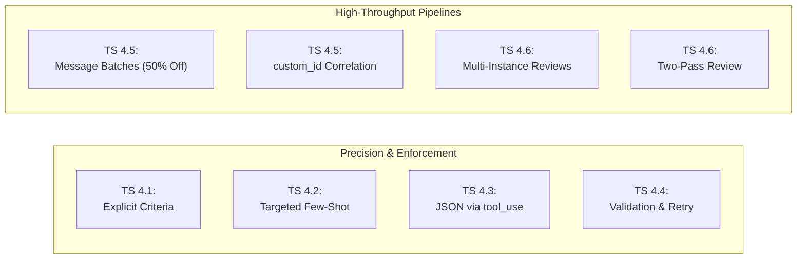
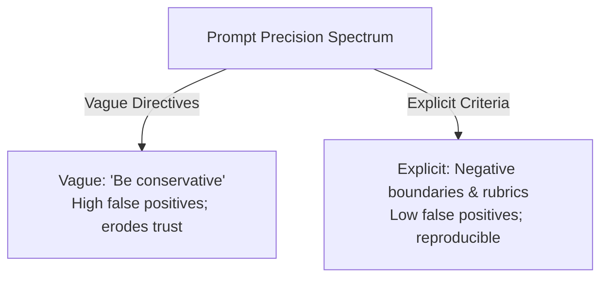
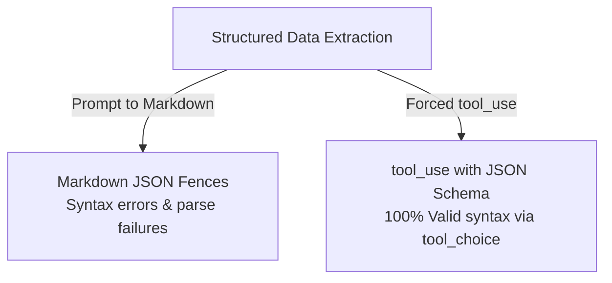
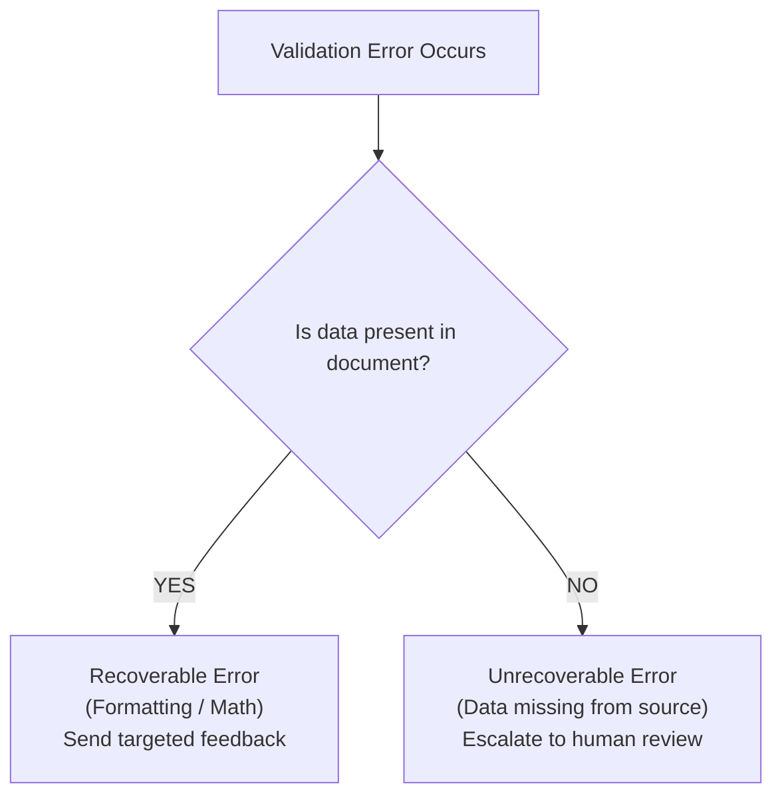
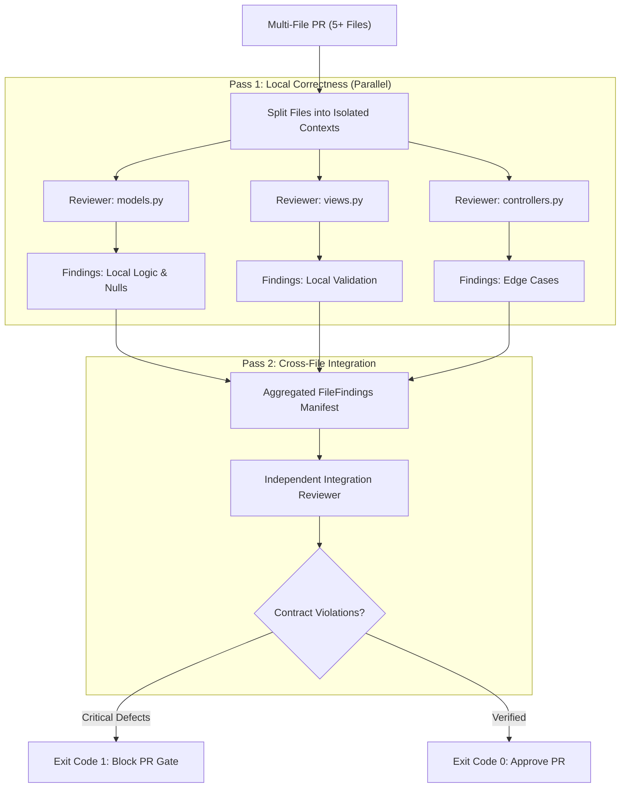
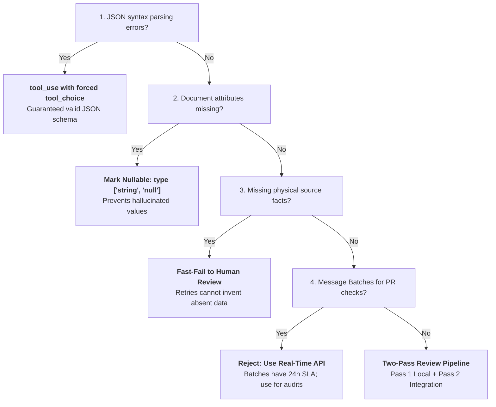

# Domain 4: Prompt Engineering & Structured Output (20% of Exam)
**Master Blueprint & Deep Architectural Guide** | **Certification Weight**: 20%

---

## 📌 Executive Architecture & Task Statement Mapping



| Task Statement | Focus Area | Deterministic Guarantee | Primary Architectural Artifact |
|---|---|---|---|
| **TS 4.1** | Explicit Criteria & Precision | Minimizing false positives | Categorical definitions with negative boundaries & severity tiers |
| **TS 4.2** | Few-Shot Prompting | Structural generalization | 2–4 diverse examples with reasoning & layout variety |
| **TS 4.3** | Guaranteed Structured Output | 100% Valid JSON syntax | Forced `tool_use` with nullable fields & extensible enums |
| **TS 4.4** | Validation & Feedback Loops | Programmatic error recovery | Pydantic validator loop; recoverable vs unrecoverable exit |
| **TS 4.5** | Message Batches API | 50% cost savings at scale | Asynchronous non-blocking batch queue with `custom_id` |
| **TS 4.6** | Multi-Pass Review Architectures| Attention dilution mitigation | Independent review instances; local pass + integration pass |

---

## 🏗️ Detailed Topic & Subtopic Explanations

### TS 4.1: Design Prompts with Explicit Criteria to Improve Precision and Reduce False Positives

#### 1. Categorical Criteria vs. Vague Directives
A common failure mode in LLM prompting is attempting to tune precision using subjective qualifiers:
- **Vague Directives (High False Positives)**:
  - *"Be conservative and only report real issues."*
  - *"Review this code thoroughly and ensure all comments are accurate."*
  - *Result*: The model applies subjective thresholds, flagging stylistic preferences or harmless documentation phrasing as critical bugs.
- **Explicit Categorical Criteria (High Precision)**:
  - *"Report a comment discrepancy ONLY when the documented parameter type, return type, or raised exception explicitly contradicts executed code logic."*
  - *"Do not flag comments for grammatical style, brevity, or missing punctuation."*



#### 2. Negative Boundaries (Defining What NOT to Flag)
Every high-precision prompt must define **negative boundaries**—explicit declarations of common patterns that Claude must intentionally ignore:
- *"Do NOT flag missing type hints in internal test helper functions."*
- *"Do NOT report missing null checks if the variable was checked in preceding guard clauses on lines 10–15."*

#### 3. Concrete Severity Tiers with Snippets
Abstract severity definitions (*"High = important, Low = minor"*) cause severe misclassification.
Production prompts must ground severity tiers in concrete technical criteria:
- **CRITICAL**: Remote Code Execution (RCE), unauthenticated SQL injection, plain-text credential leaks, or memory corruption.
- **HIGH**: Unhandled null pointer exceptions in public API routes, missing CSRF tokens on state-changing endpoints.
- **MEDIUM**: Sub-optimal database queries without indexes, unhandled HTTP 500 on invalid user input.
- **LOW**: Dead code, deprecated API usage with active fallback, minor linting deviations.

#### 4. Managing High False-Positive Categories
When deploying automated code review agents, high false-positive rates erode engineering trust.
- **Exam Rule**: If a category (e.g. "Speculative Race Conditions") produces a 40% false-positive rate, **do not filter by model confidence scores** (model confidence is poorly calibrated).
- **The Architectural Remedy**: **Temporarily disable the noisy category entirely** while engineering team leads refine its explicit criteria and provide negative boundary examples. Re-enable only after benchmark validation.

---

### TS 4.2: Apply Few-Shot Prompting to Improve Output Consistency and Quality

#### 1. Targeted, High-Impact Few-Shot Examples
Few-shot prompting is not about filling the context window with dozens of examples; it is about providing **2 to 4 carefully curated examples** that demonstrate:
1. Handling of edge cases and boundary conditions.
2. The exact formatting and schema structure expected.
3. The chain of reasoning leading to difficult classifications.

#### 2. Generalization vs. String Matching
Poor few-shot examples teach the model to match specific string literals.
High-quality few-shot examples demonstrate **generalizable architectural principles**:
```markdown
<example>
Input:
```python
def get_user_orders(user_id: int):
    # Retrieve user record
    user = db.query(User).filter(User.id == user_id).first()
    # BUG: If user is None, user.orders raises AttributeError
    return user.orders
```
Analysis: The function does not verify that `user` exists before accessing `.orders`. When an invalid `user_id` is supplied, this raises an unhandled `AttributeError` returning HTTP 500.
Classification: HIGH_SEVERITY (Null Dereference)
Remedy: Add `if not user: raise UserNotFoundError(user_id)` before line 5.
</example>
```

#### 3. Structural Diversity in Document Extraction Examples
When extracting data from varied enterprise documents (invoices, receipts, shipping manifests):
- Models frequently fail (returning empty or null fields) when the layout deviates from the prompt's assumed structure.
- **The Production Fix**: Include examples covering multiple distinct physical and syntactic layouts:
  - Example 1: Standard tabular invoice (rows and columns).
  - Example 2: Dense unstructured narrative paragraph with embedded dates and totals.
  - Example 3: Scanned key-value block with missing or null headers.

#### 4. XML Semantic Tag Wrapping
Anthropic models are pre-trained to parse and respect standard XML tags as architectural boundaries:
- Use semantic tags such as `<instructions>`, `<context>`, `<rules>`, `<examples>`, and `<output_format>` to organize prompts.
- **Benefits**:
  - **Injection Defense**: Content encapsulated inside `<document_data>` cannot easily hijack outer system instructions.
  - **Clarity**: Claude treats tags as unambiguous delimiters, preventing instruction bleeding across examples and raw context.
  - **Referenceability**: Prompts can cleanly reference sections: *"Analyze the contract in `<document_data>` adhering to the constraints in `<legal_rubric>`."*

---

### TS 4.3: Enforce Structured Output Using Tool Use and JSON Schemas

#### 1. Guaranteed Syntax Validity via `tool_use`
When extracting structured data, prompting Claude to *"Return raw valid JSON"* in markdown text is fragile:
- Text generation can produce markdown code fences (` ```json `), unescaped double quotes, trailing commas, or conversational prefixes (*"Here is your JSON:"*).
- **The Production Standard**: Define the target output schema as the `input_schema` of a custom tool (e.g., `record_extracted_data`), and set `tool_choice: {"type": "tool", "name": "record_extracted_data"}`.
- **Architectural Guarantee**: Output delivered via `tool_use` is parsed and validated directly by Anthropic's streaming JSON parser at the API layer, guaranteeing **100% syntactically valid JSON**.



#### 2. Hallucination Prevention via Nullable Schema Fields
- **The Failure Mode**: A JSON Schema defines `tax_amount` as a required `number`. When presented with a duty-free receipt that lacks any tax information, Claude **hallucinates a plausible number** (e.g. calculating 8% of total) to satisfy the required constraint.
- **The Production Standard**: Define missing-prone fields as explicitly **nullable**:
  ```json
  "tax_amount": {
    "type": ["number", "null"],
    "description": "Explicit tax amount listed on document. Return null if no tax is stated; do NOT calculate or infer."
  }
  ```

#### 3. Extensible Taxonomy: Enums with "Other" + Companion String
Strict enums break when novel business categories emerge in production documents.
- **The Production Standard**: Combine enum categories with `"other"` and a required companion string:
  ```json
  {
    "payment_method": {
      "type": "string",
      "enum": ["CREDIT_CARD", "WIRE_TRANSFER", "ACH", "CRYPTO", "OTHER"]
    },
    "other_payment_method_detail": {
      "type": ["string", "null"],
      "description": "Required if payment_method is OTHER; specifies the unlisted payment method. Null otherwise."
    }
  }
  ```

#### 4. The Prompt Placement Rule for Long Documents
When extracting structured entities from massive document contexts (20,000 to 100,000+ tokens):
- Placing instructions at the very top of the prompt causes **recency attenuation**: after reading 80 pages of text, Claude's attention on the initial instructions weakens.
- **The Architectural Standard**: Place the source document text first, enclosed in semantic XML tags (e.g. `<document_data>`), and place the specific task instructions, extraction rules, and schema definitions at the **very bottom of the prompt**. This positions the instructions closest to the generation point, maximizing adherence.

---

### TS 4.4: Implement Validation, Retry, and Feedback Loops for Extraction Quality

#### 1. Programmatic Validation with Targeted Error Feedback
When extracting high-value data, output must be validated against programmatic schema and business logic rules (e.g., via Pydantic):
1. **Pass 1**: Claude extracts data via tool call.
2. **Validation**: Python validator evaluates types, ranges, regexes, and mathematical invariants.
3. **Targeted Feedback**: If validation fails, do NOT send a generic message (*"Invalid output, try again"*). Send back the exact field failure:
   ```
   VALIDATION FAILED:
   - Field 'invoice_date': Observed '2026-14-45'. Value is not a valid ISO 8601 calendar date.
   - Field 'line_items': Sum of items ($120.00) does not match 'stated_total' ($150.00).
   Please re-extract and correct these specific discrepancies.
   ```

#### 2. Recoverable vs. Unrecoverable Validation Errors
A crucial architectural concept on the certification exam:
- **Recoverable Errors**: Formatting errors, date format mismatches, arithmetic discrepancies, missing enum mappings.
  - *Remedy*: Retry with targeted error feedback. Claude will self-correct in turn 2.
- **Unrecoverable Errors**: The required information is **fundamentally absent from the source document** (e.g., trying to extract `ssn_last_four` from a restaurant dinner receipt).
  - *Anti-Pattern*: Retrying 3 times when data does not exist. Claude will eventually hallucinate a fake SSN to satisfy the validator!
  - *Remedy*: Detect that missing required data cannot be resolved, break the retry loop immediately, and return a structured failure manifest for human exception handling.



#### 3. Semantic Cross-Validation
- Extract both primitive values and derived totals simultaneously:
  - Extract: `line_items` (with unit prices and quantities).
  - Extract: `stated_total`.
- In validation code, compute `calculated_total = sum(item.price * item.quantity for item in line_items)`.
- Flag a discrepancy if `abs(calculated_total - stated_total) > 0.01`, forcing a cross-check turn.

---

### TS 4.5: Design Efficient Batch Processing Strategies

#### 1. The Anthropic Message Batches API
The Message Batches API allows developers to submit asynchronous batches of up to 10,000 requests per batch:
- **Financial Advantage**: **50% discount** on all input and output tokens compared to standard on-demand pricing.
- **Turnaround Window**: Completed within **24 hours** (usually faster, but no real-time latency SLA).
- **Workload Qualification**:
  - **APPROVED**: Non-blocking overnight code audits, weekly compliance scanning, bulk data extraction, automated test suite generation, migration translations.
  - **PROHIBITED / ANTI-PATTERN**: Pre-merge blocking CI checks, interactive user chats, customer-facing real-time APIs.

#### 2. Batch Correlation via `custom_id`
Every request in a batch must include a unique, deterministic `custom_id`:
```json
{
  "custom_id": "audit-repo-auth-service-file-auth_py-commit-a4f1",
  "params": {
    "model": "claude-3-7-sonnet-20250219",
    "max_tokens": 2048,
    "messages": [{"role": "user", "content": "..."}]
  }
}
```
When retrieving results:
- Results can return out of order.
- The `custom_id` maps each result deterministically back to the originating database record or file.

#### 3. Handling Partial Batch Failures
A batch of 5,000 requests may result in 4,990 successes, 8 rate limit/server errors, and 2 validation errors.
- **The Anti-Pattern**: Re-submitting the entire 5,000-request batch, incurring unnecessary cost and duplicate writes.
- **The Production Standard**: Inspect `result.type` on each record. Filter out failed `custom_id` items and submit a **targeted secondary micro-batch** containing only the 10 failed requests.

#### 4. Batch Lifecycle Mechanics in Python SDK
```python
# 1. Create asynchronous batch
batch = client.messages.batches.create(requests=batch_requests)

# 2. Check processing status
status = client.messages.batches.retrieve(batch.id)
# status.processing_status is 'in_progress', 'canceling', or 'ended'

# 3. Stream results upon completion
for result in client.messages.batches.results(batch.id):
    custom_id = result.custom_id
    if result.result.type == "succeeded":
        process_success(custom_id, result.result.message)
    elif result.result.type == "errored":
        queue_for_resubmission(custom_id, result.result.error)
```

---

### TS 4.6: Design Multi-Instance and Multi-Pass Review Architectures

#### 1. Mitigating Self-Review Bias
- When a language model authors a 500-line implementation, its weights and activation states in that conversation history are primed to defend the architectural choices made.
- Requesting a review in the same session produces superficial approvals (*"Everything looks correct"*).
- **The Architecture**: Instantiate an **independent reviewer instance** with clean context and zero memory of the authoring session, equipped with an adversarial review prompt.

#### 2. Two-Pass Review Pipeline for Enterprise PRs
For pull requests spanning multiple files:



| Review Dimension | Pass 1: Local Per-File Review | Pass 2: Systemic Cross-File Integration Review |
| :--- | :--- | :--- |
| **Primary Invariant** | Local syntactic correctness, null safety, local exception handling | Cross-module API contracts, data model compatibility, security boundaries |
| **Instance Isolation** | Isolated parallel Claude instances per file | Single independent Claude instance with clean conversational memory |
| **Input Context** | Diff of single file + local test file ($\sim 2\text{k}$ tokens) | Aggregated `FileFinding` JSON + public interface signatures ($\sim 6\text{k}$ tokens) |
| **Typical Defects Caught** | Unhandled null dereference, array index out of bounds, SQL string concat | Public method deletion, schema mismatch between caller/callee, auth token leak |
| **Attentional Risk Avoided**| Monolithic review diluting attention across 15 files simultaneously | Model fixating on trivial style in file 1 while missing security flaw in file 14 |


---

## ⚡ What to Remember (Key Exam Day Rules of Thumb)

1. **Explicit Criteria > Vague Advice**:
   - Never prompt "be conservative". Define concrete technical conditions and negative boundaries.
2. **Guaranteed Syntax via `tool_use`**:
   - Force output through a tool schema with `tool_choice: {"type": "tool", "name": "..."}` to guarantee 100% valid JSON syntax without markdown parsing issues.
3. **Missing Data Must Be Nullable**:
   - Mark fields as `type: ["string", "null"]` to prevent Claude from fabricating data when source documents lack the field.
4. **Enums with "Other" + Detail String**:
   - Make taxonomies extensible by adding `"OTHER"` to enums with a companion `other_description` field.
5. **Recoverable vs Unrecoverable Retries**:
   - Formatting and math errors are recoverable via retry feedback. Missing source data is unrecoverable; retrying will cause hallucinations.
6. **50% Batch API Discount (24-Hour SLA)**:
   - Message Batches API saves 50% on tokens. Strictly for non-blocking overnight workloads; never for blocking CI pre-merge checks.
7. **Correlate Batches with `custom_id`**:
   - Use deterministic IDs to correlate responses and resubmit only failed requests.
8. **Disable Noisy Review Categories**:
   - When a review category has high false positives, disable the category entirely while refining criteria, rather than filtering by confidence scores.

---

## ⚠️ Anti-Patterns & Exam Traps

| Anti-Pattern | Exam Scenario Formulation | Real Failure Mode | Architectural Remedy |
|---|---|---|---|
| **Markdown JSON Extraction** | Asking Claude to return raw JSON wrapped in markdown backticks. | Unescaped quotes, trailing commas, and formatting text break regex/JSON parsers. | Enforce schema via `tool_use` with forced `tool_choice`. |
| **Strict Non-Nullable Missing Fields** | Required `tax_id` on receipts that don't list tax numbers. | Claude hallucinates a realistic-looking fake Tax ID to satisfy the schema. | Define field as `type: ["string", "null"]`. |
| **Batch API in Pre-Merge CI** | Using Message Batches API to review PRs before merge. | PR builds block for up to 24 hours waiting for batch completion. | Use on-demand API (`messages.create`) with `-p` flag for CI. |
| **Infinite Retries on Missing Data** | Retrying 3 times when a customer's phone number is missing from an email. | Claude invents a phone number on attempt 3 to stop the validator from complaining. | Abort retry on unrecoverable missing source data; escalate to human. |
| **Confidence Score Thresholding** | Filtering noisy code review categories by keeping only `confidence > 0.8`. | Model-reported confidence is poorly calibrated; false positives persist and real bugs are suppressed. | Disable noisy category temporarily; rewrite with explicit negative boundaries. |
| **Resubmitting Entire Failed Batches** | Resubmitting 10,000 items because 15 items failed during a batch run. | Wastes 99.8% unnecessary API cost and causes duplicate downstream processing. | Use `custom_id` to extract and resubmit only the 15 failed requests. |

---

## 🎯 Practical Scenario Questions & Answers

### Question 1: Eliminating Hallucinations in Missing Data Extraction
**Scenario**: You are architecting a structured invoice processing pipeline for an accounts payable department. The incoming invoices vary widely across 400 international vendors. Some invoices do not include a Purchase Order (PO) number.

Currently, your tool schema defines:
```json
{
  "name": "record_invoice",
  "input_schema": {
    "type": "object",
    "properties": {
      "invoice_id": {"type": "string"},
      "vendor_name": {"type": "string"},
      "po_number": {"type": "string", "description": "The customer PO number listed on invoice"},
      "total_amount": {"type": "number"}
    },
    "required": ["invoice_id", "vendor_name", "po_number", "total_amount"]
  }
}
```

During production audits, you discover that when an invoice lacks a PO number, the agent frequently outputs hallucinated PO numbers (such as `"PO-UNKNOWN"`, `"PO-99999"`, or inventing numbers matching the invoice ID).

What schema modification solves this hallucination issue?

- **A)** Add a prompt instruction: *"Please try very hard not to invent PO numbers if they are missing."*
- **B)** Change the type of `po_number` to `["string", "null"]`, remove it from the `required` array, and update the description to explicitly state: *"Return null if no PO number is present on the document."*
- **C)** Switch to markdown text output and parse the result using regular expressions.
- **D)** Run the invoice through a secondary verification model with temperature set to 1.0.

**Correct Answer**: **B**  
**Architectural Rationale**:  
Option B is correct. When an output field is marked as required with a non-nullable type (`"type": "string"`), the language model is constrained by schema validation to generate a string value. If the source document lacks the requested data, the model experiences severe tension between truthfulness and schema adherence, resulting in plausible hallucinations (e.g. `"PO-99999"`). By making the field explicitly nullable (`type: ["string", "null"]`) and removing it from the `required` list, Claude is explicitly permitted to output `null`, eliminating the incentive to fabricate data.  
- *Distractor Analysis*:  
  - Option A is incorrect because natural language prompt pleadings cannot overcome hard schema validation constraints.  
  - Option C is incorrect because plain text parsing reintroduces syntax errors, markdown backtick pollution, and unescaped quote failures.  
  - Option D is incorrect because increasing temperature increases randomness and hallucination, worsening the problem.

---

### Question 2: Message Batches API Workload Qualification
**Scenario**: An engineering organization is evaluating the Anthropic Message Batches API to optimize their AI infrastructure budget. The platform has four distinct AI workloads:
1. **Workload W1**: Automated nightly security audit scanning 50,000 legacy codebase repositories.
2. **Workload W2**: Interactive customer support chatbot responding to live web users.
3. **Workload W3**: Pull request gating check running on GitHub Actions that blocks merging until approval.
4. **Workload W4**: Weekly compliance report generating synthetic audit logs from database snapshots.

Which of these workloads are appropriate candidates for the Message Batches API?

- **A)** Workloads W1 and W4 only.
- **B)** Workloads W2 and W3 only.
- **C)** Workloads W1, W3, and W4.
- **D)** Workloads W1, W2, W3, and W4.

**Correct Answer**: **A**  
**Architectural Rationale**:  
Option A is correct. The Message Batches API provides a 50% discount on API costs in exchange for an asynchronous turnaround window of up to 24 hours without real-time latency guarantees. Consequently, it is strictly suitable for **non-blocking, asynchronous, high-volume workloads** such as nightly repository audits (W1) and weekly compliance reporting (W4).  
- *Distractor Analysis*:  
  - Workload W2 (interactive customer chatbot) requires sub-second response times; a 24-hour batch API would leave users waiting for hours.  
  - Workload W3 (pre-merge PR blocking check) requires near-real-time feedback (typically < 5–10 minutes) so developers can merge code; routing pre-merge checks to a 24-hour batch queue would completely stall engineering deployment pipelines. Thus, options B, C, and D are incorrect.

---

### Question 3: Handling High False-Positive Categories in Code Review
**Scenario**: A tech company deploys an automated Claude-powered code review bot across their engineering teams. The bot reviews PRs across four categories: Syntax Defects, Security Vulnerabilities, Performance Optimization, and Architectural Best Practices. 

After one month, an engineering survey reveals that while Syntax and Security have a 95% developer acceptance rate, the Architectural Best Practices category has a 42% false-positive rate (flagging subjective design choices as defects). Developers are becoming frustrated and have started ignoring the bot's comments entirely, including critical security alerts.

What is the recommended architectural remediation strategy?

- **A)** Keep the category active, but instruct developers to ignore comments that seem subjective.
- **B)** Add a threshold filter in code that only posts comments if Claude reports a self-assessed confidence score > 0.85.
- **C)** Temporarily disable the Architectural Best Practices category to restore developer trust, while refining its criteria with explicit negative boundaries and concrete code examples before re-enabling.
- **D)** Increase the prompt's temperature from 0.0 to 0.7 to generate more diverse architectural suggestions.

**Correct Answer**: **C**  
**Architectural Rationale**:  
Option C is correct. In enterprise developer tooling, **developer trust is fragile**. When a single noisy category produces high false-positive rates (42%), it causes "alert fatigue," leading engineers to distrust and ignore all bot findings, including valid security vulnerabilities. The documented best practice is to **immediately disable the noisy category** to protect developer confidence, collaborate with team leads to define explicit categorical criteria and negative boundaries, validate on benchmark PRs, and re-enable only when precision reaches acceptable thresholds.  
- *Distractor Analysis*:  
  - Option A is incorrect because asking developers to manually filter noise does not solve alert fatigue and degrades productivity.  
  - Option B is incorrect because LLM self-reported confidence scores are notoriously poorly calibrated; subjective comments are often generated with high model confidence.  
  - Option D is incorrect because increasing temperature increases output variance and hallucination, worsening false positives.

---

### Question 4: Recoverable vs. Unrecoverable Validation Failure
**Scenario**: An autonomous claim processing agent extracts data from medical invoices using Pydantic schema validation. In an automated test, an invoice is submitted that contains doctor notes, procedure codes, and treatment descriptions, but the patient's insurance policy ID is completely missing from the document text.

The Pydantic validator throws: `ValidationError: Field 'policy_id' is required but missing.`

How should the agent's feedback and retry loop handle this failure?

- **A)** Feed the `ValidationError` message back to Claude and retry up to 5 times.
- **B)** Classify this as an **unrecoverable error** because the ground-truth data is fundamentally absent from the source document, terminate the retry loop immediately, and route the claim to a human exception queue with a structured diagnostic manifest.
- **C)** Instruct Claude to query public internet registries to deduce the patient's policy ID.
- **D)** Automatically insert a random 9-digit number into `policy_id` so downstream database transactions do not fail.

**Correct Answer**: **B**  
**Architectural Rationale**:  
Option B is correct. In validation and extraction architectures, errors must be categorized as either **recoverable** (formatting, date syntax, arithmetic mismatches) or **unrecoverable** (information fundamentally absent from source documents). When required data is absent from the input document, retrying the extraction prompt is an anti-pattern: the model cannot extract what is not there, and repeated retries will eventually cause Claude to fabricate/hallucinate a fake policy ID to satisfy the validator. The agent must break the retry loop immediately and escalate to human review.  
- *Distractor Analysis*:  
  - Option A is incorrect because retrying when data does not exist triggers hallucinated identifiers.  
  - Option C is incorrect because medical insurance IDs are private Protected Health Information (PHI) and cannot be found on public web registries; searching public web for patient records violates HIPAA.  
  - Option D is incorrect because injecting fraudulent dummy data corrupts healthcare database integrity and triggers billing audit failures.

---

### Question 5: Partial Failure Recovery in Batch Processing
**Scenario**: An archive migration system submits a batch of 8,000 document digitization tasks to the Message Batches API. Upon batch completion after 14 hours, the response indicates:
- 7,982 requests succeeded with status 200.
- 18 requests failed due to transient upstream network timeouts (`504 Gateway Timeout`).

Every request was originally tagged with a unique `custom_id` formatted as `doc-archive-<uuid>`.

How should the orchestrator recover from this partial failure with minimal cost and latency?

- **A)** Re-submit the entire batch of 8,000 documents to the Message Batches API to ensure complete database consistency.
- **B)** Discard the 18 failed documents as permanently corrupt.
- **C)** Filter the batch results by inspecting each item's status, extract the 18 failed `custom_id`s, and submit a targeted follow-up batch (or on-demand API calls) containing only those 18 requests.
- **D)** Cancel the batch and restart the migration from scratch.

**Correct Answer**: **C**  
**Architectural Rationale**:  
Option C is correct. The primary architectural purpose of assigning deterministic `custom_id` values in the Message Batches API is to enable **fine-grained tracking and partial failure recovery**. Re-submitting the full 8,000 documents would waste thousands of dollars in redundant compute, incur another 14-hour delay, and risk duplicate database insertions. By correlating the 18 failed records via their `custom_id`, the orchestrator can resubmit only the uncompleted items.  
- *Distractor Analysis*:  
  - Option A is incorrect because resubmitting 7,982 already-completed tasks is massively wasteful and cost-inefficient.  
  - Option B is incorrect because transient 504 gateway timeouts are fully recoverable on retry.  
  - Option D is incorrect because restarting an entire 14-hour batch job from scratch destroys operational SLAs.

---

### Question 6: Few-Shot Structural Diversity & Layout Generalization
**Scenario**: You are architecting a high-volume financial data extraction pipeline for an international logistics network. Invoices originate from 300+ freight carriers in varied physical formats. When processing standard tabular invoices with clear column headers (`Item`, `Qty`, `Rate`, `Total`), Claude extracts `line_items` with 99.2% accuracy. However, when processing service invoices where billing details are described in dense narrative paragraphs (*"Consultant performed 12 hours of site inspection on Oct 4 at $125/hr, plus 2 hours of equipment calibration at $75/hr"*), the extraction accuracy drops to 48%, frequently returning `line_items: []`.

Inspection reveals that the current system prompt contains three few-shot examples, all depicting 4-column tabular invoices.

What prompt engineering enhancement provides the most robust generalization across unseen layout formats?

- **A)** Add a prompt directive: *"Please pay very close attention to narrative paragraphs and try harder."*
- **B)** Replace the homogeneous tabular examples with 2–4 structurally diverse few-shot examples featuring distinct layouts (one tabular invoice, one dense narrative statement, and one scanned key-value receipt with missing headers), including `<thinking>` or analysis blocks demonstrating how narrative text maps into the structured `line_items` schema.
- **C)** Increase the number of tabular examples from 3 to 15 to reinforce schema field names.
- **D)** Pre-process narrative invoices using a regex parser to transform them into CSV format.

**Correct Answer**: **B**  
**Architectural Rationale**:  
Option B is correct. In few-shot prompt engineering (TS 4.2), providing multiple examples with identical syntactic structures (all tabular) causes **structural overfitting**: the model learns to associate the extraction task strictly with table borders and headers, failing when identical semantics appear in narrative prose. Curating 2–4 **structurally diverse** examples (tabular, narrative, key-value block) with embedded reasoning steps teaches the model to generalize across semantic representations regardless of physical layout.  
- *Distractor Analysis*:  
  - Option A is incorrect because natural language pleading (*"try harder"*) does not teach the model how to parse unstructured paragraphs into line items.  
  - Option C is incorrect because adding 12 more tabular examples exacerbates structural overfitting and burns valuable context window tokens.  
  - Option D is incorrect because regex cannot reliably parse arbitrary international narrative descriptions with irregular grammatical structures.

---

### Question 7: Two-Pass Review Pipeline for Large Codebases
**Scenario**: A DevOps platform engineering team automates pull request auditing. Pull requests frequently modify 15 to 25 files across microservices. When the entire unified git diff is passed to Claude in a single prompt with the instruction *"Find all security and architecture defects"*, the review bot regularly misses critical authorization bypass vulnerabilities across service boundaries (e.g. `api_gateway.py` exposing an unauthenticated endpoint to `billing_service.py`), while producing verbose comments on trivial style formatting in the first few files.

Which architectural pattern solves this attention dilution and cross-file contract failure?

- **A)** Increase the model's `max_tokens` to 16,384 to allow longer reviews.
- **B)** Implement a **Two-Pass Review Pipeline**:  
  - **Pass 1 (Local Isolation)**: Run parallel, independent Claude reviewer instances for each changed file to evaluate local invariants (syntax, typing, null safety).  
  - **Pass 2 (Cross-File Integration)**: Aggregate the local finding manifests and public interface contracts, passing them to an independent Claude instance tasked exclusively with tracing cross-file authorization flows, shared data models, and API contract parity.
- **C)** Concatenate the entire repository source code into the prompt to provide full historical context.
- **D)** Instruct developers to never submit pull requests touching more than 1 file.

**Correct Answer**: **B**  
**Architectural Rationale**:  
Option B is correct. This is the canonical **Two-Pass Prompt Chaining / Review Architecture** (TS 4.6). Large multi-file diffs overwhelm attention heads, causing **attention dilution**: the model fixates on easy-to-spot syntax or formatting issues in early files and exhausts attention before evaluating complex cross-file interactions. Pass 1 isolates local concerns per file in parallel, while Pass 2 feeds compact summaries and interface signatures to an integration instance that focuses 100% of its attention budget on cross-service authorization contracts and distributed state.  
- *Distractor Analysis*:  
  - Option A is incorrect because `max_tokens` controls generation output length; it does not solve attention dilution over large prompt inputs.  
  - Option C is incorrect because dumping entire repositories floods context with tens of thousands of irrelevant tokens, worsening attention dilution.  
  - Option D is incorrect because forcing 1-file PRs breaks atomic multi-service deployments and slows developer velocity.

---

## ⚡ Exam Rules, Golden Architectural Rules & Anti-Patterns Reference

### 📋 CCAR-F Exam Rules & Scope Boundaries for Domain 4

| Aspect | In-Scope Exam Focus | Out-of-Scope Distractor (Do Not Choose) |
|---|---|---|
| **Precision Improvement** | Explicit categorical criteria, concrete code examples, negative boundaries (what NOT to flag). | Vague guidance ("be conservative"), filtering by self-reported model confidence scores. |
| **High False Positive Management** | Temporarily disable noisy categories entirely while refining criteria to preserve trust. | Relying on confidence score thresholds; instructing Claude to "think harder". |
| **Few-Shot Prompting** | 2–4 targeted examples demonstrating diverse document layouts and explicit reasoning steps. | Providing 15+ homogeneous tabular examples; string-matching regex post-processors. |
| **Structured Output Format** | Strict JSON schemas enforced via `tool_use` with forced `tool_choice`. | Asking for markdown ```json``` blocks; parsing free text with regex or `json.loads`. |
| **Missing Document Data** | Nullable schema types (`type: ["string", "null"]`) so Claude returns `null`. | Marking all fields required and hoping Claude doesn't hallucinate missing data. |
| **Extensible Categorization** | Enum values with `"OTHER"` plus a companion string field (`other_description`). | Open-ended free-text categories without enum validation. |
| **Validation-Retry Boundaries** | Retries fix format and math mismatches; retries FAIL on fundamentally absent data. | Retrying endlessly on missing source data; treating unrecoverable missing data as a model failure. |
| **Semantic Cross-Checking** | Extracting `calculated_total` alongside `stated_total` to catch arithmetic inconsistencies. | Assuming strict JSON schema validation catches semantic mathematical errors. |
| **Message Batches API** | 50% cost savings for 24h non-blocking jobs (overnight debt audits, test gen); `custom_id` correlation. | Using Batches API for blocking pre-merge CI checks; expecting multi-turn tool use in batch. |
| **Review Architecture** | Independent Claude instance (no self-review bias); Two-Pass Review (Pass 1 per-file + Pass 2 integration). | Having the generating session review its own code; single-pass review on 20-file PRs. |

---

### 🏆 The 8 Golden Architectural Rules of Domain 4

1. **Explicit Categorical Criteria Over Vague Adjectives (`TS 4.1`)**:  
   Always define concrete categorical rubrics, code examples, and explicit negative boundaries (what to ignore). Vague instructions like *"be conservative"* or *"only report high-confidence issues"* fail to improve precision because LLMs lack an objective benchmark for subjectivity.
2. **Preserve Developer Trust via Selective Category Disablement (`TS 4.1`)**:  
   When a review or extraction category produces unacceptable false positives, **temporarily disable that category entirely** while engineering better prompts. Relying on self-reported confidence thresholds fails because models are often highly confident in false-positive findings.
3. **Structural Diversity in Few-Shot Examples (`TS 4.2`)**:  
   Provide 2–4 few-shot examples featuring **structurally varied layouts** (e.g., one tabular invoice, one dense narrative paragraph, one key-value receipt). Identical layouts cause structural overfitting, causing the model to extract null when format varies.
4. **Guaranteed Valid Schemas via Tool Use (`TS 4.3`)**:  
   Always enforce structured output by defining tools with JSON schemas and setting `tool_choice: "any"` or `{"type": "tool", "name": "..."}`. Tool use leverages the model's native constrained decoding, guaranteeing 100% syntactically valid JSON and eliminating markdown parsing crashes.
5. **The Nullable Schema Rule for Missing Data (`TS 4.3`)**:  
   Define non-guaranteed attributes as nullable (`type: ["string", "null"]`). When a field is marked required but absent from the source document, Claude is forced to either hallucinate a plausible value or fail. Nullable fields allow Claude to return `null` truthfully.
6. **The Limits of Validation Retries (`TS 4.4`)**:  
   Validation-retry loops with specific error feedback easily resolve syntax errors, field placement, and arithmetic mismatches. However, **retries fail when data is fundamentally absent from the source document**. Stop retrying and immediately escalate unrecoverable missing data to human triage.
7. **The Message Batches API Qualification Rule (`TS 4.5`)**:  
   The Message Batches API provides a **50% cost discount** with a processing window up to 24 hours and no latency SLA. Use Batches strictly for non-blocking, latency-tolerant workloads (overnight technical debt audits, offline test generation). **NEVER use Batches API for blocking pre-merge CI checks.** Use deterministic `custom_id` values to correlate results and resubmit failed documents.
8. **Multi-Instance Two-Pass Review Pipeline (`TS 4.6`)**:  
   To eliminate **self-review bias**, always use an independent Claude review instance that lacks the authoring session's reasoning history. For large code reviews, execute a two-pass pipeline: Pass 1 evaluates local per-file correctness; Pass 2 evaluates cross-file integration and interface contracts to prevent attention dilution.

---

### 🚫 Architectural Anti-Patterns to Reject in Domain 4 (Exam Distractor Teardown)

| Anti-Pattern | The Exam Distractor Trap (Why Candidates Pick It) | Fatal Production Consequence | Correct Architectural Solution |
|---|---|---|---|
| **Vague Prompt Directives ("Be Conservative")** | Simple to add to prompt: *"Be conservative and only report critical issues."* | Precision does not improve; model continues flagging noisy stylistic issues based on subjective interpretation. | Define explicit categorical criteria, concrete severity tiers, and negative boundaries (what to ignore). |
| **Filtering by Self-Reported Confidence** | Asking Claude to return a confidence score (1–10) and filtering below 8. | LLMs are notoriously poorly calibrated; models frequently report 9/10 confidence on hallucinated bugs. | Validate accuracy against labeled benchmark datasets; disable noisy categories while improving prompts. |
| **Homogeneous Few-Shot Layouts** | Providing 5 tabular invoice examples because all training data looks like tables. | Model overfits to table borders; extraction drops to 40% when encountering narrative service invoices. | Curate 2–4 structurally diverse examples (tabular, narrative, receipt) with reasoning steps. |
| **Markdown Free-Text JSON Extraction** | Asking Claude to output a JSON codeblock (````json ... ````) and parsing with `json.loads`. | Markdown wrapping, missing commas, preamble text, or token cutoffs cause fatal syntax parsing crashes. | Enforce structured output via `tool_use` with strict JSON schema and forced `tool_choice`. |
| **Strict Non-Nullable Required Fields** | Marking all 20 schema fields as required to ensure complete database records. | When source documents omit optional fields (e.g. PO Number), Claude fabricates plausible strings to satisfy schema. | Mark missing-prone fields as nullable (`type: ["string", "null"]`) so Claude returns `null`. |
| **Endless Retries on Missing Source Facts** | Looping retry prompts when a required field like Tax ID cannot be found in the document. | Burns tokens and API costs; Claude eventually hallucinates a fake Tax ID on retry turn 3. | Detect unrecoverable missing information; abort retries and route directly to human exception queue. |
| **Batch API for Blocking CI/CD Workflows** | Proposing Message Batches API for pull request merge checks to save 50% on API costs. | PR checks take up to 24 hours to return results, grinding developer velocity and deployment pipelines to a halt. | Use synchronous real-time API for blocking PR checks; reserve Batches API for overnight debt audits. |
| **Monolithic Single-Pass Multi-File Review** | Submitting a 20-file unified diff in a single prompt to save API round-trips. | Causes attention dilution: model focuses on trivial syntax in file 1 and completely misses authorization flaws in file 18. | Two-Pass Review Pipeline: Pass 1 isolates per-file checks; Pass 2 audits cross-file integration contracts. |

---

### 🧠 Domain 4 Rapid Decision Matrix for Scenario Questions



| Question Trigger / Condition | Decision Branch | Architectural Action & Distractor Rule |
| :--- | :---: | :--- |
| **Eliminate JSON syntax parsing errors in extraction?** | **YES** | Enforce schema via `tool_use` and forced `tool_choice` *(NEVER parse markdown text)*. |
| **Prevent hallucinating absent document attributes?** | **YES** | Mark schema fields as **nullable**: `type: ["string", "null"]` *(NEVER required)*. |
| **Validation fails due to physically absent source facts?** | **YES** | Fast-fail and abort retries immediately; route to human review *(retries cannot invent data)*. |
| **Message Batches API for pre-merge PR blocking checks?** | **YES** | Reject: Batches have up to 24h turnaround *(reserve Batches for overnight non-blocking jobs)*. |
| **Auditing multi-file PRs without attention dilution?** | **YES** | Two-Pass Review: Pass 1 (local per-file) + Pass 2 (cross-file integration). |


