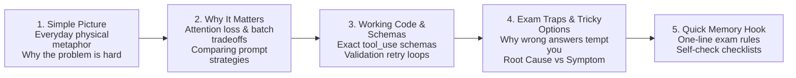
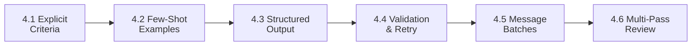
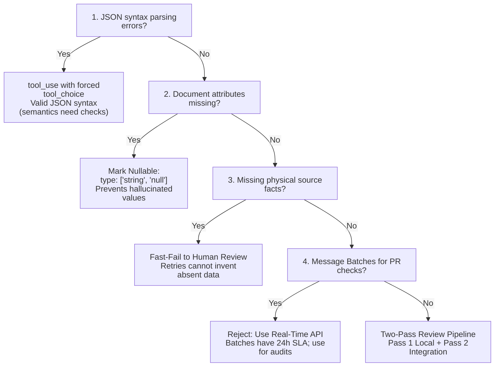

# Domain 4: Prompt Engineering & Structured Output (20% of Exam)

Domain 4 represents **20%** of the **Claude Certified Architect – Foundations (CCAR-F)** exam (D1 27%, D2 18%, D3 20%, D4 20%, D5 15%). It focuses on explicit categorical criteria, few-shot prompting, reliable structured output via `tool_use`, validation-retry feedback loops, the cost-saving Message Batches API, and multi-pass review architectures.

> 📖 **Deep Dive Master Guide**: For exhaustive technical explanations, architecture diagrams, sequence flows, gotchas, to-remember points, and practical scenario questions & answers, see [KEY_CONCEPTS.md](KEY_CONCEPTS.md).
>
> ⚡ **Quick revision**: [CHEATSHEET.md](CHEATSHEET.md) (question wording to answer, look-alike pairs, exact values, elimination filters).

---

## 🧠 How to Master Domain 4 (5 Clear Steps)

> **1. Simple Picture (Mental Model)** → **2. Architectural Why** → **3. Working Code / Schema** → **4. Exam Traps & Wrong Answers** → **5. Memory Hook**



---

## 🏛️ Everyday Metaphors: Foundational Mental Models

| Task Statement | Topic | Everyday Physical Metaphor | Why Naive Approaches Fail | Correct Architectural Pattern |
| :--- | :--- | :--- | :--- | :--- |
| **TS 4.1** | **Explicit Criteria** | **Strict Building Code Checklist** | Telling an inspector to "be careful and sensible" results in wildly inconsistent violations. | **Concrete Categorical Rubrics**: Code examples and explicit negative boundaries (what to ignore) ([TS 4.1](ts_4_1_explicit_criteria_classification/main.py)). |
| **TS 4.2** | **Few-Shot Prompting** | **Master Apprentice Demonstration** | Showing an apprentice 20 identical easy nails teaches nothing; showing 2 tricky corner joints teaches mastery. | **2–4 Structurally Diverse Examples**: Show varied layouts (tables, receipts, narratives) and reasoning steps ([TS 4.2](ts_4_2_few_shot_and_multi_instance/main.py)). |
| **TS 4.3** | **Structured Output** | **Customs Declaration with "N/A"** | If a customs form has no "N/A" box, nervous travelers invent fake numbers to avoid leaving blanks. | **Schema via `tool_use` + Nullable Fields**: Mark optional attributes as `["string", "null"]` to eliminate hallucinations ([TS 4.3](ts_4_3_structured_output_tool_use/main.py)). |
| **TS 4.4** | **Validation & Retry** | **Math Quiz Correction** | Teacher circles an arithmetic mistake for re-calculation; teacher escalates immediately if the page is missing. | **Targeted Retry vs Fast-Fail**: Retry on schema/math errors; fast-fail immediately when data is absent from source ([TS 4.4](ts_4_4_validation_retry_feedback/main.py)). |
| **TS 4.5** | **Message Batches API** | **Bulk Postal Mail vs Courier** | Shipping packages overnight costs half price; hiring an emergency motorcycle courier is needed for instant delivery. | **Batch API for Asynchronous Jobs**: 50% discount for 24h jobs (nightly audits); never use for blocking PR gates ([TS 4.5](ts_4_5_message_batches_api/main.py)). |
| **TS 4.6** | **Multi-Pass Review** | **Independent Peer Review** | Authors always overlook their own typos; a fresh colleague with clean eyes spots mistakes immediately. | **Independent Reviewer & Two-Pass**: Separate review instance; Pass 1 per-file local, Pass 2 cross-file integration ([TS 4.6](ts_4_6_multi_pass_review/main.py)). |

---

## 🗺️ Study Order & Task Statements at a Glance

Follow this sequence from prompt rules (4.1–4.2) to schema contracts (4.3–4.4) to scale & review (4.5–4.6):



| TS | Study Guide | Core Architectural Focus | Key Exam Trap to Avoid |
|---|---|---|---|
| **4.1** | [README](ts_4_1_explicit_criteria_classification/README.md) · [Notebook](ts_4_1_explicit_criteria_classification/ts_4_1_explicit_criteria_classification.ipynb) · [Code](ts_4_1_explicit_criteria_classification/main.py) | Report/skip criteria, severity examples, disabling noisy categories, `detected_pattern`. | Saying "be conservative" or filtering by model confidence scores. |
| **4.2** | [README](ts_4_2_few_shot_and_multi_instance/README.md) · [Notebook](ts_4_2_few_shot_and_multi_instance/ts_4_2_few_shot_and_multi_instance.ipynb) · [Code](ts_4_2_few_shot_and_multi_instance/main.py) | 2–4 targeted examples with reasoning; varied document layouts; explicit null cases. | Giving 15 identical tabular examples (causes layout overfitting). |
| **4.3** | [README](ts_4_3_structured_output_tool_use/README.md) · [Notebook](ts_4_3_structured_output_tool_use/ts_4_3_structured_output_tool_use.ipynb) · [Code](ts_4_3_structured_output_tool_use/main.py) | JSON schema via `tool_use`; `tool_choice`; nullable fields; `unclear`/`other` enums. | Marking every field required (forces fabrication), or forced tool + thinking (HTTP 400). |
| **4.4** | [README](ts_4_4_validation_retry_feedback/README.md) · [Notebook](ts_4_4_validation_retry_feedback/ts_4_4_validation_retry_feedback.ipynb) · [Code](ts_4_4_validation_retry_feedback/main.py) | Retry with document + failed output + error; semantic sum checks; absent vs fixable. | Retrying when the requested fact is physically missing from the source document. |
| **4.5** | [README](ts_4_5_message_batches_api/README.md) · [Notebook](ts_4_5_message_batches_api/ts_4_5_message_batches_api.ipynb) · [Code](ts_4_5_message_batches_api/main.py) | 50% discount for async 24h jobs; `custom_id` matching; SLA math; partial resubmission. | Using Batches API for blocking pre-merge PR checks. |
| **4.6** | [README](ts_4_6_multi_pass_review/README.md) · [Notebook](ts_4_6_multi_pass_review/ts_4_6_multi_pass_review.ipynb) · [Code](ts_4_6_multi_pass_review/main.py) | Independent review instance; Pass 1 per-file + Pass 2 integration; confidence routing. | Same-session self-review, or stuffing 20 files into one giant prompt. |

**Cross-links:** 4.1 ↔ 4.4 (`detected_pattern`, dismissals) · 4.3 ↔ 4.4 (schema syntax then code validation) · 4.5 ↔ 4.6 (batch the nightly review) · 4.2 ↔ 4.6 (few-shot in independent reviews).

---

## ⚡ Domain 4 Exam Rules, Golden Architectural Rules & Anti-Patterns Reference

### 📋 CCAR-F Exam Rules & Scope Boundaries for Domain 4

| Aspect | In-Scope Exam Focus (Official Syllabus) | Out-of-Scope Distractor (Do Not Choose on Exam) |
|---|---|---|
| **Precision Improvement** | Explicit categorical criteria, concrete code examples, negative boundaries (what NOT to flag). | Vague guidance ("be conservative"), filtering by self-reported model confidence scores. |
| **High False Positive Management** | Temporarily disable noisy categories entirely while refining criteria to preserve trust. | Relying on confidence score thresholds; instructing Claude to "think harder". |
| **Feedback Loop Design** | Tracking code constructs that trigger findings (`detected_pattern` field) to enable systematic dismissal analysis. | Deleting dismissals without logging or relying on subjective developer surveys. |
| **Few-Shot Prompting** | 2–4 targeted examples demonstrating diverse document layouts and explicit reasoning steps. | Providing 15+ homogeneous tabular examples; string-matching regex post-processors. |
| **Structured Output Format** | Strict JSON schemas enforced via `tool_use` (`"any"` or a named tool; no extended thinking on forced calls). | Asking for markdown ```json``` blocks; parsing free text with regex or `json.loads`. |
| **Missing Document Data** | Nullable schema types (`type: ["string", "null"]`) so Claude returns `null` instead of fabricating data. | Marking all fields required and hoping Claude doesn't hallucinate missing data. |
| **Extensible Categorization** | Enum values with `"OTHER"` plus a companion string field (`other_description`). | Open-ended free-text categories without enum validation. |
| **Validation-Retry Boundaries** | Retries fix format, syntax, and arithmetic mismatches; retries FAIL on fundamentally absent data. | Retrying endlessly on missing source data; treating unrecoverable missing data as a model failure. |
| **Semantic Cross-Checking** | Extracting `calculated_total` alongside `stated_total` to flag discrepancies; adding `conflict_detected` booleans. | Assuming strict JSON schema validation catches semantic mathematical errors. |
| **Message Batches API** | 50% cost savings for 24h non-blocking jobs (overnight debt audits, test gen); `custom_id` correlation. | Using Batches API for blocking pre-merge CI checks; expecting multi-turn tool use in batch. |
| **Batch SLA Scheduling** | Submission interval + 24 h window must fit the SLA (30 h SLA: at most every 6 h; every 4 h with a 2 h margin); chunking failed items. | Submitting single monolithic batch at the deadline and failing SLA on partial errors. |
| **Batch Sample Refinement** | Refining prompts on a small sample set before batch-processing large volumes to maximize first-pass success. | Submitting 500,000 requests on unverified prompts and paying for massive re-submission rounds. |
| **Review Architecture** | Independent Claude instance (no self-review bias); Two-Pass Review (Pass 1 per-file + Pass 2 integration). | Having the generating session review its own code; single-pass review on 20-file PRs. |

---

### 🏆 The 8 Golden Architectural Rules of Domain 4

1. **Explicit Categorical Criteria Over Vague Adjectives (`TS 4.1`)**:  
   Always define concrete categorical rubrics, code examples, and explicit negative boundaries (what to ignore). Vague instructions like *"be conservative"* or *"only report high-confidence issues"* fail to improve precision because LLMs lack an objective benchmark for subjectivity.
2. **Preserve Developer Trust via Selective Category Disablement (`TS 4.1`)**:  
   When a review or extraction category produces unacceptable false positives, **temporarily disable that category entirely** while engineering better prompts. Relying on self-reported confidence thresholds fails because models are often highly confident in false-positive findings.
3. **Structural Diversity in Few-Shot Examples (`TS 4.2`)**:  
   Provide 2–4 few-shot examples featuring **structurally varied layouts** (e.g., one tabular invoice, one dense narrative paragraph, one key-value receipt). Identical layouts cause structural overfitting, causing the model to extract null when format varies.
4. **Reliable Syntax via Tool Use (`TS 4.3`)**:  
   Define tools with JSON schemas and set `tool_choice` to `"any"` (several extraction tools, type unknown) or `{"type": "tool", "name": "..."}` (a specific tool first). This removes JSON syntax errors and markdown parsing crashes, but not semantic errors. A forced tool cannot be combined with extended thinking.
5. **The Nullable Schema Rule for Missing Data (`TS 4.3`)**:  
   Define attributes that may be absent as nullable (`type: ["string", "null"]`). When a field is marked required but absent from the source document, Claude is pushed to hallucinate a plausible value. Nullable fields allow Claude to return `null` truthfully.
6. **The Limits of Validation Retries (`TS 4.4`)**:  
   Validation-retry loops with specific error feedback easily resolve syntax errors, field placement, and arithmetic mismatches. However, **retries fail when data is fundamentally absent from the source document**. Stop retrying and immediately escalate unrecoverable missing data to human triage.
7. **The Message Batches API Qualification Rule (`TS 4.5`)**:  
   The Message Batches API provides a **50% cost discount** with a processing window up to 24 hours and no latency SLA. Use Batches strictly for non-blocking, latency-tolerant workloads (overnight technical debt audits, offline test generation). **NEVER use Batches API for blocking pre-merge CI checks.** Use deterministic `custom_id` values to correlate results and resubmit failed documents.
8. **Multi-Instance Two-Pass Review Pipeline (`TS 4.6`)**:  
   To eliminate **self-review bias**, always use an independent Claude review instance that lacks the authoring session's reasoning history. For large code reviews, execute a two-pass pipeline: Pass 1 evaluates local per-file correctness; Pass 2 evaluates cross-file integration and interface contracts to prevent attention dilution.

---

### 🚫 Architectural Anti-Patterns to Reject in Domain 4 (Exam Distractor Teardown)

| Anti-Pattern | The Exam Distractor Trap (Why Candidates Pick It) | Fatal Production Consequence | Correct Architectural Solution |
|---|---|---|---|
| **Vague Prompt Directives ("Be Conservative")** | Simple to add to prompt: *"Be conservative and only report critical issues."* | Precision does not improve; model continues flagging noisy stylistic issues based on subjective interpretation. | Define explicit categorical criteria, concrete severity tiers, and negative boundaries (what to ignore). |
| **Filtering by Self-Reported Confidence** | Asking Claude to return a confidence score (1–10) and filtering below 8. | LLMs are notoriously poorly calibrated; models frequently report 9/10 confidence on hallucinated bugs. | Validate accuracy against labeled benchmark datasets; disable noisy categories while improving prompts. |
| **Homogeneous Few-Shot Layouts** | Providing 5 tabular invoice examples because all training data looks like tables. | Model overfits to table borders; extraction drops to 40% when encountering narrative service invoices. | Curate 2–4 structurally diverse examples (tabular, narrative, receipt) with reasoning steps. |
| **Markdown Free-Text JSON Extraction** | Asking Claude to output a JSON codeblock (````json ... ````) and parsing with `json.loads`. | Markdown wrapping, missing commas, preamble text, or token cutoffs cause fatal syntax parsing crashes. | Enforce structured output via `tool_use` with strict JSON schema and forced `tool_choice`. |
| **Strict Non-Nullable Required Fields** | Marking all 20 schema fields as required to ensure complete database records. | When source documents omit optional fields (e.g. PO Number), Claude fabricates plausible strings to satisfy schema. | Mark missing-prone fields as nullable (`type: ["string", "null"]`) so Claude returns `null`. |
| **Endless Retries on Missing Source Facts** | Looping retry prompts when a required field like Tax ID cannot be found in the document. | Burns tokens and API costs; Claude eventually hallucinates a fake Tax ID on retry turn 3. | Detect unrecoverable missing information; abort retries and route directly to human exception queue. |
| **Batch API for Blocking CI/CD Workflows** | Proposing Message Batches API for pull request merge checks to save 50% on API costs. | PR checks take up to 24 hours to return results, grinding developer velocity and deployment pipelines to a halt. | Use synchronous real-time API for blocking PR checks; reserve Batches API for overnight debt audits. |
| **Monolithic Single-Pass Multi-File Review** | Submitting a 20-file unified diff in a single prompt to save API round-trips. | Causes attention dilution: model focuses on trivial syntax in file 1 and completely misses authorization flaws in file 18. | Two-Pass Review Pipeline: Pass 1 isolates per-file checks; Pass 2 audits cross-file integration contracts. |

---

### 🧠 Domain 4 Rapid Decision Matrix for Scenario Questions



| Question Trigger / Condition | Decision Branch | Architectural Action & Distractor Rule |
| :--- | :---: | :--- |
| **Eliminate JSON syntax parsing errors in extraction?** | **YES** | Enforce schema via `tool_use` and `tool_choice` *(NEVER parse markdown text; no thinking on forced calls)*. |
| **Prevent hallucinating absent document attributes?** | **YES** | Mark schema fields as **nullable**: `type: ["string", "null"]` *(NEVER required)*. |
| **Validation fails due to physically absent source facts?** | **YES** | Fast-fail and abort retries immediately; route to human review *(retries cannot invent data)*. |
| **Message Batches API for pre-merge PR blocking checks?** | **YES** | Reject: Batches have up to 24h turnaround *(reserve Batches for overnight non-blocking jobs)*. |
| **Auditing multi-file PRs without attention dilution?** | **YES** | Two-Pass Review: Pass 1 (local per-file) + Pass 2 (cross-file integration). |

---

## 🛠️ Offline Verification & Test Commands

All Domain 4 exercises and simulations execute 100% offline:

```bash
# Run all Domain 4 offline unit tests:
uv run pytest tests/test_domain4_enhancements.py -q
```

---

## 🧭 Navigation & Study Links
- ⬅️ **Previous Domain**: [Domain 3: Claude Code & Developer Workflows](../domain3/README.md)
- 📋 **Exam Blueprint**: [5-Domain Blueprint Matrix](../EXAM_BLUEPRINT.md)
- ⚡ **Exam Refresher**: [Core Architectural Rules & Cheatsheet](../EXAM_REFRESHER.md)
- ➡️ **Next Domain**: [Domain 5: Operational Excellence, Monitoring & Production Readiness](../domain5/README.md)
- 🎯 **Scenario Practice**: [Master Scenario Practice](../scenarios/MASTER_SCENARIO_PRACTICE.md)


