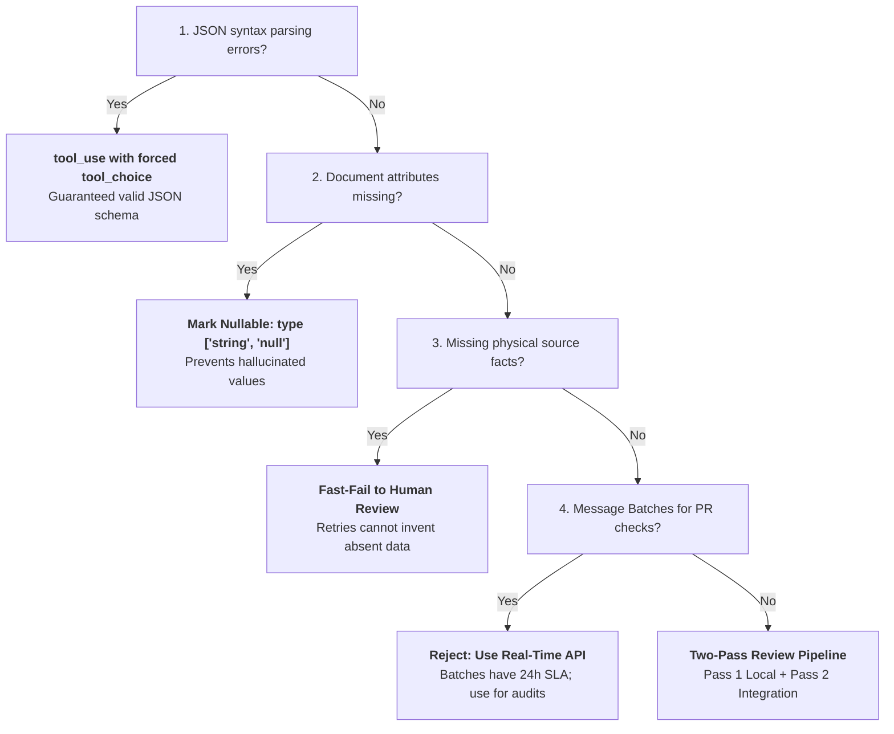

# Domain 4: Prompt Engineering & Structured Output (20% of Exam)

Domain 4 represents 20% of the **Claude Certified Architect – Foundations (CCAR-F)** exam. It focuses on designing prompts with explicit categorical criteria, few-shot prompting for structural generalization, guaranteed valid structured output via `tool_use`, validation-retry feedback loops, high-throughput asynchronous Message Batches API pipelines, and multi-pass review architectures.

> 📖 **Deep Dive Master Guide**: For exhaustive technical explanations, architecture diagrams, sequence flows, gotchas, to-remember points, and practical scenario questions & answers, see [KEY_CONCEPTS.md](KEY_CONCEPTS.md).

---

## 📋 Task Statements & Core Architectural Principles

### [TS 4.1: Design Prompts with Explicit Criteria to Improve Precision and Reduce False Positives](ts_4_1_explicit_criteria_classification/main.py)
- **Categorical Criteria vs Vague Guidance**: Explicit criteria with code examples drastically outperform subjective directives like "be conservative and careful".
- **Negative Boundaries**: Explicitly state what NOT to report (e.g. ignore missing types in test helper functions) to prevent over-eager classification.
- **Managing False Positives**: Temporarily disable noisy categories entirely while refining criteria, rather than filtering by unreliable model confidence scores.
- **Concrete Severity Tiers**: Define Critical, High, Medium, Low with unambiguous technical criteria.
- **Reference Exercise**: [ts_4_1_explicit_criteria_classification/](ts_4_1_explicit_criteria_classification/)

### [TS 4.2: Apply Few-Shot Prompting to Improve Output Consistency and Quality](ts_4_2_few_shot_and_multi_instance/main.py)
- **Targeted Examples**: 2–4 high-impact few-shot examples illustrating complex reasoning, boundary edge cases, and expected output formatting.
- **Generalization**: Teach underlying principles and reasoning rather than string matching.
- **Structural Diversity**: Include diverse layout examples (tables, key-value blocks, unstructured text) to eliminate null extraction errors on varied enterprise documents.
- **Reference Exercise**: [ts_4_2_few_shot_and_multi_instance/](ts_4_2_few_shot_and_multi_instance/)

### [TS 4.3: Enforce Structured Output Using Tool Use and JSON Schemas](ts_4_3_structured_output_tool_use/main.py)
- **Guaranteed Valid Syntax**: Enforcing schemas via `tool_use` with forced `tool_choice` guarantees 100% syntactically valid JSON, eliminating markdown parsing errors.
- **Preventing Hallucinations via Nullable Fields**: Mark missing-prone fields as `type: ["string", "null"]` so Claude outputs `null` instead of fabricating data.
- **Extensible Taxonomy**: Use enum categories with `"OTHER"` plus a companion string field `other_description`.
- **Reference Exercise**: [ts_4_3_structured_output_tool_use/](ts_4_3_structured_output_tool_use/)

### [TS 4.4: Implement Validation, Retry, and Feedback Loops for Extraction Quality](ts_4_4_validation_retry_feedback/main.py)
- **Targeted Error Feedback**: Feed specific Pydantic / JSON schema validator errors (field, observed value, expected format) back to Claude for self-correction.
- **Recoverable vs Unrecoverable Errors**: Retries fix formatting and math errors; retries fail when data is fundamentally absent from source documents. Stop retries and escalate unrecoverable errors to human queues.
- **Semantic Cross-Checking**: Compare independent fields (e.g. `sum(line_items)` vs `stated_total`) to catch calculation mismatches.
- **Reference Exercise**: [ts_4_4_validation_retry_feedback/](ts_4_4_validation_retry_feedback/)

### [TS 4.5: Design Efficient Batch Processing Strategies](ts_4_5_message_batches_api/main.py)
- **Message Batches API**: 50% discount on API costs with up to 24-hour turnaround window (no latency SLA).
- **Workload Qualification**: Ideal for non-blocking overnight audits, large-scale extraction, and test generation; never use for blocking pre-merge CI checks.
- **Correlation & Partial Recovery**: Assign deterministic `custom_id`s to correlate results and resubmit only failed requests.
- **Reference Exercise**: [ts_4_5_message_batches_api/](ts_4_5_message_batches_api/)

### [TS 4.6: Design Multi-Instance and Multi-Pass Review Architectures](ts_4_6_multi_pass_review/main.py)
- **Mitigating Self-Review Bias**: Independent Claude review instances (with clean context) catch subtle defects that the authoring instance overlooks.
- **Multi-Pass Review Pipeline**: Split large PR reviews into Pass 1 (isolated per-file checks) + Pass 2 (cross-file integration pass) to prevent attention dilution.
- **Reference Exercise**: [ts_4_6_multi_pass_review/](ts_4_6_multi_pass_review/)

---

## 🛠️ Hands-on Exercises in this Domain
- `ts_4_1_explicit_criteria_classification/`: Precision classification with explicit negative boundaries and severity tiers.
- `ts_4_2_few_shot_and_multi_instance/`: Diverse few-shot prompting across varied invoice structures.
- `ts_4_3_structured_output_tool_use/`: Guaranteed schema extraction via `tool_use` with nullable fields.
- `ts_4_4_validation_retry_feedback/`: Programmatic validation-retry loops and unrecoverable missing data handling.
- `ts_4_5_message_batches_api/`: Batch submission, `custom_id` correlation, and partial failure resubmission.
- `ts_4_6_multi_pass_review/`: Two-pass code review architecture (local per-file pass + cross-file integration pass).

---

## ⚡ Domain 4 Exam Rules, Golden Architectural Rules & Anti-Patterns Reference

### 📋 CCAR-F Exam Rules & Scope Boundaries for Domain 4

| Aspect | In-Scope Exam Focus (Official Syllabus) | Out-of-Scope Distractor (Do Not Choose on Exam) |
|---|---|---|
| **Precision Improvement** | Explicit categorical criteria, concrete code examples, negative boundaries (what NOT to flag). | Vague guidance ("be conservative"), filtering by self-reported model confidence scores. |
| **High False Positive Management** | Temporarily disable noisy categories entirely while refining criteria to preserve trust. | Relying on confidence score thresholds; instructing Claude to "think harder". |
| **Feedback Loop Design** | Tracking code constructs that trigger findings (`detected_pattern` field) to enable systematic dismissal analysis. | Deleting dismissals without logging or relying on subjective developer surveys. |
| **Few-Shot Prompting** | 2–4 targeted examples demonstrating diverse document layouts and explicit reasoning steps. | Providing 15+ homogeneous tabular examples; string-matching regex post-processors. |
| **Structured Output Format** | Strict JSON schemas enforced via `tool_use` with forced `tool_choice` (`"any"` or named tool). | Asking for markdown ```json``` blocks; parsing free text with regex or `json.loads`. |
| **Missing Document Data** | Nullable schema types (`type: ["string", "null"]`) so Claude returns `null` instead of fabricating data. | Marking all fields required and hoping Claude doesn't hallucinate missing data. |
| **Extensible Categorization** | Enum values with `"OTHER"` plus a companion string field (`other_description`). | Open-ended free-text categories without enum validation. |
| **Validation-Retry Boundaries** | Retries fix format, syntax, and arithmetic mismatches; retries FAIL on fundamentally absent data. | Retrying endlessly on missing source data; treating unrecoverable missing data as a model failure. |
| **Semantic Cross-Checking** | Extracting `calculated_total` alongside `stated_total` to flag discrepancies; adding `conflict_detected` booleans. | Assuming strict JSON schema validation catches semantic mathematical errors. |
| **Message Batches API** | 50% cost savings for 24h non-blocking jobs (overnight debt audits, test gen); `custom_id` correlation. | Using Batches API for blocking pre-merge CI checks; expecting multi-turn tool use in batch. |
| **Batch SLA Scheduling** | Calculating submission frequency (e.g. 4-hour windows to guarantee 30-hour SLA with 24-hour batch turnaround); chunking failed items. | Submitting single monolithic batch at the deadline and failing SLA on partial errors. |
| **Batch Sample Refinement** | Refining prompts on a small sample set before batch-processing large volumes to maximize first-pass success. | Submitting 500,000 requests on unverified prompts and paying for massive re-submission rounds. |
| **Review Architecture** | Independent Claude instance (no self-review bias); Two-Pass Review (Pass 1 per-file + Pass 2 integration). | Having the generating session review its own code; single-pass review on 20-file PRs. |

---

### 🏆 The 8 Golden Architectural Rules of Domain 4

1. **Explicit Categorical Criteria Over Vague Adjectives (`TS 4.1`)**:  
   Always define concrete categorical rubrics, code examples, and explicit negative boundaries (what to ignore). Vague instructions like *"be conservative"* or *"only report high-confidence issues"* fail to improve precision because LLMs lack an objective benchmark for subjectivity.
2. **Preserve Developer Trust via Selective Category Disablement (`TS 4.1`)**:  
   When a review or extraction category produces unacceptable false positives, **temporarily disable that category entirely** while engineering better prompts. Relying on self-reported confidence thresholds fails because models are often highly confident in false-positive findings.
3. **Structural Diversity in Few-Shot Examples (`TS 4.2`)**:  
   Provide 2–4 few-shot examples featuring **structurally varied layouts** (e.g., one tabular invoice, one dense narrative paragraph, one key-value receipt). Identical layouts cause structural overfitting, causing the model to extract null when format varies.
4. **Guaranteed Valid Schemas via Tool Use (`TS 4.3`)**:  
   Always enforce structured output by defining tools with JSON schemas and setting `tool_choice: "any"` or `{"type": "tool", "name": "..."}`. Tool use leverages the model's native constrained decoding, guaranteeing 100% syntactically valid JSON and eliminating markdown parsing crashes.
5. **The Nullable Schema Rule for Missing Data (`TS 4.3`)**:  
   Define non-guaranteed attributes as nullable (`type: ["string", "null"]`). When a field is marked required but absent from the source document, Claude is forced to either hallucinate a plausible value or fail. Nullable fields allow Claude to return `null` truthfully.
6. **The Limits of Validation Retries (`TS 4.4`)**:  
   Validation-retry loops with specific error feedback easily resolve syntax errors, field placement, and arithmetic mismatches. However, **retries fail when data is fundamentally absent from the source document**. Stop retrying and immediately escalate unrecoverable missing data to human triage.
7. **The Message Batches API Qualification Rule (`TS 4.5`)**:  
   The Message Batches API provides a **50% cost discount** with a processing window up to 24 hours and no latency SLA. Use Batches strictly for non-blocking, latency-tolerant workloads (overnight technical debt audits, offline test generation). **NEVER use Batches API for blocking pre-merge CI checks.** Use deterministic `custom_id` values to correlate results and resubmit failed documents.
8. **Multi-Instance Two-Pass Review Pipeline (`TS 4.6`)**:  
   To eliminate **self-review bias**, always use an independent Claude review instance that lacks the authoring session's reasoning history. For large code reviews, execute a two-pass pipeline: Pass 1 evaluates local per-file correctness; Pass 2 evaluates cross-file integration and interface contracts to prevent attention dilution.

---

### 🚫 Architectural Anti-Patterns to Reject in Domain 4 (Exam Distractor Teardown)

| Anti-Pattern | The Exam Distractor Trap (Why Candidates Pick It) | Fatal Production Consequence | Correct Architectural Solution |
|---|---|---|---|
| **Vague Prompt Directives ("Be Conservative")** | Simple to add to prompt: *"Be conservative and only report critical issues."* | Precision does not improve; model continues flagging noisy stylistic issues based on subjective interpretation. | Define explicit categorical criteria, concrete severity tiers, and negative boundaries (what to ignore). |
| **Filtering by Self-Reported Confidence** | Asking Claude to return a confidence score (1–10) and filtering below 8. | LLMs are notoriously poorly calibrated; models frequently report 9/10 confidence on hallucinated bugs. | Validate accuracy against labeled benchmark datasets; disable noisy categories while improving prompts. |
| **Homogeneous Few-Shot Layouts** | Providing 5 tabular invoice examples because all training data looks like tables. | Model overfits to table borders; extraction drops to 40% when encountering narrative service invoices. | Curate 2–4 structurally diverse examples (tabular, narrative, receipt) with reasoning steps. |
| **Markdown Free-Text JSON Extraction** | Asking Claude to output a JSON codeblock (````json ... ````) and parsing with `json.loads`. | Markdown wrapping, missing commas, preamble text, or token cutoffs cause fatal syntax parsing crashes. | Enforce structured output via `tool_use` with strict JSON schema and forced `tool_choice`. |
| **Strict Non-Nullable Required Fields** | Marking all 20 schema fields as required to ensure complete database records. | When source documents omit optional fields (e.g. PO Number), Claude fabricates plausible strings to satisfy schema. | Mark missing-prone fields as nullable (`type: ["string", "null"]`) so Claude returns `null`. |
| **Endless Retries on Missing Source Facts** | Looping retry prompts when a required field like Tax ID cannot be found in the document. | Burns tokens and API costs; Claude eventually hallucinates a fake Tax ID on retry turn 3. | Detect unrecoverable missing information; abort retries and route directly to human exception queue. |
| **Batch API for Blocking CI/CD Workflows** | Proposing Message Batches API for pull request merge checks to save 50% on API costs. | PR checks take up to 24 hours to return results, grinding developer velocity and deployment pipelines to a halt. | Use synchronous real-time API for blocking PR checks; reserve Batches API for overnight debt audits. |
| **Monolithic Single-Pass Multi-File Review** | Submitting a 20-file unified diff in a single prompt to save API round-trips. | Causes attention dilution: model focuses on trivial syntax in file 1 and completely misses authorization flaws in file 18. | Two-Pass Review Pipeline: Pass 1 isolates per-file checks; Pass 2 audits cross-file integration contracts. |

---

### 🧠 Domain 4 Rapid Decision Matrix for Scenario Questions



| Question Trigger / Condition | Decision Branch | Architectural Action & Distractor Rule |
| :--- | :---: | :--- |
| **Eliminate JSON syntax parsing errors in extraction?** | **YES** | Enforce schema via `tool_use` and forced `tool_choice` *(NEVER parse markdown text)*. |
| **Prevent hallucinating absent document attributes?** | **YES** | Mark schema fields as **nullable**: `type: ["string", "null"]` *(NEVER required)*. |
| **Validation fails due to physically absent source facts?** | **YES** | Fast-fail and abort retries immediately; route to human review *(retries cannot invent data)*. |
| **Message Batches API for pre-merge PR blocking checks?** | **YES** | Reject: Batches have up to 24h turnaround *(reserve Batches for overnight non-blocking jobs)*. |
| **Auditing multi-file PRs without attention dilution?** | **YES** | Two-Pass Review: Pass 1 (local per-file) + Pass 2 (cross-file integration). |


