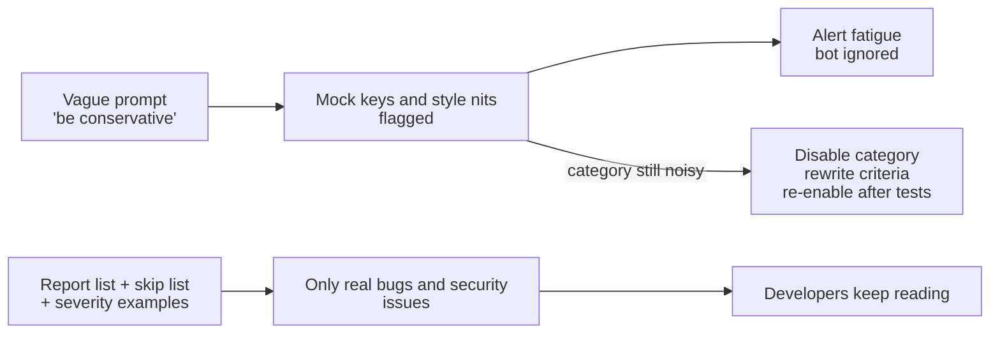

# Task Statement 4.1: Explicit Criteria and Negative Boundaries

> Scenarios: Scenario 5 (Claude Code for CI) and Scenario 6 (Structured Data Extraction).

## In One Minute
- **What**: Tell Claude exactly what to report, what to skip, and what each severity means.
- **Why**: Vague words like "be conservative" or "only high-confidence" do not change what Claude flags. Noisy reviews make developers ignore the bot.
- **How**: Write report and skip categories, give a code example for each severity, and add negative boundaries (for example, mock keys in `tests/`).
- **If a category stays noisy**: switch that category off for now and fix its criteria. Do not filter by the model's confidence.
- **Exam answer in one line**: *Explicit categorical criteria beat vague guidance.*

---

## 🧒 Explain Like I'm 13

**The picture:** A referee. "Be fair" is not a rulebook. "Yellow card for a late tackle, here is a video example; red card for violent conduct, here is another" is. If one rule causes constant arguments, pause that rule until it is fixed.

**In plain steps:**
1. List exactly what to report and what to skip (tests, mocks, TODOs).
2. Define each severity with one example.
3. Ask for evidence first, then the label.
4. Noisy category? Turn it off, fix it, test it, turn it on.

**Tiny example:** "Only report high-confidence issues" fails because Claude has no number line for "confident". "Skip anything in `tests/`" is a rule it can follow.

---

## 📖 Concepts Explained

### 1. The Human Dynamics of Alert Fatigue
Automated review bots and AI evaluators do not fail in production because they lack intelligence; they fail because of **developer alert fatigue**. When an automated reviewer posts speculative comments or nitpicks variable names on pull requests, developers spend valuable engineering time reading and dismissing false alarms. Within two to three weeks, trust completely erodes: developers begin instinctively clicking "Resolve conversation" without reading the feedback. When the bot eventually discovers a catastrophic SQL injection or authentication bypass, the finding is ignored because it is buried in a wall of noise.

The primary goal of prompt engineering in automated evaluation is therefore **precision optimization over recall greed**. High false-positive rates undermine developer confidence across all categories, including accurate ones.

### 2. Four Concrete Building Blocks of Precision Prompts
To eliminate ambiguity, an evaluation prompt must establish four distinct, non-negotiable boundaries:
1. **Explicit Report Categories**: Name the specific failure classes that must be surfaced (e.g. unhandled null pointer dereferences, off-by-one loop errors, missing transaction rollbacks, SQL/command injection).
2. **Explicit Skip Categories**: Explicitly enumerate non-actionable issues to discard (e.g. variable naming conventions, line length formatting, import ordering, framework idioms).
3. **Calibrated Severity Levels with Code Examples**: Define each severity tier (Critical, High, Medium, Low) using concrete 3-line code snippets rather than subjective adjectives. When an engineer and Claude both see what "CRITICAL" looks like in code, classification variance vanishes.
4. **Negative Boundaries**: Define specific syntactic patterns that resemble vulnerabilities but are legitimately permitted by team design (e.g. dummy credentials matching `mock_*` inside test fixtures, or raw `print()` statements in CLI scripts).

### 3. Remediation Strategy for High False-Positive Categories
When production metrics show that a specific review category (e.g. "speculative race conditions") suffers a high dismissal rate (e.g. > 50% dismissed by developers), how should an architect respond?
- **The Correct Architectural Action**: **Temporarily disable the noisy category completely**. Disabling the noisy category immediately halts developer trust erosion while engineering refines the prompt. The category is rewritten with explicit negative boundaries and few-shot examples, evaluated against a labeled benchmark, and re-introduced only when precision meets team thresholds.
- **The Fatal Distractor**: Instructing Claude to *"be more conservative"* or *"only report findings with >90% confidence"*. Language models are notoriously poorly calibrated on open-ended subjective scales; an overconfident model will assign 95% confidence to a hallucinated issue, doing nothing to reduce false positives.
- **Continuous Tracking via `detected_pattern`**: Every emitted finding should carry a structured metadata tag (e.g. `detected_pattern: "unindexed_foreign_key"`). When developers dismiss a comment in GitHub, telemetry correlates dismissal rates by pattern to identify which prompt rubrics need tuning.

---

## 🧪 Worked Example

### ❌ Invalid Example (Anti-Pattern: Vague Prompt & Alert Fatigue)
```text
# BROKEN: Asking for "conservative" review without concrete rules
System Prompt:
"You are a conservative code reviewer. Only report high-confidence issues. Be careful."

What happens on a Pull Request:
1. tests/test_auth.py:12  CRITICAL  Hardcoded API key! (It's a fake mock key in a test!)
2. src/utils.py:3         LOW       Variable name 'x' is not descriptive.
3. src/db.py:40           HIGH      Possible SQL injection. (Genuine bug)

Why it fails in production:
- 2 out of 3 comments are useless noise.
- Developers suffer alert fatigue and click "Dismiss all", causing the real SQL injection to slip into production.
```

### ✅ Valid Example (Production Pattern: Explicit Criteria, Negative Boundaries & Severity Rules)
```text
# CORRECT: Categorical criteria, explicit negative skip boundaries, and code-level definitions
System Prompt:
Report ONLY:
- Bugs that change runtime behavior (null dereference, wrong comparison, swallowed exception)
- Security vulnerabilities (live production secrets, SQL or command injection)

Do NOT report (Negative Boundaries):
- Stylistic preferences (naming conventions, line length, import order)
- CLI or debugging patterns the team uses on purpose (print() statements in scripts)
- Mock secrets in test files or fixtures (anything with mock_, test_, or dummy_ prefixes)

Severity Tiers (use exactly these definitions):
- CRITICAL: Live leaked credentials or remote code execution. (Example: API_KEY = "sk-ant-live...")
- HIGH: Untrusted user input reaches SQL or shell without escaping. (Example: cursor.execute(f"SELECT ... {uid}"))
- MEDIUM: Unhandled edge case that crashes on unexpected input. (Example: return user.orders without null check)
- LOW: Informational; never blocks a merge.

For each finding, provide: location, evidence_quote, rationale, severity.

Output on the same PR:
src/db.py:40  HIGH  User input directly concatenated into SQL  evidence: execute(f"SELECT ... {uid}")
```

The code in [main.py](main.py) has this prompt as `build_explicit_prompt()` and a small rule engine that behaves the same way.

---

## 🔑 Key Terms

- **Explicit Criteria**: Concrete, unambiguous technical rules that specify exactly which functional defects or security risks belong in a report category.
- **Negative Boundary**: An explicit exclusion rule that instructs the model what code patterns to deliberately ignore (such as mock keys in test files or print statements in CLI scripts).
- **Alert Fatigue**: The cognitive burnout that occurs when developers are bombarded with noisy, false-alarm notifications, leading them to dismiss all alerts including real critical bugs.
- **Severity Rubric**: An objective classification system pairing each severity level (Critical, High, Medium, Low) with a concrete code snippet demonstrating what constitutes that violation.
- **Pattern Telemetry (`detected_pattern`)**: A machine-readable tag attached to every finding that allows engineering teams to track dismissal rates and pinpoint which prompt rules produce false positives.

---

## 🏗️ Architecture



---

## ⚠️ Exam Traps and Correct Patterns

### Trap 1: "Be conservative" and "only report high-confidence findings"

**Exam scenario**: A code-review bot flags test fixtures, TODO comments, and style nits. Developers start ignoring it. The prompt is changed to "be conservative; only report when confident". Noise barely drops.

**Why it fails**: the words give no objective line. Claude's confidence is not calibrated, so "confident" is a feeling, not a rule.

```text
ANTI-PATTERN
  "Review this code. Be conservative and only report high-confidence issues."

PATTERN: explicit report and skip categories
  REPORT: (1) bugs that cause wrong results or crashes; (2) security: injection, secrets, authz.
  SKIP:   style and naming; anything under tests/ or in files named mock_*; TODO comments;
          local variable naming; minor refactors.
  For each finding give: file, line, category, and the exact code that proves it.
```

### Trap 2: Severity names without definitions

```text
ANTI-PATTERN: "Label each issue critical, high, medium, or low."
  -> The same SQL concatenation is "critical" on Monday and "high" on Tuesday.

PATTERN: one rule and one code example per level
  critical: exploitable data loss or auth bypass.
    e.g. query = "SELECT * FROM users WHERE id=" + request.args["id"]
  high: wrong result in normal use.
    e.g. total = price * qty - discount  # discount may be None
  medium: wrong result in an edge case.     low: maintainability only.
```

### Trap 3: Keeping a noisy category on while you tune

If developers dismiss most "naming" findings, every extra false positive teaches them to ignore the real bugs next to them. **Disable that category temporarily**, rewrite its criteria, test on a sample, then re-enable. Filtering by the model's self-reported confidence is the same trap as Trap 1. Setting temperature to 0 makes output steadier, not more correct.

### Trap 4: Label first, reasoning second

```text
ANTI-PATTERN output: {"severity": "high", "explanation": "..."}   (label already chosen)
PATTERN output:      {"evidence": "line 42 divides by qty without a zero check",
                      "reasoning": "qty comes from user input", "severity": "high"}
```

Producing evidence before the label makes the label follow from it.

---

## 📝 Exam-Style Practice Questions

**Q1 (Scenario 5).** Your CI review bot comments on `tests/fixtures/mock_auth.py` with "CRITICAL: hardcoded secret". Developers have started ignoring the bot. What is the best fix?
- A) Add "be conservative and only report high-confidence findings" to the prompt.
- B) Add skip rules for `tests/` and `mock_`/`test_` prefixes, and keep the report rule for live secrets.
- C) Set temperature to 0.
- D) Ask Claude for a confidence score and drop findings below 0.8.

**Q2 (Scenario 5).** Severity labels change from run to run: the same SQL string issue is HIGH on Monday and MEDIUM on Tuesday. What should you do?
- A) Ask Claude to "use consistent severity".
- B) Give each level a rule and a concrete code example.
- C) Run each review three times and take the median.
- D) Remove severity and sort findings alphabetically.

**Q3 (Scenario 5).** The "possible race condition" category is dismissed by developers 60% of the time. Other categories are fine. What is the best action?
- A) Filter this category by model confidence.
- B) Disable only this category, rewrite its criteria with examples, test, then re-enable.
- C) Disable the whole review bot.
- D) Tell Claude to "think harder" about races.

### Answers
**Q1: B.**
- A fails: "conservative" and "high-confidence" give Claude no objective line.
- C fails: temperature does not define what a mock key is.
- D fails: self-reported confidence is poorly calibrated, so mocks can still score high.

**Q2: B.**
- A fails: a request for consistency has no criteria behind it.
- C fails: it triples cost and still has no shared definition of each level.
- D fails: it removes the information developers need to triage.

**Q3: B.**
- A fails: Claude can be confident and wrong, so noise stays.
- C fails: it throws away the categories that work and hurts trust more.
- D fails: more thinking does not add missing criteria.

---

## ✅ Self-Check Checklist
- [ ] I can name two report categories and two skip categories.
- [ ] I can write a severity rule plus a code example for each level.
- [ ] I can explain why "be conservative" does not work.
- [ ] I know to disable a noisy category, not filter by confidence.
- [ ] I can say why `detected_pattern` is useful.

**Memory hook**: *Rules, not adjectives.*

---

## 🛠️ Hands-on Workbook Guide

In [`ts_4_1_explicit_criteria_classification.ipynb`](ts_4_1_explicit_criteria_classification.ipynb):
1. **Step 1: Setup**: finds the repo root and adds it to the import path.
2. **Step 2: Prompts and classifier**: imports the vague prompt, the explicit prompt builder and the classifier from `main.py`.
3. **Step 3: Simulation**: compares the vague behaviour with the explicit rules on a test file and a production file, then disables one category.
4. **Step 4: Verification**: asserts zero false positives on fixtures, one CRITICAL finding in production, and that a disabled category stays silent.

Everything runs offline. Run the exercise file by hand with `uv run domain4/ts_4_1_explicit_criteria_classification/main.py` (no API calls).

---

## 🧭 Navigation & Study Links
- 📋 **Domain Overview**: [Domain 4: Prompt Engineering & Structured Output](../README.md)
- ➡️ **Next Topic**: [TS 4.2: Few-Shot Prompting for Consistent Output](../ts_4_2_few_shot_and_multi_instance/README.md)
- 🎯 **Scenario Practice**: [Master Scenario Practice](../../scenarios/MASTER_SCENARIO_PRACTICE.md)
