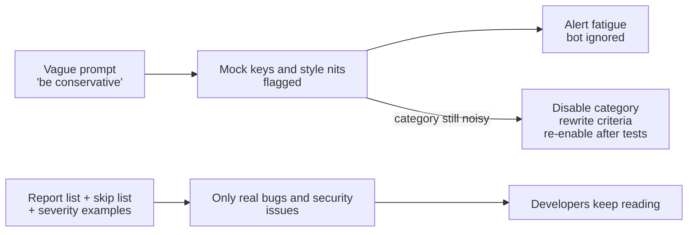

# Task Statement 4.1: Explicit Criteria and Negative Boundaries

> Scenarios: Scenario 5 (Claude Code for CI) and Scenario 6 (Structured Data Extraction).

## In One Minute
- **What**: Tell Claude exactly what to report, what to skip, and what each severity means.
- **Why**: Vague words like "be conservative" or "only high-confidence" do not change what Claude flags. Noisy reviews make developers ignore the bot.
- **How**: Write report and skip categories, give a code example for each severity, and add negative boundaries (for example, mock keys in `tests/`).
- **If a category stays noisy**: switch that category off for now and fix its criteria. Do not filter by the model's confidence.
- **Exam answer in one line**: *Explicit categorical criteria beat vague guidance.*

---

## 🧒 Explain Like I'm 13

**The picture:** A referee. "Be fair" is not a rulebook. "Yellow card for a late tackle, here is a video example; red card for violent conduct, here is another" is. If one rule causes constant arguments, pause that rule until it is fixed.

**In plain steps:**
1. List exactly what to report and what to skip (tests, mocks, TODOs).
2. Define each severity with one example.
3. Ask for evidence first, then the label.
4. Noisy category? Turn it off, fix it, test it, turn it on.

**Tiny example:** "Only report high-confidence issues" fails because Claude has no number line for "confident". "Skip anything in `tests/`" is a rule it can follow.

---

## 📖 Concepts Explained

### 1. Why it matters
- Every false positive costs a developer a few minutes.
- After a few weeks, developers stop reading the bot's comments.
- A bot nobody reads also misses the real bug.

### 2. How it works: four building blocks
1. **Report categories**: behaviour bugs and security issues.
2. **Skip categories**: minor style, and local patterns the team uses on purpose.
3. **Severity levels with code examples**: so "HIGH" means the same thing every run.
4. **Negative boundaries**: concrete things *not* to flag, such as `mock_` keys under `tests/`.

### 3. Managing a noisy category
Suppose "speculative race condition" findings are dismissed 60% of the time.
- **Do**: temporarily disable that category, rewrite its criteria with examples, test on labelled samples, then switch it back on.
- **Do not**: ask Claude for a confidence number and filter below a threshold. Claude can be confident and wrong.
- Keep a `detected_pattern` field on each finding so you can see which patterns get dismissed (see TS 4.4).

---

## 🧪 Worked Example

**Before (vague)**
```text
You are a conservative reviewer. Only report high-confidence issues. Be careful.
```
Typical output on a PR:
```text
tests/test_auth.py:12  CRITICAL  hardcoded API key  (it is a mock)
src/utils.py:3         LOW       variable name 'x' is not descriptive
src/db.py:40           HIGH      possible SQL injection  (real)
```
Two of three comments are noise.

**After (explicit)**
```text
Report ONLY:
- Bugs that change behaviour (null dereference, wrong comparison, swallowed exception)
- Security issues (live secrets, SQL or command injection)
Do NOT report:
- Minor style (naming, line length, import order)
- Local patterns the team uses on purpose (print() in CLI scripts)
- Secrets that are obvious mocks in tests/ or fixtures/ (mock_, test_, dummy_ prefixes)
Severity (use exactly these):
- CRITICAL: live secret or remote code execution. Example: API_KEY = "sk-ant-live..."
- HIGH: user input reaches SQL or a shell. Example: cursor.execute(f"SELECT ... {uid}")
- MEDIUM: bug that fails on bad input. Example: return user.orders  # user may be None
- LOW: never blocks a merge
For each finding give: location, evidence_quote, rationale, severity.
```
Output now:
```text
src/db.py:40  HIGH  user input in SQL string  evidence: execute(f"SELECT ... {uid}")
```

The code in [main.py](main.py) has this prompt as `build_explicit_prompt()` and a small rule engine that behaves the same way.

---

## 🔑 Key Terms

- **Explicit criteria**: objective rules that say when something belongs in a category.
- **Negative boundary**: a rule that says what *not* to flag.
- **Alert fatigue**: people ignore alerts because too many are wrong.
- **Severity rubric**: one rule plus one code example per severity.
- **`detected_pattern`**: a field recording which construct triggered a finding, so dismissals can be analysed.

---

## 🏗️ Architecture



---

## ⚠️ Exam Traps and Correct Patterns

### Trap 1: "Be conservative" and "only report high-confidence findings"

**Exam scenario**: A code-review bot flags test fixtures, TODO comments, and style nits. Developers start ignoring it. The prompt is changed to "be conservative; only report when confident". Noise barely drops.

**Why it fails**: the words give no objective line. Claude's confidence is not calibrated, so "confident" is a feeling, not a rule.

```text
ANTI-PATTERN
  "Review this code. Be conservative and only report high-confidence issues."

PATTERN: explicit report and skip categories
  REPORT: (1) bugs that cause wrong results or crashes; (2) security: injection, secrets, authz.
  SKIP:   style and naming; anything under tests/ or in files named mock_*; TODO comments;
          local variable naming; minor refactors.
  For each finding give: file, line, category, and the exact code that proves it.
```

### Trap 2: Severity names without definitions

```text
ANTI-PATTERN: "Label each issue critical, high, medium, or low."
  -> The same SQL concatenation is "critical" on Monday and "high" on Tuesday.

PATTERN: one rule and one code example per level
  critical: exploitable data loss or auth bypass.
    e.g. query = "SELECT * FROM users WHERE id=" + request.args["id"]
  high: wrong result in normal use.
    e.g. total = price * qty - discount  # discount may be None
  medium: wrong result in an edge case.     low: maintainability only.
```

### Trap 3: Keeping a noisy category on while you tune

If developers dismiss most "naming" findings, every extra false positive teaches them to ignore the real bugs next to them. **Disable that category temporarily**, rewrite its criteria, test on a sample, then re-enable. Filtering by the model's self-reported confidence is the same trap as Trap 1. Setting temperature to 0 makes output steadier, not more correct.

### Trap 4: Label first, reasoning second

```text
ANTI-PATTERN output: {"severity": "high", "explanation": "..."}   (label already chosen)
PATTERN output:      {"evidence": "line 42 divides by qty without a zero check",
                      "reasoning": "qty comes from user input", "severity": "high"}
```

Producing evidence before the label makes the label follow from it.

---

## 📝 Exam-Style Practice Questions

**Q1 (Scenario 5).** Your CI review bot comments on `tests/fixtures/mock_auth.py` with "CRITICAL: hardcoded secret". Developers have started ignoring the bot. What is the best fix?
- A) Add "be conservative and only report high-confidence findings" to the prompt.
- B) Add skip rules for `tests/` and `mock_`/`test_` prefixes, and keep the report rule for live secrets.
- C) Set temperature to 0.
- D) Ask Claude for a confidence score and drop findings below 0.8.

**Q2 (Scenario 5).** Severity labels change from run to run: the same SQL string issue is HIGH on Monday and MEDIUM on Tuesday. What should you do?
- A) Ask Claude to "use consistent severity".
- B) Give each level a rule and a concrete code example.
- C) Run each review three times and take the median.
- D) Remove severity and sort findings alphabetically.

**Q3 (Scenario 5).** The "possible race condition" category is dismissed by developers 60% of the time. Other categories are fine. What is the best action?
- A) Filter this category by model confidence.
- B) Disable only this category, rewrite its criteria with examples, test, then re-enable.
- C) Disable the whole review bot.
- D) Tell Claude to "think harder" about races.

### Answers
**Q1: B.**
- A fails: "conservative" and "high-confidence" give Claude no objective line.
- C fails: temperature does not define what a mock key is.
- D fails: self-reported confidence is poorly calibrated, so mocks can still score high.

**Q2: B.**
- A fails: a request for consistency has no criteria behind it.
- C fails: it triples cost and still has no shared definition of each level.
- D fails: it removes the information developers need to triage.

**Q3: B.**
- A fails: Claude can be confident and wrong, so noise stays.
- C fails: it throws away the categories that work and hurts trust more.
- D fails: more thinking does not add missing criteria.

---

## ✅ Self-Check Checklist
- [ ] I can name two report categories and two skip categories.
- [ ] I can write a severity rule plus a code example for each level.
- [ ] I can explain why "be conservative" does not work.
- [ ] I know to disable a noisy category, not filter by confidence.
- [ ] I can say why `detected_pattern` is useful.

**Memory hook**: *Rules, not adjectives.*

---

## 🛠️ Hands-on Workbook Guide

In [`ts_4_1_explicit_criteria_classification.ipynb`](ts_4_1_explicit_criteria_classification.ipynb):
1. **Step 1: Setup**: finds the repo root and adds it to the import path.
2. **Step 2: Prompts and classifier**: imports the vague prompt, the explicit prompt builder and the classifier from `main.py`.
3. **Step 3: Simulation**: compares the vague behaviour with the explicit rules on a test file and a production file, then disables one category.
4. **Step 4: Verification**: asserts zero false positives on fixtures, one CRITICAL finding in production, and that a disabled category stays silent.

Everything runs offline. Run the exercise file by hand with `uv run domain4/ts_4_1_explicit_criteria_classification/main.py` (no API calls).
