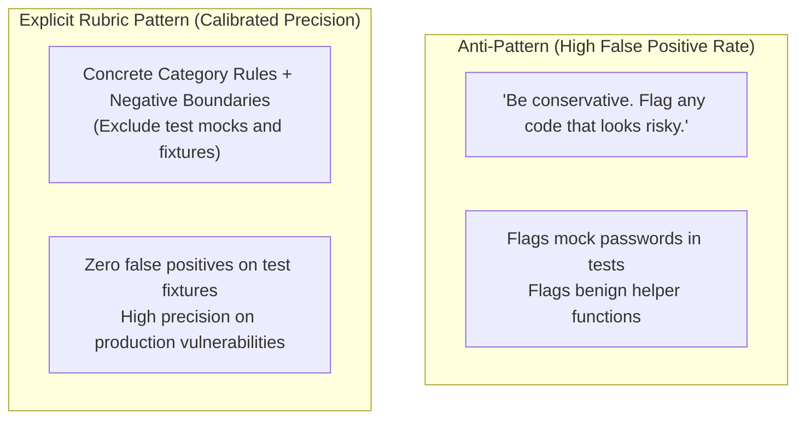

# Task Statement 4.1: Explicit Criteria & False Positive Reduction

## 🎯 Exam Objective
Understand how to replace vague prompt heuristics with concrete categorical criteria, explicit boundaries, and calibrated rubrics to eliminate false positives in classification and auditing tasks.

---

## 🏗️ Architecture: Vague vs Explicit Prompting

---

## 📋 The 3-Part Calibration Framework

1. **Exhaustive Category Definitions**:
   - Every class/severity tier has exact inclusion rules (e.g. `CRITICAL`: plaintext secret with valid checksum).
2. **Explicit Negative Boundary Examples**:
   - Provide concrete snippets showing what looks suspicious at first glance but must **NOT** be flagged (e.g. `mock_api_key = "test_abc123"` in `test_*.py`).
3. **Deterministic Evaluation Order**:
   - Check negative boundary conditions *first* to short-circuit benign cases.
