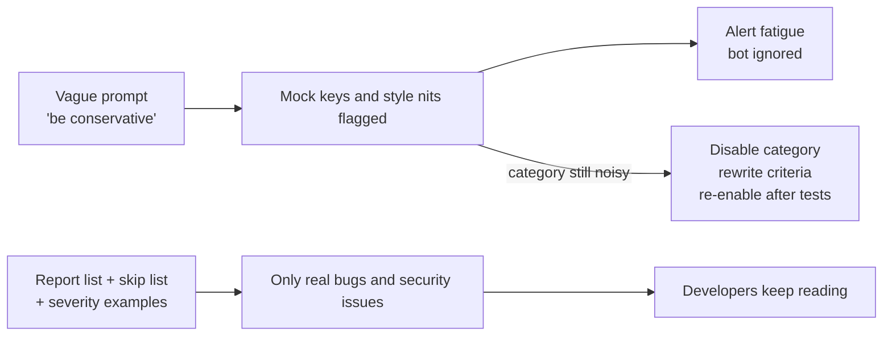

# Task Statement 4.1: Explicit Criteria and Negative Boundaries

## In One Minute
- **What**: Tell Claude exactly what to report, what to skip, and what each severity means.
- **Why**: Vague words like "be conservative" or "only high-confidence" do not change what Claude flags. Noisy reviews make developers ignore the bot.
- **How**: Write report and skip categories, give a code example for each severity, and add negative boundaries (for example, mock keys in `tests/`).
- **If a category stays noisy**: switch that category off for now and fix its criteria. Do not filter by the model's confidence.
- **Exam answer in one line**: *Explicit categorical criteria beat vague guidance.*

---

## 📌 Overview

- **Domain**: Domain 4: Prompt Engineering & Structured Output (**20%** of the exam; the others are D1 27%, D2 18%, D3 20%, D5 15%).
- **Scenarios**: Scenario 5 (Claude Code for CI) and Scenario 6 (Structured Data Extraction).
- **Goal**: Cut false positives and keep developer trust.
- **Exam focus**: Questions show a bot that flags test fixtures or style nits and ask which prompt change fixes it.

---

## 📖 Concepts Explained

### 1. The simple idea
A reviewer prompt is a rulebook. If the rulebook says "be careful", Claude has to guess what you mean. If it says "report null dereferences and live secrets, skip naming style", Claude can follow it.

### 2. Why it matters
- Every false positive costs a developer a few minutes.
- After a few weeks, developers stop reading the bot's comments.
- A bot nobody reads also misses the real bug.

### 3. How it works: four building blocks
1. **Report categories**: behaviour bugs and security issues.
2. **Skip categories**: minor style, and local patterns the team uses on purpose.
3. **Severity levels with code examples**: so "HIGH" means the same thing every run.
4. **Negative boundaries**: concrete things *not* to flag, such as `mock_` keys under `tests/`.

### 4. Managing a noisy category
Suppose "speculative race condition" findings are dismissed 60% of the time.
- **Do**: temporarily disable that category, rewrite its criteria with examples, test on labelled samples, then switch it back on.
- **Do not**: ask Claude for a confidence number and filter below a threshold. Claude can be confident and wrong.
- Keep a `detected_pattern` field on each finding so you can see which patterns get dismissed (see TS 4.4).

---

## 🧪 Worked Example

**Before (vague)**
```text
You are a conservative reviewer. Only report high-confidence issues. Be careful.
```
Typical output on a PR:
```text
tests/test_auth.py:12  CRITICAL  hardcoded API key  (it is a mock)
src/utils.py:3         LOW       variable name 'x' is not descriptive
src/db.py:40           HIGH      possible SQL injection  (real)
```
Two of three comments are noise.

**After (explicit)**
```text
Report ONLY:
- Bugs that change behaviour (null dereference, wrong comparison, swallowed exception)
- Security issues (live secrets, SQL or command injection)
Do NOT report:
- Minor style (naming, line length, import order)
- Local patterns the team uses on purpose (print() in CLI scripts)
- Secrets that are obvious mocks in tests/ or fixtures/ (mock_, test_, dummy_ prefixes)
Severity (use exactly these):
- CRITICAL: live secret or remote code execution. Example: API_KEY = "sk-ant-live..."
- HIGH: user input reaches SQL or a shell. Example: cursor.execute(f"SELECT ... {uid}")
- MEDIUM: bug that fails on bad input. Example: return user.orders  # user may be None
- LOW: never blocks a merge
For each finding give: location, evidence_quote, rationale, severity.
```
Output now:
```text
src/db.py:40  HIGH  user input in SQL string  evidence: execute(f"SELECT ... {uid}")
```

The code in [main.py](main.py) has this prompt as `build_explicit_prompt()` and a small rule engine that behaves the same way.

---

## 🔑 Key Terms

- **Explicit criteria**: objective rules that say when something belongs in a category.
- **Negative boundary**: a rule that says what *not* to flag.
- **Alert fatigue**: people ignore alerts because too many are wrong.
- **Severity rubric**: one rule plus one code example per severity.
- **`detected_pattern`**: a field recording which construct triggered a finding, so dismissals can be analysed.

---

## 🏗️ Architecture



---

## ⚠️ Exam Traps and Correct Patterns

| Goal | Correct pattern | Trap | Why the trap fails |
|---|---|---|---|
| Fewer false positives | Explicit report/skip categories and negative boundaries | "Be conservative" or "only high-confidence" | Claude has no objective line to apply |
| Consistent severity | One rule and one code example per level | Level names only | The meaning drifts between runs |
| Noisy category | Disable it temporarily, fix criteria | Filter by self-reported confidence | Confidence is not calibrated |
| Better judgement | Evidence and rationale before the label | Label first | The label is decided before the reasoning |

### Common Mistakes
- Writing "be careful" and expecting precision to improve.
- Listing severity names without code examples.
- Leaving a noisy category on while "tuning" the prompt.
- Using a confidence threshold as the fix.
- Using temperature 0 as the fix. It makes output steadier, not more correct.

---

## 💡 Quick Decision Rules

| Symptom | Fix |
|---|---|
| Test fixtures flagged | Add a negative boundary for `tests/` and `mock_` |
| Severity differs between runs | Add a concrete example per level |
| One category is mostly dismissed | Disable it, rewrite, re-enable |
| Developers ignore the bot | Cut categories to bugs and security only |

---

## 🧠 Claude 4.5 Notes

- Models: `claude-sonnet-4-5` for review reasoning, `claude-haiku-4-5` for cheap triage.
- If you enable thinking, omit `temperature` (it is rejected), and leave `top_k`/`top_p` unset.
- With thinking, `tool_choice` may only be `auto` or `none`. A forced tool call must not use thinking.
- Better criteria help more than more thinking tokens.

---

## 📝 Exam-Style Practice Questions

**Q1 (Scenario 5).** Your CI review bot comments on `tests/fixtures/mock_auth.py` with "CRITICAL: hardcoded secret". Developers have started ignoring the bot. What is the best fix?
- A) Add "be conservative and only report high-confidence findings" to the prompt.
- B) Add skip rules for `tests/` and `mock_`/`test_` prefixes, and keep the report rule for live secrets.
- C) Set temperature to 0.
- D) Ask Claude for a confidence score and drop findings below 0.8.

**Q2 (Scenario 5).** Severity labels change from run to run: the same SQL string issue is HIGH on Monday and MEDIUM on Tuesday. What should you do?
- A) Ask Claude to "use consistent severity".
- B) Give each level a rule and a concrete code example.
- C) Run each review three times and take the median.
- D) Remove severity and sort findings alphabetically.

**Q3 (Scenario 5).** The "possible race condition" category is dismissed by developers 60% of the time. Other categories are fine. What is the best action?
- A) Filter this category by model confidence.
- B) Disable only this category, rewrite its criteria with examples, test, then re-enable.
- C) Disable the whole review bot.
- D) Tell Claude to "think harder" about races.

### Answers
**Q1: B.**
- A fails: "conservative" and "high-confidence" give Claude no objective line.
- C fails: temperature does not define what a mock key is.
- D fails: self-reported confidence is poorly calibrated, so mocks can still score high.

**Q2: B.**
- A fails: a request for consistency has no criteria behind it.
- C fails: it triples cost and still has no shared definition of each level.
- D fails: it removes the information developers need to triage.

**Q3: B.**
- A fails: Claude can be confident and wrong, so noise stays.
- C fails: it throws away the categories that work and hurts trust more.
- D fails: more thinking does not add missing criteria.

---

## ✅ Self-Check Checklist
- [ ] I can name two report categories and two skip categories.
- [ ] I can write a severity rule plus a code example for each level.
- [ ] I can explain why "be conservative" does not work.
- [ ] I know to disable a noisy category, not filter by confidence.
- [ ] I can say why `detected_pattern` is useful.

**Memory hook**: *Rules, not adjectives.*

---

## 🛠️ Hands-on Workbook Guide

In [`ts_4_1_explicit_criteria_classification.ipynb`](ts_4_1_explicit_criteria_classification.ipynb):
1. **Step 1: Setup**: finds the repo root and adds it to the import path.
2. **Step 2: Prompts and classifier**: imports the vague prompt, the explicit prompt builder and the classifier from `main.py`.
3. **Step 3: Simulation**: compares the vague behaviour with the explicit rules on a test file and a production file, then disables one category.
4. **Step 4: Verification**: asserts zero false positives on fixtures, one CRITICAL finding in production, and that a disabled category stays silent.

Everything runs offline. Run the exercise file by hand with `uv run domain4/ts_4_1_explicit_criteria_classification/main.py` (no API calls).
