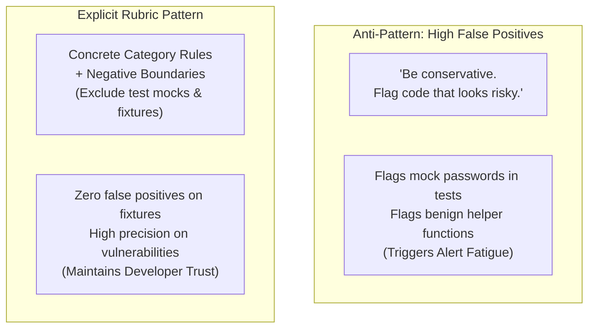

# Task Statement 4.1: Design Prompts with Explicit Criteria and Negative Boundaries

## 📌 Executive Overview: Goal, Scope & Exam Importance

### Certification Domain & Weight
- **Domain**: Domain 4: Prompt Engineering & Structured Output
- **Domain Weight**: 18% of total CCAR-F exam score
- **Scenario Alignment**: Scenario 5 (Continuous Integration) & Scenario 6 (Structured Data Extraction)

### The Core Goal
To design classification, triage, and security auditing prompts with **explicit categorical inclusion criteria** and **negative boundary guidance ("What NOT to flag")**, eliminating false-positive inflation and developer alert fatigue.

### Why This Matters in Production
In production CI/CD scanners and compliance systems, a high false-positive rate is fatal:
- If a security review agent flags harmless mock credentials in `tests/fixtures/mock_auth.py` or flags benign debugging loggers as *"CRITICAL SECURITY RISKS"*, developers quickly suffer from **alert fatigue**.
- Within two weeks, developers learn to ignore or bypass the automated scanner, defeating the purpose of security automation.
Vague prompt directives like *"Be conservative and flag anything suspicious"* cause LLMs to over-flag benign code. By defining unambiguous category boundaries and explicitly documenting what to ignore, architects achieve high precision without sacrificing recall.

### Exam Importance
Task Statement 4.1 questions test prompt calibration for classification tasks. The exam will ask how to fix an agent that is flagging test fixtures as security leaks, or how to eliminate subjective boundary disagreements between severity tiers.

---

## 📖 Deep Narrative: Why We Do What We Do

### 1. The Alert Fatigue Anti-Pattern
Consider an automated security scanner prompt:
```markdown
You are a conservative security auditor.
Flag any code that contains hardcoded secrets, API keys, or risky configurations.
```
When this prompt runs across a test suite:
- It flags `TEST_API_KEY = "sk-test-12345"` in `tests/unit/test_auth.py`.
- It flags `LOCAL_MOCK_PASSWORD = "password123"` in a fixture file.
- It blocks the CI build.
- **The Consequence**: The engineering team complains, and leadership disables the AI review bot.

### 2. The Architectural Solution: The 3-Part Calibration Framework
Production classification and scanning prompts follow a rigorous **3-Part Calibration Framework**:

#### Part 1: Exhaustive Category Definitions
Every severity tier or classification label has unambiguous inclusion criteria:
- `CRITICAL`: A live, production API key or secret string matching active vendor entropy patterns with no test/mock prefix.
- `HIGH`: Unsanitized user input concatenated directly into an SQL query string or OS command.
- `LOW`: Missing docstrings or non-standard variable casing.

#### Part 2: Explicit Negative Boundaries ("What NOT to Flag")
State clearly what the model must ignore:
- *"Do NOT flag strings located inside files under `tests/`, `fixtures/`, or matching `test_*.py`."*
- *"Do NOT flag variables with prefixes `mock_`, `test_`, `dummy_`, or `example_`."*
- *"Do NOT flag public environment variable names (e.g. `PORT`, `NODE_ENV`)."*

#### Part 3: Mandatory Evidence & Reasoning First
Force the model to cite the exact line of code and justify the vulnerability *before* selecting the category label:
```markdown
For each finding, provide:
1. `evidence_quote`: The exact code snippet.
2. `rationale`: Why this is an active production risk (not a test mock).
3. `severity`: One of ["CRITICAL", "HIGH", "WARNING", "INFO"].
```
Requiring reasoning first dramatically improves classification precision.

---

## 🔑 Key Technical Terminology Explained

- **Explicit Inclusion Criteria**: Unambiguous, objective rules defining exactly which characteristics qualify an entity for a given category.
- **Negative Boundary Guidance**: Explicit instructions detailing which edge cases, mock data, or benign patterns must be intentionally ignored.
- **Alert Fatigue**: The psychological exhaustion experienced by engineers when an automated tool produces high volumes of false-positive warnings, leading them to ignore all alerts.
- **Evidence-First Generation**: Requiring the model to output verbatim evidence and intermediate reasoning before emitting the final classification label.
- **In-Distribution vs Out-of-Distribution Data**: Distinguishing between production source code (subject to security rules) and test scaffolding (subject to test mock allowances).

---

## 🏗️ Architecture: Vague vs Explicit Prompting



---

## ⚠️ Critical Exam Distinctions & Distractor Teardown

| Prompting Element | Correct Implementation | Exam Trap to Reject | Why the Trap Fails |
|---|---|---|---|
| **Reducing False Positives** | Add **explicit negative boundaries**: *"Do not flag mocks in tests/ or variables prefixed with mock_"*. | **TRAP**: Lowering temperature to 0.0 or instructing Claude to *"be smarter and more careful"*. | Lowering temperature does not define what a "mock" is; without definitions, Claude consistently flags test keys. |
| **Severity Differentiation** | Provide explicit, mutually exclusive criteria for each severity tier. | **TRAP**: Providing only category names (`CRITICAL`, `HIGH`, `MEDIUM`) with no inclusion rules. | Without rules, the model applies subjective human judgment that drifts unpredictably across turns. |
| **Classification Accuracy** | Enforce **evidence-first generation**: produce justification before category. | **TRAP**: Generating the category label as the first token of the output JSON. | Forcing the category label first deprives the model of reasoning tokens to evaluate nuanced context. |

---

## 💡 Architectural Decision Matrix: Prompt Refinement

| Symptom in Production | Root Cause | Architectural Fix |
|---|---|---|
| Bot flags test credentials as security leaks | Missing negative boundary | Add explicit exclusion for `tests/` and `mock_*`. |
| Inconsistent severity ratings across runs | Subjective tier definitions | Write concrete criteria per tier (Critical vs High). |
| High false-positive rate on benign code | Vague directive ("be conservative") | Replace with objective checklist. |

---

## 🧠 Claude 4.5 Extended Thinking & Parameter Standards

- **Reasoning Calibration**: Claude 4.5's Extended Thinking operates as a built-in reasoning buffer, allowing the model to evaluate negative boundaries and compare code context against exclusion rules during thinking.
- **Sampling Rules**: Omit `temperature` whenever thinking is enabled.
- **Structured Findings**: With negative boundaries established, thinking blocks cleanly dismiss test fixtures and output only actionable findings.

---

## 🛠️ Hands-on Workbook Guide: Following the Code Step-by-Step

When exploring [`ts_4_1_explicit_criteria_classification.ipynb`](ts_4_1_explicit_criteria_classification.ipynb):
1. **Step 1: Setup & Codebase Samples**: Prepares code snippets containing both genuine secrets and test mocks.
2. **Step 2: Simulating Vague Directives**: Demonstrates how vague prompts falsely flag test fixtures.
3. **Step 3: Implementing Negative Boundaries**: Demonstrates how negative boundaries filter out test fixtures with zero false positives.
4. **Step 4: Evidence-First Severity Evaluation**: Demonstrates extracting verbatim quotes before severity scoring.
5. **Step 5: Verification Assertions**: Verifies 100% precision on true vulnerabilities and 0 false positives on fixtures.
