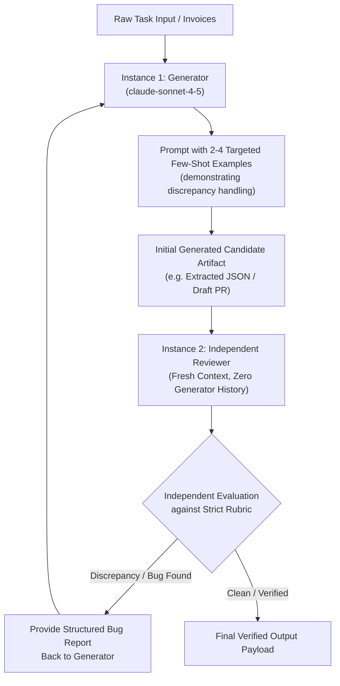

# Task Statement 4.2: Apply Few-Shot Prompting and Multi-Instance Review Architectures

## 🎯 Exam Objective
Understand how to craft targeted **few-shot examples with reasoning** to resolve edge cases, and design **multi-instance review architectures** that eliminate author confirmation bias.

---

## 🏗️ Architecture: Multi-Instance Independent Review Pipeline

---

## ⚠️ Critical Exam Distinctions & Anti-Patterns

| Prompting / Review Architecture | Recommended Implementation | Exam Trap to Reject |
|---|---|---|
| **Few-Shot Example Selection** | Curate **2 to 4 high-yield examples** specifically targeting borderline and ambiguous edge cases with reasoning. | **TRAP**: Bloating the system prompt with 30+ trivial happy-path examples, consuming unnecessary context window tokens. |
| **Review Isolation** | Use an **independent Claude instance** with zero access to the generator's internal thinking blocks or rationale. | **TRAP**: Asking the same generator agent to "self-review" its own output in the same conversation thread (prone to confirmation bias). |
| **Few-Shot Example Structure** | Include input, step-by-step reasoning justification, and final structured output. | **TRAP**: Providing only raw inputs and outputs without explaining the decision rule for edge cases. |

---

## 💡 Architectural Decision Matrix

| Review Pattern | Independence Level | Confirmation Bias | Ideal Use Case |
|---|---|---|---|
| **Single-Agent Self-Review** | Zero (same context thread) | High | Trivial typo and grammar checks. |
| **Multi-Turn Critic** | Partial (same session, subsequent turn) | Moderate | Code formatting and style alignment. |
| **Multi-Instance Independent Review** | Complete (isolated fresh session) | Low / None | Security auditing, legal extraction, compliance verification. |

---

## 🛠️ Production Code Reference
- Interactive Workbook: [`ts_4_2_few_shot_and_multi_instance.ipynb`](ts_4_2_few_shot_and_multi_instance.ipynb)
- Runnable Script: [`main.py`](main.py)
- Offline Verification: Run via `uv run pytest tests/test_domain4_full.py` in WSL.
