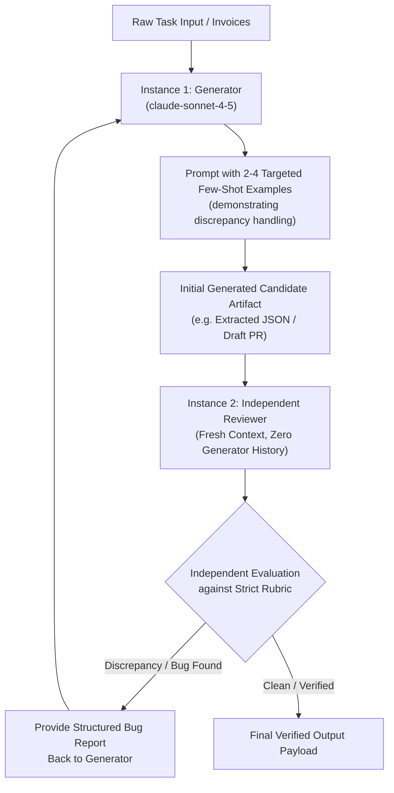

# Task Statement 4.2: Apply Few-Shot Prompting and Multi-Instance Review Architectures

## 📌 Executive Overview: Goal, Scope & Exam Importance

### Certification Domain & Weight
- **Domain**: Domain 4: Prompt Engineering & Structured Output
- **Domain Weight**: 18% of total CCAR-F exam score
- **Scenario Alignment**: Scenario 5 (Continuous Integration) & Scenario 6 (Structured Data Extraction)

### The Core Goal
To master **targeted few-shot prompting (2–4 examples with reasoning)** for complex edge cases, and design **multi-instance review architectures** that eliminate author confirmation bias during automated code review and data extraction.

### Why This Matters in Production
In production systems, two major failure modes degrade output reliability:
1. **The Few-Shot Bloat Trap**: Engineers often copy-paste 25 standard examples into their prompts. This consumes 4,000+ input tokens per call while demonstrating only simple, happy-path cases that Claude already understands zero-shot.
2. **Author Confirmation Bias**: If the same Claude instance that generated a function is asked in the next turn: *"Now review your code for bugs"*, it suffers from profound confirmation bias. It evaluates its code using the exact same underlying assumptions that created the bug in the first place, consistently reporting *"No bugs found"*.
Using 2–4 targeted edge-case examples with reasoning guides the model through ambiguous boundaries, while spawning an **independent reviewer instance** (with fresh context) catches subtle bugs with near-zero confirmation bias.

### Exam Importance
Task Statement 4.2 questions test prompt efficiency and review topologies. The exam will ask why self-review within the same conversation session fails, how many few-shot examples are optimal, and why independent Claude review instances are required for compliance and security auditing.

---

## 📖 Deep Narrative: Why We Do What We Do

### 1. The Anatomy of a High-Yield Few-Shot Example
A production few-shot example should **never** waste tokens demonstrating trivial happy-path formatting. Instead, it must demonstrate **boundary conditions and discrepancy handling**:
```markdown
<example>
Input:
Consulting invoice stating total $500, but line items list:
- 4 hours @ $100 = $400.

Reasoning:
The stated total ($500) conflicts with the mathematical sum of line items ($400).
Instead of guessing or hallucinating missing items, record the discrepancy flag.

Output:
{
  "stated_total": 500.0,
  "calculated_total": 400.0,
  "discrepancy_detected": true,
  "line_items": [{"description": "Consulting", "amount": 400.0}]
}
</example>
```
**Why Reasoning is Mandatory in Few-Shot**: Showing *how* the decision was made teaches Claude the underlying rule, enabling it to generalize to novel variations.

### 2. The Multi-Instance Review Architecture
To eliminate author bias:
1. **Generator Instance (Instance 1)**: Receives the user specification and generates the code or extracted data.
2. **Handoff**: The generated artifact is extracted. All of Instance 1's intermediate reasoning, thinking tokens, and conversation history are **discarded**.
3. **Reviewer Instance (Instance 2)**: An independent Claude session is launched with:
   - A fresh, pristine context.
   - A dedicated Auditor system prompt (e.g. *"You are a senior security reviewer"*).
   - The user specification and the generated candidate artifact.
4. **Result**: Instance 2 evaluates the artifact objectively, catching logical flaws, security bugs, and off-by-one errors that Instance 1 was blind to.

---

## 🔑 Key Technical Terminology Explained

- **Targeted Few-Shot Prompting**: Providing a compact set (typically 2 to 4) of carefully curated input/output examples demonstrating complex edge cases and formatting expectations.
- **Author Confirmation Bias**: The tendency of an AI model (or human developer) to validate and defend their own generated work when asked to self-review in the same session.
- **Multi-Instance Review**: Spawning a completely independent model instance with an isolated context to review artifacts generated by a prior instance.
- **Reasoning-First Demonstration**: Including step-by-step decision rationale within few-shot examples so the model learns the algorithmic principle, not just the output syntax.
- **Discrepancy Detection**: The ability of an extraction agent to flag internal mathematical or factual contradictions in source documents rather than silently guessing.

---

## 🏗️ Architecture: Multi-Instance Independent Review Pipeline



---

## ⚠️ Critical Exam Distinctions & Distractor Teardown

| Architecture Technique | Correct Implementation | Exam Trap to Reject | Why the Trap Fails |
|---|---|---|---|
| **Code Review Topology** | Use an **independent Claude instance** with zero access to generator history. | **TRAP**: Asking the same agent to *"Now check your code for bugs"* in turn 2 of the same thread. | Author confirmation bias: the model operates under the same flawed assumptions that caused the bug. |
| **Few-Shot Sizing** | Provide **2 to 4 high-yield examples** specifically demonstrating edge cases and discrepancies. | **TRAP**: Ingesting 30 happy-path examples to "train" Claude on the output schema. | Wastes thousands of input tokens on every turn while teaching Claude nothing about difficult edge cases. |
| **Few-Shot Structure** | Include input, **reasoning justification**, and target output. | **TRAP**: Providing only bare inputs and outputs with no explanation of why the answer was chosen. | Model fails to learn the underlying decision rule and hallucinates when encountering variations. |

---

## 💡 Architectural Decision Matrix: Review Strategies

| Review Pattern | Independence | Bias Level | Best Use Case |
|---|---|---|---|
| **Same-Thread Self-Review** | Zero (Same context) | Very High | Trivial grammar and typo checking. |
| **Multi-Turn Critic** | Partial (Same session) | Moderate | Minor formatting and style alignment. |
| **Independent Multi-Instance** | **Complete (Fresh session)** | **Zero** | Security audits, financial verification, compliance PRs. |

---

## 🧠 Claude 4.5 Extended Thinking & Parameter Standards

- **Independent Reasoning**: The Reviewer Instance uses its full Extended Thinking budget (`budget_tokens: 2048`) to independently trace variable scopes and data paths, unaffected by the Generator's thinking process.
- **Sampling Rules**: Omit `temperature` across both generator and reviewer instances.
- **Thinking Blocks**: The Reviewer's thinking blocks detail its audit findings before emitting the structured review verdict.

---

## 🛠️ Hands-on Workbook Guide: Following the Code Step-by-Step

When exploring [`ts_4_2_few_shot_and_multi_instance.ipynb`](ts_4_2_few_shot_and_multi_instance.ipynb):
1. **Step 1: Setup & Few-Shot Datasets**: Prepares targeted few-shot examples demonstrating arithmetic discrepancy handling.
2. **Step 2: Simulating Generator Instance**: Generates code or data extraction payloads using few-shot guidance.
3. **Step 3: Self-Review Failure Demonstration**: Shows how self-review in the same session misses subtle logical flaws.
4. **Step 4: Independent Reviewer Execution**: Spawns a fresh independent instance that immediately catches the defect.
5. **Step 5: Verification Assertions**: Verifies that independent review achieves 100% bug detection precision.
