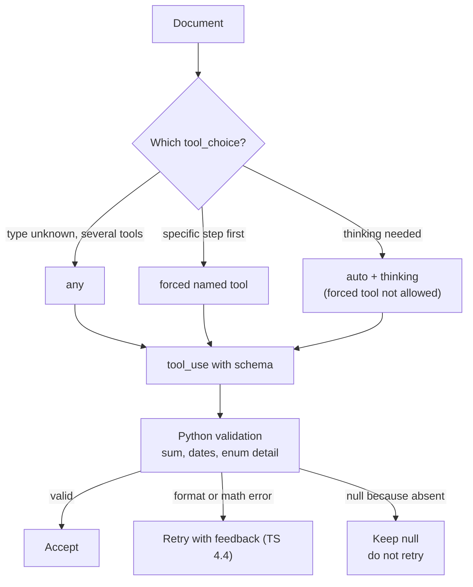

# Task Statement 4.3: Structured Output with Tool Use and JSON Schemas

## In One Minute
- **What**: Get structured data by defining a tool whose `input_schema` is your JSON schema.
- **Why**: Tool use removes JSON *syntax* errors. It does **not** remove *semantic* errors, such as line items that do not add up to the total.
- **How**: Make fields nullable when the source may lack them, add `"unclear"` and `"other"` + detail to enums, and validate the meaning in code.
- **Trade-off**: `tool_choice` `any` or a forced tool cannot be used together with extended thinking.
- **Exam answer in one line**: *Tool use + schema for syntax, nullable fields against fabrication, code validation for meaning.*

---

## 📌 Overview

- **Domain**: Domain 4: Prompt Engineering & Structured Output (**20%** of the exam; D1 27%, D2 18%, D3 20%, D5 15%).
- **Scenario**: Scenario 6 (Structured Data Extraction).
- **Goal**: Reliable, honest, machine-readable extraction.
- **Exam focus**: Which `tool_choice` to use, why a field must be nullable, and what a schema cannot catch.

---

## 📖 Concepts Explained

### 1. The simple idea
Asking for "JSON in a code block" is fragile. A tool call with a schema is the standard way to get structured output.

### 2. Why it matters
- Text JSON can have fences, trailing commas, or a chatty preamble.
- A required field that the document lacks pushes the model to make something up.
- A valid JSON object can still be wrong: `items` add up to 400 but `total` says 500.

### 3. How it works

**a. Tool schema.** Define one tool per extraction type. Claude returns a `tool_use` block whose `input` follows the schema. Add `"strict": true` at the top level of the tool definition and `"additionalProperties": false` on each object in `input_schema`. Claude's tokens are then constrained to the schema, so types and required fields always match. It still cannot check meaning, such as totals or a value in the wrong field.

**b. `tool_choice`:**

| Value | Meaning | Use when |
|---|---|---|
| `auto` | Claude may answer in text | Normal chat with tools |
| `any` | Claude must call *some* tool | Document type unknown and you have several extraction tools |
| `{"type": "tool", "name": "extract_metadata"}` | Claude must call that tool | You need a specific step first, for example run `extract_metadata` before anything else |

**c. Honest schema.**
- **Nullable or optional fields** (`"type": ["string", "null"]`) for anything the source may not state.
- **Enums with `"unclear"` and `"other"`**: `unclear` when the document gives no signal; `other` plus an `other_category_detail` string when it fits none of the values.
- **Format rules in the prompt**: dates as `YYYY-MM-DD`, amounts as plain numbers, `null` when not stated.

**d. Semantic checks in code.** Ask for `calculated_total`, `stated_total` and `conflict_detected`, and recompute the sum in Python. Schemas catch shape, not arithmetic.

**e. Absent vs wrong.** A `null` for something the document never says is correct. A bad date format is an error and is worth a retry with feedback (TS 4.4).

### 4. The thinking trade-off
With extended thinking, `tool_choice` may be only `auto` or `none`. A forced tool call (`any` or a named tool) returns HTTP 400 if `thinking` is enabled.

So for extraction you choose:
- **Forced tool, no `thinking`** (default for extraction; reliable and cheap), or
- **`thinking` with `auto`**, and handle the case where Claude answers in text.

Never send `temperature` with thinking. Leave `top_k`/`top_p` unset. In a tool loop, send thinking blocks back unchanged with their signatures.

---

## 🧪 Worked Example

**Invoice text**
```text
ACME Cloud   Total Due: $300.00
Hosting x2 @ $120 = $240     Support x1 @ $50 = $50
```
**Output** (note the `null`s and the flagged conflict)
```json
{
  "invoice_number": null,
  "vendor_name": "ACME Cloud",
  "issue_date": null,
  "due_date": null,
  "purchase_category": "software_subscription",
  "other_category_detail": null,
  "line_items": [
    {"description": "Hosting", "quantity": 2, "unit_price": 120.0, "total": 240.0},
    {"description": "Support", "quantity": 1, "unit_price": 50.0, "total": 50.0}
  ],
  "stated_total": 300.0,
  "calculated_total": 290.0,
  "conflict_detected": true
}
```
- The schema accepts this. It is valid JSON.
- Python sees `290 != 300`, so `conflict_detected` is true and a human or a retry resolves it.
- `invoice_number` is `null`. If it had been required, the model would likely invent one.

Request shape (see `build_extraction_request()` in [main.py](main.py)):
```python
{"model": "claude-haiku-4-5", "tools": [EXTRACTION_TOOL],
 "tool_choice": {"type": "tool", "name": "extract_invoice"}}   # no thinking, no temperature
```

---

## 🔑 Key Terms

- **Tool use**: Claude calls a tool; its `input` is your structured data.
- **`tool_choice`**: `auto`, `any`, a forced named tool, or `none`.
- **Syntax error**: invalid JSON. Tool schemas prevent these.
- **Semantic error**: valid JSON but wrong meaning. Needs validation in code.
- **Nullable field**: may be `null` when the source does not say.
- **Extensible enum**: fixed values plus `unclear` and `other` + detail.
- **`conflict_detected`**: flag set when computed and stated totals disagree.

---

## 🏗️ Architecture



---

## ⚠️ Exam Traps and Correct Patterns

| Goal | Correct pattern | Trap | Why the trap fails |
|---|---|---|---|
| Valid JSON | Tool + `input_schema` | Ask for JSON in text | Fences and typos break parsing |
| No fabrication | Nullable or optional fields | Everything `required` | Model invents values to satisfy the schema |
| Right totals | Recompute in code, set `conflict_detected` | "The schema guarantees correctness" | Schemas check shape, not arithmetic |
| New categories | Enum + `other` + detail, and `unclear` | Closed enum | Forces a wrong label |
| Force a tool | `tool_choice` without `thinking` | Forced tool + `thinking` | HTTP 400 |
| Unknown doc type | `any` | Forcing one tool | Wrong tool for the document |

### Common Mistakes
- Making `invoice_number`, `vendor_name`, `issue_date` required.
- Believing the schema also checks the sums.
- Combining a forced `tool_choice` with extended thinking.
- Sending `temperature` together with thinking.
- Treating a correct `null` as a failure and retrying.

---

## 💡 Quick Decision Rules

| Situation | Choose |
|---|---|
| Need guaranteed JSON shape | Tool use + schema |
| Field may be missing in source | Nullable, not required |
| Several extraction tools, unknown document | `tool_choice: any` |
| Must run one tool first | Forced named tool |
| Want thinking | `auto` or `none` only |
| Totals might disagree | `calculated_total` + `stated_total` + `conflict_detected` |

---

## 🧠 Claude 4.5 Notes

- `claude-haiku-4-5` extracts; `claude-sonnet-4-5` reasons about hard or ambiguous documents.
- Thinking: omit `temperature`; leave `top_k`/`top_p` unset; `budget_tokens` at least 1024 and less than `max_tokens`.
- Thinking allows only `tool_choice` `auto`/`none`. For forced extraction, run without thinking.
- When echoing assistant turns in a tool loop, keep thinking blocks and signatures unchanged.
- The loop in `main.py` branches on `stop_reason`: `tool_use` validates; `pause_turn` continues; `max_tokens`, `refusal` and `end_turn` without a tool stop.

---

## 📝 Exam-Style Practice Questions

**Q1 (Scenario 6).** Invoices from many vendors sometimes lack a PO number. With `po_number` required, the model returns values like `"PO-99999"`. What is the best change?
- A) Add "do not invent PO numbers" to the prompt only.
- B) Make `po_number` `["string", "null"]`, remove it from `required`, and say "null if not stated".
- C) Switch to JSON in a text reply and parse it.
- D) Run a second model at a higher temperature.

**Q2 (Scenario 6).** You have `extract_invoice`, `extract_receipt` and `extract_contract` tools. The document type is unknown and Claude sometimes replies in plain text. Which `tool_choice` fits?
- A) `auto`
- B) `{"type": "tool", "name": "extract_invoice"}`
- C) `any`
- D) `none`

**Q3 (Scenario 6).** A team enables extended thinking and forces `extract_invoice` with `tool_choice`. The API returns an error. What is the best fix?
- A) Add `temperature: 0`.
- B) Remove `thinking` for the forced extraction call (or use `auto` with thinking).
- C) Strip the thinking blocks from history.
- D) Raise `max_tokens` to 64000.

### Answers
**Q1: B.**
- A fails: a hard-required schema still pushes the model to fill the field.
- C fails: free text brings back syntax errors.
- D fails: higher temperature increases randomness, not honesty.

**Q2: C.**
- A fails: Claude may still answer in text.
- B fails: forces the invoice tool even for a contract.
- D fails: `none` prevents any tool call.

**Q3: B.**
- A fails: temperature is also rejected with thinking and does not address `tool_choice`.
- C fails: stripping blocks causes different errors and is not the cause here.
- D fails: token limits are unrelated to the `tool_choice` restriction.

---

## ✅ Self-Check Checklist
- [ ] I can say what tool use fixes (syntax) and what it does not (semantics).
- [ ] I can explain `auto`, `any` and a forced tool, with a use case for each.
- [ ] I know why nullable beats required for missing-prone fields.
- [ ] I can add `unclear` and `other` + detail to an enum.
- [ ] I know a forced tool cannot be combined with thinking.

**Memory hook**: *Schema for shape, null for honesty, code for sums.*

---

## 🛠️ Hands-on Workbook Guide

In [`ts_4_3_structured_output_tool_use.ipynb`](ts_4_3_structured_output_tool_use.ipynb):
1. **Step 1: Setup**: finds the repo root and adds it to the import path.
2. **Step 2: Schema and validator**: imports the nullable schema, request builder and validator from `main.py`.
3. **Step 3: Simulation**: validates an invoice with nulls and a conflicting total, and shows the thinking/forced-tool guard.
4. **Step 4: Verification**: asserts nulls are not errors, conflicts are flagged, and a forced tool with thinking is rejected.

Everything runs offline. The live extraction run in `main.py` is manual only (it uses the API).
