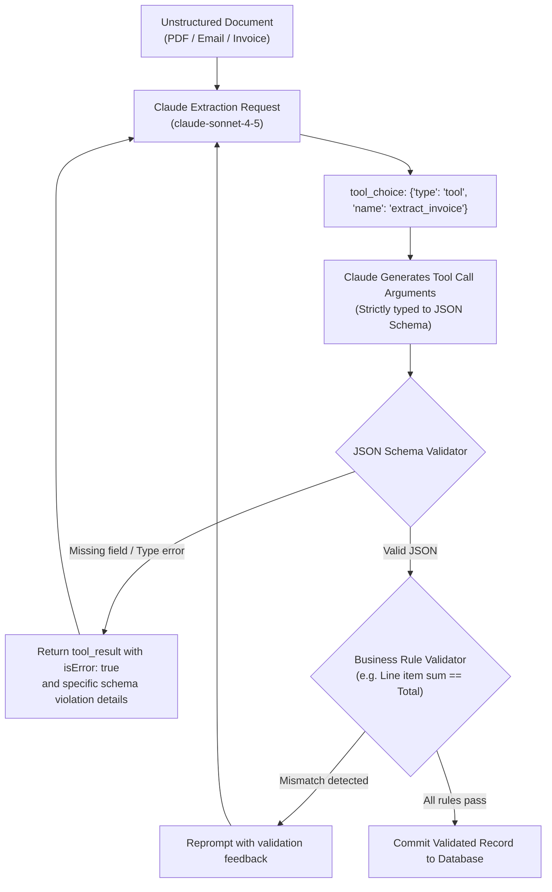

# Task Statement 4.3: Enforce Structured Output Using Tool Use and JSON Schemas

## 🎯 Exam Objective
Understand why **Tool Use with JSON Schema** is the gold standard for deterministic structured data extraction, how to design schemas with **nullable fields** and **extensible taxonomies**, and how to enforce execution via `tool_choice`.

---

## 🏗️ Architecture: Schema-Enforced Extraction Flow

---

## ⚠️ Critical Exam Distinctions & Anti-Patterns

| Strategy / Technique | Recommended Implementation | Exam Trap to Reject |
|---|---|---|
| **Output Format Guarantee** | **Tool Use with JSON Schema**: Define the output schema as a tool definition and force invocation with `tool_choice`. | **TRAP**: Relying on prompt instructions alone ("Output valid JSON only") and using regex or `json.loads` to parse raw Markdown prose. |
| **Handling Missing Information** | Define optional fields with **explicit nullable types** (`type: ["string", "null"]` or omitted from `required`). | **TRAP**: Making every field strictly required without nullability, forcing the model to hallucinate values when text is absent. |
| **Categorical Taxonomies** | Use an **extensible enum pattern**: `enum: ["Hardware", "Software", "Services", "Other"]` paired with an optional `other_description` field. | **TRAP**: Rigid closed enums with no fallback option, causing extraction to fail when encountering novel categories. |
| **Enforcing Extraction** | Configure `tool_choice: {"type": "tool", "name": "extract_invoice"}` to ensure 100% execution on turn 1. | **TRAP**: Leaving `tool_choice: "auto"` and hoping Claude doesn't reply with conversational filler text before the JSON. |

---

## 💡 Architectural Decision Matrix

| Extraction Approach | Schema Conformity | Hallucination Resistance | Token Cost |
|---|---|---|---|
| **Markdown Prose + Regex** | Low (fragile markdown fences) | Low | Low |
| **Prompt-only JSON Mode** | Moderate (may leak leading text) | Moderate | Low |
| **Tool Use + JSON Schema** | **100% Deterministic** | **High (with nullables)** | Moderate |

---

## 🛠️ Production Code Reference
- Interactive Workbook: [`ts_4_3_structured_output_tool_use.ipynb`](ts_4_3_structured_output_tool_use.ipynb)
- Runnable Script: [`main.py`](main.py)
- Offline Verification: Run via `uv run pytest tests/test_domain4_full.py` in WSL.
