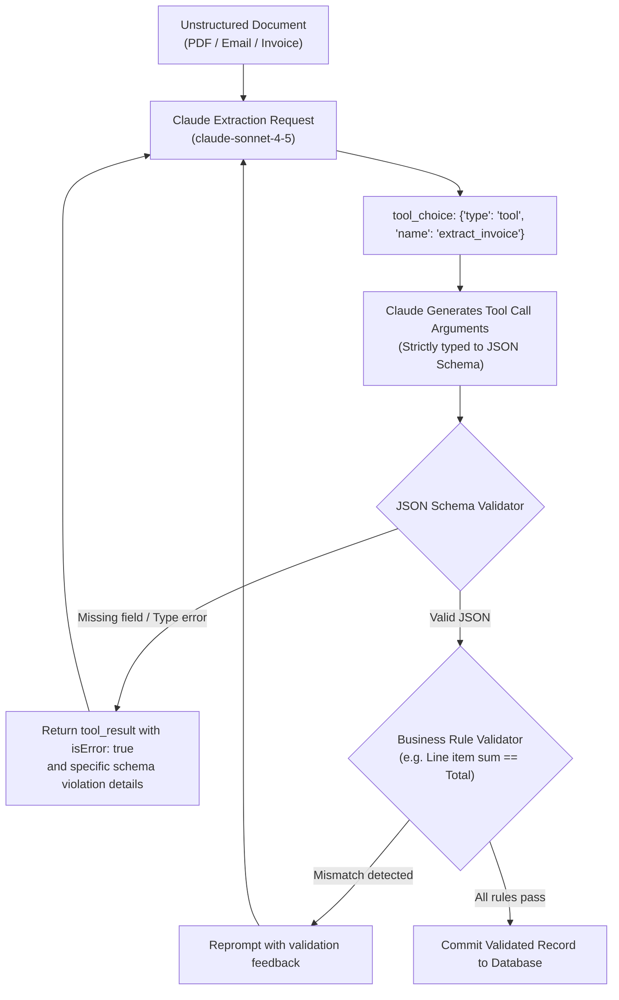

# Task Statement 4.3: Enforce Structured Output Using Tool Use and JSON Schemas

## 📌 Executive Overview: Goal, Scope & Exam Importance

### Certification Domain & Weight
- **Domain**: Domain 4: Prompt Engineering & Structured Output
- **Domain Weight**: 18% of total CCAR-F exam score
- **Scenario Alignment**: Scenario 6 (Structured Data Extraction Pipeline)

### The Core Goal
To master deterministic structured data extraction by configuring **Tool Use with JSON Schema**, enforcing 100% execution via **forced `tool_choice`**, designing schemas with **explicit nullable fields** to prevent hallucination when facts are absent, and implementing **extensible taxonomies** (`enum` with `"Other"`).

### Why This Matters in Production
In enterprise data pipelines (e.g. processing 50,000 invoices, medical records, or legal filings daily), data must load directly into relational databases or downstream Kafka queues.
If an architect relies on prompt-based JSON instructions:
1. **Markdown Formatting Artifacts**: Claude outputs conversational filler (*"Here is the requested JSON:"*) or wraps output in markdown fences (` ```json ... ``` `), breaking downstream `json.loads()` parsers.
2. **Fabrication on Missing Facts**: If a schema marks `tax_id` as a required non-nullable string, but the physical receipt has no tax ID, Claude feels forced by the schema to invent a plausible-looking fake tax ID.
3. **Rigid Taxonomy Breakage**: If an expense category enum only supports `["Travel", "Meals"]` and an employee submits an invoice for `Software Subscriptions`, validation fails completely.
Configuring Tool Use with JSON Schema guarantees 100% syntactic validity, while nullable fields and extensible enums eliminate data fabrication.

### Exam Importance
Task Statement 4.3 is one of the most frequently tested topics on the exam. Questions test why tool calling is preferred over regex for structured output, how to prevent hallucinations on missing document fields (nullable types), and how to configure extensible categorical fields.

---

## 📖 Deep Narrative: Why We Do What We Do

### 1. Why Tool Use Outperforms Prompt-Only JSON Mode
- **Prompt-Only JSON Mode**: The model generates JSON as natural language tokens. If token generation drifts or if max tokens is reached, the JSON is malformed or surrounded by prose.
- **Tool Use Extraction**: The Anthropic API's tool-calling engine constrains token generation at the decoding level to strictly match the provided JSON schema. By setting:
  ```python
  tool_choice = {"type": "tool", "name": "extract_invoice"}
  ```
  Claude **cannot output conversational prose**. Its entire response consists solely of the structured tool argument payload, guaranteeing 100% parser-safe JSON.

### 2. Nullable Fields: The Defense Against Data Fabrication
Consider a contract missing a termination notice window:
- **Flawed Schema**: `{"notice_days": {"type": "integer"}}` (Marked as required).
  - *Model Dilemma*: The document doesn't mention notice days, but the schema requires an integer.
  - *Failure*: Claude hallucinates `30` because 30 days is common in contracts.
- **Production Schema (Nullable Defense)**:
  ```json
  {
    "notice_days": {
      "type": ["integer", "null"],
      "description": "Notice period in days required for termination, or null if unstated in document."
    }
  }
  ```
  - *Result*: Claude outputs `"notice_days": null`. Zero hallucination.

### 3. Extensible Taxonomies (The "Other" Pattern)
Real-world documents contain infinite variations. Closed enums break pipelines when encountering novel categories:
```json
{
  "category": {
    "type": "string",
    "enum": ["Hardware", "Software", "Cloud", "Consulting", "Other"]
  },
  "category_other_detail": {
    "type": ["string", "null"],
    "description": "Specify the category if 'Other' was selected, otherwise null."
  }
}
```
This guarantees that novel vendor items are captured with full semantic fidelity without failing JSON schema validation.

---

## 🔑 Key Technical Terminology Explained

- **Tool-Use Structured Output**: Leveraging Claude's native tool-calling capabilities to emit structured JSON arguments matching a predefined schema rather than relying on natural language text.
- **Forced Tool Choice**: Setting `tool_choice: {"type": "tool", "name": "..."}` to force the model to invoke the extraction schema on turn 1 without emitting conversational text.
- **Explicit Nullable Type**: Defining a JSON Schema property with `type: ["<type>", "null"]` to explicitly permit `null` when source documents lack the data.
- **Extensible Taxonomy**: A schema design pattern pairing a controlled `enum` (including an `"Other"` option) with an auxiliary free-text description field.
- **Decoding Constraint**: An architectural guarantee where the API runtime forces model token generation to conform to JSON syntax rules.

---

## 🏗️ Architecture: Schema-Enforced Extraction Flow



---

## ⚠️ Critical Exam Distinctions & Distractor Teardown

| Extraction Technique | Correct Implementation | Exam Trap to Reject | Why the Trap Fails |
|---|---|---|---|
| **Structured Output Format** | Use **Tool Use with JSON Schema** and forced `tool_choice`. | **TRAP**: Asking for JSON in prompt and using regular expressions to strip markdown code blocks. | Fragile; prompt-only JSON frequently leaks leading conversational text or truncated braces. |
| **Missing Document Facts** | Define fields with **explicit nullable types** (`type: ["string", "null"]`). | **TRAP**: Marking missing fields as required non-nullable strings. | Forces Claude to invent/hallucinate plausible values to satisfy the rigid schema requirements. |
| **Categorical Taxonomies** | Use an **extensible enum pattern** (`["CatA", "CatB", "Other"]` + `other_detail`). | **TRAP**: Using a rigid, closed enum with no fallback options. | Breaks the extraction pipeline whenever a document contains a novel or unexpected category. |

---

## 💡 Architectural Decision Matrix: Extraction Strategies

| Extraction Requirement | Optimal Implementation | Reason |
|---|---|---|
| 100% syntactically valid JSON | Tool Use + `tool_choice` | Eliminates markdown wrapping and syntax parsing errors. |
| Optional or missing document data | `type: ["string", "null"]` | Prevents the model from fabricating false information. |
| High-variety categorization | Enum with "Other" + detail | Retains structured classification while capturing novel categories. |

---

## 🧠 Claude 4.5 Extended Thinking & Parameter Standards

- **Extraction Reasoning**: Extended Thinking allows Claude to cross-reference multiple pages of a document, reconcile confusing layout tables, and calculate subtotal checks before emitting the extraction tool arguments.
- **Sampling Rules**: Omit `temperature` whenever thinking is enabled.
- **Thinking Blocks**: The assistant's thinking blocks document how each fact was located in the source text before emitting the JSON payload.

---

## 🛠️ Hands-on Workbook Guide: Following the Code Step-by-Step

When exploring [`ts_4_3_structured_output_tool_use.ipynb`](ts_4_3_structured_output_tool_use.ipynb):
1. **Step 1: Setup & Tool Definition**: Builds a production invoice extraction tool schema with nullable fields and extensible enums.
2. **Step 2: Forced Tool Execution**: Demonstrates `tool_choice: {"type": "tool", "name": "extract_invoice"}` eliminating conversational filler.
3. **Step 3: Handling Missing Facts**: Shows that missing fields cleanly extract as `null` without fabrication.
4. **Step 4: Extensible Taxonomy**: Demonstrates extracting a novel category into `"Other"` with detailed descriptions.
5. **Step 5: Verification Assertions**: Verifies 100% schema compliance and zero hallucinated values.
