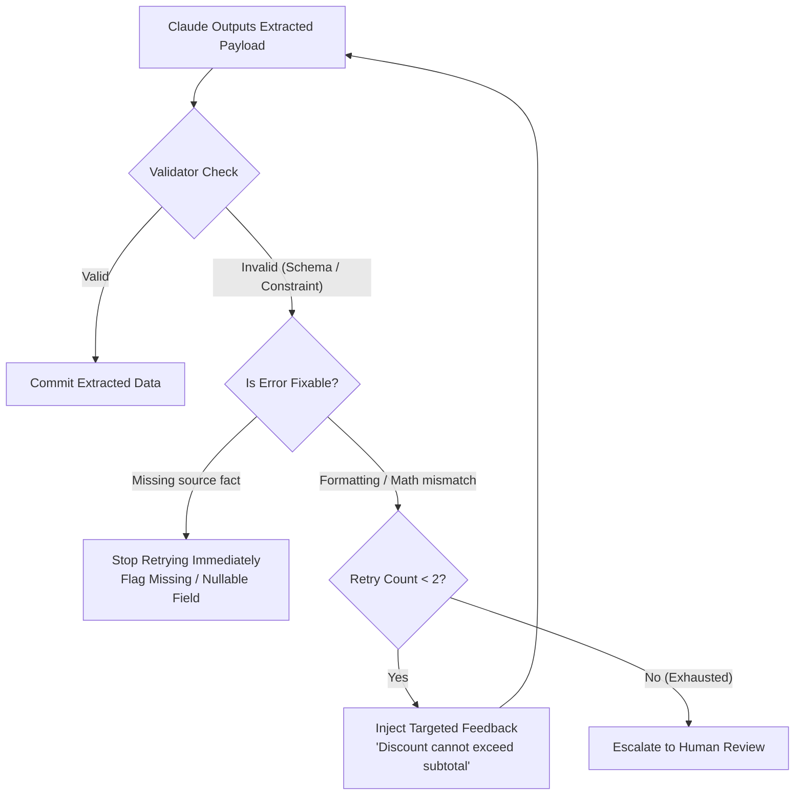

# Task Statement 4.4: Implement Validation, Retry, and Targeted Feedback Loops

## 📌 Executive Overview: Goal, Scope & Exam Importance

### Certification Domain & Weight
- **Domain**: Domain 4: Prompt Engineering & Structured Output
- **Domain Weight**: 18% of total CCAR-F exam score
- **Scenario Alignment**: Scenario 6 (Structured Data Extraction Pipeline)

### The Core Goal
To design intelligent **closed-loop validation and retry architectures** that provide **targeted diagnostic feedback** on recoverable errors (mathematical discrepancies, format violations), enforce **bounded retry limits**, and execute **early termination** on unrecoverable errors caused by missing source facts.

### Why This Matters in Production
In automated extraction and processing pipelines, extraction errors fall into two fundamentally different classes:
1. **Recoverable Errors**: Claude misread a messy table or forgot to add shipping tax to the total ($45 + 5 \neq 55$). Providing targeted feedback (*"Line items sum to \$45 and tax is \$5, but total was \$55; please check for shipping charge"*) allows Claude to correct the extraction in turn 2.
2. **Unrecoverable Errors**: The physical receipt genuinely does not contain a VAT/Tax ID number. 
If an architect builds a naive retry loop that blindly retries 3 times whenever validation fails:
- The system burns latency and tokens on doomed retries.
- On the third retry, Claude feels pressured by the repetitive error messages and **fabricates a completely hallucinated VAT number** to pass validation.
Production systems must detect unrecoverable missing facts and halt retries immediately.

### Exam Importance
Task Statement 4.4 is tested through the famous "Unfixable Error" scenario. The exam will ask what the system should do when an invoice fails validation due to data that does not exist in the source text. You must reject all answers that advocate retrying, and select **immediate early termination with human triage**.

---

## 📖 Deep Narrative: Why We Do What We Do

### 1. The Anatomy of Targeted Feedback
When an extracted payload fails business validation:
- **The Generic Anti-Pattern**:
  ```markdown
  User: "Your extraction failed validation. Please try again and fix your errors."
  ```
  Claude does not know *what* failed (Schema? Business logic? Date format?). It guesses randomly and often breaks fields that were previously correct.
- **The Targeted Production Feedback**:
  ```markdown
  User: "Validation Error on invoice_calc:
  - Error: The sum of line items ($400.00) does not match the stated total ($500.00).
  - Diagnostic: Re-examine the bottom-right corner of page 1 to check if a $100 service fee or expediting fee was listed."
  ```
  Claude inspects the specific coordinates, locates the expediting fee, and corrects the payload in a single retry.

### 2. The Early Termination Protocol on Missing Facts
Consider a medical record extraction pipeline where `insurance_policy_number` is required:
- The patient paid in cash; the document contains no insurance information.
- The validator checks: Is `insurance_policy_number` missing from the payload? Yes.
- **Early Exit Decision**: Does the raw OCR text contain any strings resembling insurance policies? No.
- **Action**: **HALT RETRIES IMMEDIATELY (0 retries burned)**.
- **Outcome**: Mark `insurance_policy_number: null`, flag status as `ABORTED_MISSING_SOURCE_FACT`, and route directly to the human intake queue.
- **Consequence Avoided**: Prevents the model from hallucinating a fraudulent insurance ID.

---

## 🔑 Key Technical Terminology Explained

- **Closed-Loop Validation**: An architectural pattern where model outputs are validated by deterministic code rules, and failure diagnostics are fed back to the model for automated self-correction.
- **Targeted Diagnostic Feedback**: Specific, actionable error messages detailing the exact mathematical mismatch or schema violation, guiding precise model correction.
- **Recoverable Error**: A defect in the output (e.g. arithmetic mistake, misplaced decimal) where the required information exists in the source text and can be corrected.
- **Unrecoverable Error**: A validation failure caused by the total absence of the required information in the source document.
- **Early Termination Protocol**: Halting retry attempts immediately upon determining that missing data cannot be resolved from the source text.
- **Bounded Retry Budget**: Enforcing a strict cap (typically 1 or 2 retries maximum) to prevent runaway token spend and latency spikes.

---

## 🏗️ Architecture: Closed-Loop Validation with Early Exit



---

## ⚠️ Critical Exam Distinctions & Distractor Teardown

| Validation Scenario | Correct Implementation | Exam Trap to Reject | Why the Trap Fails |
|---|---|---|---|
| **Missing Source Data** | **Halt retries immediately**: Mark field as null or route to human review. | **TRAP**: Blindly retrying 3 times with higher temperature or stronger prompt warnings. | Retrying cannot discover data that does not exist; forces the model to hallucinate fake facts. |
| **Mathematical Discrepancy** | Inject **targeted feedback** showing exact numbers: *"Line items sum to $400, total is $500"*. | **TRAP**: Sending generic feedback: *"Your extraction had errors, please re-read and fix."* | Model does not know which calculation failed and alters correct fields while guessing. |
| **Retry Budgeting** | Cap retries strictly at **1 or 2 attempts** before human escalation. | **TRAP**: Allowing dynamic retries until validation passes or turn 10 is reached. | Wastes budget on circular logic and drives response times beyond production latency SLAs. |

---

## 💡 Architectural Decision Matrix: Handling Validation Errors

| Failure Category | Can Source Resolve It? | Action to Take | Retry Count |
|---|---|---|---|
| Line item sum $\neq$ Total | Yes (Source has all numbers) | Inject exact arithmetic feedback | Max 1–2 retries |
| Date formatted as MM/DD instead of ISO | Yes (Source has date) | Inject schema format reminder | 1 retry |
| Document lacks Tax ID | No (Data does not exist) | Early termination $\rightarrow$ Human triage | **0 retries** |
| Illegible / Blurry scan | No (Optical data corrupted) | Early termination $\rightarrow$ Human triage | **0 retries** |

---

## 🧠 Claude 4.5 Extended Thinking & Parameter Standards

- **Error Self-Correction**: When Claude receives targeted feedback with specific numbers, Extended Thinking enables the model to locate the missing line item in the document text and calculate the new sum before outputting the corrected tool arguments.
- **Sampling Rules**: Omit `temperature` whenever thinking is enabled.
- **Thinking Continuity**: In the retry turn, preserve the assistant's previous thinking block with its signature so the model understands what it previously extracted and why it failed.

---

## 🛠️ Hands-on Workbook Guide: Following the Code Step-by-Step

When exploring [`ts_4_4_validation_retry_feedback.ipynb`](ts_4_4_validation_retry_feedback.ipynb):
1. **Step 1: Setup & Business Validator**: Implements invoice validation logic (arithmetic checks and tax rules).
2. **Step 2: Simulating Recoverable Math Errors**: Demonstrates injecting targeted feedback and achieving clean recovery on retry 1.
3. **Step 3: Simulating Unrecoverable Missing Facts**: Demonstrates the early termination protocol halting retries immediately.
4. **Step 4: Bounded Retry Budgeting**: Verifies that retries never exceed the maximum configured threshold.
5. **Step 5: Verification Assertions**: Verifies that 0 tokens are wasted on missing facts and mathematical errors recover with 100% accuracy.
